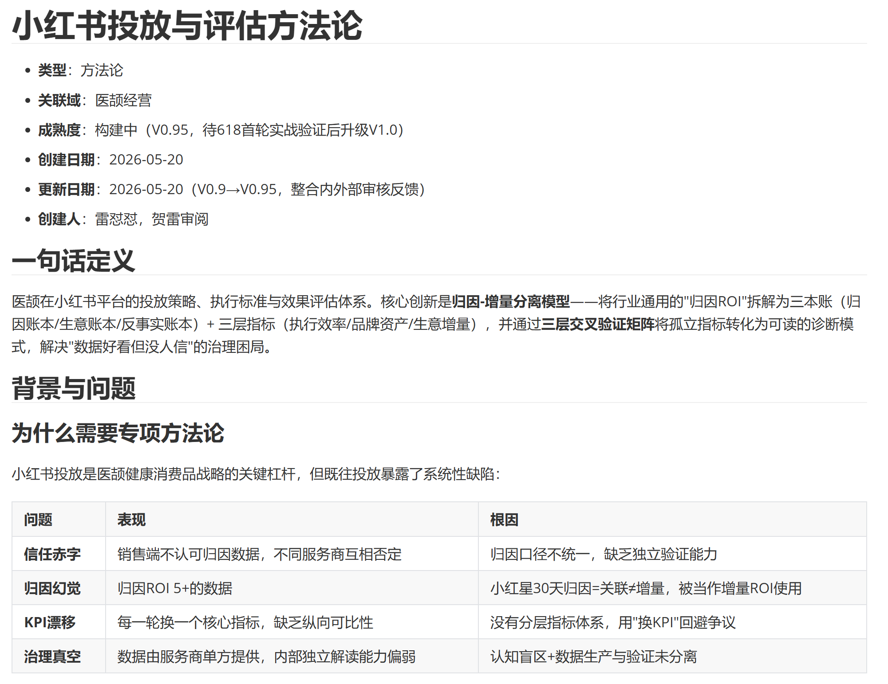
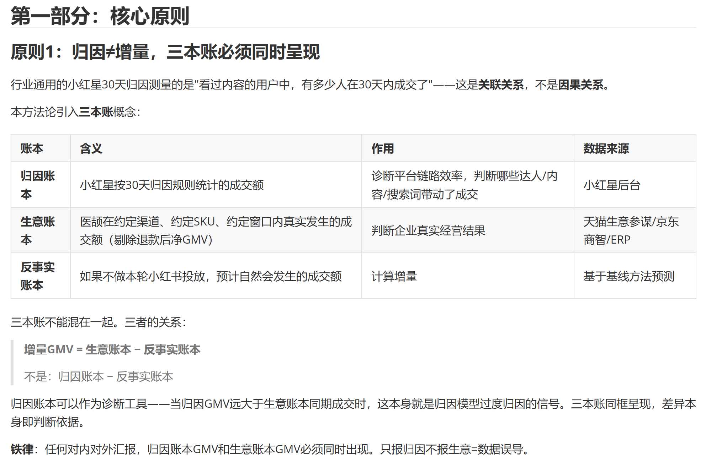
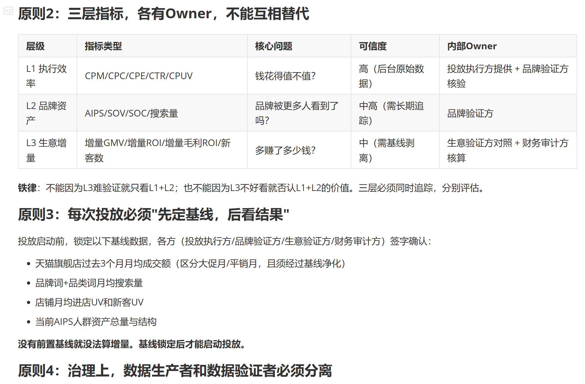
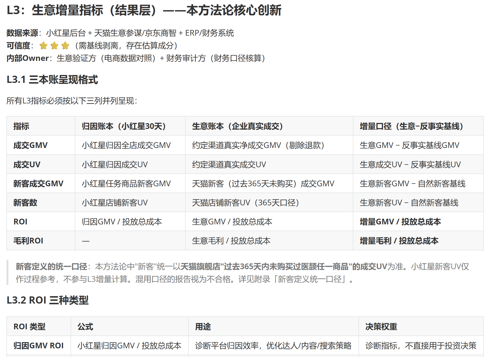
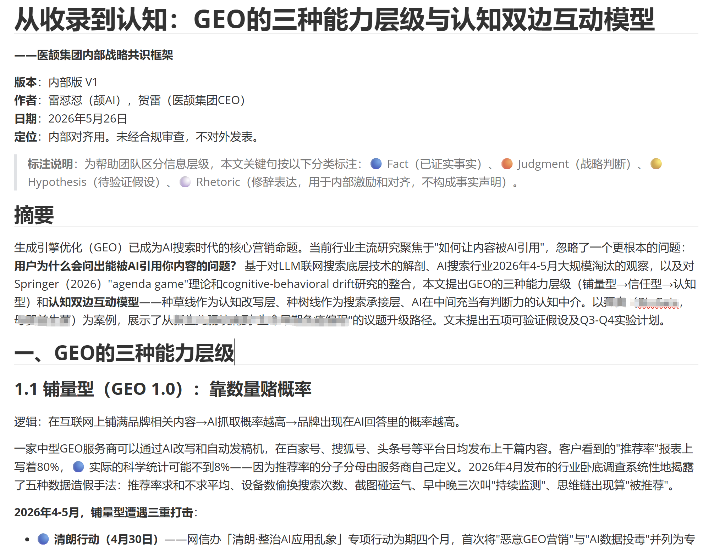
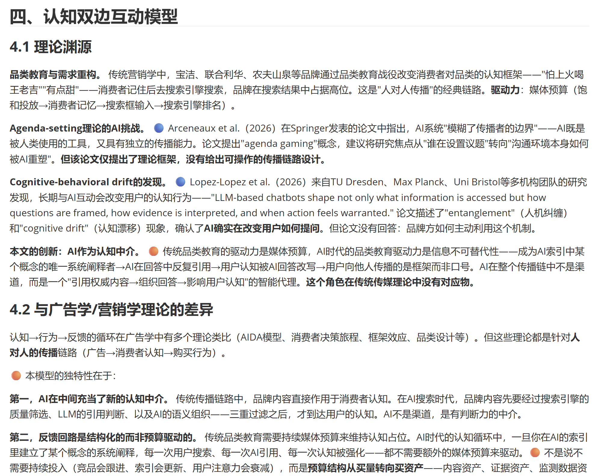
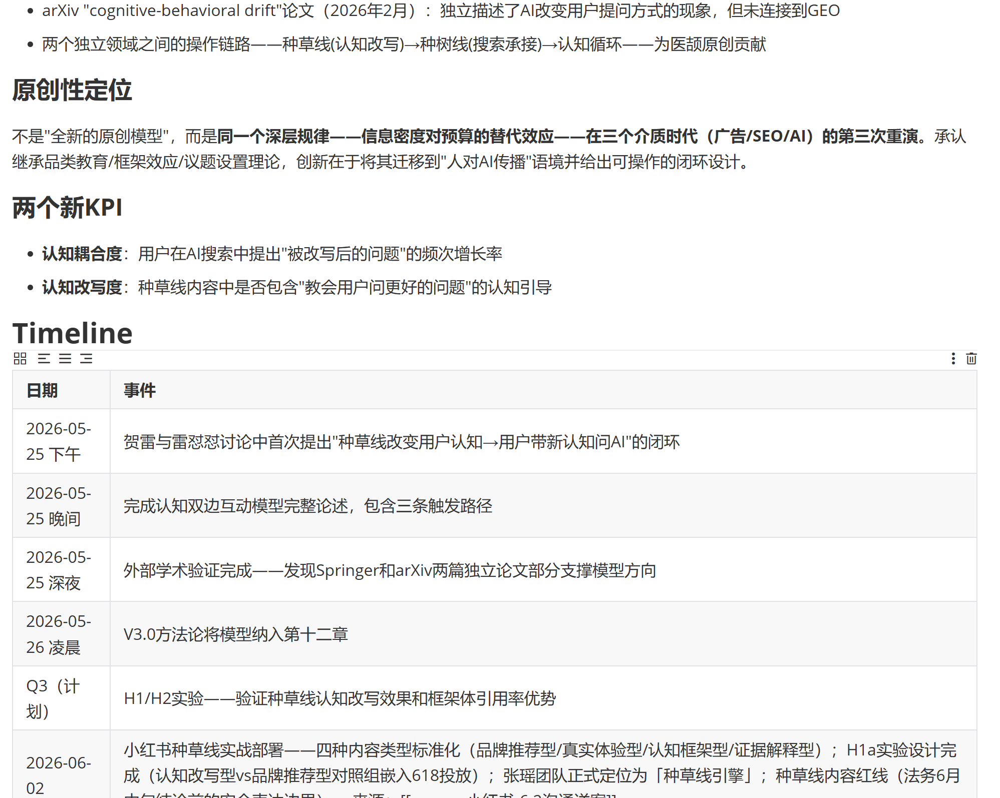
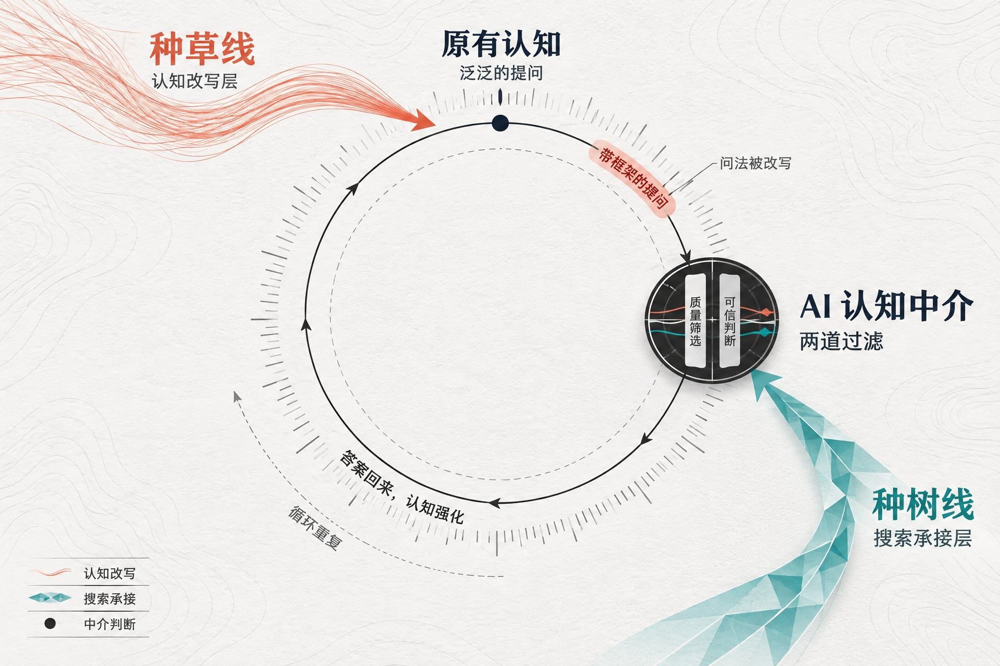

### 第三部分：业务经营的科学探索

#### 案例4：小红书投放的分歧

我们第一次认真接触小红书投放，是在 2025 年底。

我们开始尝试小红书这类C端传播时，对它并没有现在这么多认识。所以一开始，是用了一个长期合作的外部团队来做这件事。

后来，公司内部孵化的一个新零售团队看了，说这一版做得不好，他们能做老板就拍板，让第二个团队也试一版。

第二版做出来，新团队认为自己做得很好。原来那一边又完全不认可。事情很快就不只是两套内容、两组数据。原团队和公司更熟，过去合作时间也长。新团队也拿出了自己的数据，大家站在各自的位置上，都能讲出一套理由。

我正好在这个时候接手。

这种处境，很多经营者都会遇到。你不完全懂一门新业务，对方又能把报告讲得很漂亮。你究竟凭什么判断，而不是凭谁更会讲、谁关系更近？

我不想用行政方式替这种争论画句号。因为今天我可以拍板选一方，明天遇到新问题，团队仍然可能回到原来的立场。

那怎么办？

我没有先问“谁更好”。

我问大家：**我们先别争，能不能用同一把尺子，测一次？**

第一轮，我没有直接比 ROI。两个团队使用的平台、内容形式和人群承接并不完全一样。直接比 ROI，很容易把平台、产品和执行差异混在一起。

那这一轮比什么？

**比同一个策略、同一个池子里的人群触达、流转和投放执行效率。**说白了，先看谁更能把合适的内容送到合适的人面前，谁能把投放这件事执行得更专业。

结果出来，新团队明显更强，甚至超过了我们当时参考的大盘。

所以我们先得到一个判断：**至少在执行上，新团队更专业。**

原团队很快又提出一个问题：**“投放效率高有什么用？销售又没有增长，对生意没有帮助。”**

这句话听起来像不服气。但我仔细想，它其实也问得对。**投得专业，不等于生意一定增长。**

于是有了第二轮。

这一次，我们没有等结果出来再商量什么叫好。事前就把比较对象、时间范围、转化口径和判断条件定下来：

> 和哪个竞品比？

> 和大盘比，差多少算正常，超过多少算更好？

> 如果结果和预判不一致，哪些情况叫有效，哪些情况只能算暂时看不出来？

这些要先说。不然结果一出来，每个人都能挑一段对自己有利的数据。

第二轮的结果同样不错，**比我们约定的竞品和大盘都好。**

事情到这里似乎可以结束。可销售团队又站出来，说了一句更关键的话：

“**这个 ROI 虚高。很多人不看小红书，本来也会买。**”

这句话很关键。它不是简单否定投放，也不是销售团队不懂平台规则。它把另一个问题摆到了桌面上：

**平台算出来的成交，和这次投放真正新增的生意，是不是一回事？**

平台的归因有它自己的规则。在当时讨论的典型情况里，用户看了内容或点了帖子，又在规则规定的时间里完成购买，这笔成交就可能算到这次投放上。

这个数据有用。它能告诉我们，哪些内容和哪些成交发生过联系，也能帮执行团队优化内容、人群和投放链路。

可它没有自动回答另一个问题：**如果这次不投，这些人本来会不会买？**

一个原本就准备买的人，看过内容以后买了，这笔成交可以满足归因规则。但他是不是被这次投放“新增”出来的，还要另问。

问题于是往前推了一步：

**我们原来问的是，平台给我们算回了多少成交。**

**现在要问的是，这次行动到底改变了多少生意。**

这不是说平台数据不能信，也不是换一个更高级的词。

**归因帮我们看内容与成交的联系，增量帮我们判断，如果没有这次行动，生意会不会一样发生。**

我们后来尝试用三本账去拆。

- **第一本，归因账本。**平台说，有多少成交按它的规则与这次内容发生了关系。
- **第二本，生意账本。**我们自己在约定的产品、渠道和时间里，真实发生了多少净成交。这里要把退款和口径说清，不能拿订单笔数和成交金额直接对比，也不能一边看单品、一边看全店。
- **第三本，反事实账本。**名字听起来有点学术，其实是在问一句很朴素的话：如果没有本轮投放，本来会发生多少生意？

第三本最难，因为它不是一张可以直接从后台下载的表。事情已经发生了，我们不能把同一个世界倒回去，让它在完全相同的条件下再经历一次“不投放”。

所以，它是一种需要检验的估计，而不是另一个真实发生过的销售记录。

可以看历史同期，也可以看近期自然趋势、促销安排和渠道变化。有条件时，还可以找合适的比较对象。

但不同估计方法会给出不同结果。这些结果不能只拿来选一个最漂亮的，而要用真实业务数据继续检查：哪种解释更符合后来的变化，哪种漏掉了别的因素。

最核心的关系其实很朴素：

**估计增量成交，来自实际生意结果减去“不做这次行动，本来会发生什么”的估计。**

再用这个估计增量，除以本轮投入的成本，得到相应的增量GMV ROI。

**【特别提醒💡】**特别要注意，不是拿平台归因成交减去自然基线。归因账本与实际生意账本，不是同一本账。

下面这组数字，完全是为了解释算法，不是我们的实际项目业绩。

假设这次投放花了10万元，平台按规则归因了50万元成交，归因 ROI 是5。

再看相同产品、渠道、时间范围里的生意账本，真实净成交是120万元。我们估计如果不做这次投放，本来会成交100万元。那么估计的新增成交就是20万元，除以10万元投入，增量GMV ROI是2。

如果更合理的反事实基线是110万元，新增就只剩10万元，增量 ROI 变成1。

同一轮投放，5和2回答的不是同一个问题。一个不天然骗人，一个也不天然正确。尤其那个2，它依赖“不投本来会有100万元”这个估计。

所以大家看，减法和除法最简单。真正难的是：**我凭什么说，不投也会有100万元？**

我们不能因为想要一个漂亮回报，就把自然基线往低了选；也不能把历史里受其他活动影响的销售，轻易叫作自然成交。

如果碰上大促，去年同期、今年趋势和促销条件就需要一起看；如果新品没有足够历史，可能需要寻找合适参照，并把估计的不确定性保留下来。

讨论盈利时，还需要进一步看毛利和相关成本。增量成交的倍数，不等于利润倍数。

我今天不打算把它讲成一堂完整的效果测量课。最想让大家看清的是：一旦从归因走向增量，许多过去可以直接接受的解释，都要重新检查。

我们在这件事上的状态，也需要说清楚。**三本账的方案已经形成，但模型形成，不等于它已经被证实。**

接下来还要拿真实投放数据回来，看不同基线估计能不能解释业务变化，看差异来自趋势、促销、渠道还是新品，最后再看它能支持哪一种经营决策。

如果做了一轮还是解释不了，就继续看缺了什么条件。出现和预判不同的结果，也不能把数据修到符合自己的想法。

AI 可以帮我们找估计思路、整理口径、对照结果、寻找遗漏因素。但哪些解释符合业务，哪一种证据算足够，最后还得由人判断。

#### 再回看：Y到底用在哪里

故事讲到这里，我们先把它放回 Y模型。

**左边，是我们原来的理论和经验。**行业里习惯看归因 ROI，过去的供应商也用这套口径解释结果。我自己原来的判断也很直接：谁投得更专业，谁就更值得继续。

**右边，是两轮测试带回来的事实。**第一轮，新团队的投放执行更好。第二轮，转化结果也超过了约定的大盘和竞品。可销售团队又拿出一个事实：平台归因的成交里，有一部分人本来就会买。

这几个事实放在一起，原来的解释就不够了。

它不再是“哪个团队更专业”一个问题，还多了一个问题：我们到底用什么口径，判断这次投放有没有改变生意？

**中间的“我的认知”，因此发生了变化。**

- 我开始把“谁对谁错”改成“各自在回答哪个问题”，
- 把“ROI 高不高”改成“这是归因 ROI，还是增量 ROI”，
- 把“结果好，所以判断成立”改成“还缺哪一种事实”。

**新假设和行动，就是三本账和后续的数据检验；实践再带回新的事实。**

没有 Y模型，我们会不会做测试？

也会。

很多人看到两个团队争论，也会让他们比一比。差别在于，比之前有没有说清：这一轮回答什么问题，和谁比，什么结果算有效，结果回来以后由哪条认识接受检验。

没有这些，测试很容易变成双方各自寻找支持自己的证据。

假设驱动，是先承认三本账也是一个假说。

定性定量，是既听团队怎么解释，也把人群、成交、退款和成本这些事实摆出来。

提炼建模，是把一次次讨论收成一个能继续检验的经营模型。

知行合一，则是这个模型必须回到真实投放里去，不能停在 PPT 和公式上。

再给大家分享一点我们的新认知：

当我们研究小红书时，还有一组工作在研究GEO（生成式引擎优化），简单说，GEO 就是“让AI在回答问题时，主动提到你、信任你、推荐你”的新技术。

为了做GEO，我们也需要做内容建设，**让 AI 在脑子里记住我们，在写答案时“替我们说话、把我们当成资料来源引用出来”**。

为了讲得直观，我们把小红书这一类日常内容传播叫“种草”，把长期的证据与知识内容建设比作“种树”。“种树”是我们自己的比喻，不是要求大家记一个新的行业术语。

种草比较容易让人看到当期的兴趣和转化。种树强调长期积累：持续提供可以核对、有适用条件、有来源的内容，让用户以及搜索、AI系统在需要时有依据可查。

两条线原来是不同团队在做，看起来也不完全相同：

- 小红书团队关心，怎样让用户理解产品、产生兴趣，并进入后续选择。
- 另一条线关心，AI面对相关问题时，能不能找到恰当、有证据的资料。

后来我们发现，这两边可能不是互不相关。

**以益生菌这个品类为例。**

用户选择时，可能先关注牌子、菌株数量、活菌数量等容易比较的指标。而从科学评价的角度，还应追问具体菌株、具体场景与适用条件下，有什么证据支持相应主张。

问题是，我们准备了这些知识，用户未必会这样问。他可能只说：“哪个牌子好？”或者用一句很宽泛的话描述自己的需要。AI接到不同的问题，寻找资料的方向和组织回答的方式，也会不同。

这时就出现一个新的设想：**我们在内容里帮助用户理解选择标准，会不会改变他后续向AI提问的方式？**

如果他从“哪个牌子好”，开始进一步问“针对我的需要，什么证据支持这个选择”，那AI面对的问题就更具体了。GEO工作线积累的相关知识与证据，也就更有机会回答这个具体问题。

而用户得到回答后，又可能修正或强化自己对选择标准的理解，下一次继续提出更具体的问题。

**所以我们提出“认知双边互动”这个假设：**

一边，是人的认知与提问怎样形成；另一边，是AI获得什么材料、怎样组织回应。两边可能通过持续提问和回答，相互影响。

这里不是说“让更多人这样问，就能直接改写基础模型”，也不是把AI当成替品牌背书的权威。如果证据不足，换一个传播入口也不能让它成立。我们要研究的，是更清楚的问题与更有依据的信息，能否真的改善理解和选择。

提出这个想法后，我让AI去查：有没有人研究过类似关系？它与已有的营销、传播和认知理论有什么联系？哪些只是换了一种表达，哪些是我们这个场景里值得继续验证的部分？

AI 找回了相关研究线索，也提醒我们，这不是所有内容都从零发明。这是理论侧的一次帮助：实践里产生一个新问题，AI 把相关知识带回来。

但人的工作没有结束：判断这些联系有没有用，决定这个假设怎样表达，哪些关系最值得先查。

**不能因为找到了一篇相近的文章，就宣布我们的模型已经被证明。别人研究的条件，和我们的经营场景也未必一样。接下来还是要回到事实。**