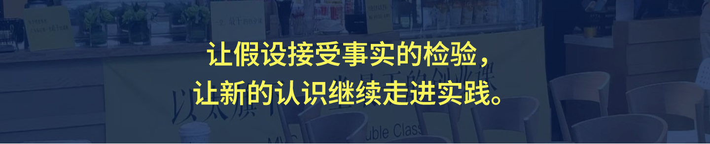

### 写在最后

今天，我们从医学里的问询开始，走到了个人AI的人机协作，再走到了多个技术方案的验证，最后回到真实经营中的投入与认知问题。

场景不同，需要的专业知识也不同，但有一条线是相通的。

**先依据当前认识提出一个值得检验的假设。让实践带回事实。发现不符合预期时，不急着维护原来的答案，也不轻易把整个目标否定掉，而是检查哪一部分需要修改。用新的认识，再去决定下一步。**

这就是我理解的科学迁移。

MBA山顶营线下活动的时候，很多同学分享了自己的一个卡点：**听完 Y模型，会说它有道理，可一回到工作里就停住了，总觉得自己研究的理论不够，或者是事实没调研充分，影响成败的要素也写不完善，总觉得还没准备好。**

这里我要给大家破处这个误区，你不用先画一张完整的图。先写下一个不完整判断，再拿眼前能拿到的事实去碰它。我说句实话，如果一定要准备完整才敢开始，那科学可能根本走不起来。

**科学就是从最简陋的假说开始的，Y模型也是有个粗糙的版本就能去实践拿反馈。**

请大家再回到开场选的那件事，现在，只留三句话。

**我现在怎样理解它，依据是什么？**

**什么新的观察，最可能让我改判断？**

**下一步做什么，结果回来以后从哪里继续？**

如果有一项已经比开场更清楚，今天这堂课就已经进入了你自己的工作。

谢谢大家。