### 奖励任务环节：特别礼物

最后，这次教研组的大家派我给大家送礼物，大家可以直接扣口令**「我请客」**完成小任务，就可以领这次的特别礼物了。

这次我们给大家准备了1个礼物，是Y模型实操落地工具：**《一堂Y模型STEPS策略集V0.5》**。正面是Y模型画布，背面是策略小抄。

这张小抄最大的价值，就是帮你把一个“我想长期做好的课题”，一步步变成**有明确目标、有基本框架、有迭代方向，也有行动配套的科学实操方案**，真正找到“快速入门、无限进步”的路径。

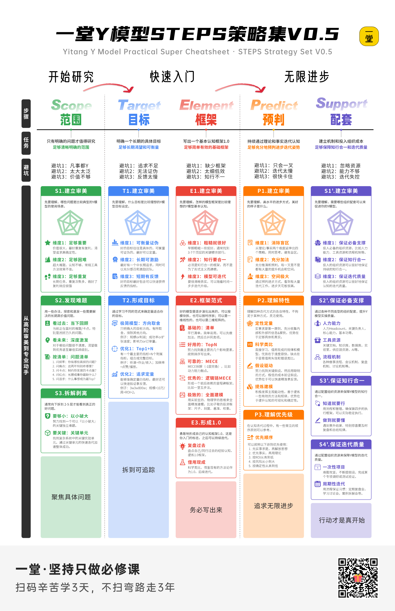

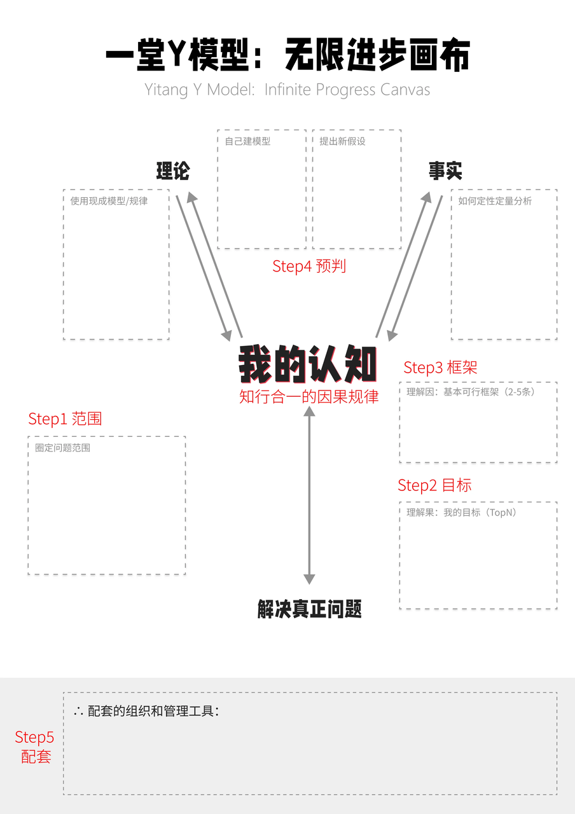

拿到之后，你可以放在办公桌上，或者带到团队讨论里。每次研究一个新课题，或者一个老问题迟迟没有进展，就对照着看一看：问题是不是定得太大了？目标有没有判断好坏的标准？下一步还有哪些值得验证的机会？

你可以从眼前一个具体问题开始，一次次练习，把积累下来的认知和能力带到更多课题里。**这是一套值得以十年为单位反复修炼的科学做事基本功。**

那怎么领呢？任务在这儿：）

截止**周三中午12点**：你只要**成功邀请1个人及以上**，就可以获得A3硬膜塑封版的**《一堂Y模型STEPS策略集V0.5》**。

**【报名🙋‍♂️】**评论区扣一个口令：**我请客**。班班会在**当日/次日下午**把下面这组图片发给你，图片上的二维码换成你的ID定制版，分享图片、邀请同学即可，记得查收。

> 注意：观看录播回放的同学也可以扣「我请客」，领取任务，触发卡片~

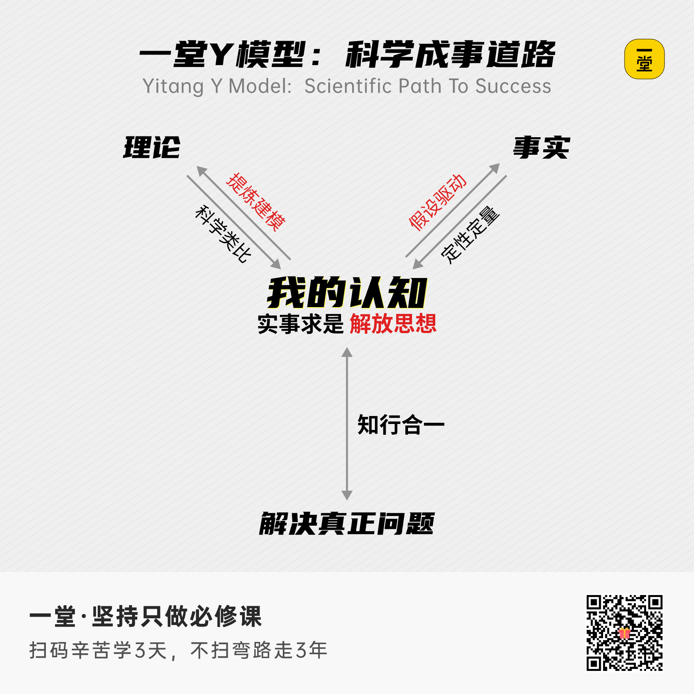

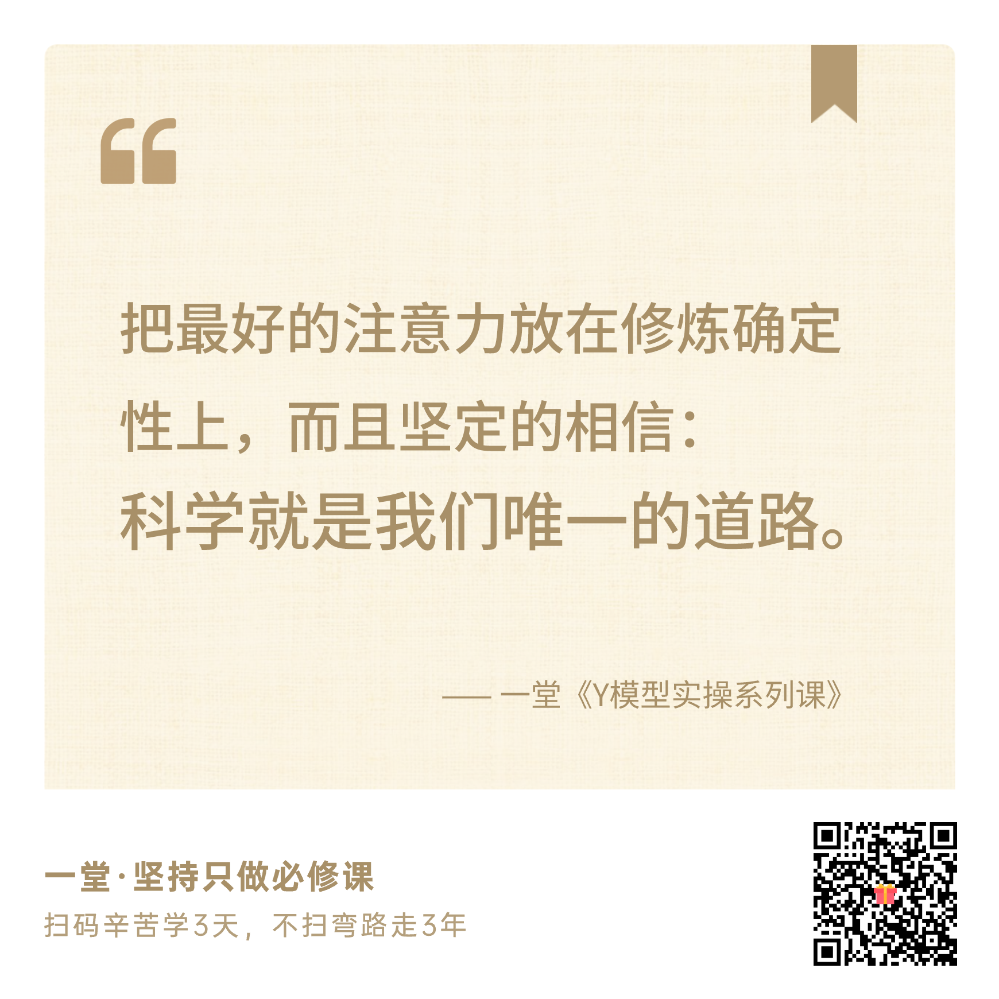

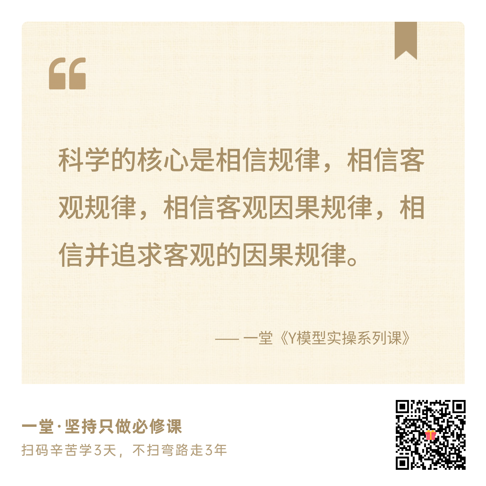

你邀请来的同学，可以**免费免审**，绿色通道直接上课；而且朋友写作业可以**永久计入你的合伙人指数**。

好啦，今天的课程就结束啦，感谢大家陪我到最后～

#### 复习：Y模型是什么

一句话：

Y模型，就是一张遇到难题时的“解题草稿纸”。

它帮你把三件事想清楚：
1. **我到底想要什么结果？**
2. **为什么现在拿不到这个结果？**
3. **我接下来怎么试一下，才能知道自己想得对不对？**

所以它解决的，不是“我知道不知道一个道理”，而是：

**这个问题我暂时不会，但我接下来应该先干什么。**

**遇到一个复杂、暂时没有答案的问题时你就可以用 Y 模型来解题：**

左边这一叉，叫**理论**——别人已经验证过的规律、总结好的方法；

右边这一叉，叫**事实**——你自己亲眼看到的、亲手做出来的真实情况；

中间交汇的那一点，叫**认知**——你拿理论和事实互相印证之后，长出来的那个判断；

再往下，这个判断必须回到真实世界里去解决问题，再拿结果回来，校正你的认知，也就是“**知行合一**”。

- **1：一个核心：因果规律**
- **2：两个基本点：理论，事实**
- **3：三大必备原则：知行合一，实事求是，解放思想**
- **4：四种迭代方式：科学类比，定性定量，假设驱动，提炼建模**
- **5：五步推理里程碑：问题范围，明确目标，基本认知，预判进步，组织配套**

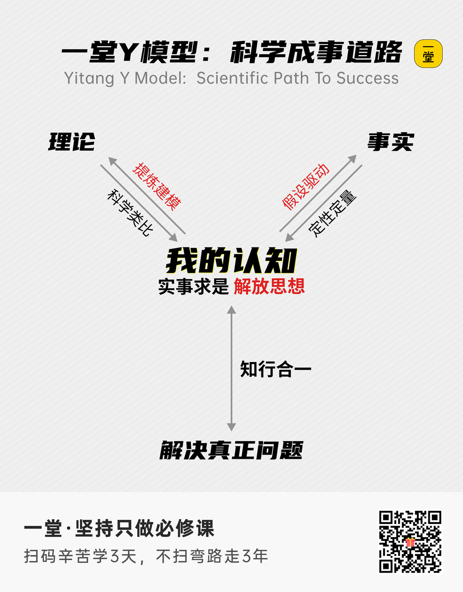

很多人第一次听Y模型，会觉得：要找到因果、要实事求是、要知行合一——这些听起来都对，但好像没什么用。

其实真正难的，从来不是说出这些原则。

真正难的是：当你面前有一个复杂问题，手上又没有现成答案，好几个方向看起来都挺有道理，你到底先信什么、先做什么、做完以后怎么知道自己有没有错？

Y模型解决的，就是这个。

说白了，它是在你没有答案的时候，帮你用一套科学的方法，把答案一步一步推出来：

**先圈定问题，再定结果，补理论和事实，搭一个因果框架，做出预判，配上动作，最后拿真实反馈回来修正判断。**

为什么它强调“因果”，因为**很多结果不是凭空发生的，背后通常有原因。**

你找到原因，才知道该改什么，你找不到原因，就只能靠感觉反复试。

所以Y模型不是让你显得更专业，而是帮你少做一件事：**少在没有想清楚为什么的情况下，急着找动作。**

假设你头疼，去找医生。你真正想要的“果”，不是“吃一片药”，而是“头不疼了，而且找到原因”。

医生不会一上来就随便给你开药。他会先问你：

> - “昨晚睡得好吗？”

> - “最近是不是太累了？”

> - “有没有感冒？”

这些就是他在猜“因”。

然后他会量体温、做检查，这些就是找事实。

最后，他可能先让你休息、喝水、观察一下；如果还不行，再换一种检查或治疗。这就是先做一个小验证，再看结果有没有变化。

这里最关键的是：

**吃药是动作，不是原因。**

找到头疼背后的原因，才是Y模型要帮你做的事。

---

换成工作里，也一样：假设你负责一场活动，结果报名人数很少。

假设咱们现在遇到一个问题：今晚直播的预约人数不理想，怎么办？

很多人的第一反应是：“多发几条群消息。”或者：“把海报再改得好看一点。”

但发消息、改海报，都是动作。动作不一定能解决问题，因为咱们还不知道，到底卡在哪。

第一步：圈范围

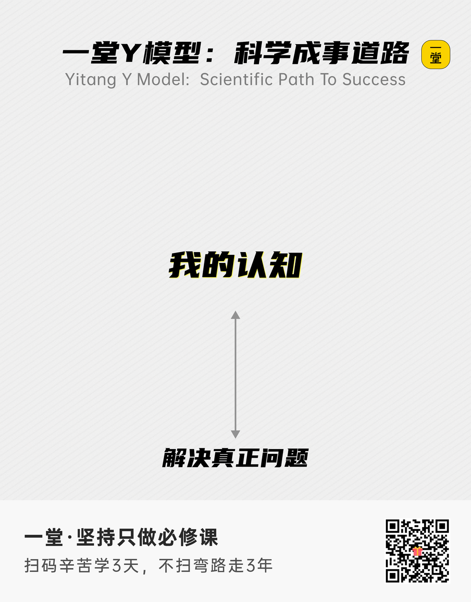

先别问“怎么让所有人都来预约”，这个问题太大了。

咱们把范围缩小：这次只看“最近看过课程介绍，但还没有预约今晚直播的同学”。

为什么先看这群人？因为他们已经接触过课程，至少没有停在“完全不知道这场直播”这一步。完全没看到的人，是另一个问题。

所以第一句话写下来：

**这次只解决：这批看过介绍、但还没预约的同学，为什么没有往前走一步。**

圈范围不是把目标做小，而是先让问题变成一个有边界、能分析的问题。

第二步：定目标

咱们要的结果，也不是“今天多发几条消息”，而是：

**在这批同学里，让更多真正感兴趣、今晚也方便的人完成预约，并且在9点来到直播间。**

如果想让目标更具体，可以假设这批人有100个，咱们希望今晚8点前，把有效预约从5个提到15个。

这里的关键是：目标要写结果，不要写动作。“发通知”不是目标，“让多少人完成预约并到场”才是目标。

第三步：补理论和事实

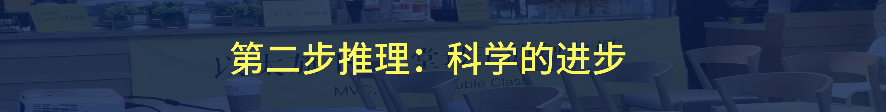

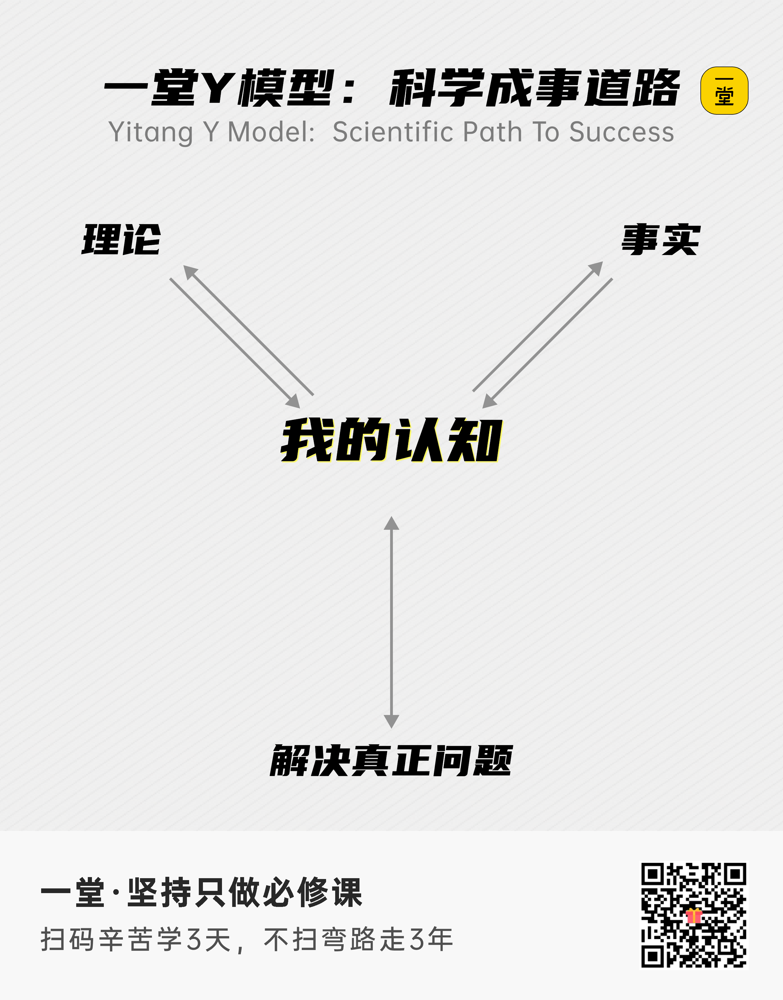

接下来，把脑子里的理论和手里的事实分开。

理论这边，咱们可以借一个已经有很多验证的行动规律：一个人愿不愿意行动，通常不只看他被提醒了几次，还要看他有没有看懂价值、相不相信这件事、此刻有没有时间，以及行动麻不麻烦。

事实这边，咱们去看已经发生了什么：

- 多少人看过课程介绍？
- 看到哪一步走了？
- 群里大家最常问什么？
- 上一场直播，预约的人最后来了多少？

而“大家肯定都太忙了”，在没有数据之前，只是猜测，不能直接当结论。

这一步很重要：理论给方向，事实纠正咱们的想象，猜测则要老老实实标出来。

第四步：搭一个因果框架1.0

现在，咱们把可能影响结果的几个变量摆到一起：

**预约人数，取决于有多少人触达、有没有看懂跟自己有关、相不相信值得来、今晚有没有时间，以及预约这一步够不够简单。**

这就是一个很粗糙的“因果框架1.0”。

它不保证正确，也不是标准答案。它的作用是先把咱们脑子里的假设摊到桌面上，让下一步能验证。

这里再强调一次：“发群消息”是动作，“没看懂这件事跟自己有什么关系”才可能是原因。因果框架不是任务清单，它要回答的是：哪个条件变了，结果才会变？

第五步：做一个预判

看完事实，咱们发现群里的问题很多都是：“Y模型到底是什么？”“这跟我工作有什么关系？”

那咱们先提出一个判断：

**这批人没有预约，可能不是提醒不够，而是还没看懂今晚能带走什么。**

如果这个判断成立，会发生什么？

咱们把通知从“今晚讲Y模型”，改成“今晚带你用一个方法，拆开一个正在卡住你的工作问题”，并给一个20秒的小例子。

预判就是：**这样改完，看过的人里，应该会有更多人预约。**

如果大家看得更多、问得更多，但预约几乎没变；或者很多人直接问“几点、有没有回放”，那就说明问题不只在“价值没讲清”。咱们要回来改判断。

第六步：配套动作

接下来，把判断变成能执行的动作。

比如，咱们规定清楚：

- 谁来做：班班来发；
- 发给谁：只看刚才圈定的那批同学；
- 什么时候发：今晚7点；
- 发什么：一个新的价值表达，但直播内容、时间、老师都不变；
- 看什么结果：看完人数、预约人数、私聊里新出现的问题；
- 什么时候复盘：今晚8点半。

这一轮只改“怎么表达价值”，别的先不动。因为一次同时改文案、时间、渠道和激励，最后就算有效，咱们也不知道到底是哪一步起作用。

第七步：行动，再拿反馈更新判断

咱们假设真跑了一轮。

结果发现：看通知的人多了，但预约只从5个变成6个，而且不少人问：“今晚几点？有回放吗？”

这时不用急着说“Y模型没用”。这次反馈其实告诉咱们：

“价值没讲清”可能有影响，但它不是唯一的卡点。“时间不确定”和“怕错过”很可能也是原因。

于是因果框架更新成2.0：预约不只取决于价值感，还取决于今晚的时间是否方便，以及错过以后有没有补救。

下一轮再配两个动作：把开播时间、时长和回放规则说得更清楚，并在8点45分做一次提醒。

大家看，完整跑一圈下来就是：

**圈范围，定目标，补理论和事实，搭因果框架，做预判，配资源，行动验证，再根据结果更新认知。**

这就是Y模型的完整使用方式。因果很重要，但它只是中间的一环；真正有用的是这一整条链。

#### 第一次用，先盯住这几个关键点

第一，先圈范围。问题太大，什么都能解释，最后什么都验证不了。

第二，目标是结果，不是动作。不要一上来就写“我要改文案、做调研、开个会”。

第三，因果框架只是1.0。它不是用来证明自己聪明，而是用来被事实修正。

第四，动作不等于原因。每个动作都要能回答：它准备改变哪个条件？

> “改文案”“发消息”“加提醒”都是动作。

> “看懂价值”“担心错过”“预约麻烦”才是可能影响结果的条件。

> 为什么要追问“这个动作准备改变哪个条件”？

> 因为不追问，很容易变成：

> 我也不知道为什么，但别人都这么做，我先做了再说。

第五，一次只改一个关键地方。不然结果好了，你也不知道为什么好；结果不好，也不知道该改哪里。

第六，反馈不是给原判断找证据。支持就继续，不支持就更新。能让你发现“原来我想错了”，也是一次很有价值的进步。

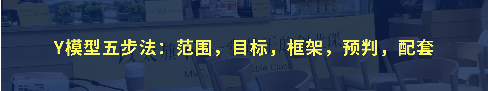

**【划重点💡】**我们简化后，容易理解和讨论：**范围，目标，框架，预判，配套**

**我们找到一个刚好的翻译“STEPS模型”**：**S**cope，**T**arget，**E**lement，**P**redict，**S**upport。

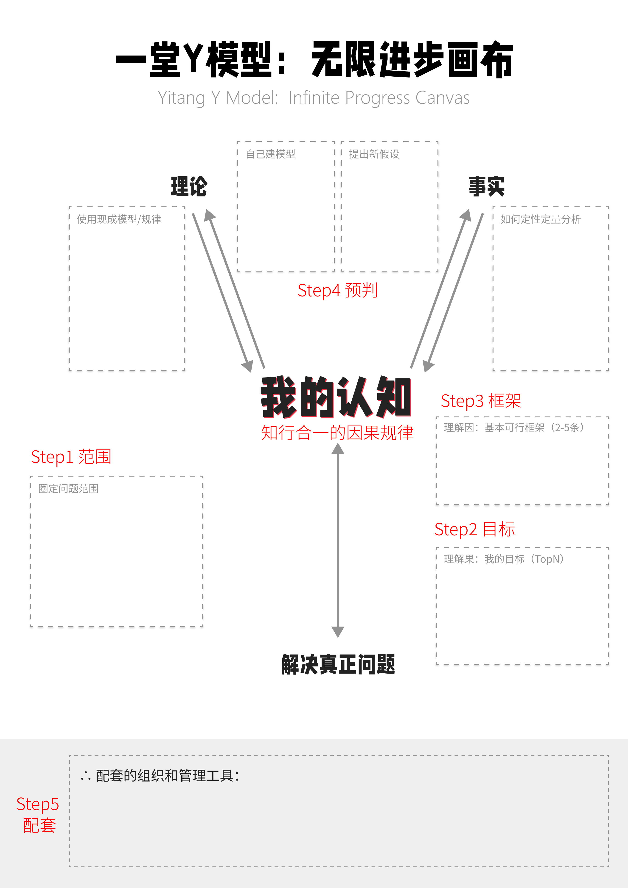

**【划重点🎁】周一中午12点前**，两个Y模型Partner**限免开放**（仅限YAI网页版使用）：

- T教学：Y模型 · 成长教学官   #对人责任
- C顾问：Y模型 · 高阶推演官  #对方案负责

前者负责你你的成长，带你理清价值、挖掘场景和带你把模型长在你的身上。

会给你一个《专属的Y模型学习资产报告》。

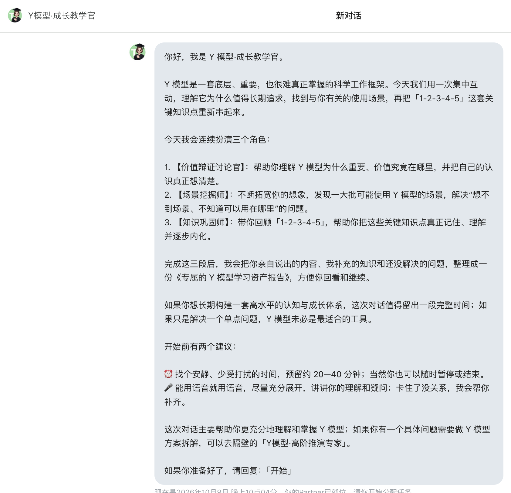

后者负责带你一步步解题，你拿出一个真实场景难题，他带你一步步推演、画画布。

给你一套《Y模型高水平工作备忘录》

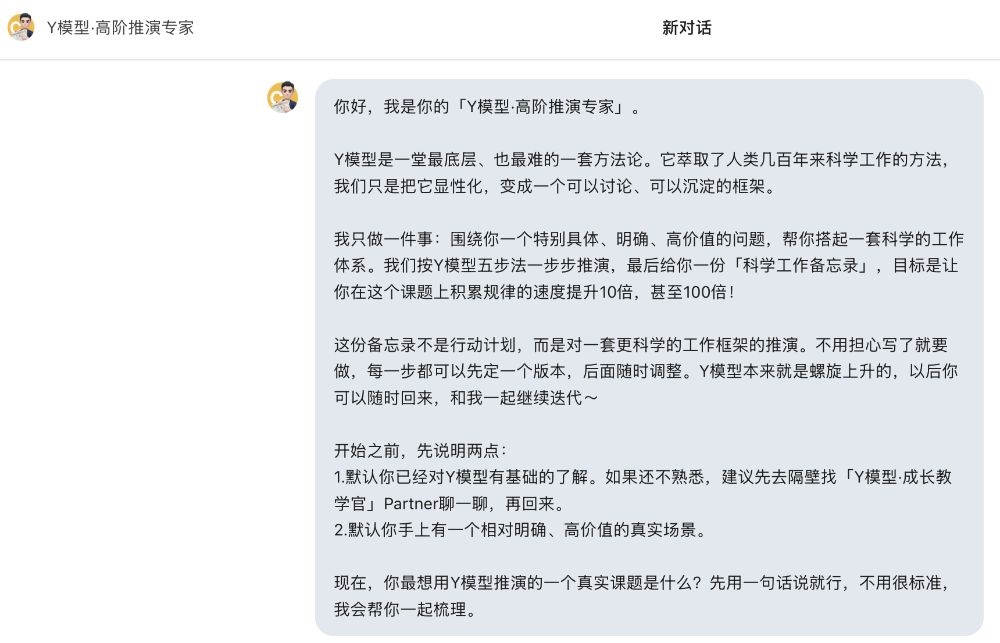

希望大家可以抓住机会，去实践，去和Partner拉满工作。

📌Y模型正式作为一堂战略的全员必修课题来推。两周前，我们请徐剑、莫非、花总从业务、教练、AI三个视角拆解Y模型，反响非常好。

这周，我们又请了两位内部称为"大哥级"的业务高手，再次为大家解读Y模型，把“击穿”再往前推一步。

第一位，劉衞，做了近二十年大客户销售。他会讲清楚，靠关系、拼经验的大客户销售，如何长出一套能复制、能带人的科学模型？

第二位，贺雷，华西医学背景，医疗公司CEO。他会讲一段很少见的科学迁移经历：从看病到经营公司，再到和AI一起解决未知问题。同一种科学思维，如何一路迁移？

两个讲师都是十余年、多个领域的探索，他们会用自己的案例，带你理解科学和Y模型。

如果你还觉得Y模型不好理解、离自己的业务很远，这一场，强烈建议你来。

直播间的同学们，大家抓紧做个听课准备：

- 用手机的同学，快去打开你的**电脑**，画质更清晰，评论区互动更欢乐~
- 把你的椅子、靠垫、水杯等准备好，营造一个舒适的**学习环境**~
- 准备好沉浸式学习，和直播间几千人一起，开启今晚的**高效成长**之旅~

好，那接下来，把时间交给劉衞。

欢迎劉衞～～～