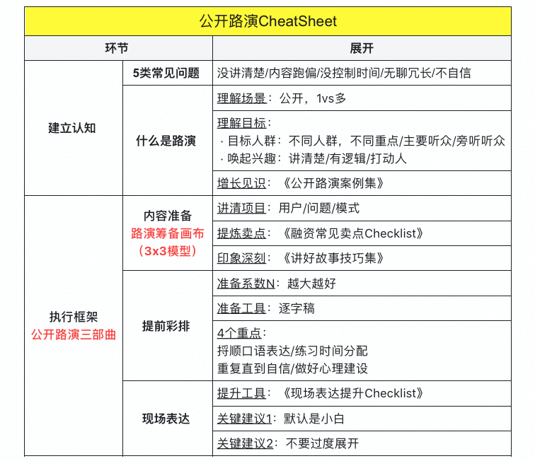
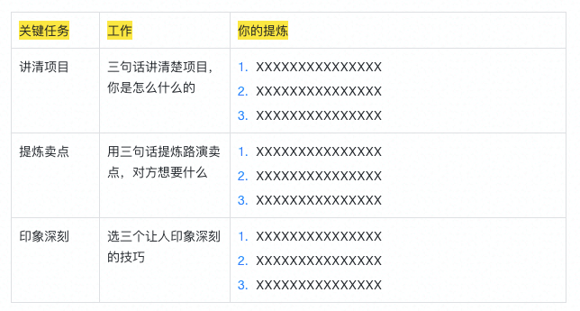
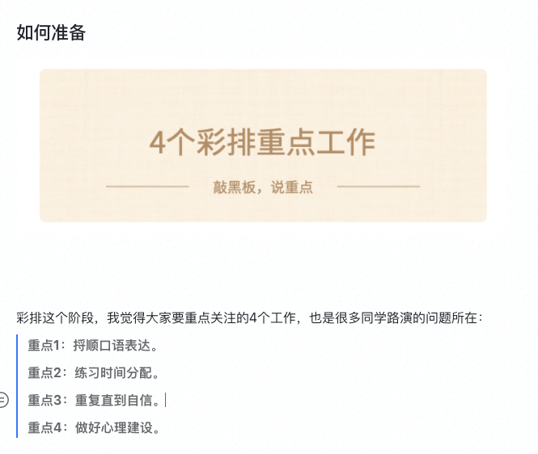
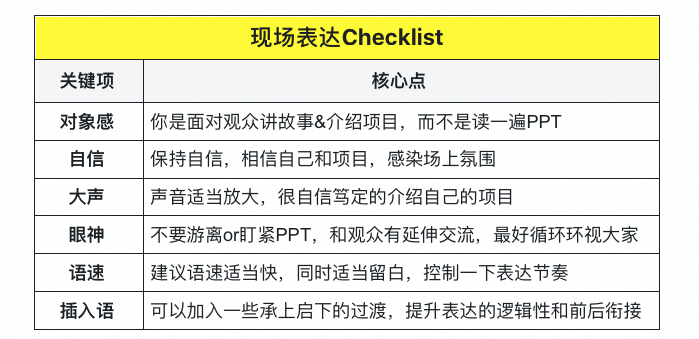

逐字稿实操：从入门到高手

## 开始上课

hello，大家好，我是Truman，

今天的主题是：公开路演的实操篇，如何撰写发言的逐字稿。

哈哈哈提醒一下大家，今天可能比较费嗓子，大家提前自己准备点水。：）

### 为什么要讲这个话题

每一个创业者，讲故事能力都非常重要。

我们曾经做了一节课，教大家如何准备公开演讲和路演：

但是实操还不够，在现场表达，很多同学都会有各种困扰：
1. 有些新人，上讲台根本就讲不了，说话颠三倒四的，想想又补充几点。
2. 很多好听的句子，精美的词，语言的力量，一紧张全都忘了。
3. 临场发挥是靠不住的。闲聊的时候，你可以临场发挥，你甚至能连续讲好几个小时。做分享的时候，你要考虑逻辑，要考虑语速快慢，要考虑听众是否理解你所说的话，控制不好。

所以今天的主题是实操，教大家**逐字稿**这个表达工具。

### 预热思考题

今天我们遵照一堂的惯例，给大家两个预热思考题啊。

**第一个题目：**请你假想一下，假如那个站到台上做分享的人是你，面对台下黑压压的听众，你讲着讲着发现，下面的人慢慢开始走神，低头玩手机，甚至睡着了，你会是一种什么感受？如何来训练自己，解决这个问题？

**第二个题目：**假设你不是一个口若悬河，临场口才非常出色的选手，如果你现在知道了，有一个叫逐字稿的方法可以提升讲课质量，那么你知道具体应该怎么写吗？你用过吗？最大的困扰是什么？

这两个题目，大家可以认真想一想，第一个代入一下场景，第二个想一想实践层面，你的短板在哪里。今天我们来完整带大家建立认知、开始训练。

### 本节课作业

【💡 本周作业】围绕今天的课程方法，反思和完成一次自我训练，然后从四个题目中任选1-3个，然后完成一份打磨过的逐字稿：

**第一个作业：写一份同学自我介绍。**

假设你参加一堂的线下活动，面对一堂同学，有3-5分钟介绍自己，写一份逐字稿，介绍一下自己的背景，重点讲一讲你的亮点，曾经做过比较厉害的事情，以及对其他同学的社交价值，**目的是希望快速融入一堂，认识一些高价值的同学**。你会怎么做呢？

**第二个作业：写一份项目销售话术。**

假如你参加一个大会，场下有100个你产品的目标用户，你有3-5分钟介绍你的产品，**目标是引起大家的兴趣，促使更多听众使用或者购买你的产品。**

好，问题来了，你可以想一想，这3-5分钟你会怎么说，写一份逐字稿吧。

**第三个作业：写一份你的路演简单介绍。**

假如你参加一次路演，路演时间3-5分钟，你需要面向投资人介绍你的项目，**目的是获得对方的投资兴趣，你会怎么做呢？**

**第四个作业：写一份一堂的推荐语。**

如果你没有项目，或者特别喜欢一堂，可以选择这个作业。假如你参加线下创业聚会，每个人有一个3-5分钟的主题发言，推荐你学过最好的课和书，你打算推荐一堂，**目的是获得其他创业者对一堂的兴趣，来一堂上课，你会怎么说呢呢？**

提醒一下，3-5分钟可能需要500-1000个字，你可以想一想你会怎么组织这个发言，写一份逐字稿吧。如果你没听过上一节课，建议一定先听一遍，上节课讲的是筹备框架，今天主要讲逐字稿。

特别期待看到大家提交的发言逐字稿。

🎁 作业奖励Candy：下周三前点评作业，下周三前点评完可以领取一份**《优秀作业合集》，**供大家学习。

提醒：新课免费内测，请务必按时学习提交作业，3次报名内测不写作业，后面不会再邀请。

【Flag🙋】这节课做起来很辛苦，希望大家不要辜负，我们新系统可以统计大家学习，连续3次不提交内测报告，以后可能就取消内测资格了。

来来来，希望大家一起立一个Flag（承诺），认真听课，好好内测，最后完成这次训练作业。

扣一句话吧：一定作业！！

提醒：新课免费内测，请务必按时学习提交作业，3次报名内测不写作业，后面不会再邀请。