## 开始：重新理解"逐字稿"

先来给你们讲讲我的成长和练习历程：

### 我的入门/进阶之路

在2015年以前，我一直有一个看法：很羡慕有些人口才出色，演讲能力真好。

> 觉得讲课能力很难，需要很强的表达和口才才行

> 讲课总有人看手机，去洗手间，聊天==

> 发挥很不稳定，从30-90分飘忽不定（看心情/饿不饿/状态好坏）

最近两年做的课程，貌似做的还不错了：

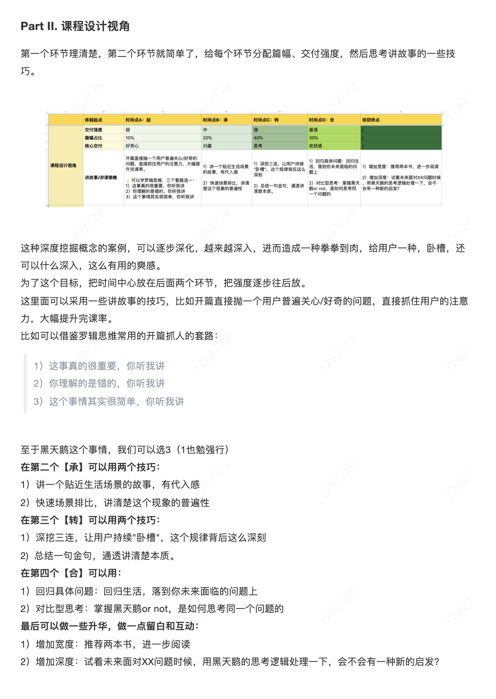

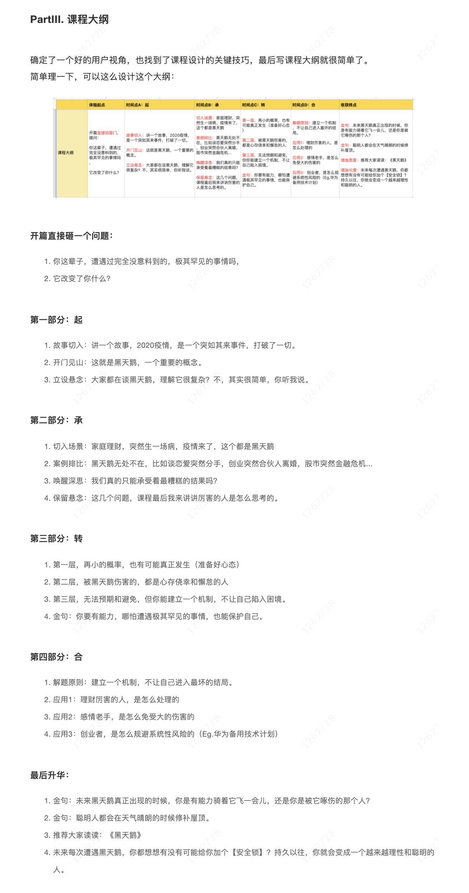

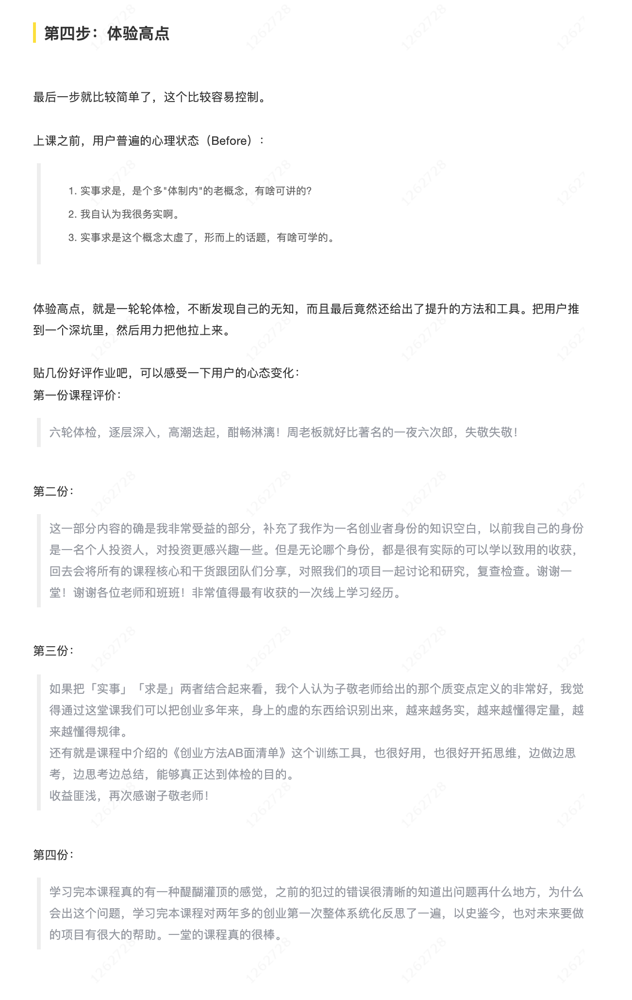

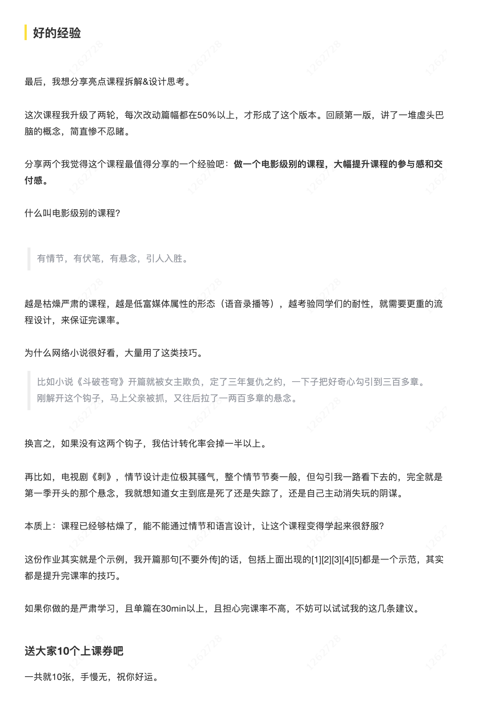

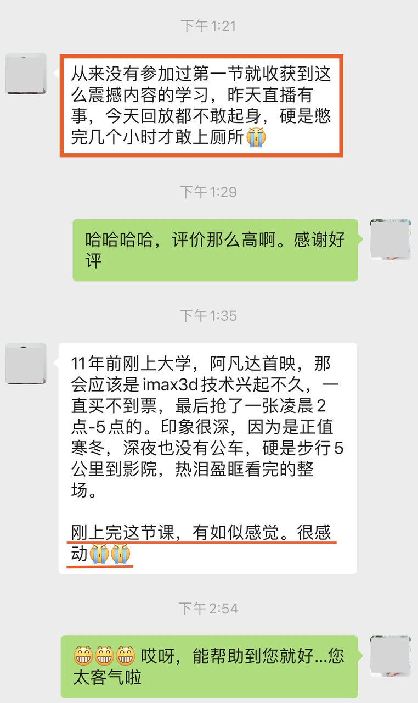

大概有两个时间点改变了我的看法：

**节点1：2015年，我周末去了一个培训机构，训练讲课能力。**

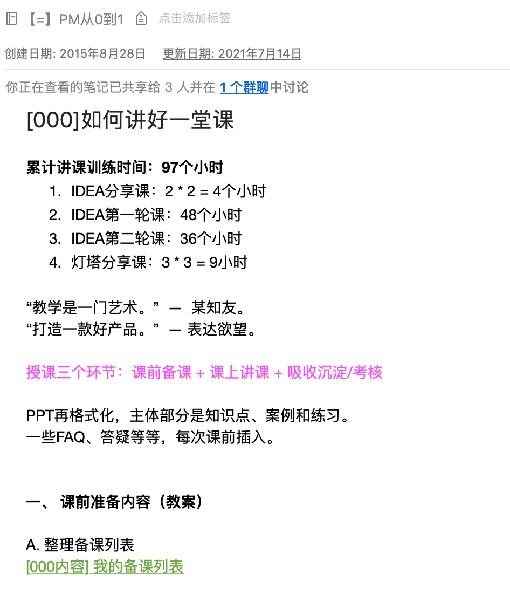

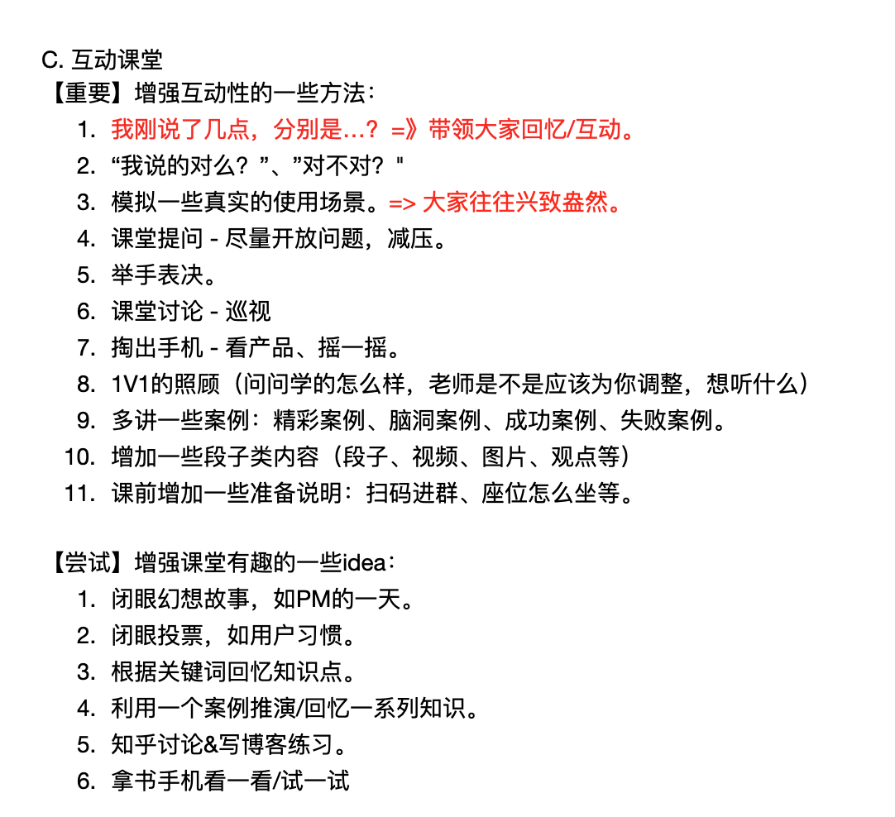

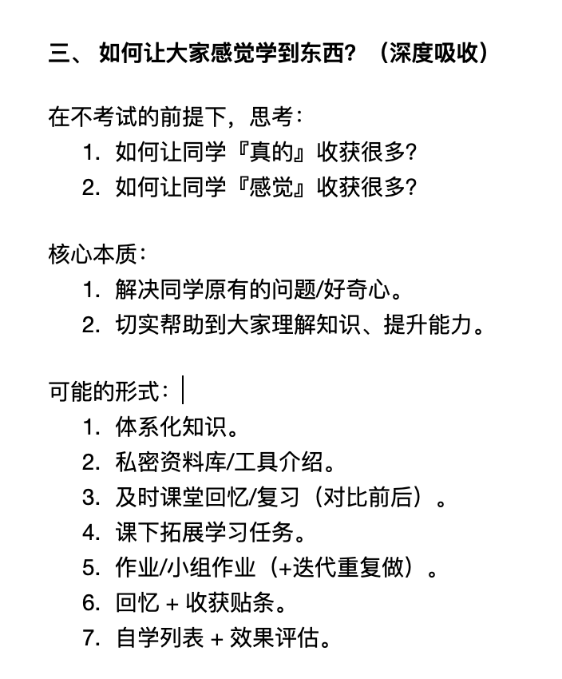

————

【划重点💡】世界上没有即兴的精彩演讲。

> 不再迷信口才和天赋，讲课是可以刻意练习出来的。

困扰：对于提升表达的质量、精细化文字，一直缺少一个抓手。

**节点2：2016年，我突然看到了一篇文章。**

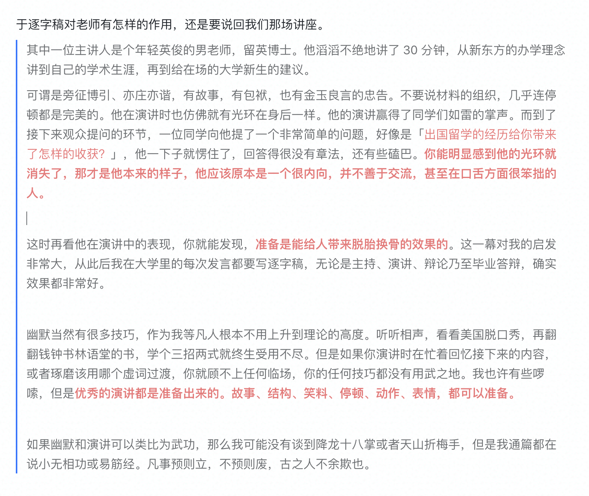

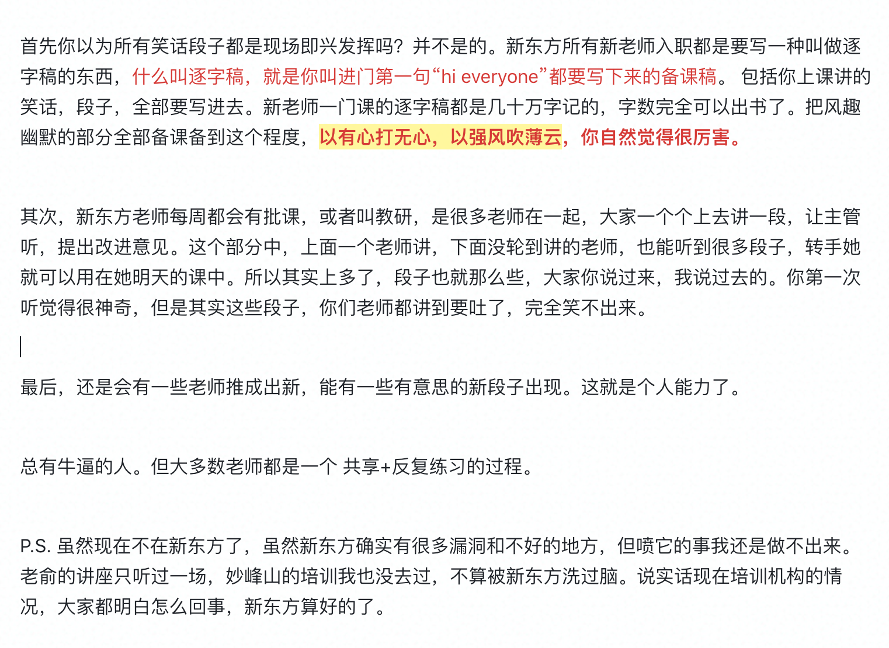

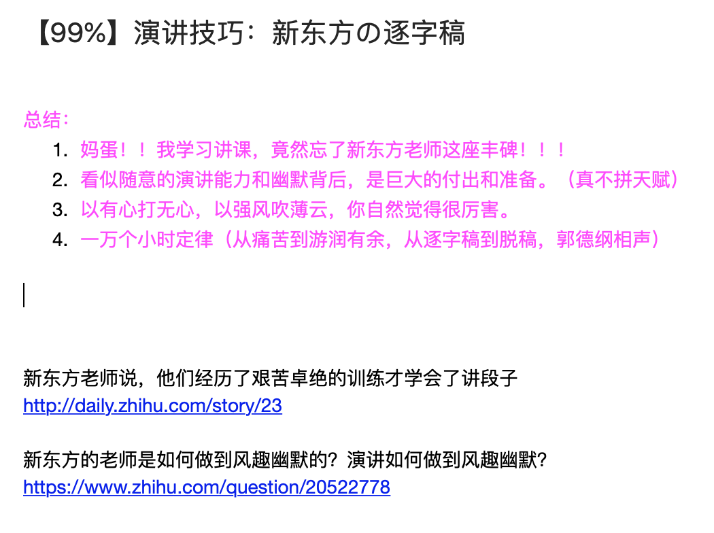

【划重点💡】逐字稿，可以改变世界。

希望大家能够在演讲之前有所准备，天底下所有演讲的准备只有两种方式：

- 第一个是准备提纲，
- 第二个是逐字稿。

没逐字稿拼临场发挥和才华，有逐字稿拼你的专业筹备。

### 什么是逐字稿？

很多人都以为写逐字稿=写作，或者写作文，导致方向完全错了。

因为没有认真思考过逐字稿的本质，大家觉得本质是什么？

——

开门见山吧，站在实操角度，我直接下一个定义吧：

【本质💡】逐字稿不是写作，本质是**现场说话能力的训练工具。**
1. 关键词1：现场（核心的场景）
2. 关键词2：说话能力（路演/演讲/讲课/主持/卖货）
3. 关键词3：训练工具（有适用条件/不要迷信被绑架）

### 逐字稿的价值

就像我一样，很多同学有一次特别重要的发言or演讲，但是不知道该怎么准备：

> 一遍遍改PPT？一遍遍对着镜子讲？

> 提前3天就不断重复，那除了胆量和勇气，究竟练什么呢？

> 我特别想努力，但是抓手在哪儿呢？

这时候，**『逐字稿』就是你的神器。**

【划重点💡】这个就是逐字稿的核心价值：
> 4. 打磨基础：把临场发挥，拉到3天，甚至3个月以前，提前筹备和练习。
> 5. 表达剧本：把内向和不善发言，藏在心里，扮演一个善于演讲的创业者。
> 6. 稳定交付：消除不确定性，在各个场合，都能稳定发挥。

夸了半天逐字稿，我们这次发言，真的需要写逐字稿吗？怎么判断？

大家怎么看？最好都写逐字稿吗？

【提问🙋‍♂️】在之前课程里，我也调研了大家写逐字稿的困扰，你们呢：
7. ~~懒~~
8. ~~字太多，时间把控~~
9. 不知道怎么口语化，写和讲融不到一起
10. 逻辑精准，缺少框架
11. 感觉表达的节奏感不行
12. 写也背不下来/不会背/不敢念
13. 背了容易生硬/忘词

### 逐字稿的N个变种

【划重点💡】几个难题：觉得浪费时间，不会写，写了不愿意用。

理解区别：**即兴发挥，发言腹稿，大纲稿，逐字稿，完整逐字稿。**

大家能理解差别么？我举个例子，你们感受一下：

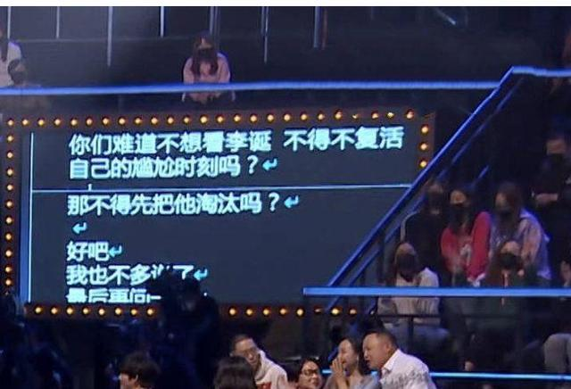

比如我可以写成这种『大纲稿』：
14. 吐槽大会提词器事件，沸沸扬扬。
15. 很多观众觉得被欺骗了，但是其实，这个案例非常优秀。
16. 能拆成逐字稿，才能团队协作，才有机会持续做脱口秀节目，而不是依赖嘉宾的临场和才华。
17. 强调一下逐字稿的价值。

**案例：逐字稿版本**

前段时间时间《吐槽大会》的提词器事件，在市场上闹得沸沸扬扬，很多人以为的这些人的表演，这些才华横溢的演出都是即兴，最后才发现，原来都是在对着提词器读稿子啊。

很多观众觉得自己的感情被欺骗了，但是站在产品操盘手的角度，我看了这个案例，反而觉得特别优秀。

他们通过逐字稿，把前期写稿子创作和现场发挥拆开了，前面是编剧，后面是IP，就可以大规模工业化复制脱口秀作品，这个不是非常牛吗？

实话说，来参加脱口秀的那些演员、运动员、模特和歌手，有几个真正会演讲、会脱口秀和写段子的？不好意思，**这都是团队作品，用逐字稿协作的功劳。**

所以逐字稿在一定程度上，可以让那些口才没那么好的，让那些现场发挥比较弱的，更稳定地交付出高质量的产品。**这就是逐字稿的价值。**

所以提醒大家，逐字稿是个基本功。你可以不用，但是，你一旦用了，或者哪怕写一部分逐字稿，或者一个粗糙的大纲稿、关键词稿，整个的演讲的质量会上升一个特别大的台阶。

> **什么叫“完整的逐字稿”呢，在逐字稿中，你需要写下你的每一句话，你的每一个动作，你的所有停顿点，所有的升调降调点，还有你的眼神，手部动作以及整体的身体语言。**

前段时间时间《吐槽大会》的提词器事件，在市场上闹得沸沸扬扬，很多人以为的这些人的表演，这些才华横溢的演出都是即兴，最后才发现，原来都是在对着提词器读稿子啊。（Hold一下，笑）

很多观众觉得自己的感情被欺骗了，但是站在产品操盘手的角度，我看了这个案例，反而觉得**特别**优秀。（加强）

他们通过逐字稿，把前期写稿子创作和现场发挥拆开了，前面是编剧，后面是IP，（朗读节奏）就可以大规模工业化复制脱口秀作品，这个不是非常牛吗？

实话说，来参加脱口秀的那些演员、运动员、模特和歌手，有几个真正会演讲、会脱口秀和写段子的？不好意思，**这都是团队作品，用逐字稿协作的功劳。（提问加强语气，然后弱下去）**

#切换到下一页PPT

所以逐字稿在一定程度上，可以让那些口才没那么好的，让那些现场发挥比较弱的，更稳定地交付出高质量的产品。**这就是逐字稿的价值。（强调）**

所以提醒大家，逐字稿是个基本功。你可以不用，但是，你一旦用了，或者哪怕写一部分逐字稿，或者一个粗糙的大纲稿、关键词稿，整个的演讲的质量会上升一个特别**（重音）**大的台阶。

### 如何选择呢？

现在大家可以看懂这个图了吧：

| 分析 | 判断维度 | 1. 即兴发挥 | 2.提前腹稿 | 3.大纲稿 | **4.逐字稿** | 5.完整逐字稿 |
|---|---|---|---|---|---|---|
| 价值 | 内容质量 | 低 | 低 | 中 | **高↑** | 最高 |
| 细节把控 | 弱 | 弱 | 中 | **强↑** | 最强 |  |
| 交付稳定 | 无 | 低 | 低 | **高↑** | 最高 |  |
| 成本 | 撰写难度 | / | 低 | 中 | **难↓** | 最难 |
| 练习难度 | / | 低 | 中 | **难↓** | 最难 |  |

我们今天的目标，就是带大家学习，提升逐字稿的价值，降低逐字稿的成本，把它变成你一个可以用的工具。

我们有很多的演讲、会议和分享：

> 内部开会，内部分享，公开主持，公开讲课，公开路演，公开演讲，脱口秀表演，总统竞选。

那你的工作，如何判断需不需要"逐字稿"这个复杂的工具？

建议大家看三个维度，除了你的**演讲临场能力**，还有**是不是公开**，是不是**需要表演**。

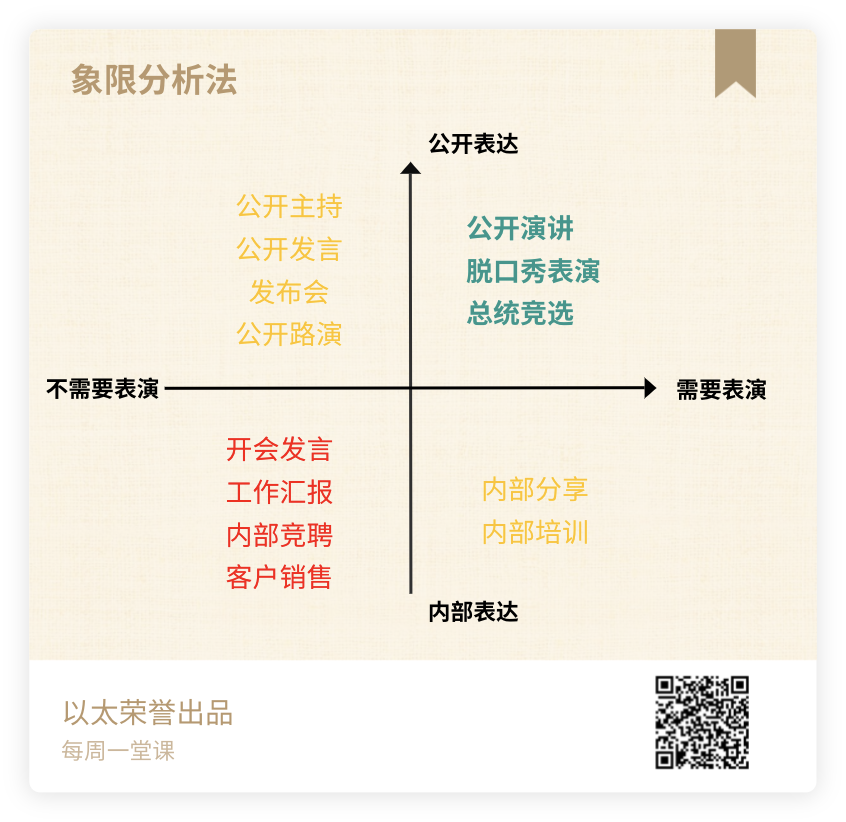

【划重点💡】逐字稿特别适合：**演讲经验不多，公开表达，且需要一定现场表演发挥的场合。**

哈哈哈哈，我曾经做过一个噩梦，让我一身冷汗==。

一堂现在的做法：直播课靠大纲稿+半逐字稿，录播课纯靠逐字稿。