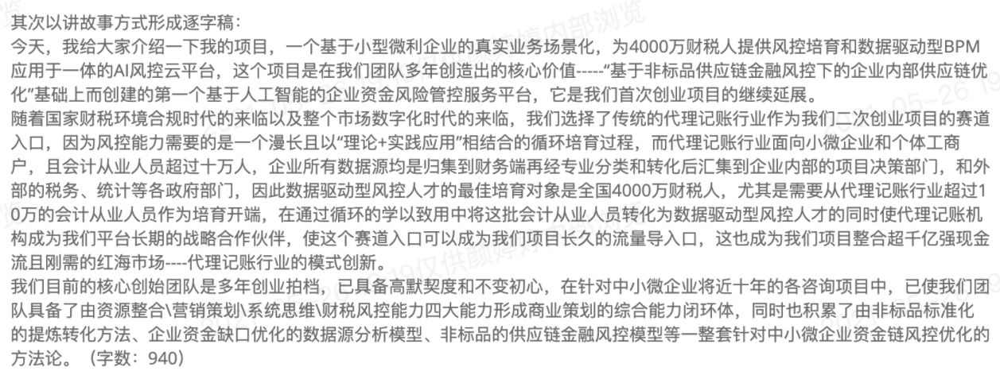
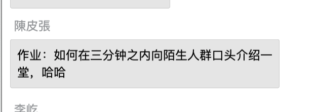
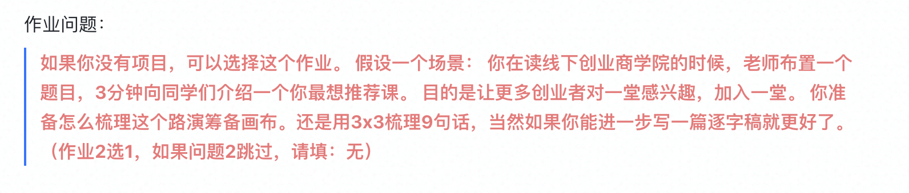
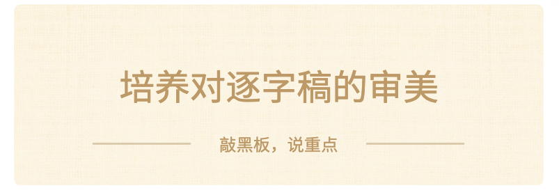

## 见识：逐字稿的审美

### 

正常写逐字稿，需要有一些前置工作，比如确定中心思想、写提纲，整理内容点，或准备PPT。

所以强调一下啊，我们假设你的数据、卖点、逻辑和观点都是现成的了。

我们今天专注一点，**只讨论『逐字稿表达』的问题。**

### 分析几个例子

下面，每一个例子我们看30-60s，大家来找找问题，有没有什么优化空间？

【提问🙋‍♂️】大家觉得有哪些改进建议？

A 半夜早点睡

> 各位老师、同学们：大家好！

> 很荣幸有这样的机会，请多批评指正，非常感谢！

> 我们项目来自华东，坐标上海，编号22。首先，简单向各位创客同学，做一下宣讲：

> （项目亮点：1-1.5分钟）

> 1.我们是一个回归原点，从零到一实践的项目。（本来项目准备上线运营，做增长。通过学习一堂的课程，意识到基础还不扎实。这里是接下来项目推进，对应的一堂选课学习的计划，未来我们一起学习，一起实践。把我们项目当成小白鼠。）

> 2.（然后）这是一个文娱行业，早期做To C服务平台的项目。（未来我们一起深入做行业分析预判，定量、建模、验证，对相关业务会有很好的借鉴意义。）

> 3.（最后）我们项目有较好的商业价值，同时初心是服务创作者，促进行业发展。（欢迎有同学能成为我们的合伙人，一起做一件既有经济利益，又有行业价值的事业！）

> （项目概况：0.5分钟）

> （好，进入正题）我们项目，是一个基于威客模式的创作者智能云服务平台。为创作者提供一站式、覆盖创作全流程的服务，比如：作品封面制作、侵权维权等。

> 未来也计划通过技术路径，解决创作者的其他需求。

> （痛点分析：1-1.5分钟）

> 1.我个人从事文娱行业10年，最早也是作者，了解创作过程中会遇到各种的服务需求，比如给作品做一个封面，（这里我们按需求类型，分五大类做了分析）。但是，行业对创作者的这些需求，鲜有关注，服务不足。

> 2.行业里喜欢炒“孵化”这个词：孵化作品。这在作者眼中，很难共情。孵化本来是给一个蛋保护和温暖，让她破壳而出，健康成长。而那些所谓IP孵化，顶多叫“赛马”，把数据好，跑得快的，拿来各种改编，而剩下的大多数，不会被关注。

> 3.十年过去了，这个领域并没有大的改观。类似一堂的初心，是服务早期创业者。这些年我固执地有个疑问：针对创作者的系统服务，到底有没有人管？

> （市场概况：0.5-1分钟分钟）

> 就网络文学行业来讲，2020年服务用户4.6亿，占网民整体的46.5%，市场规模288.4亿元，对数字娱乐产业的影响范围超过40%，约合2531亿元市场。

> 网络文学累计产出作品2784万部，有2056万网络作家辛勤工作。作为行业底层劳动者，不能被遗忘，应该被服务！

> （团队介绍：0.5分钟）

> 所以，我们有了“蛋客”这个项目。为此，我们集合了一批行业资深从业者：3位有行业Top5公司经历，主编及总编资历，带过项目，行业资源丰富。也包括资深IT开发人员，核心人员主导过基于区块链的版权保护项目等。

> （商业模式：1分钟）

> 我们计划，采用威客模式：针对创作者实际需求，匹配相应能力的人进行服务，过程中产生劳务费用，平台以小比例的佣金分成，适当开展自营业务。

> 未来开展技术路径的云服务，获取服务费。如果能有较高的集中度，成为行业入口，则可以拓展渠道收入，甚至内部孵化高价值项目。

> （竞争格局：0.5分钟）

> 我们初步调研了市场，可以看到：

> 1.其他领域的威客模式项目，在国内比较成熟，实现了较好的发展。

> 2.（另外）创作者服务赛道的现状，缺少系统服务平台，单一服务质量不足。比如作品封面雷同和版权问题，多年没有有效解决。

> （运营现状：1分钟）

> 1.目前项目已经做了基础工作，有运营实体，注册商标，开发有网站demo，有新媒体等布局。

> 2.技术路径尝试有工具类云服务，前期考虑作为增长工具

> 3.冷启动，计划整合创始团队多年积累的行业资源，包括作家社群，前期预计触达数千种子用户。

> （未来规划：1分钟）

> 1.目前项目是以轻资源的形式切入，待条件成熟加大技术路径投入，丰富服务形式，拓展服务对象。

> 2.一堂关于需求分析的内测课，启发我们有新的思考，如果能达到较高集中度，就有可能成为行业入口，有更多的营收渠道，甚至做内部孵化。

> 3.如果掌握相当一部分行业人力资源，就有一定话语权，有机会推动一些更合理、高效的业务模式，促进行业健康发展。

> （融资&招募计划：1-1.5分钟）

> 最后，真诚邀请各位同学，一起学习，相信成长；实事求是，一起实践！立个Flag：未来每个实践环节我会做一个深度复盘，所有实践材料提供一堂做教研。

> （前面有介绍）我们项目属于文娱行业，前期商业逻辑是威客模式的ToC业务，也欢迎IT、运营、销售等各个领域的同学！

> 我们是一个开放团队，欢迎未来有同学能成为我们的合伙人！

> 介绍完毕，谢谢大家，感谢！

【提问🙋‍♂️】大家觉得有哪些改进建议？

毅程

> 介绍一个周围朋友的项目：

> 大家好，我今天带来的项目是“城市社区食堂”

> 我们的用户，是快节奏城市居民里，比较缺乏日常社交场所的中低端小区居民

> 他们需要解决的问题：给居民提供一个日常可以交流的场所

> 我们的提供的产品是社区食堂。

> 我们发现随着城市化进程的发展，很多城市居民缺乏日常相互之间的交流。尤其缺乏一种随意一点的，不是正式吃饭那种的，而且频次可以很高的，交流场所。而且因为城市节奏快，每个家庭做一顿饭，买菜、洗菜、做饭也要很多时间，尤其是一些上班族，朝九晚五的，每天就1-2个小时空闲时间，根本就没有时间花在做饭上。

> 我们提供的服务可以很好的解决这个问题，我们的食堂都开在大型居民社区里，选址我们都会考察，选择社区，周围其他的餐饮店都是比较小的店，往往都只有七八个平方，我们的店面至少有五十平方。

> 装修风格按照食堂的装修风格，提供的都是家常菜。本着薄利多销的原则，每餐每人价格在10元到30元之间。基本每个人都可以邀请他的朋友、家人到店里消费，基本没有顾虑。而且宽大的空间，热闹的氛围，亲民的价格，让这里的客人都十分放松。

> 我们现在在上海已经有5家店了，5家店数据共享，厨师可以轮换，这样保证菜式可以不断更新。我们定期分析居民的选择偏好，保证我们的菜式都是符合客户口味的。我们已经有几款明星菜品， 辣椒炒肉、鱼香肉丝、清蒸鲫鱼，流程标准化，每月都可以销售3万份，成为客人到我们店消费的重要理由。

> 我们的团队，核心团队都在餐饮行业有10年以上的经验，我们和**烹饪学校还有固定的合作关系。

> 我们这次融资，是希望能扩大经营范围，打造品牌，以后成为大家身边的家庭厨房，减少大家买菜、洗菜、洗碗的时间，让城市居民有更多的时间休闲娱乐，而且本身我这里也是一个很好的交流的场所。

【提问🙋‍♂️】大家觉得有哪些改进建议？

Jeromy：

> 两个初为人父的工程师为解决孩子海量照片视频的存储管理，再试用诸多产品后，发现没有一款产品能把照片视频的本地存储和管理做的和云端一样的易用稳定，而大多用户的本地照片管理还和十多年前一样，手动拷贝到硬盘，通过电脑手动管理，这些年来，硬件也越来越强大，成本也越来越低，功耗也越来越低，很多技术宅已经在自己家里7x24小时运行基于ARM芯片的小服务器，运行开源软件来替换云端服务了，这就包括价格和技术门槛都高的NAS系统，矿难也催生了另外一部分玩家，用几百块钱甚至几十块钱的矿难机刷系统来替换云端服务，但照片云没有一个很好的方案，很多已有的开源产品都是PC时代的产品，从架构上并不能满足移动时代的需求，从功能方面和稳定性方面也都有所欠缺。黑群晖NAS系统刷机后，虽然有做的比较好照片云服务，但对于普通用户而言还是有价格和技术的门槛，也有存储设备制造商做类似的产品，但毕竟不是主营业务，产品质量也饱受诟病。我们认为，从时机上来看，云存储结束了疯狂补贴的阶段，用户也开始理性思考并探索照片本地存储备份候选。所以他们开始自研产品，当开发出产品原型后，有一次和朋友聊天，朋友说为什么你们要做这个产品，说他新买的西部数据的mycloud就能备份照片，很好用，一个月后，他找我们吐槽了一下mycloud的诸多不便，然后试用了一下我们的原型产品，过了一周后，决定加入我们一起来做。我们现在的很多用户有很多技术小白，同时也有很多和他一样的资深NAS玩家，对于小白用户，他们选择我们的产品因为简单易用，而专业NAS用户更多的是有和其他产品深入的比较做出的决定。我们的优势是同时有丰富的互联网产品经验和企业级软件产品经验，能做到消费级产品体验和企业级质量保证，并且拥有美国硅谷的全球视野和中国深圳的完整产业链支持。我们相信一定能做成这件事情，保护好普通用户的宝贵数字资产。

【提问🙋‍♂️】大家觉得有哪些改进建议？

马文锐

> 大家好，我是Dr.Color创始人XXX，我们做的是针对精准色彩管理的轻量级SAAS产品。

> 我目前就职于一家细分涂料行业的头部企业，整个市场上我们的同行有8000多家，而扩大到整个涂料行业，有近5万家，每家涂料企业均有200-1000家客户，客户群体规模在百万家。而调色、对色等颜色管理需求是目前行业存在的痛点。

> 我们发现市场上存在解决这样问题的方案，但是都是外资企业，产品太贵、用户体验差，没有深入了解用户需求来打造产品。

> 我们通过引入色差仪行业专家、软件专家、人工智能专家组成了技术团队，历时3年研发了一款性价比更高、使用体验更好的软硬件产品。改变了原有行业色差仪单价非常高、产品体验很差的模式，让更多的有色彩管理需求的用户能够提升在产品管理方面的能力，为这些用户降本增效，提高效率。

> 以轻量SAAS收取年度合作年费3万元(根据功能多少会调整），设备成本下降3倍。以用户数量增长为项目目标，通过SAAS产品年费获利，硬件产品毛利率也有50%。

> 目前我们已经200家用户接入我们的SAAS系统，并且我们提供了老色差仪通过人工智能算法可以介入SAAS系统的服务，大大降低了用户的设备成本。今年我们的项目在涂料厂端的增速是70%，未来我们会加强在涂料厂客户端的推广力度。未来我们预计，我们的涂料端用户将达到2000家企业，涂料厂客户端用户将会达到100000人。

> 这是一个专业度非常细分垂直的行业，主要涉及涂料企业和涂料企业的客户们。如果我们未来的渗透率可以做到10%，500家涂料企业，5000家涂料企业的客户，我们将会成为这个行业的创投领域第一名。

> 我们的融资金额和轮次是XXX，感谢您的时间，谢谢大家。

【提问🙋‍♂️】大家觉得有哪些改进建议？

钱之越

> 我们做的是一个帮助子女服务老人安全及健康方面的平台。

> 为什么会做这个产品？

> 我之前一直在500强工作，一天突然接到电话说我外婆走了。

> 因为我从小是外婆带大的，外婆身体一直很健康，突来的噩耗导致我很难接受这个事实。

> 了解到原因，外婆和我外公年过90+相依为命居家养老不愿意请阿姨照料，这天我外公在隔壁书房与我妈煲电话粥，这边外婆在卧室床前意外跌倒，未及时发现和抢救，导致错过抢救黄金时间，送到医院就脑死亡了。

> 后来问了一下周边的朋友，这样的老人意外情况太多了，然而这个问题可以解决吗？

> 这个问题，子女解决不了，一来没时间，二来没精力。

> 那我们找到了一个机会，构建一套完整的服务平台来服务老人。

> 我们组建了团队，有来自政府的高管，来自养老院的掌舵人，来自公益的，来自保险公司的高管 以及一些愿意为社会出点力的上市公司，参与这个项目

> 还连接到医疗体系，把过往养老行业涉及到的老人意外的场景及案例做了深度的分析，及解决方案的推演，交付给子女一套标准的服务。

> 总之，调动全部力量，做个有爱心的真正为老人智慧安康保驾护航的“艾兴”服务平台。

> 讲完过去，将现在的模式和进展

> 做老人服务是一个吃力不讨好的事，需要衔接好各方关系，真正为老人安全和健康着想。

> 半年时间，平台的价值和商业模式基本验证通过，有10000名老人体验过，家属给出87%的满意度好评，我们也收到了1000多份表扬信。

> 我们采用与运营商+智慧养老设备方合作的模式，目前已经找到增长渠道，预计今年可实现盈亏平衡，最近一个季度收入增加了6倍，单月服务人数增长了5倍，而且未来3-5个季度预期会有5-10倍增长。

> 最后讲一下未来

> 我们想象中的智慧养老模式是怎么样的？

> 相对于市场现状的玩家，我们艾兴最有价值的点，在于具有大范围规模化服务的潜力，前期研发的投入大，但是由于我们人群数量大规模了，可以摊薄成本，同时很多智慧养老的产品其实已经技术成熟了，而他们的痛点在于无差异化，价格太高，获客成本太高，我们通过我们的平台运营模式，结合政府大力宣传和支持，降低成本，使老百姓真正享受到福利，即解决了政府一直很头疼的老龄化问题，又解决了运营商及智慧厂家同质化竞争的格局，我们帮他们创收。

> 目前中国超过60岁以上的老人是2.5亿人，如果未来能做到10%渗透率，也就是2500万人，按我们现在的收费模式是500元/年，当然之后我们还会有更多增值服务来做额外收费，这个业务目前还没有集中化，我们希望能最快速度跑出来，3-5年的时间上市，成为这个行业的独角兽，真正帮助子女服务老人安全及健康方面的艾兴平台

> 我们的融资金额 是3000万，目前A 轮，感谢您的宝贵时间，谢谢大家。

> 如果有兴趣体验我们产品的，我现场也带了几套，供大家体验。

> 我们的智能手表功能对标苹果IWATCH 市价3000多，而我们相当于是爱心公益方式与厂家及一些上市公司联手，送给独居老人。对于所有意外的探测我们都有全屋智能报警，遇到紧急情况直接联系120。

> 愿人间少一些老人因意外去世的人间惨剧，也愿我们的未来更安康，谢谢大家。

> 我是艾兴智能的创始人。

【提问🙋‍♂️】大家觉得有哪些改进建议？

翟存宝（中亿之星）

> 各位老板，我们是同学，我们毫无利益关系，我只是，就事论事，我也是一个创业者，之前也去参加了很多融资学习，会议，但是效果很不好，价格很高，但是学习很粗糙，我给大家推荐，我学习的一堂。

> 一堂学习，他们创始人是头条的天使投资人，很专业，还有很多大咖，最主要的是他们的课很落地，其他机构只是和投资人牵个线，至于项目本身并你不做过多辅导！一堂是从需求的验证，解决方案，商业模式，增速增长，壁垒建立，这些在融资前的准备工作都做的很透！我们很多初期创业者其实连最基本的很多内容都没搞清楚，这些都需要专业的人去指导！最重要的是一堂的课，价格很低，几乎每个人都能到得起，性价比很高！只要学习了一堂，就好像练就了火眼金睛，市场上的融资课，融资机构都能一眼看穿！我创业多年在融资学习中一堂是最专业的！

【提问🙋‍♂️】大家觉得有哪些改进建议？

蔡留照

> Hi, 年轻的小伙伴， 你想创业逆袭人生吗？ 焦虑的中年族， 你想尝试创业改变每天千篇一律的上下班吗？你有激情、动力、Idee 想创业吗？你想通过“一堂课“来解决你创业中的问题吗？

> 来来来， 我这里有高手云集、良师指点， 助你创业少踩坑， 找方法， 有实战营训练， 有一对一辅导， 一堂课解决一个实际问题， 一堂课找到一个方法论。

> 一堂课包括创业方向， 找客户、找市场。

> 一堂课包括解决方案的认知思维， 验证的低成本和精准性。

> 一堂课帮你学习股权， 股权融资融人才， 融资源， 少踩坑。

> 一堂课帮你学习融资， 为创业助力。

> 还有很多一堂课精益课， 陪你走过一生创业路。

> 以太的CEO Truman， 以美团的实战经验， 和以太的校长周子敬组建的行业顶尖团队， 结合6000名创业项目的案例， 打磨了3000万字的课程作业， 给新创企业和团队带来听得懂、用得上的高效实战课。

> 还在为创业学习付费焦虑吗？ 还在为动辄10多万元的MBA课程而徘徊吗？ 一堂只要19.9元的体验课， 只要1580元的会员费（18门经典课程）， 也许199元的融资课可以帮你拿到百万千万的融资， 也许199元的股权课可以帮你节省3000/5000的律师咨询费用， 还不动心吗？

> 给一堂一次机会， 一堂还你一生创业的捷径。

【提问🙋‍♂️】大家觉得有哪些改进建议？

### 如何判断好坏

| **段位** | **评价Feature** | 通常的评价 |
|---|---|---|
| 60分 #能听 | 有对象感 口语化 路线清晰 | "嗯，是在跟我说话" "说人话，能听懂" "逻辑性不错，我能跟上" |
| 70分 #好听 | 语言有节奏 用词有讲究 不时有金句 | "语言听着很舒服" "用词很准确" "这句很精彩啊。" |
| 85分 #入戏 | 表达有张力 课程有情节 主题有升华 | "听起来很有张力" "很吸引人，引人入胜" "主题很颠覆/印象深刻" |

合格的逐字稿，使用自然语言、有对象感、没有长难句、易理解。

写优秀逐字稿的过程，就像设计**一台戏剧**。

好啦，下面我们来讲如何训练，我把它叫做『逐字稿撰写ABC』。