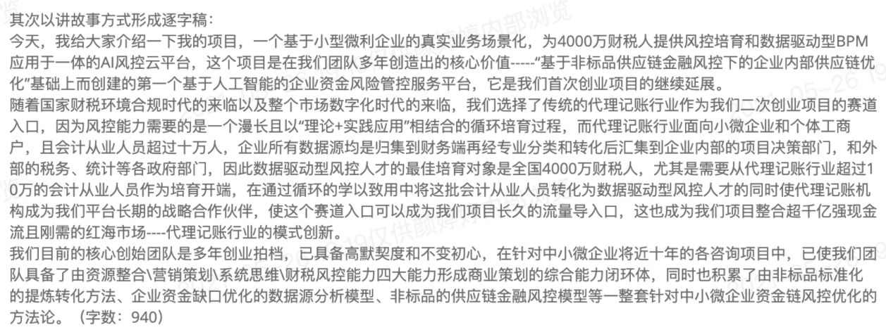
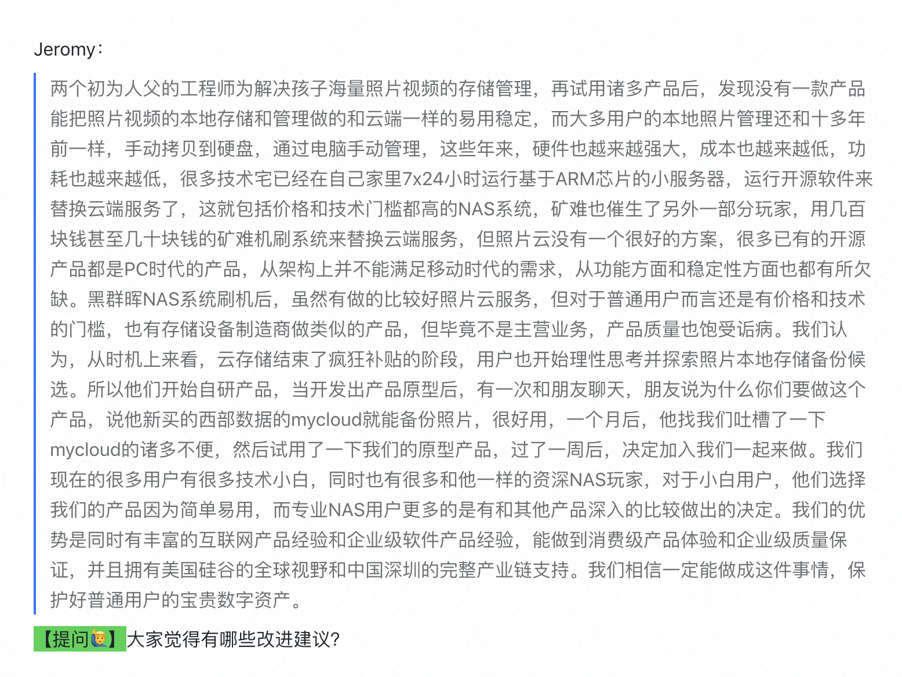
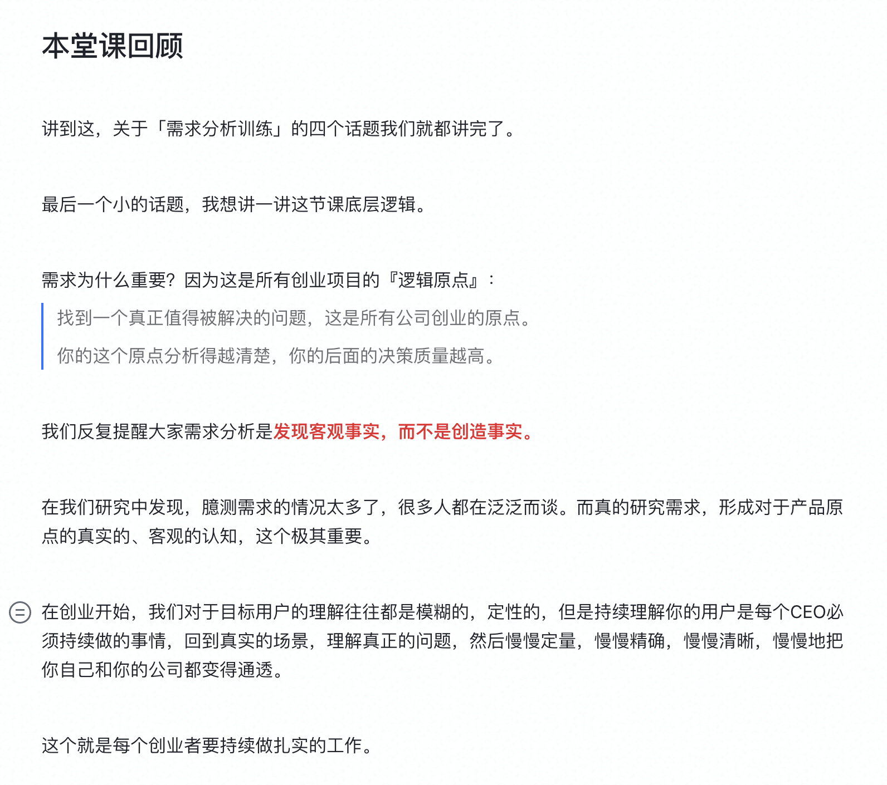
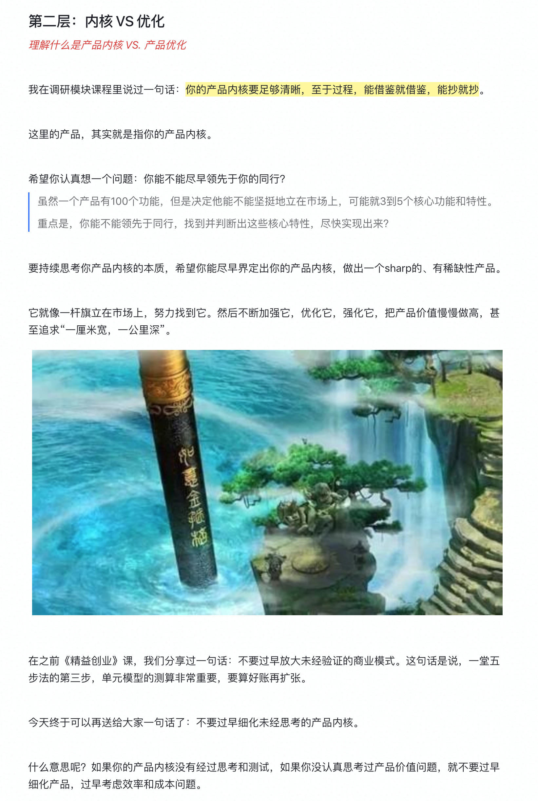
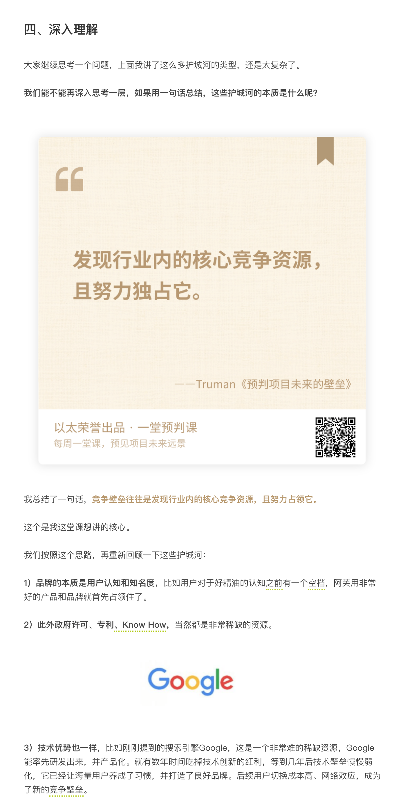
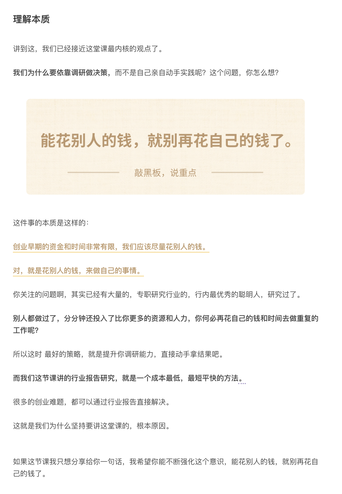
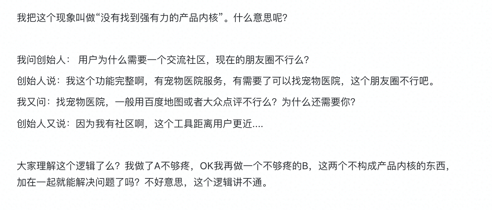
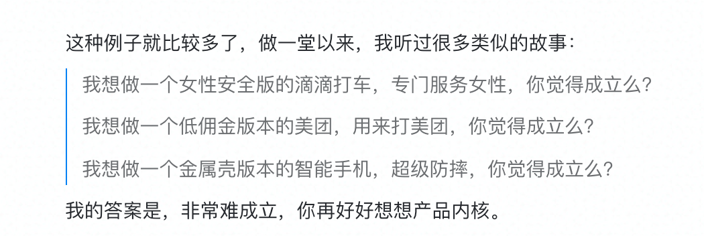
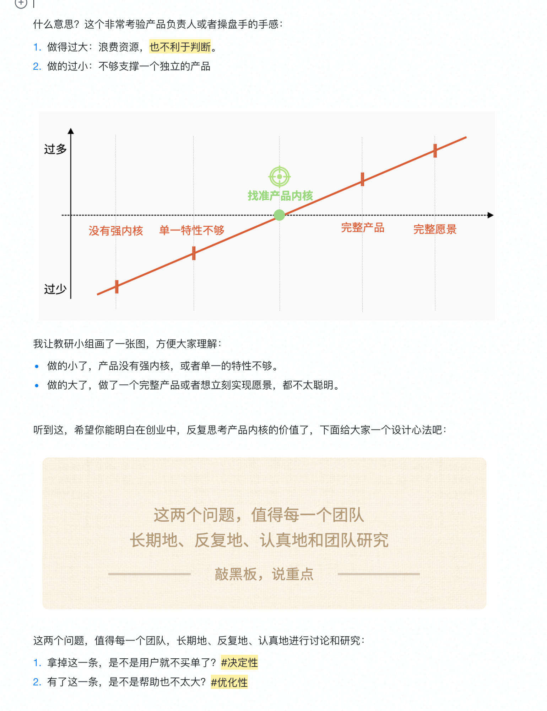

## 实操：逐字稿撰写ABC

再强调一遍，这里只探讨逐字稿写作，我假设演讲的主题、核心内容和大纲都是现成的了，

我们今天讲的，更多是如何提升表达质量。

### 第一步：口语化写作（A）

大家要理解啊，逐字稿不是书面写作，场景完全不一样。

| 口语化写作刻意练习要点 |  |  |
|---|---|---|
| 要点 | 书面化 | 口语化 |
| **策略1：用口语常用词** | 书面语 | 口语化 |
| **策略2：尽量选择短句式** | 复杂长句 | 短句 |
| **策略3：增加语气词/插入语** | 避免 | 丰富 |
| **策略4：照顾的器官不一样** | 照顾眼睛 | 照顾耳朵 |

【刻意练习💡】 练习从"脑->手"到"脑->口->手"的写作模式切换。

> 平时的书面写作，都是脑->手，直接把脑子里想的写出来；而逐字稿需要先说出来。

改逐字稿，需要培养逐字稿的语感。

**【划重点💡】**给大家几个技巧：
1. 你对面坐着一个真实的用户，讲给他听（Eg.得到都很棒）
2. 用嘴写作，说人话（Eg.反面：喜马拉雅很多课）
3. 尽量用短句，避免复杂语法结构的句子（Eg.行业报告调研老版本）
4. 可以安排语气词/插入语/线路图，中途持续上下过渡（context）

【案例】什么叫“口语化表达”呢？举个例子：

> “**单元模型是指你在分析和预测商业模式可行性的时候，选用的一个未来用来复制的商业模式单位**。”

所以怎么改呢？

————

你应该说：“什么叫单元模型呢？很简单，单元模型就是你的一个可以被运营、被复制的商业单元。你未来业务能不能盈利、能不能复制，分析的就是这个模型。”

【划重点💡】Tips：你平时怎么张嘴说话，你就下笔怎么写。

【举一反三🙋‍♂️】还有哪些书面语，要在口语表达中替换掉？

- 因此，似乎，些许，难以接受，以XX的名义
- 列表如下，由以上实验结果可以得出xxxxx结论
- 。。。。

相信我，脑袋里想的和嘴巴里实际说出来的，完全是两码事。

书面语喜欢采用长句子，而我们平时说话大多数是短句子。把长句子变短，就能让语言显得更口语化。

【案例】比如，我在路演里这么介绍一堂，感觉怎么样？

> **2020年独立运营的一堂是国内最务实的创业学习组织和早期创业课程平台，已经有13000位优秀的早期创业者在这个平台上完成选课和学习。**

== 千万不要写一段长到一口气读下去会让人呼吸困难简直想死的长句子

怎么改？

——————

一堂，作为早期创业者的学习平台，在2020年独立运营，是国内最务实的学习组织。已经有13000位创业者，在这里持续选课、持续学习。

【举一反三🙋‍♂️】来来来，练习一下，怎么改：

> 两个初为人父的工程师为解决孩子海量照片视频的存储管理，再试用诸多产品后，发现没有一款产品能把照片视频的本地存储和管理做的和云端一样的易用稳定，而大多用户的本地照片管理还和十多年前一样，手动拷贝到硬盘，通过电脑手动管理

海明威曾说过:“任何一切文章的初稿都是狗屎。"

哈哈哈哈哈，特别认同，你们是没看过我们课程V0.1版本的样子。

### 第二步：提升表达张力（B）

送大家一句话吧：语言的张力，要能配得上你内容的力量

什么叫文字的张力呢，如果听过课程中，你听到这三个版本，你感受一下：
> 5. 版本一：单元模型大家要重视，要认真学。
> 6. 版本二：单元模型是商业模式的工具，一定要重视。
> 7. 版本三：单元模型，是创业早期最重要的商业评估工具。

说人话就是，张力是你表达的强度、吸引人的程度、语言的力量、让人印象深刻的程度。

如何做呢？其实技巧很多，我给大家几个比较普遍，拿来就能用的技巧吧：

第一个技巧：

【划重点💡】早期《罗辑思维》给了一些套路，很好用：

设置认知悬念，形成反常识的感觉：
> 8. **这个事情你以为是这样的，其实是错的，你听我说。**
> 9. **这个事情你以为复杂，其实很简单，你听我说。**
> 10. **这个事情非常重要，你必须得知道，你听我说。**

举一个例子：

> 最后讲一下未来

> 我们想象中的智慧养老模式是怎么样的？

> 相对于市场现状的玩家，我们艾兴最有价值的点，在于具有大范围规模化服务的潜力，前期研发的投入大，但是由于我们人群数量大规模了，可以摊薄成本，同时很多智慧养老的产品其实已经技术成熟了，而他们的痛点在于无差异化，价格太高，获客成本太高，我们通过我们的平台运营模式，结合政府大力宣传和支持，降低成本，使老百姓真正享受到福利，即解决了政府一直很头疼的老龄化问题，又解决了运营商及智慧厂家同质化竞争的格局，我们帮他们创收。

【举一反三🙋‍♂️】来来来，如何设计一个反常识的故事线？
11. XXXXXXXX
12. XXXXXXXXX
13. XXXXXXXXX

好，下面第二个技巧：

做课跟拍电影一样（故事片/悬疑片；有情节有表达力；全程无尿点/按在椅子上）

留有悬念，不要和盘托出。不要一开始就和盘托出，想想看什么样的语言会吸引观众，使他们想要跟你一起踏上旅程。针对不同的观众，要使用不同的语言。把重要的启示留到演讲的中间或末尾是恰当的做法。

激发兴趣。激发兴趣是吸引观众的最简单有效的工具。如果演讲的目标是让观众接受一种思想，那么兴趣就是促使观众积极参与的催化剂。怎样才能激发兴趣？最简单的方式就是提问，但不是随便提问，而是问有趣的问题。

【举一反三🙋‍♂️】大家在一堂的课程里，有没有发现我刻意设置了很多的套路？
14. XXXXXXXXXX
15. XXXXXXXXXXX
16. XXXXXXXXXX
17. XXXXXXXXX

第三个技巧：

升华主题，铺垫到最后，要么挖到本质，要么上升到全世界，最后High点。

第四个技巧：

【划重点💡】一些常用划重点词CheatSheet：
> 18. 强调：特别，一定，务必，非常，非常非常，强调，核心，千万不要，关键
> 19. 规律：背后逻辑，底层思考，本质，深层次原因，思考模型，执行框架
> 20. 疑问：究竟，到底，难道，
> 21. 稀缺：首次，唯一，最，根本，真的，极少，只。

【举一反三🙋‍♂️】来来来，还有哪些我没提到的，可以用来划重点的重点词？
22. XXXXXXXXXX
23. XXXXXXXXXX
24. XXXXXXXXXX

### 第三步：调整语言节奏（C）

终于到第三步了，这一步很多同学都很缺。

要不断重复、不断复述、不断阅读，来寻找语言的节奏。

【案例1💡】我们来欣赏一段我特别喜欢的演讲，大家感受一下她好在哪儿，重点关注一下语言节奏，是怎么控制的？

别的优点不说，我们来重点拆一下她的语言表达节奏：

> 我想请现场的男生去设想或者是回忆一个场景，你的女朋友呢板着脸站在一边，突然就很委屈的哭出来了，你问她什么都不开口的。**宝宝心里苦，但是宝宝不说**。这个时候你心里很慌张，你想不对呀，怎么回事呢?**上个月看中的包我买了呀，昨天的朋友圈我点赞了呀，前天前女友发过来的短信我删掉了的呀**。

> 这个时候她大小姐终于开口了，她说我也不知道为什么，就是没有安全感了。这个时候你的内心是崩溃的，这是她第101次跟你提出安全感的概念。鼓掌的那个哥们，可能你女朋友跟你提了200次。 这个时候男生会很沉默对吧，然后你妹子看你不理她就很慌啊，她就跑到知乎这样的地方去提问。她发了个帖子叫：跟男朋友说没有安全感，男朋友不理我了，姐妹们我该怎么办?在线等，挺急的。

> 这种帖子底下一般评论也不会太多的，但是通常会有一个饱经沧桑的老司机说一句废话，而这句废话被你的妹子视为真理。老司机就说：妹子，安全感不是男朋友给的，安全感是我们自己给自己的呵。这个老司机说的其实没有错，生活中的安全感是我们自己给自己的。**好好工作，会有物质上的安全感，好好学习，才能有期末考试的安全感**，不作死你就不会死，那是爱情的安全感。安全感的本质是我们用自己的努力和生活进行的一场等价交换，但是今天我想说的是一份不基于任何条件，不需要努力，我们往往身在福中而不知福的安全感。

> 今年春天的时候我们学院组织同学去各个国家实地调研，我选择了去位于中东地区的以色列，这个国家多灾多难，但却是国际强国，所以我对它充满了兴趣。有两个细节奠定了我对于这个国家的看法。第一个细节发生在机场。当时我去托运行行李，大家都知道你托运行李一般就是5分钟到10分钟的时间，不会有人问你太多问题，对不对?但是那一天，以色列的安检人员对我进行了长达半个小时的盘问，**你叫什么，姓什么，从哪里来到哪里去，念过什么学校，做过什么工作，去过哪些国家有过什么梦想，写过什么论文，爱过谁国，全部都要问**。我觉得很被冒犯，因为我是一个普通的游客，你为什么要把我当作恐怖分子?这个时候我身边的以色列同学跟我解释，他说这其实是我们以色列航空多年的常态，自从1948年建国以来，我们一直受到国际上各种恐怖势力的袭击，阿拉伯世界至今没有承认我们的国家地位，所以我们只能用这种最保险的但是最笨的方法排查危险。国家太小，袭击太多，我们输不起。

> 第二个细节发生在机舱内，当飞机下降在特拉维夫这座城市的时候，机舱里响起了一阵掌声。我很纳闷，因为整趟行程是非常的安全的，没有任何的气流颠簸，换言之，它是一次常规到不能再常规的安全着陆，在这种情况下鼓掌有意义吗?我的以色列同学又跟我解释，他说，每一趟航班无论是国际航班还是国内航班只要安全着陆，我们就一定会鼓掌!因为我们对于安全有一种执念。二战时期，纳粹对犹太人展开种族屠杀，我们的父辈不是在逃难就是在逃难的途中遇难，从那个时候起我们成为一个没有安全感的民族。所以我们今天所做的一切就是重建安全感。

> 他的话让我意识到不安全感对于一个国家和他的国民而言，是一种怎样的体验。不安全感其实不影响你综合国力的提升，因为不安全感催人奋进，**所以今天的以色列在国防、军事、科技、农业、商业、金融，你能想到的任何领域都是世界强国。**但是这样一种不安全感，一旦渗透进每一个国民他自己的生活中，一旦蔓延进每一个国民他自己的心里，会让人失去一份心安理得。**这份心安理得意味着你不需要向外界去解释你国家存在的正当性，你不需要时刻去提防国土安全，你更不需要担心国破家亡而流落他乡。这份安全感是一个国家给国民最根本的安全感。**生活中的安全感，就像我们开头所说它很多时候是一种等价交换，但是国家层面的安全感，是抛开个人因素不谈，只因享有国民身份，就可以**免受漂泊，免于恐惧。**

> 在美国的时候，我的班上有一个来自叙利亚的同学，当他得知我毕业之后就要回到中国的时候，他跟我说，他说我很羡慕你呀，我的国家长年在内战。虽然在今天我们两个都是在美国的留学生，但是我们各自都还有一个身份，**我的身份叫叙利亚难民，而你的身份叫中国国民**。难民与国民的最大的区别在于，你是否拥有自由选择的权利。**你是否一定要将自己的命运寄托在一个别的国家，寄托在一纸非常冰冷的移民法案**，还是说你可以轻飘飘地讲，世界那么大我想去看看，可是家里这么好，我随时可以回得来。

> 安全感所带来的自由选择的权利，是一个国家赋予年轻人最好的礼物。因为这意味着你不必因为在一个别国的国土上成为一个非常优秀的个体才可以被尊重。你就踏踏实实的做一哪怕普普通通的中国人也会被善待，因为你的背后是一个稳定的国家，而世界对你的国家充满敬畏。

> 在美国读书的时候，我经学在课堂上被我们老师安排，去向大家**解释中国的十三五规划”一带一路”,解释我们刚刚出台的二胎政策又或者是南海冲突**。其实我的语言是有很多瑕疵的，我的观点可能也很平凡，但是这样的我能在课堂上永远有一丝话语权，那是因为他们觉得中国很重要，所以中国学生的话一定要听。

> 一百多年前。梁启超曾经说，今日之责任不在他人而全在我少年，少年强则中国强。一百年后的今天，其实道理反过来也一样，**中国强则少年强，中国强则中国少年强。**

> 因为一个强大的国家会赋予一个少年强大的安全感。基于安全感，他可以自由的选择他想生活的地点职业状态乃至是心情。因为他是轻装上阵去看这个世界又理直气壮的回到自己的家园。有一句话是这样讲的，**如果你觉得你活很舒服，那是因为有很多人在默默的为你付出。如果你觉得很安全，那是有很多人在为你承担风险**。他们是边疆官兵，维和部队，外交官，公共服务的各行各业……在为你和我更强的安全感在不懈努力。

> 但即便不懈努力如他们，我们国家还是有很多不完美的地方，我们也有自己的不安全感。所以在这个意义上，今日中国固然强，但今日之中国少年唯有更强。因为只有这样我们才能骄傲的回应，一百多年前梁启超先生的期盼，告诉他说，**少年强则国强，中国强则中国少年更强，中国强就是因为少年强。**

【划重点💡】给大家一些思考建议吧：
25. 寻找押韵的节奏（写逐字稿不是顺手，而是顺口）
26. 适当形成对仗、排比，寻找文字韵律（寻找AA，ABABAB，AAAB）

逐字稿是你的，要符合你口语表达的习惯，是一个『优秀口才』的你。

【案例2💡】看时间，要不要现场拆一节课，是一堂我讲的次数最多的一堂课。

最近一期复盘营文稿：