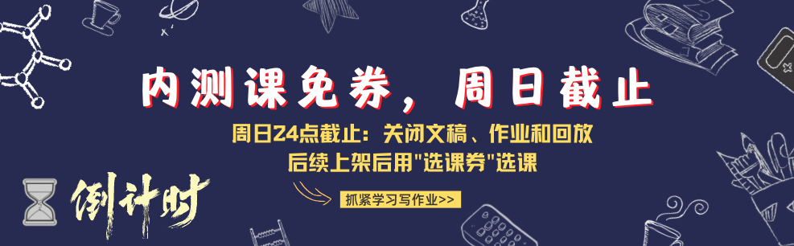

## 总结和回顾

好了，今天这个课终于讲完了，大家感觉怎么样？

今天如果总结一下，希望你记住三句话：
1. 公开讲课和演讲，是可以练习的，顶尖很难，但合格容易。
2. 逐字稿可以让你脱胎换骨，但是也不要盲目迷信，只是个工具。
3. 光听课没用，去写作业，去参加DemoDay，去准备从0到1，实践才有价值。

感谢大家报名这次的新课内测，大家抓紧写作业，我们下周不见不散~~~

### 评选MVP

【MVP🎁】来来来，这一期有没有MVP？

【结束签到🙋‍♂️】好啦，最后签个到吧，大家周末愉快~~~~~