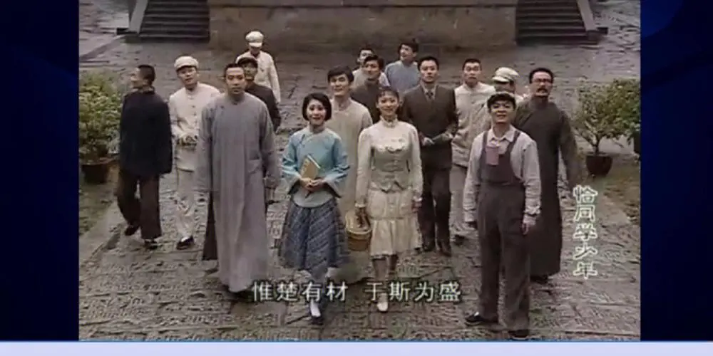

## 唤醒体感：我的红点故事

作为一个初步有了**一点点**结果的人，大家听了我很多课程了，也对一堂的过往和未来有了基础了解，你们觉得，我之所以能做成这件事，我最最最最擅长or稀缺的一个能力/素质是什么？

————

这些年，在直播间，我听到过很多感谢和谬赞，比如：聪明，情商高，自律，学习能力强，善建模，事业心强等等。

但我个人觉得，这些都不是，甚至这里面多数都是我**自己认为自己的缺点**，是我一直在补的短板。

我其实最喜欢的一个答案是：**Truman是一个对于非常长期有笃定的人，是一个知道未来想要什么东西的人。**

至于上面这些，在我看来，皆是手段。

这不是凡尔赛，也不是谦虚，你们知道，我内心是一个挺骄傲的人，今天这个结束，你会知道我为什么会这么讲。

考虑到有些同学刚加入一堂，或者没有完整听过《我用一堂做一堂》，对我了解不够多，为了避免断片儿，我先讲讲大的背景吧。

每个人都有自己的擅长和短板，我也有一堆长板和毛病，但和我共事比较久的人，或者一堂内部的员工，或者聊的比较多的学员，往往对我有一个评价：**我有长期追求。**

的确，这是我**特别特别特别在乎**的东西，我希望我的职业目标是相对清晰的（而不盲目），我希望我的路径是相对循序渐进挑战的（而不推翻），我希望我的每一天，每一次重要决策，都在积累我的核心能力（而不平庸）。

之前我和合伙人复盘，包括和LIMING（家庭教育专家）聊我的思考习惯，发现的确我有三个很特别的东西：

**第一个，工作经验没有大块浪费。**

我毕业后，每年的工作，都在累加工作经验，没有大块的浪费，而且我基本上就是3-5个核心能力，10-20个核心套路，一直持续迭代，一直重复、常年迭代出复利。

每个能力迭代练习几百上千次，3-5年以后，基本上就超过市场上绝大多数人了，是不是这种工作方式很奇怪？

**第二个，每5-10年维度，有里程碑计划。**

就像『五年计划』一样，我会有N个五年计划的里程碑，越来越难，越来越有挑战，但我会要求自己一步步爬上去，是不是挺奇怪？

**第三步，敢于非常大胆提出宏大的愿景。**

提出了一些非常宏大的愿景，比如建学科，科学创业，教育普惠等等，虽然非常模糊且宏伟，但竟然看上去有机会完成，甚至有一群人愿意一起来见证、推动实现，是不是也挺奇怪？

这三个，的确是身边人很多人羡慕的地方，包括一些非常NB教育背景的同事，包括一些富二代，包括一些已经一定程度成功过的同行。

**这三个，的确是我非常非常在乎，几乎是我这个人，所有决策里面，几乎最不愿意凑合，不愿意妥协的决策。**

它比我任何一次设计产品，一次转型，一次换工作/换领域，一次创业，都要重要得多得多得多。

我是怎么慢慢变成现在的样子了呢？

讲完整的人生红点之前，我先分享一下我们收集到的一些困扰，这些困扰，有些来自于内部同学的困扰，有些来自于零碎的评论区和作业。

**我们找到了一大堆困扰和痛点：**
1. 在长期和终局上花的时间和决心，少得可怜。
2. 很多人穷其一生，做了所有事情，却没思考过终局。
3. 缺少人逼着你思考一遍，没有机会勇敢直面自己的内心。
4. 非常拧巴，做的事情，不是自己内心最想要的事情。
5. 见过很多人，我做过一个比喻：一辆大巴，接着一辆大巴，最好的年华就过去了。
6. 最怕的是明明想做A，因为什么原因吧，一直就没有积累。
7. 左走一下，右走一下，浪费了很多经验，你们积累的，每年积累的，可能都不是一个东西。
8. 很多人的职业，可能都会断掉。

好啦，铺垫够了，开始进入今天的案例故事环节。

先用我在ROI训战营上的一张图，简单看一下我的经历：

工作了12年，我形成了一系列的做事准则：最佳实践，刻意练习，顶层设计，目标导向等等。

我也练了一大堆能力，ROI，萃取，做课，做产品，讲课，咨询，提炼模型等等。

磨课时候大家都很好奇，这些是怎么形成的，我最早能追溯到什么年龄，偶遇了什么，纠结了什么，看了什么作品和对标，如何挣扎变成了现在的样子。

ok，那今天的第一个重点，我给大家完整回顾一下我的故事，大家可以代入我的视角，感受一个跟平时不一样的我。

大家重点体会三个东西：
1. 我遭遇了哪些纠结，是如何想清楚，一步步自洽的？
2. 如果是你，代入我的角色，你会怎么做？能有一样的结果吗？
3. 这些人生卡点，我的解题思路，和一堂已有课程相关性？你能看出几节课？

我发现，我最早的改变，其实是从中学读书开始的。

### 第一阶段：读书阶段

我常常不喜欢讲原生家庭和出身，简单一句话，我就是一个非常非常普遍的家庭的一个非常普通的孩子：北京远郊，城边农村，上有一姐，打小听话。

小学初中因为学校比较普通，成绩一直不错，一直在年级top3内，但其实并没多好，只是环境衬托。

这些都不重要，回到课题，我能追溯影响我人生价值的第一个大的拐点，是有一次初中的一个非常意外的思考：

我印象很深，大概初三，我骑车回家的路上，我一般会放空，无聊，瞎想，然后我突然意识到一个问题：**我有一天会死啊。**

你知道这个念头，对于一个平常初中生来说，有多么的恐怖和失控，我突然意识到一个可怕的问题：**我的存在没有意义啊。**

不管是我活到99岁，还是今天骑车就被大卡车xx；不管是我多么开心，幸福，还是焦虑，失败；不管我这次中考考了全区第一，还是名落孙山；随着人的消失，记忆磨灭，这都没有意义啊。

我看着路边的蚂蚁洞，觉得：**站在生物角度来看，我和他们并没有本质区别啊，只是一粒尘埃，一个生物样本而已啊。**

而且最恐怖的是，我发现，身边的人，绝大多数人穷其一生，可能都没有抬头看过天，哪怕一次。

作为一个思考能力只有初中水平的人来说，打开了一个这样的课题，就很恐怖了，突然觉得眼前的一次次考试，没啥大意义了。

**【代入🙋‍♂️】**你们曾经有过这种困扰吗？如果换做是你们，你们在当时的情况下，可能会怎么做？

——————

于是从初中开始，我开始跟自己和解，我开始努力抬头看天，哈哈，这是一个比喻，也是一个真实的画面：**在北京空气最好的区(县)，几乎每天都是繁星。**

那个时候的我，迷迷糊糊地觉得，考试不太重要，未来得成为一个厉害的人，成为一个有理想的人。

哈哈哈哈，中二少年的自我探索之旅开始了：

初三开始，我开始接触"**上台讲课**"，发现讲得还不错，觉得以后要是能当个厉害的老师，教书育人也不错。

我读了一些小说，就想成为一个『**作家**』，还真写了两个短篇，hh，后来因为和语文老师的矛盾，放弃了。

上高中，我姐夫送了我一本**《爱因斯坦传》**，我靠，这才是有价值的人生，我想学物理，做物理学家。

后来学了生物，觉得物理还是有点枯燥和寂寞，**生物**迭代多快，大量实验短平快就能拿到答案，我想学生物，做生物学家。

后来捣鼓家里电脑，接触到了**《大众软件》**，觉得这是趋势啊，做一个厉害的IT高手也不错。

那时候，还提前接触了很多同龄人很少接触的内容：凤凰卫视，政治观点，名人幕后，历史还原等等。

......

一个郊区的中二少年，在身边人都在熬作业写卷子的时候，就已经瞎琢磨了，在他仅仅有限的视野里，把身边能想到的美好人生都意淫了一遍，哈哈哈。

大概告一段落，为了故事尽量还原完整，诶，我讲完吧：

高中区重点重点班，入学成绩不错，因为姐/姐夫的榜样，的确奔着清北去的，但这三年，因为一系列的兴趣驱动、学习分心、至亲离世、父母矛盾、高考心态等等一系列debuff的加成下，高考很差。

整个高三，尤其是高考以后，出了成绩，整个人非常丧和低沉，想不明白，做不明白，没成就感。

就在2008年北京奥运会的那个夏天，就在我最阴霾的那个阶段，不得不提到一个对我影响巨大的作品。

当年我高考失利，非常非常丧，犹豫是复读还是算了，惶恐是不是这辈子就完了，我看了一部剧：**《恰同学少年》**

这部剧有同学完整看过吗？

这部剧是一个历史传记风格的电视剧，描述的是教员在我当时那个年龄段的所遇、所思、所想、所做。

我从头到尾，一集一集一遍遍看，看了大概两三遍，看到了他的教育试错，看到了他遇到了名师，遇到了人生追求，遇到了同志，敢于思考救中国，不断探究答案的过程，然后非常鼓舞。

一个小地方的师范学校（甚至还不是清北这样有名的大学），一群学生就能如此忧国忧民，不断探究拯救中国之道，实在是颠覆我的认知。

基本上，靠着这个作品，中二少年又满血复活了，而且更勇敢了：除了那一次考试和一摞卷子，我们凭什么不能拥有厉害的人生，我们凭什么不能立志改变世界？

当然这个剧还有一些细节，对我做事影响很大，比如：先博后渊，闹市学英语，二十八画生征友等等。

> 题外话：这个剧我推荐过一些人，在人生迷茫期，可以静下心来试试看，能不能找到一些力量。

最终觉得一年时间还是很宝贵，没有选择复读，调剂去了北京一个非常普通的一本学校，本着一个IT工程师高手的愿望，进入了计算机专业。

然后大学入学，因为学校一般和同学衬托，到了后半程，一直在年级top5-10%，慢慢恢复了一些信心。

ok，第一阶段的故事就到这里了，一句话总结：**我的确在中学时代，就开始纠结"为什么而活"这种哲学问题，但当初的我，完全没办法想清楚，控制住这么宏大且艰难的命题。**

但是我身体里**"不甘"+"勇敢"**的种子，最早的确是那个时候种下的。

时间来到2013年，学计算机，毕业写了一年代码(非常入门)，后来发现，相对于『代码实现』，我更喜欢更前端的『设计创造』，我希望通过创造产品来改变一些事情。

于是进入大公司，上市前后的去哪儿网，转行做了产品经理。

### 第二阶段：产品经理第一年

当时不觉得，后来多年后我才意识到，我真的是运气好，2013年的去哪儿网，从产品素质和奋斗精神来说，应该说是整个北京Top3优秀的团队，正是临近上市期，赶超携程的关键阶段。

那时候的PM还没那么满大街都是，当时去哪儿带我们的Leader们，基本都是当年早期百度的一些优秀的PM。

刚入职的前一个季度，作为一个靠自学成才的野路子PM，瞬间觉得自己完全不适，觉得自己原来一直在『业余裸奔』。

**在去哪儿，他们有着非常专业，甚至近乎严苛的产品管理：**
1. 极度明确的目标驱动：没目标，就不谈任何事情。
2. 明确的ROI分析：分析不清楚ROI，就推不动事情。
3. 业务管理三段论：**目标，路径，关键资源。**
4. 方案设计三段论：背景、目标、关键路径。

我入职就做了一个大方案，整个社区重构改版，因为无法梳理清楚业务逻辑，算不清楚ROI，就一遍遍被打回，重改，打回，重改。

终于经过了2-3个季度的磨合，我慢慢入门了，开始掌握科学的产品方案设计和ROI决策框架，基本能和+1+2级别平等对话了。

然后又是有一天，不知道又是哪根筋搭错了，可能也是在马路边放空，无聊，看天，瞎想，我又意识到一个非常可怕的问题：

**我的人生ROI是什么啊？！！**

科学决策ROI告诉我们：**我们要目标导向，有了目标和价值，就可以评估ROI，可以配置资源和路径了。**

那我的人生目标是什么呢？我的每一天工作，意义是什么呢？

学生时代，我可以说我为了考试，为了毕业，但是工作以后，我有40年工作时间，我又是为了什么呢？

我在一些小的决策上，ROI算的很好，但最大的人生决策，ROI竟然是模糊和错乱的...

如果没有目标，那眼下的ROI，眼下的决策怎么分析呢？我要呆在这家公司吗？我要做这个大项目啊？我要结婚吗？我要做PM吗？我要待在旅行行业吗？

瞬间陷入了和初三（2004年）同样的痛苦中。

**【代入🙋‍♂️】**你们曾经有过这种困扰吗？如果换做是你们，你们在当时的情况下，可能会怎么做？

————

这一次，我比中学时候能力强多了，毕竟我身边有非常多的人，前辈，我会用知识管理工具了，我也会用搜索引擎了，于是我开始动手各种拿信息：

我看《乔布斯传》《富兰克林传》，去看当时各种产品高手，周鸿祎，王兴等等。

我去问身边的人，一些非常优秀&亲近的人：**你活着的意义是什么?**

原来真的会人跟我认真说：**朝闻道，夕死可矣**，我想学习和了解这个领域背后的原理和真相。

也有人会跟我说：我想成为一个厉害的大学教授，希望可以在这个领域成为厉害的学者。

有人跟我说，我就是想把地球当成一个大乐园，我想看遍这个世界，我想拥有最丰富多样的人生经验。

也有人跟我说：我就是想踏踏实实赚钱，买房买车，然后换房换车，然后，买别墅，换最好的车。

....

那三个月，我一直在吸收信息，尝试消化，**自洽**，用我ROI的专业能力来说服自己，一直不行，一直不行，陷入到深深的自我怀疑里。

甚至有那么几周，我感觉我随时会离职，随时会换行业，换城市，甚至分手，重启人生。

在这个阶段，我断断续续想清楚了两个东西：

第一个东西：

有一次陪家属逛街，大家应该能体会那种无聊的状态吧哈哈，于是我开始看各种商场的商品设计，突然想到了一句话：

**"To Know and To Be Best"**

> 或许有语病，但真的是这句话

我意识到，既然我寻求意义，既然我想做产品，同样是学习，同样是做事，为什么不去追求学习和成为最好的呢？

几年以后，为了教学，我才管这个东西叫做"**最佳实践**"，但是当初我已经模模糊糊在开始研究和拆解最好作品了。

第二个东西：

我做产品经理以后，就非常幸福和有成就感，这大概率是我非常长期的工作方向了。但是单一公司，单一岗位，还是太具体了，未来很难稳定和迁移啊。

我开了一篇笔记：**产品经理的本质是什么？**

我找了很多人的定义：

- 有人说得很具体：产品经理就是写产品方案的。
- 有人说得很美好：“让正确的事情相继发生”

我大概总结了一句话：通过创新，发掘产品新价值。

当我意识到这两个东西以后，慢慢开始想清楚了，我送给了自己一句话，我的人生意义是：

这么一个非常朴素的话，瞬间让那个时候的我笃定下来，我要以产品能力为核心手段，去学习最佳实践，未来有机会做出自己的的产品。

就像是一个东倒西歪的不倒翁，因为这句话，突然就稳定下来了，有了这句话，我开始跟自己自洽了：

- **意义：做属于自己有价值的产品。**
- **路径：最佳实践，卓越的产品能力。**

从这个阶段起，我开始大量找项目，增加我的产品设计机会，也就是从这个时候开始，我在心里喊一个口号**《像做产品一样做XX》**，比如婚礼，做课，写文章，深度旅行，求职，简历，面试，盖房子，装修，写脚本等等。

这个阶段，也推荐一部电影吧：《三傻大闹宝莱坞》，应该很多人都看过吧？这是一部被电影名字耽误的好电影。

这部电影给了我比较稳定的价值观：我是追求钱，还是追求产品价值？哪个是目的，哪个是手段？

从那时候到现在，我就一直很稳定了，我在乎钱，但赚钱不是最终目的，只是衡量我做事价值的维度之一而已。

在后面的一年多时间里，因为完成了**目标-能力**的自洽，我完成了第一次飞跃，像换了一个人一样：**公司项目很好，还在积累我的能力，还有人带，让我成长还给我开工资，真的是......**

于是从那个时候开始，一直到现在，就一直保持非常亢奋的加班状态，因为目标明确了，我希望用工作强度来不断缩短成长时间。

甚至后面不止一个人跟我说，那一片人的加班氛围，都是被我带动起来的，诶...hh

这一次的自洽，带来了一年多的踏踏实实成长，而且《三傻》的台词没有骗人，随着能力快速提升，一次次升职加薪，会随之而来的。

通常，故事到这里，拐点又要出现了。

### 第三阶段：我的美团阶段

因为项目机会的问题，我在两年后去了当时认为平替的公司：**美团。**同样的路线，同样的目标，同样的做事风格，同样的加班。

当时在一次美团的会上，不记得哪个老板，因为什么事情，就顺带着讲了讲一个思考方式，就随笔画了一个图：

> 曲线a：各种转圈；曲线b：大致清晰，跌跌撞撞；曲线c：努力想透，努力拉直。

他说：**商业预判**（PMF/单元模型/规模经济）其实还相对容易，但**人生预判**就难太多了，因为它极度非标和开放，而且横跨几十年，但是很可悲，绝大多数有事业心，渴望成事的人，都在路上迷失了，大量的选择和工作经验都被浪费掉了。

而作为一个有长期追求的人，我们应该努力追求那"**一条直线**"。

> 注意：真正的直线极难实现，我说的是"追求"。

不知道算是运气好，还是运气差，两年的时间，又一次把我的自洽和平衡打破，不倒翁又开始疯狂晃动了：是啊，我的具体红点是什么？我的路径是什么？我现在的工作和项目，真的是**最短路径**吗？

之前的人生意义太模糊了，三五年也行，三五十年也行，根本没有任何计划性和里程碑，而且并不能有效指导工作。

**【代入🙋‍♂️】**你们曾经有过这种困扰吗？如果换做是你们，你们在当时的情况下，可能会怎么做？

————

于是，我开始努力去思考，调研，去具象我的红点：

什么叫产品创新呢？太大了。

我那个时候看了很多身边的案例，发现无论如何，绕不过"**创业**"这两个字，这是一个必经之路。

我看了很多方向，金融，o2o，消费，最后发现教育大概率是我的『应许之地』：市场足够大，足够陈旧，产品有广阔的创新机会，产品有机会驱动创业，而且我打小就考虑当老师，也不错。

于是就规划了一个非常典型的路径：**产品经理 - 新业务负责人 - 创业者 - 投资人 - 自由创造者。**

初步觉得想创业，想做教育，但对于创业公司完全不懂啊，于是开始业余时间，主动做了很多课外项目（Site Project）：

- 做咨询：帮一个B轮公司梳理产品结构；
- 做方案：帮助一个从0到1的APP写PRD；
- 做课程：去一个线下产品经理培训机构刻意练习了100个小时。

有半年时间，我大概除了睡眠，全部都在做各个项目，公司2-3个大项目，周末2-3个项目，很累，但是觉得很值得。

虽然感觉很累，但是我一直在问自己：**足够直线吗？**这个路径是最短的吗？最直接的方式是什么？

于是除了具象红点，我开始努力去具象我的实现路径：

2015年，我大概26岁，我觉得自己大概率30岁左右会创业，需要成为一个相对靠谱、有机会做成的创业者。

四年的时间怎么用呢？凭借我当时的观察，我发现我缺4张牌：
1. 高阶的商业分析能力。
2. 从0到1做成新业务的能力。
3. 复杂的团队管理能力。
4. 创业资源和认知筹备。

当我找到了路径以后，悲观地发现：**课外项目还能有些积累，但我的美团的工作，几乎没什么直接帮助。**

3年多的DDL就一直在倒计时，而我发现这个目标很难完成，于是我果断提了离职，继续下一份工作。

面了阿里和以太，阿里offer高了将近一倍，但我和周子敬聊完（短平快，就这4点），果断加入了以太，开始继续攒我的牌。

前两段都推荐影视了，这里也有一个小插曲：我家属刚入职一个类外企，需要英文名字，想了一晚上都不满意，我就一边查，一边翻看，于是发现了一个很好的名字：Truman，哈哈哈哈。

这个电影和我的中文名字，人生红点都相得益彰，而且国内用的人极少，于是，哈哈哈，就一直用到了今天。

故事讲到这，大家感觉如何？能不能感觉到我的人生红点和成长在明显提速？

但说是实话，现在回顾，我现在目前90%的能力和认知，都是在下一个阶段，第四阶段锻炼出来的。

### 第四阶段：以太和一堂阶段

我跟大家讲过，我受美团影响很深，但不是在美团的那两年，而是以太的这些年，我以太的Leader是当年美团外卖的某个新业务一号位（跟王慧文汇报），而且以太一大批都是美团内推过来的。

2016到2018年，我完成了从产品经理到新业务负责人最难的跨越，约等于你们在一堂听课，学习的过程。

**【实话🙋‍♂️】**大家觉得，把一堂业务板块的课听明白，基本会用，难么？

————

你们学的还是成品的课，是现成的美食，我当年更难，我是从地里一下一下的刨地，一点点把菜刨出来，再做成饭吃下去。

在一堂，我见过非常多同学，觉得一堂的课太硬太难了，就中途放弃了。而当年的我，遇到的课题跟你们一样，还没有现成的课，我只能在自己的笔记本里，建了一个《爬坡笔记》，硬咬着牙往下学。

因为人生红点是追求，**唯一最短的道路就是往往最难的。**

我硬是从一个个项目里，自学学会了一堆业务逻辑：单元模型，产品内核，精益创业，需求驱动，规模经济，品牌，壁垒，增长驱动因素等等。

如果你听了周子敬的《我用一堂拆以太》和我的《我用一堂做一堂123456》，你应该能把故事接得上了。

作为今天《人生红点》的主题，我想讲讲这个阶段，对于我人生红点影响最大的三个进步：

**进步一：关于高手成长。**

刚入职以太，遇到了各种名校、海龟和顶级大厂同事，身边充斥着**"聪明"，"情商"**这种评价，动不动就是：这个人不够聪明，offer算了吧。

刚入职前三个月，搞得我很自卑，我既不聪明，又不在意情商，我怎么在这家公司混下去？

后来遇到了那本书《刻意练习》，惊为天人，突然觉得好像这才是解锁的正确姿势，我开始去调研、观察和分析各种高手案例，从打牌，到投篮，到做数据分析，到张嘴接豆子，发现都是一致的。

所以我简化了一点，有了自己的版本：

- 刻意：有强目标感，追求成为专家。
- 练习：套路、非舒适区、大量重复、反馈。

然后我把自己现在和未来N年的发展和兴趣，拆成一个刻意练习题目，凑够四个要素，然后一直大量重复。

**进步二：关于底层思考。**

在这个阶段，我发现要处理的信息太多了：不同行业，模式，各种项目，各种方案、各种人......

有没有可能，做一轮大幅的化简，掌握一套底层逻辑，以不变应万变呢？于是，和身边的同事一起，被迫着深入底层逻辑，寻找共性。

比如，我们看了大量的在线教育项目，总结出了教育的本质公式；

比如，我们讨论补贴的本质逻辑，看到了各种场景的错位和失误；

比如，我们开始思考品牌的本质，讨论发挥作用的具体价值。

随着一轮轮思考底层的方法论，甚至本质，大幅化简了我们思考和做事的套路，事情变得越来越简单了。

**进步三：开始独立建模。**

也正是在这个阶段，我发现原有的知识模型不够用了，我开始尝试自己建模，总结方法论，SOP，清单和模板。

最早你们看到的一堂五步法，融资公式等等，都是那个时候总结出来的。

然后4年后，就变成了这两张地图：

后面的故事我就不讲了，大家很熟悉了，我开始创立一堂，开始用团队的力量做教育，开始搭建学习型组织，把我的人生红点和公司的使命，慢慢融为一体......

我们希望在教育这个领域做产品创新，希望推动科学创业，把创业打造成一个学科。

然后这个红点和使命感召了越来越多的人，有15个同学加入一堂公司，有超过200+同学参与做课，有超过4000+同学参与共建一堂......

从一个人的红点，变成了一个集体的使命；

从一个人的成长，变成了一个公司的基本功；

从一个人的意义，变成了一个团队的团队文化；

故事讲完了，大家能感受到人生红点的价值了么？

好啦，故事讲完了，我用一个非常细颗粒度的方式，给你们回忆了我一步步纠结，痛苦、又自洽的过程，大家感受到人生红点的价值了吗？

也感受到了我从一个中二少年，到高中颓废高考失利，再到职场一步步重新加速，现在重回名校同学圈子，甚至发展并不太逊色的故事。

下面，总结一下我的人生红点：

### 我的人生红点

**其实，人生红点到底是追求什么？就是不断发掘内心的渴望，一步步探索和自洽，寻找到确定性。**

什么叫确定性？目标，行业，能力，资源都行，要拥有可以稳定积累，不断复利叠加上去的确定性。

这个大概就是我目前的人生红点（阶段性）答案：

**∴ 我的人生红点：**
1. **最大的选择：作品型，**我希望N年后，还有人因为我存在过而受益。
2. **最大的路径：产品创新**，从PM到新业务到CEO到泛创新。
3. **训练的能力：教育，泛产品设计，体系建模，刻意练习**。

这就是我的红点，我的直线，我的积累，核心其实就是这句话：

我曾经纠结过几次，每次都是辗转反侧，无限焦虑，大量调研，思考，整理，然后才能让自己自洽化。

我职业生涯上这1%的时间投入，换来的是99%时间的更加笔直，成倍地增加长期的做事ROI。

**【划重点💡】总结一下，拥有人生红点的价值：**
1. **热情积极：**在实现自己认可的东西，为自己而工作，内心充盈，不拧巴。
2. **最短路径：**你的职业、项目、生活方式选择，都会直达红点，不浪费大块的工作经验。
3. **内心笃定：**会很安心，每一次决策，每一个选择，每一年都在实现它，不担心推翻。
4. **敢于挑战：**不设限思考，敢于设定超级难题，并且大家相信，并且愿意跟你一起干。

Ok，我个人的故事就讲完了，大家初步感受到了红点的价值了么？
