## 认识红点：从理念到工具

这次我们看了超过2000+份作业，发现大量同学跟我有曾经类似的经历，当然有些人和我一样，比较幸运，尽早找到了自己的红点，但是多数人都还在不断思考、不断挣扎的过程中。

### 我聊过很多同学

在面对一些合伙人/业务负责人/教研的岗位时，为了更好地了解对方，评估匹配，往往MBTI啊，DISC啊，都不够好用，我往往都会用人生红点来讨论一轮。

但我往往发现，几乎所有人在人生红点问题上，意识、能力和花的时间都远远不够。

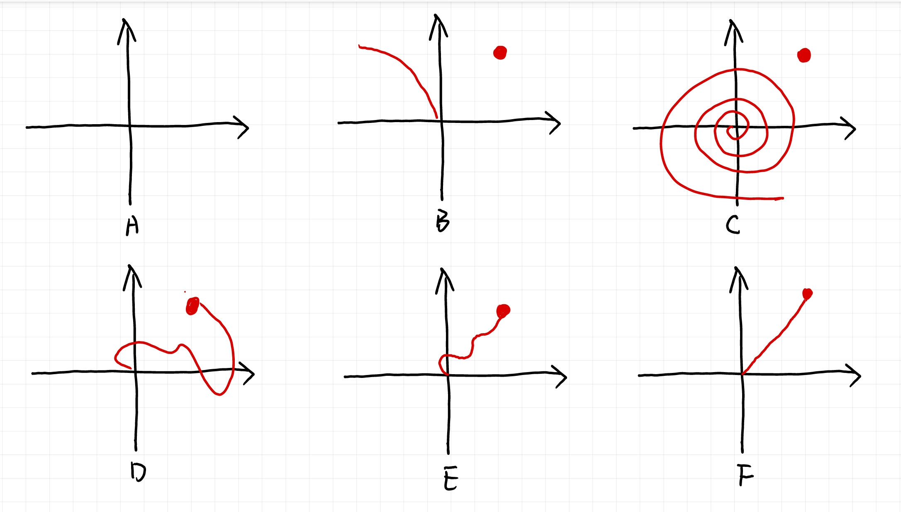

而且非常典型的是，往往很多人工作了多年，发现很多时间、工作经验都被浪费了。

**典型同学1：M同学**

M同学有极好的教育背景，国内top5+藤校，内心是骄傲且有追求的，但做的决策每次都不一样，一直是一趟车又一趟车地换，遇到学习机会就上，遇到创业机会就上，遇到赚钱机会就上。

本科毕业15年了，在中国和美国做了很多事情，赚过几百万，也赔过几百万，但内心最想要的东西，却积累的很少，一直拧巴着。

平时总是在匆忙赶路，在夜深人静的时候，在机场等飞机的时候，在一个人陪着内心的时候，对自己非常的不满。

我给过他一个机会，让他来一堂Gap一段时间，我带他感受一下不一样的人生红点，以及不拧巴究竟是怎么跟自己和解的，希望他未来能跟自己和解吧。

**典型同学2：L同学**

读书时学的是新闻专业，有过新闻理想，希望用文字传播信息，让世界更进步。但毕业去了街道小报纸，理想很快就被一篇篇"社区小文儿"磨灭了，感觉就这样吧，于是开始换大行业，转运营，转内容，转直播。

兜兜转转好多年，虽有不甘，但不得不忘记自己的"追求"了。

当我聊起之前的理想，我讲了一段关于新闻理想的话：

> 有新闻理想的人往往会觉得世界上的信息是不流通的：

> 觉得那些贫穷弱势群体面对的不公需要被政府看见；

> 觉得那些社会的阴暗丑恶就应该被揭露；

> 觉得那些光辉美好的人事物值得被看见被表扬；

> 这些时代的流沙都是应该被沉淀在时代的洪流里的;

> ......

她瞬间被我说哭了，内心还是渴望的，但是感觉这辈子求而不得了。

我和她讲：是你看的太表层了。新闻理想就是传统媒体吗？做传播就只是做新闻吗？

如果因为你的存在：
1. 那些最好的商业案例，被大众看见；
2. 那些最真实的商业细节，被开源共享；
3. 那些最痛苦的商业失败，被大众学习;

这些不也是你最初的追求吗？

嗯，她现在在负责一堂的项目库，很多同学的访谈，就是她做的。

**典型同学3：C同学**

这个同学也很典型，她很想做教育，而且热爱教育，希望这辈子可以推动教育创新，有机会改变教育的模式。

这是一个极好的人生红点感召，她这些年，自己创过业，跟知名KOL做过知识付费课，在头部知名商学院做过封装课。

面试时，我就问了一个问题：如果你想达成你的人生红点，这些工作经验真的有帮助吗？你想没想过，最短路径是什么？

很可惜，她的长期目标，倒拆回来，很多工作经验都是不直接有贡献的。

她有目标，甚至有非常大的人生使命感，但一直模模糊糊在推进，没有拆解里程碑，没有关键路径，没有积累复利，浪费了不少年华。

对了，她现在也在一堂教研，跟我学习做课，一起探索教育创业的内核和边界。

最近几年，我明确了红点以后，大概遇到了50+各种红点困扰，也1v1聊了不少人，怎么帮大家来锁定人生红点呢？

我过去也接触过一些测评工具：性格测试，心理测试，价值观测试，优势测试等等，这些都是一些围绕眼下现状的分析，或者相对于某些特定场景的分析。

我们在磨课过程中，找到了非常多工具： 
> 1. **DISC**：分成D-指挥者、I-影响者、S-支持者、C-思考者来辅助组织分工和管理。
> 2. **罗克奇价值观调查表**：列出了世界和平、自由、平等、幸福等18项终极价值观和雄心壮志、勇敢、正直、自律等18项工具价值观。
> 3. **施瓦茨价值观量表**：主要包括自我超越、自我提高、保守和对变化开放态度的4个维度，以及10个普遍的价值观动机类型。
> 4. **盖洛普优势**：涵盖了执行力、影响力、关系建立和战略思维4个领域的34种才能，帮助识别天赋优势。
> 5. **大五人格**：将人的性格特质归纳为5个维度，分别是开放性、神经质、外倾性、宜人性和尽责性。
> 6. **MBTI**：包括了注意力方向、认知方式、判断方式、生活方式4个维度，组成了16种性格类型。
> 7. **性格色彩**：分为红色-快乐动机、蓝色-完美动机、黄色-成就动机、绿色-稳定动机。
> 8. ......

这次访谈了一些同学，发现这些工具的确有效，但更局限在一些眼下的、局部的、具体的决策上。而面对人生终局课题，几十年的路径规划问题，这些工具就显得有些具体了。

人生红点，不是眼下决策，不是已有能力分析，不是具体某一个项目的选择，而是直接跳出眼下，直面终局：**不断寻找、洞察、探究自己的内心最大的渴望和终极追求。**

我一直在用我训练的科学方法（ROI/战略/假设）进行不断排列组合，不断规划和探索，**于是有了一套自己的东西。**随着一次次跟大家聊红点，我慢慢演化出了一套"**终局预判工具**"。

### 我的"餐巾纸诊断"

这两年，遇到一些重要的候选人、合作方，如果对方没有深刻思考过，还在迷茫和纠结期，我通常会给对方做一次1v1的一小时诊断。

人的终局是一个有限集，只是需要一个爆炸式研究。围绕沟通者的普遍追求，我建了一个模型，包含5-10个选项，然后做终局选择。

我一般会问，对于非常非常长期，你有没有特别渴望的东西，或者这辈子，特别想要的东西？

甚至，我会给一个极端提问：**假设N年后，人生结束，假设你只能做成一件事，你内心，最想做成哪件事？**然后我会一张一张写纸巾，每一张上是一个人生终局，然后让他排序：哪个优先，哪个劣后，然后判断最想要哪个？

这是当时我给M同学做的真实的纸巾备忘：

> 开始就只有赚钱，成就，生活；随着辅导，逐步演化出了一组类型：赚钱型，成就型，作品型，出名型，生活型，体验型，过程型，内心型，高手型。

哈哈哈，这类沟通&面试，真的很费卫生纸啊。

通过一轮轮回顾过去历次关键选择、幻想未来画面，挖掘高峰体验和糟糕体验，寻找对标，帮助对方一步步清晰自己的未来"**可能的人生红点**"。

但是问题来了，1v1相对容易，那作为面向1万人、未来可能10万人的大课，这种大规模的分享，我该怎么教学呢？

在磨课过程中，我们看了很多同学的作业，存在很多困扰：
1. 这些红点不够MECE（不重不漏）啊，感觉有点乱。
2. 一次性选择"第一红点"有些难啊，我该怎么取舍?
3. 红点太难了，愿景太宏大了，我觉得跟我无关啊。
4. ......

诶哈哈，大家是不是好奇，这么深远，这么本质的问题，我是怎么跟他们探讨的？尤其是初次见面，甚至在面试场合，如何聊地这么深入？

这个背后，其实有3层价值，有点难理解，下面我一步步来尝试带大家来理解一下。

### 第一层：案例背后是"状态"

人生红点有什么价值呢？我们先来理解第一层：**人当下的做事状态。**

如果我们按照一个人当下【是不是自洽】和【是不是在舒适区】划分，就会发现一个非常有趣的规律：

有些人痛苦，是因为在**【自我怀疑区】**，特别形象是端着枪上战场，顶着极大风险压力和枪林弹雨，拼命往前冲，但是心里空虚，并不知道为何而战，这种状态很容易导致**"自我怀疑"、"迷茫失控"，**甚至严重的可能会导致**"自我抑郁"**，陷入一种持续的高压焦虑和自我怀疑中。

其他的三个状态，没有严格意义地好坏，都是普遍大家的工作和方式。

**【划重点💡】**如何主动调整自己呢？

- **变得自洽：**探索自己的长期的渴望，保持一致，循序渐进，逐步积累。
- **进入非舒适：**调整姿势，开始"刻意练习"，选择并且持续寻找和挑战难题。

包括这一年多，通过我的1v1面聊，探索营的课程，我们陆续帮助不少同学从【自我怀疑区】和【低头做事区】调整到了【幸福做事区】和【无限进步区】，获得了极高的做事笃定感和成就感。

这些做事状态背后是什么呢？所谓的"笃定和自洽"，背后本质是什么呢？

**【提问🙋‍♂️】**先请大家思考一个问题：**一个人的长期自洽，重要吗？必要吗？**

> 这里自洽是指：知道自己长期最渴望/想要的东西，并且眼下在一步步积累和接近中。

————

我的答案是：**对于一个长期有追求，渴望想成事儿的人来说，极其重要。**

**自洽**展开一下，通常有几个特点：

- 追求上，我清楚的知道我最想要什么，我可以妥协什么。
- 选择上，我的每一次关键选择，都是基于长期稳定的笃定。
- 能力上，眼下能力积累，和长期渴望一致，一步步持续进步。

### 第二层：状态背后是"理念"

**【划重点💡】**思考人生红点的最终目标：**思考你的人生坐标系，通过不断校准，来形成自洽和人生复利。**

如果你渴望这辈子追求一些长期东西，我们来探讨，如何站在一个足够大的时间尺度上，如何思考和做决策。如何通过不断预判方向，修正坐标，形成笃定，最终来不断积累复利，加速形成你的人生红点。

**【划重点💡】**我先说一下"**人生红点**"作为一个工具的适用条件：
1. **成事儿：**长期有追求，渴望这辈子做成一些事情。
2. **有选择：**人生没有完全锁死，还有很多项目/岗位/机会选择。
3. **信科学：**在科学范畴里讨论，不涉及宗教/身心灵的范畴。

如果这辈子你决定混沌一闭眼就过去了，或者你已经被锁定在某个体制内岗位上（50岁+），没有任何选择空间，那么这节课大家谨慎听。

所以，人生红点的探讨，需要有三个显著的特点：

我在磨课时候，写了3个关键词：

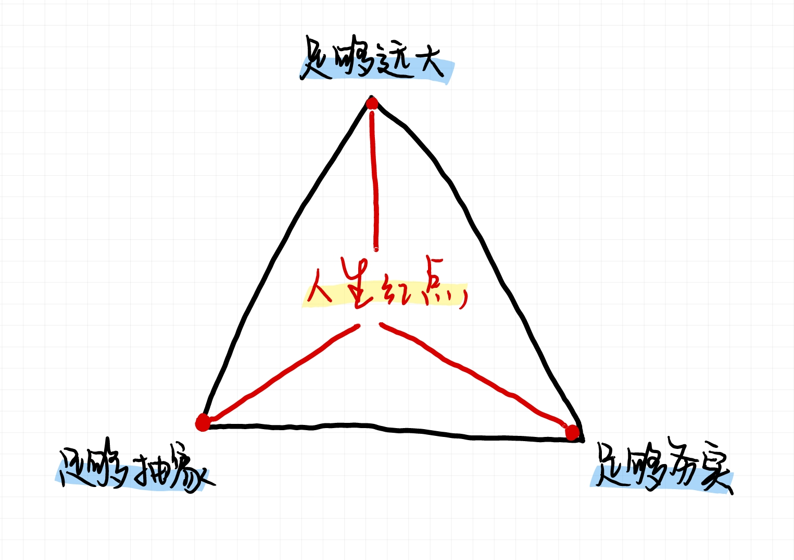

**特点1 足够远大，**只有足够远大、有挑战，才能激发和形成自驱做事。

**特点2 足够抽象，**只有足够抽象，才能足够稳定，不容易变，积累复利。

**特点3 足够务实，**只有足够务实，才有路径过去，持续精进，不断逼近。

具体怎么实现呢？其实我的餐巾纸问诊，就是尝试去寻找一个足够远大（自驱），足够抽象（稳定）和足够务实（有用）的模型。

我这些年，一直尝试把"**科学做事**"的一些管理和创业理念，放到人生计划里：

- **战略思考：**从Topdown的角度思考全局的、决定成败的艰难选择。
- **科学决策：**投入全部人生时间，投产比ROI分析。
- **路径设计：**如何完成目标、路径、资源的一致性。
- **假设思维：**对于未知的部分，提出假设，去试着学习和验证答案。

上节课，我们做了抛砖引玉，于是这节课，我们尝试做了一些展开和化简，给大家一些更明确的思考过程。

跟上我的方向，我们来做一次完整推演。

### 第三层：理念背后是"取舍"

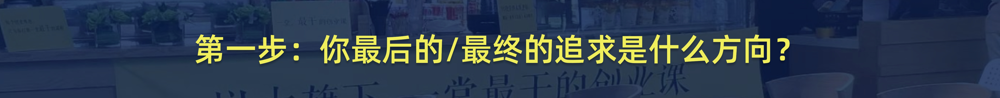

**我们发现，很多人对于长期的渴望不同（最长期）：**

- 有些人渴望成事儿，要自己做出来，而有些人觉得"我自己想清楚"就足够好了。
- 有些人渴望改变世界，而有些人渴望改变自己和家庭。
- 有些人渴望结果，而有些人最渴望过程，过程就足够了。

> 再次强调，这是人最终意义的追求，不是眼下的某一两次的选择。

于是，如果我们按照【终极追求】的维度，划分为【结果/过程】和【现实主义/理想主义】，就会发现，不同人的终极追求往往是不同方向的：

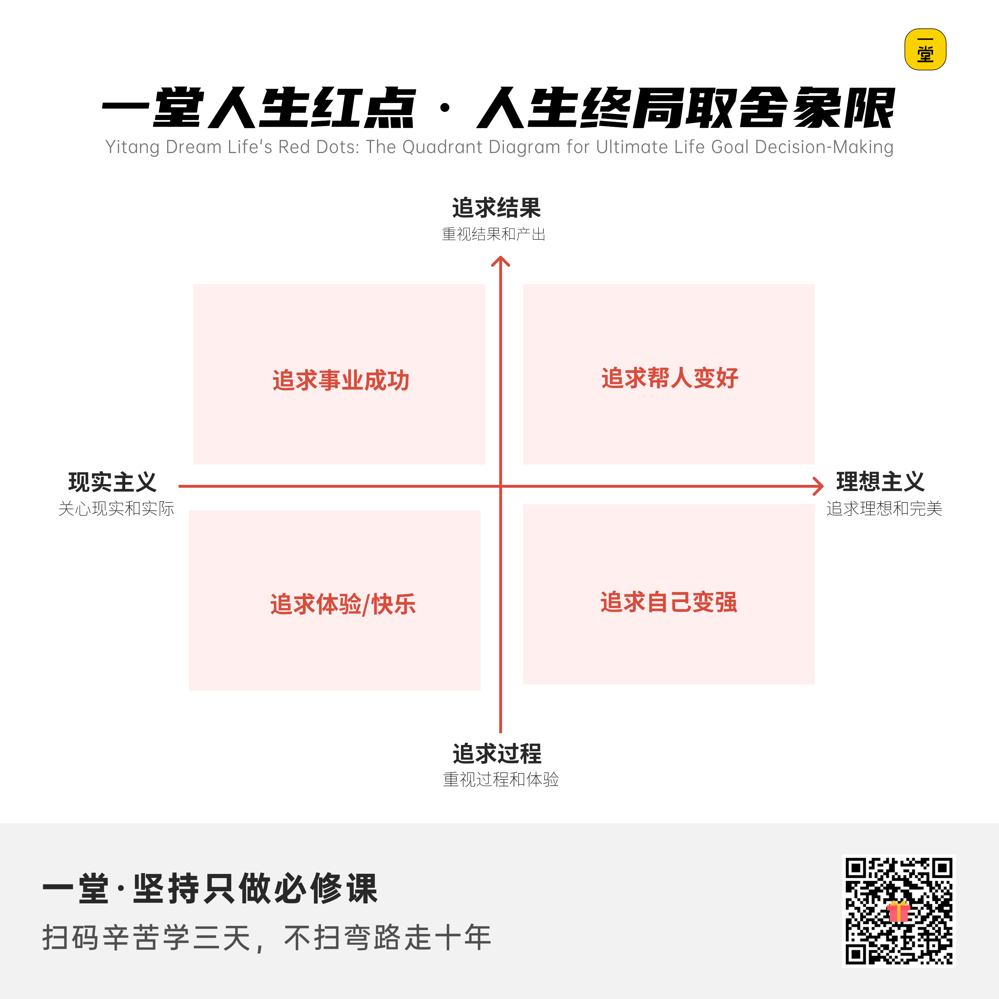

有些人觉得过程足够了，而有些人极度渴望结果；

你是哪一种？

有些人非常理性和现实，专注具体的生活和赚钱，而有些人内心忍不住有一些理想主义；

你是哪一种？

再次强调一下，这个象限的选择，不是眼下，不是最近某一两次职业选择，而是如果人生各种选项向你打开，站在未来30-50年的视角来看，**你最终最渴望、最追求、最能激发你、点燃你的方向是什么？**

哈哈，终于我们在这个层级上做到MECE了，大家可以认真问问自己，然后我们开始下一步。

当我们把每个象限里的【常见人生红点】展开，就会发现有一组常见的红点清单出现了：赚钱&出名常常伴随出现/同时选择，成就/作品常常同时纠结，内心和高手也是。

于是就会发现一个非常有趣的模型：

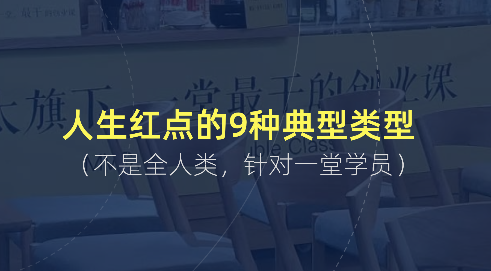

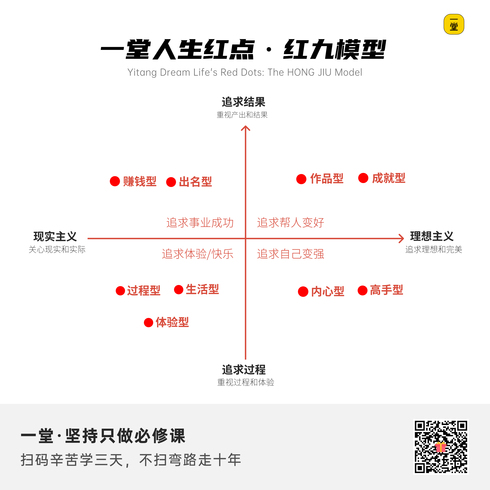

如何理解呢？我和教研团队做了一个非常"有趣"的工作，我们调研并且推演了各种明确红点的选手，常常会有的一些特点，特别是【信奉的信条】，我们准备了3句话，大家可以试着找找感觉。

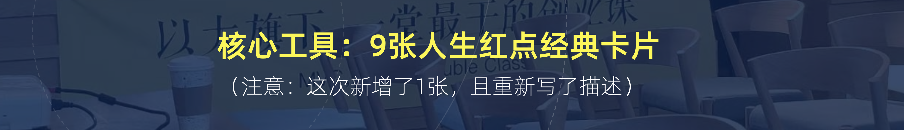

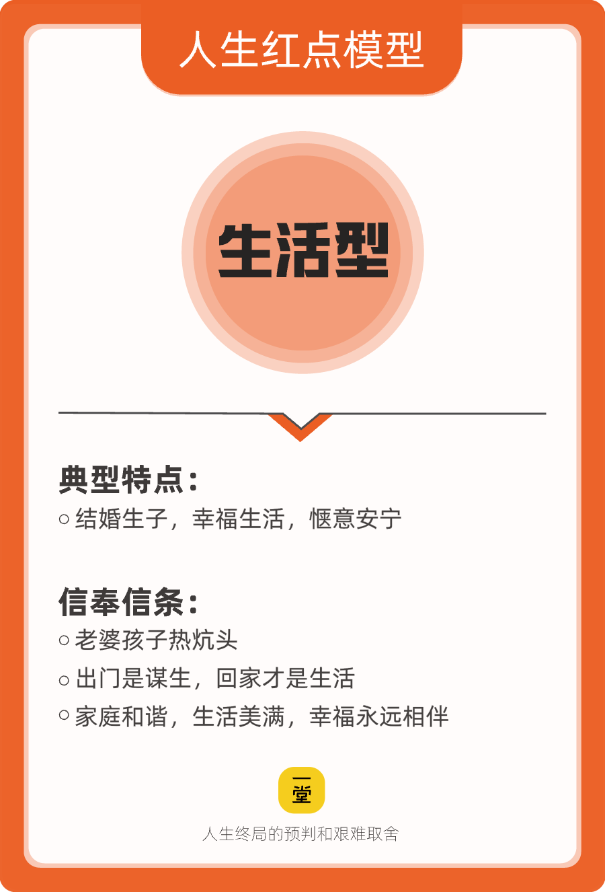

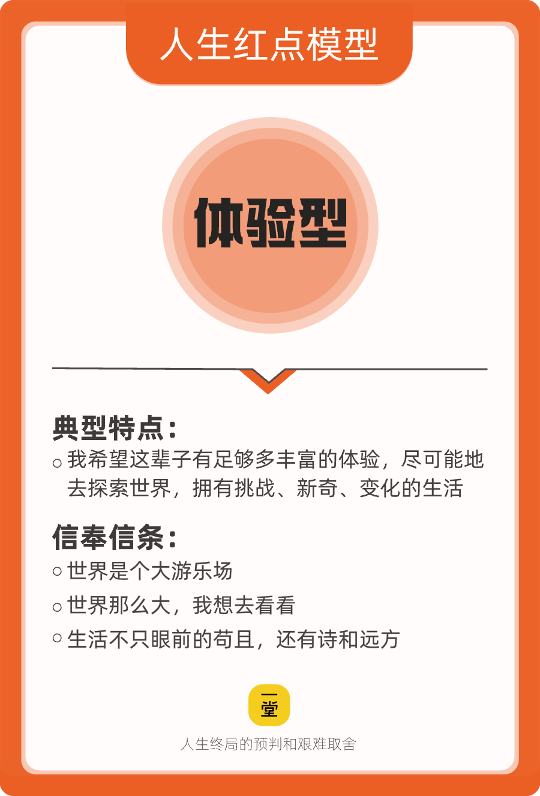

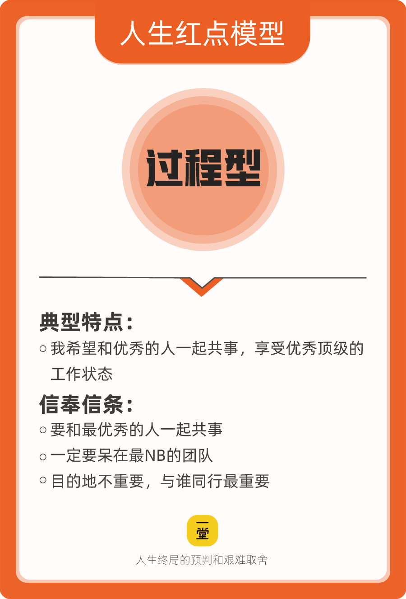

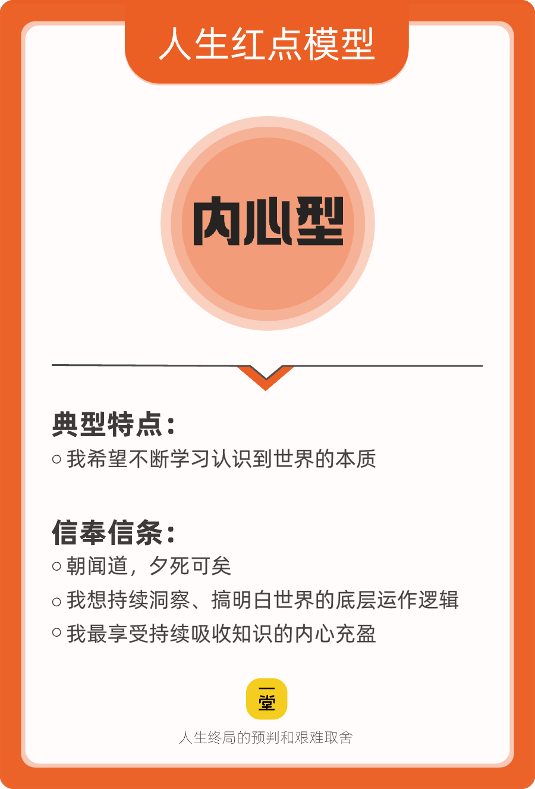

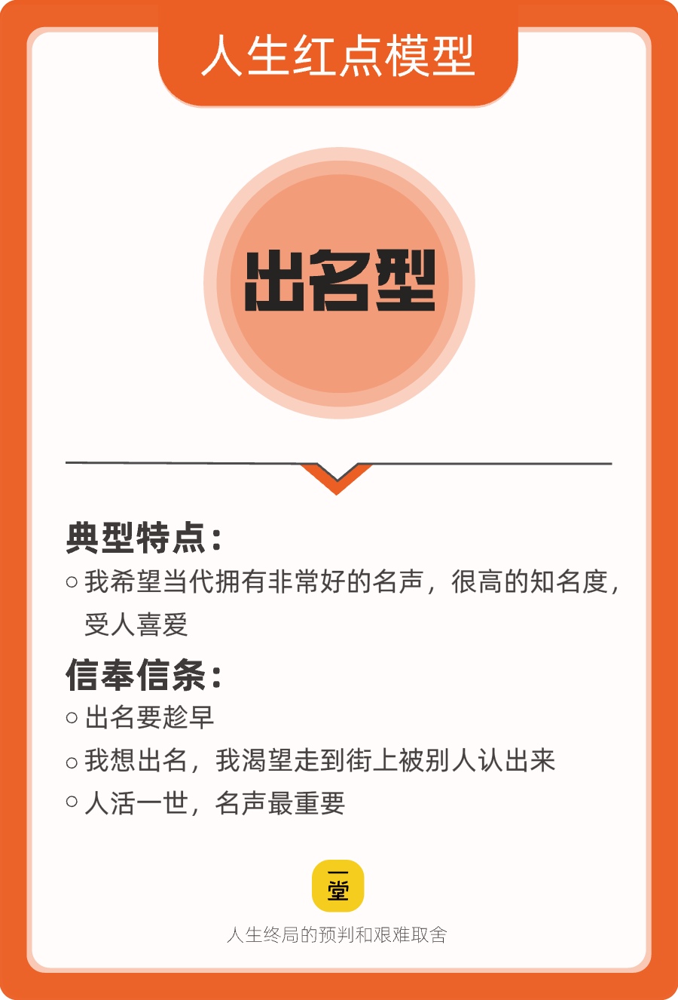

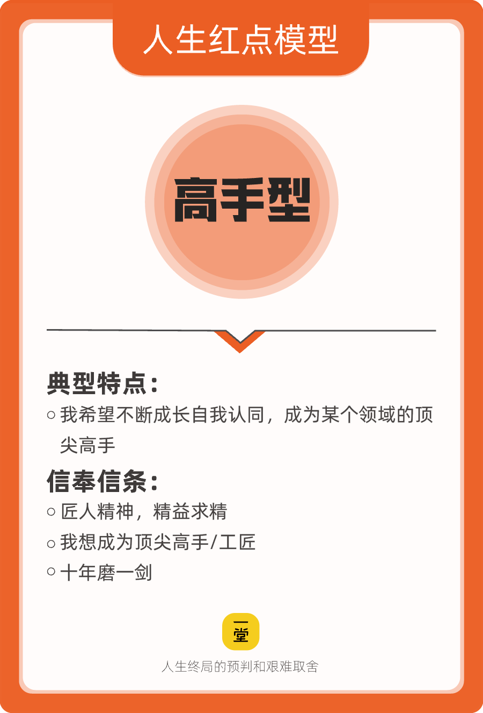

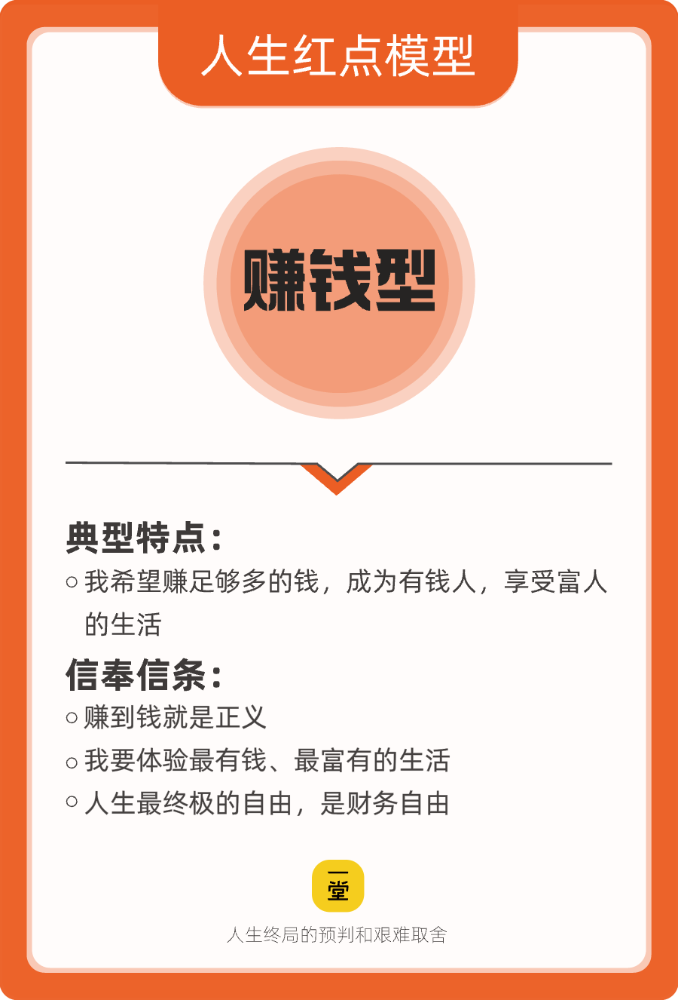

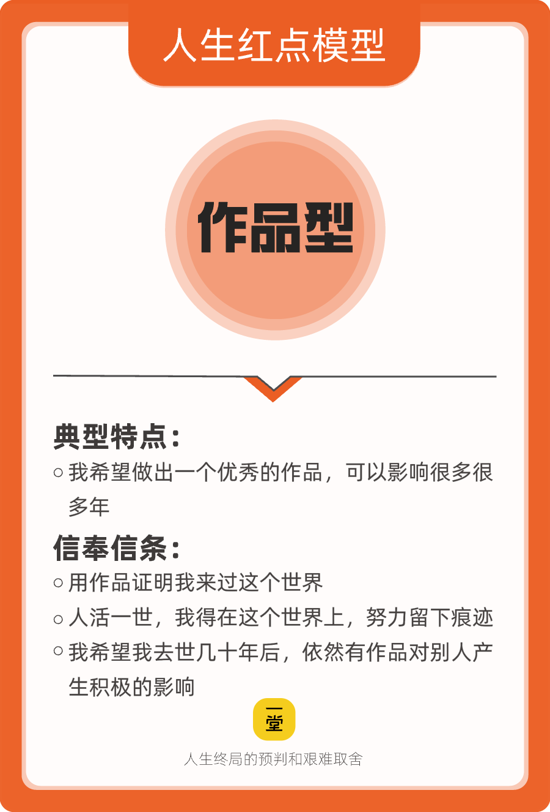

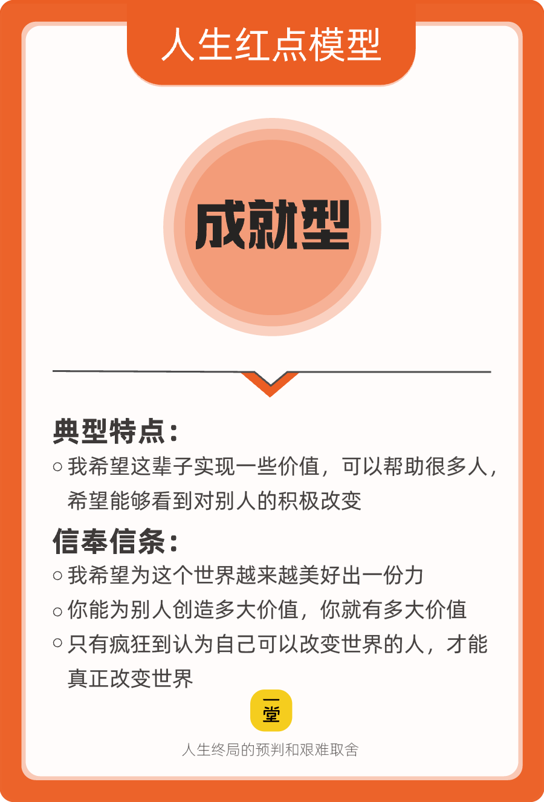

简单读了一遍，大家有备选了么？备选2-3个是什么？Top1是什么？

**【划重点💡】**怎么判断一个人真正找到了红点呢？可以从**3个表征**来看：
1. **笃定：**很自洽，知道自己想要什么了，不容易纠结了，不拧巴。
2. **自驱：**做事情更加专注和投入，为了自己而工作，内心充盈，有热情。
3. **自我闭环：**持续能够拿结果，享受"能力-做事-结果"不断循环的快乐。

好了，初步理解了红点类型，如果想不清楚，没关系，不要着急，这就是一个非常漫长的思考、纠结、试错的过程中。

初步认识了红点，下面，我试图回答下一个问题：**人生红点，如果作为一套做事体系的话，如何一步步进步和修炼？高水平的人生红点能力，是如何形成的？**

开始今天的实操进阶：**如何掌握人生红点。**
