## 开始修炼：人生红点探索进阶

这次我结合我的经历，在内部拆解了10+个同学红点，以及复盘了数百份作业，我给大家讲一讲，如果想修炼人生红点，发挥巨大威力，你需要完成的三次飞跃。

### 第一次飞跃：从没有意识到有意识

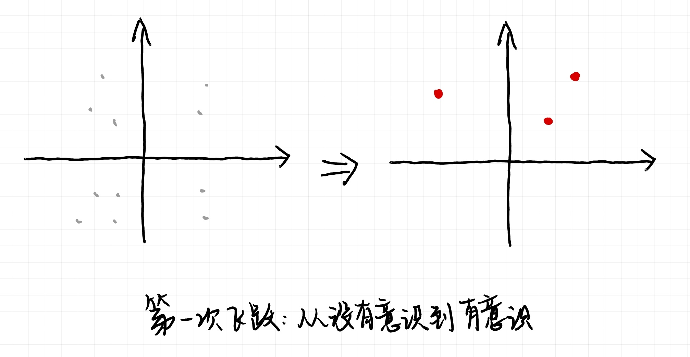

这次飞跃相对简单，就是用意识、有勇气去思考未来。

**【Before】**飞跃以前，典型的特点是：很多人都只关注眼下，最多思考未来2-5年想做的事情，想积累的能力和资源，对于10-30年的事情基本很少思考了。

一来，太远了，想也想不清楚，想了也是徒劳；二来，饭都是一顿一顿吃的，不要好高骛远，做好每一天，每一年的工作就好了。

于是导致的问题是，每天埋头苦干，日复一日，要么忘了内心渴望的东西，要么就是一次次换工作，换行业和岗位，忘记了自己的长期目标，浪费了大量的经验。

**【After】**这个飞跃后的典型状态是：可以跳出眼下的某一个两个项目，从10年，甚至人生尺度去思考，自己最想做，最渴望，最追求，最想积累的东西是什么。

**【划重点💡】**完成这次飞跃，你会不拘泥于眼下事情，**站在一个非常长的时间尺度里，去正视自己的追求和渴望，大概有2-3个备选红点，思考自己的真正认可的意义所在，能持续激发自己的意义所在。**

下面，我讲讲如果你想跨越，需要培养的2个自我修养。

**【思考🙋‍♂️】**磨课时有人问：如果红点实现不了，是不是这辈子就很失败？

你怎么看？

————

#### 自我修养1：勇敢追求终局

好的人生红点就是为了**『实现不了』而存在的**，如果容易完成了，它该多无趣啊。

我在今年《给全部同学的一封信》里有一段话：

> 任何一个野心勃勃的创业者或者管理者，都应该按照常识+内心使命的方式，制定一个十年甚至三十年的发展计划。

> 这个计划你很可能无法完成，但实践这个计划本身，就是一个有价值并充满乐趣的事情。当你有了这个计划，再倒推回今天，你的日常决策和思考的坐标系会完全不同：它会帮你终止随波逐流的状态，并让你形成自己的笃定。

从今天内容来看，是不是更容易理解，为什么我会给大家这个建议了？：）

我们复盘，看了很多同学的作业，让我意外的是，很多人在作业里面说：

- "看了Truman的故事，原来他这么勇敢地追求这么高的红点"
- "哇，还可以这么勇敢地设想终局"
- "居然有人可以因为终局想得足够清楚，而不浪费自己流的每一滴汗"
- "原来可以这样不断迭代自己，敢想敢做，向着规划好的人生红点进发"
- "有句话深准地切中了我的心理和需求，就是——送给不甘于此，渴望笃定的你"
- "原来即便是普通人也可以不设限思考，敢于设定超级难题"
- ......

如果想习得人生红点，第一个任务：**就是不设限。**

就是勇敢并且敢于思考一个高难度的、有挑战的人生终局，然后为此而筹备计划，不断积累能力，不断驱动自己进步，这件事情本身就意义非凡。

**ok，关于『终局』，**继续我们再来看一个典型的问题：

> 我的红点是老年银发教育，我想做出版，我想做新闻，我想做一个顶级的外科医生，我想做中国最大的跨境教育公司，但是过了1-3年，就变了/完不成/转型了，变了又变，失望了，就算了。

大家有这个困扰么？如何理解和解题？

**【划重点💡】**关键解法一句话：**人生红点不必追求非常具体，开始的模糊才是务实的做法。**

因为当你足够抽象，它才足够稳定，足够笃定，足够支撑。

就像前面讲的，你以为的职业追求：**我想做出版，把国外的好书带到国内。**

其实你内心的追求：**想把最好的商业和管理理论推广开。**

甚至再抽象一下，你内心最底层的追求：**想通过优秀内容的传播，推动更多人进步。**

如果你想到第一层，就接受总是变吧。

如果你能想到第三层，你可以跨领域，跨行业，跨职业来实现你的人生红点。

包括刚才的**新闻理想**，当年鲁迅的**弃医从文**，我的**泛产品创新**，皆是如此。

所以，我们要善于接受模糊，模糊了才能有确定性，不要过早追求精确。

讲完了第一个自我修养，我们先来看一个典型的问题：

> 我就是刚毕业没两年啊，我看的不多，见识行业很少，不懂啊，肯定没办法找到我的人生红点。

**【思考🙋‍♂️】**如果你们来回答，你们会怎么理解？背后是什么？

————

#### 自我修养2：笃定红点ROI

磨课的时候，我跟上文那个名校的M同学访谈，他说：Truman，你很特别的点是，真的会花一些时间去停下来，反复调研，纠结，甚至访谈，来收集信息，让自己自洽。而我看到了一两个选项，觉得还不错，就扎进去做了。

而且我也不太懂，不太会做这个调研啊。

**【划重点💡】**关键解法一句话：**就是没深刻认识到人生红点ROI价值。**

假设你有一个工作，花10天可以把你的30年的工作整体效率提升一倍，你愿不愿意花着10天？这10天可以做什么？

**话说也没人拦着你去调研，去分析你的人生啊，而且这些也并不需要什么"专业性"：**

- **你可以全网调研：**看各种岗位故事，知乎体验，纪录片。
- **你可以看传记：**你可以看一些名人传记，感受一下重大选择的过程。
- **你可以看终局：**找一些你渴望成为的对标，去拆一拆他们的成长履历。
- **你可以拆高手：**你可以找到一些厉害的高手，去拆一拆他们成长的过程。
- **你可以访谈：**问一些身边的、优秀的、羡慕的人，大家如何理解目标和路径。

甚至你可以花一两年，去到最渴望的一个优秀公司，去认识同事，去建立审美。

**投入不坚决，往往是目标和价值感不够强。**

如果你真的有长期追求，有时间看《甄嬛传》和《脱口秀大会》，而没时间去纠结和学习，这个就太说不过去了。

所以我一直觉得，在人生红点的问题上，我觉得"我不懂"往往是偷懒的借口，核心还是**意识不够问题**，严肃对待，不妥协，不凑合，要努力想清楚。

### 第二次飞跃：从有意识到有红点

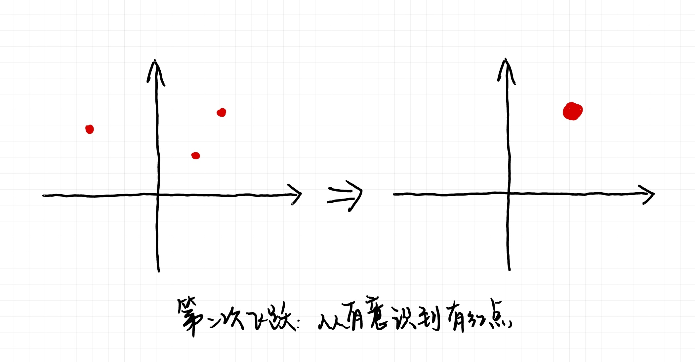

有了基本的意识和抽象追求，第二层，就要是锁定你的红点了。

**【Before】**飞跃前典型的状态是：我都想要，生活就是中庸，我既想生活特别美满，也想赚最多的钱，还想做最好的作品，我也希望加入最出色团队，我都不想割舍。

这种四面八方的用力和追求，其实你会发现彼此很多是矛盾的，最终没办法知道自己最想要什么。

**【After】**飞跃后典型的状态是：我知道我最想要的东西是什么，我一定要追求、坚持、笃定的东西是什么，其他的哪些我愿意放弃，哪些愿意妥协，哪些做到60分就够了。

**【划重点💡】**完成这次飞跃，你会**非常笃定，清晰知道自己想要什么，能够找到Top1红点，知道自己最最想要的东西，然后在各种决策里，完成自洽，不拧巴。**

下面来看看，两个自我修养。

第一个工作，就是你得能够不断理解红点，一层层不断深挖自己的内在驱动力。

**【抢答🙋‍♂️】**假设你工作了10年，有什么方法来深挖自己的红点？

——————

#### 自我修养3：善于深挖红点

哈哈，我和团队尝试把我们这两年，实践过的一些方法，集合一些国内外经典的测试，做了一个很有趣的清单：《人生红点十二问》

大家可以试一下，按照自己的理解，写写作业。

时间有限，这节课没办法补充案例了，我们在考虑，要不要后续加一节《人生红点实操案例篇》，给大家在自我测评、1v1讨论、专家问诊等场景下，究竟是怎么深挖3-4层，把红点挖出来的。

> 提醒：这是旧版本，如果后续实操篇，请以实操篇新工具为准。

我们先来看一个典型的问题：

> 我都想要啊，我很优秀，我能兼顾，我都想要1234，不必要非得取舍了吧？我可以兼得的，为什么一定要有个取舍，有个排序呢？

**【思考🙋‍♂️】**如果你们来回答，你们会怎么理解？

————

#### 自我修养4：敢于不断取舍

**【划重点💡】**关键解法一句话：**可以兼顾，但依然必须取舍，因为一定会经常撞车&矛盾。**

的确，事实上可以兼容，比如一堂，我希望是能兼顾4/9条，但**一定会有各种矛盾和撞车**，必须要取舍，未来一定会撞车。

比如，赚钱和作品矛盾，我优先赚钱，还是作品？

比如，封装课(快/没有创造性)和原创课(研究/创造)矛盾，我应该怎么选？

比如，如果有些事情长期极有价值，但短期看不到收益，做还是不做？比如教育创新。

就像《公司文化》里讲的，当我们对于使命/愿景/价值观有了方向，其实日常没那么多纠结，很多答案都是现成的。

你得区分，**什么是核心，什么是顺带；什么是目的，什么是手段；**

- 对于有些人来说，创业是赚钱的手段，有人会觉得赚钱是创业的手段。
- 对于有些人来说，成长是作品的手段，有人会认为作品是成长的磨刀石。

核心是你最好问问自己，你愿意为了什么而妥协什么。

关于职业规划，我平时很少给直接建议，但是有一种我会拦着比较多：**长期想做产品，偏作品型/成就型，但是有了一个去区块链的机会，我一般都会鼓励极其谨慎，它不是一个工作机会，而是一次快钱爽过后的无法回退。**

> 严谨来说，这的确是我的刻板印象（甚至成见），但据我观察，95%是对的，有5%能兼顾很好。

背后的逻辑，其实就是他们会通向两个完全不同的终局。

两年前，我看到过曹政（CaoZ）的一篇文章，里面有一句话，让我瞬间被圈粉，大意是：

> 总有些人问我，为什么没赶上区块链赚到大钱，其实我想说，我是国内最早一批接触比特币的，但我一直没有碰，**我有选择赚什么钱的权利，在我看来，钱有高低，我只赚我认可价值的钱。**

这就是一个优秀的产品经理，该有的价值观，无关好坏，就是很自洽。

如果你的第一张牌选择了赚钱，那就不用有那么多心理包袱，只要不违法，违反基本的道德，法不禁止即可为，什么离钱近，就做什么就好了，这个也就很自洽。

这也是为什么，如果在一堂的严肃面试，我一定会追问一个Top1出来，哪怕只是阶段性的，哪怕还很模糊，但是一旦做完选择，后面很多做事就很容易自洽了。

在旧版本课程里，甚至包括1v1面聊，我发现很多人误解了一个东西：我会说，极限情况下二选一，你怎么选？

很多人认为人生红点就是选一个，而放弃所有：

- 选作品，就得没有成就。
- 选赚钱，就没办法做作品。
- 选生活，就没有工作。
- 选成就，就没有生活。

......

这个思考是用来做**"极端推演练习**"的，这是世界里不会这么苦逼和发生的，我并不会为了追求一个红点，而放弃其他所有（0分），这个不可能也不现实。

真实世界里，你需要持续做的取舍是：**分清楚哪个红点要追求（90分+），哪些红点可以妥协（60分），而不是来回转圈，平均用力。**

我画了一个图，这么一看，就一目了然了：

比如，我想要作品型，但同时我也想要成就型，赚钱型和高手型，但是我只要在能接受的范围内，我会经常愿意妥协，来不断实现更好的作品。

- 比如：降薪，我愿意降到底线（妥协赚钱），来换某一个快速成长的机会。
- 比如：我愿意忍受很长一段时间寂寞（妥协成就），来换做出更好的课程。
- 比如：我愿意带团队一起进步（妥协高手），来换未来更顶级的作品。
- ......

一旦我的第一红点清晰以后，眼下的很多这些决策，基本就不纠结了，很容易做判断了。

### 第三次飞跃：从有红点到有规划

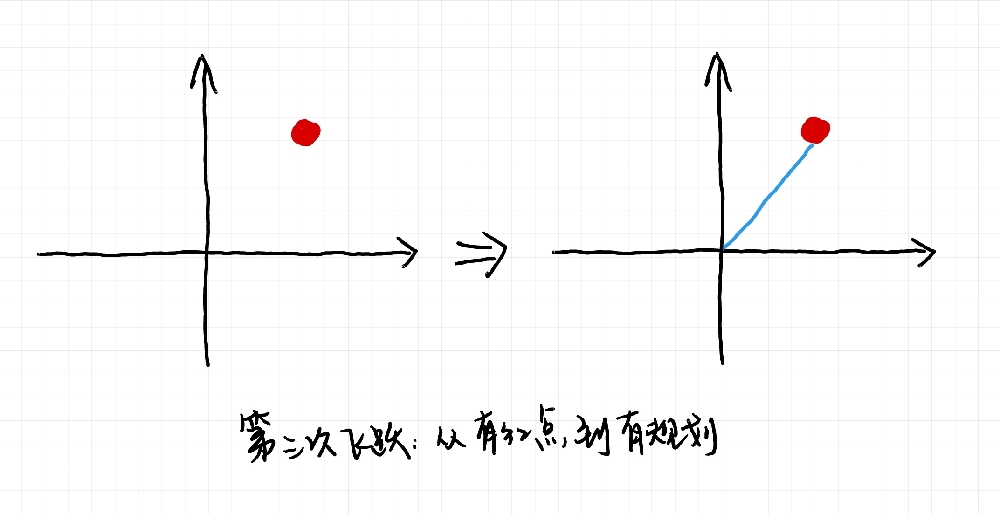

有了第二次飞跃，真正考验技术的时候到来了，这一次飞跃，不只是有一个红点，还能把红点和眼下的工作关联上，不断积累不断修炼，一步步接近那个红点。

**【Before】**飞跃前典型的状态是：虽然笃定了红点，但是理想和现实往往是脱节的，我渴望作品型，但是我不知道这个跟我日常工作的关系是什么。

虽然对于未来很笃定，很清晰的，但是这个只局限在"设想里"，没办法转化成能力和复利，内心安稳，但成长速度很慢，并不会显著增长。

**【After】**飞跃后典型的状态是：能够给一个宏大的红点，设定一些里程碑，并且不断思考我怎么才能一步步接近它，然后和现在的工作联系起来。

最理想的情况是，你会感觉每一天，每一年都在积累红点，每一段时间都会快速接近红点，感觉在一步步接近。

**【划重点💡】**完成这次飞跃，你**不止会笃定，还清楚地知道自己该学什么，该练什么，该积累什么。随着你一步步笃定的选择，成倍地增加你进步的速度，最终脱颖而出（在同行和同龄人）。**

下面，开始讲讲最后两个自我修养。

我在想，红点不是职业规划，更不是眼下的项目目标，是非常宏大的遥远的东西，有没有可能完成和眼下工作的关联呢？我们强调科学，真正的科学人生规划，如何理解呢？

**【提问🙋‍♂️】**本质上，我该积累什么，来一步步接近红点呢？

————

#### 自我修养5：努力规划路径

在探索营上，最后我偷偷给了一个我用来指导自己工作的分析框架，个人版本的五步法，或者叫做《人生红点五步法》。

我们做过无数次选择，甚至学过各种战略，战略就是"**影响成败的艰难选择**"，我们学过用户战略，商业战略，营销战略，增长战略，但是，这些还是微观的，你作为一个几十年的人存在，你的"**人生战略**"你有认真思考过吗？

如果用做商业战略的要求来看，在人生最重要的选择上，你累计花了多少时间？有取舍吗？有路径吗？有资源吗？有里程碑吗？

我们学过ROI，学过管理三段论，训练过目标导向，你在你这辈子最重要的投资（你自己）上，有把能力拉满，做过测算吗？

你有没有放空自己，静下心，诚实面对自己，从起点到终点，一定要诚实，问问在这个星球上，这一遭，你想要什么。

有人说，一个人被什么打动，什么就是他的使命。

也有人说，使命，就是你打算怎么使你这条命。

努力地找到一些你的确定性，然后把它变成一个红点，试试看，能不能画出一条直线，和你现在连在一起，用它来指导你的每一次换工作， 换项目，换伴侣，换城市，换赛道，换伙伴，能做到吗？

你和红点之间的这条"**笔直直线**"，就是你的拥有的最科学的人生。

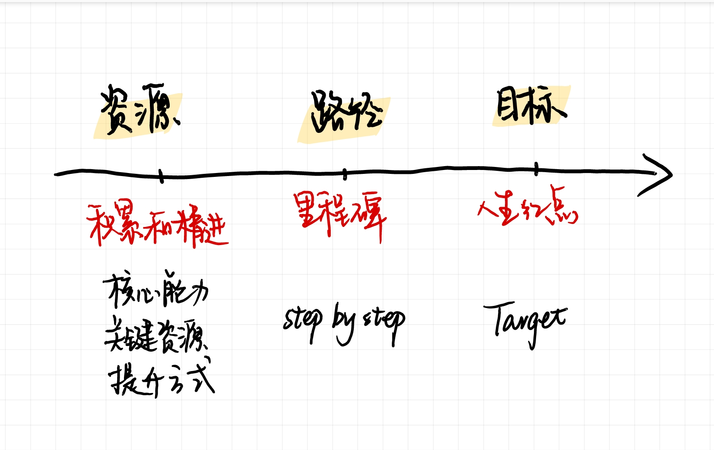

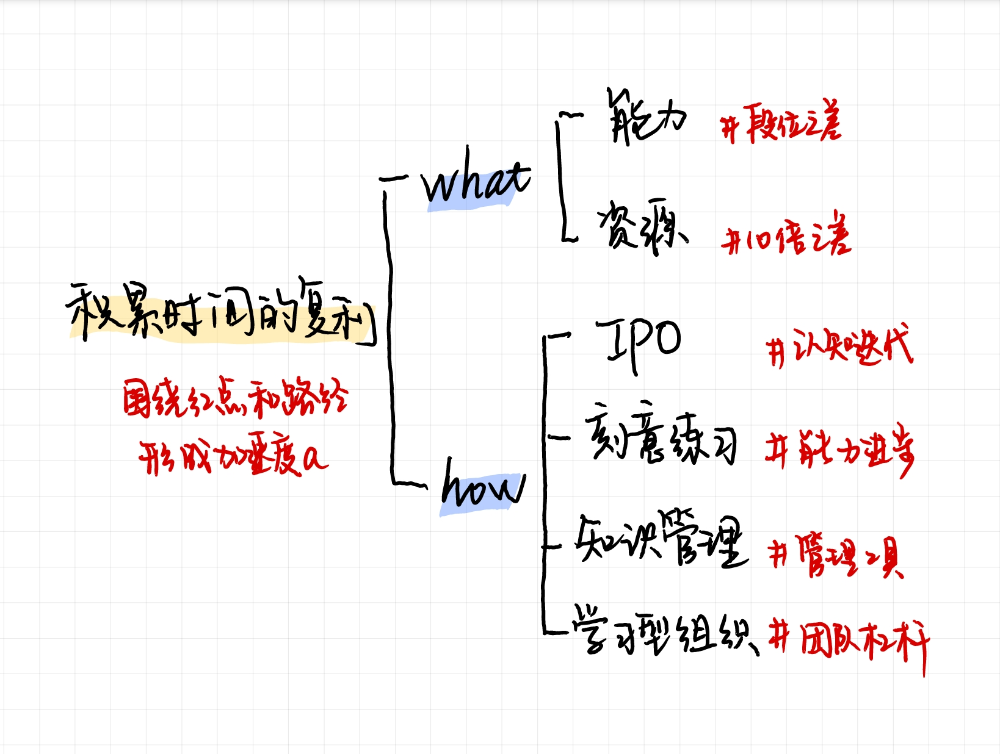

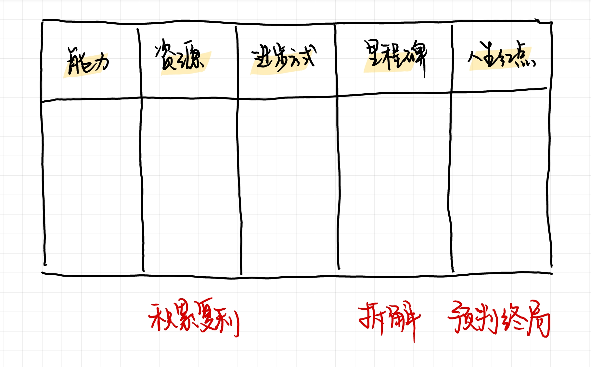

当有了这个逻辑以后，就可以用一页纸，解释我所有的**人生红点计划**了。

#### 个人版本的一堂五步法

**能力**

**资源**

**进步方式**

**里程碑**

**人生红点**
1. 懂教育
2. **泛产品创新**
3. 懂商业操盘
4. 体系建模

1. 头部关系
2. 创业圈关系
3. 优秀团队
- 最佳实践
- 高效IPO
- 刻意练习

1. 靠谱产品经理
2. 优秀业务负责人
3. 成熟创业者
4. 自由创新者

作品存世型：用产品创新的方式，不断推动这个世界的边界。

> 教育优先，涵盖其他

然后呢，我们就收到了各种各样的同学们的路径规划：

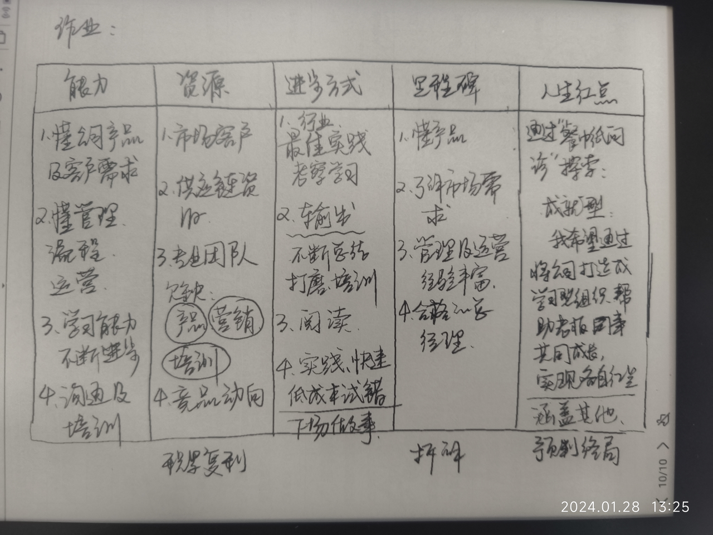

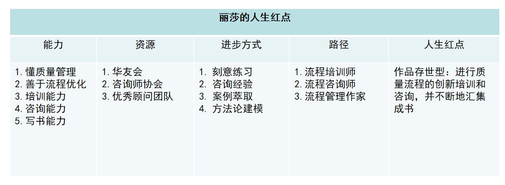

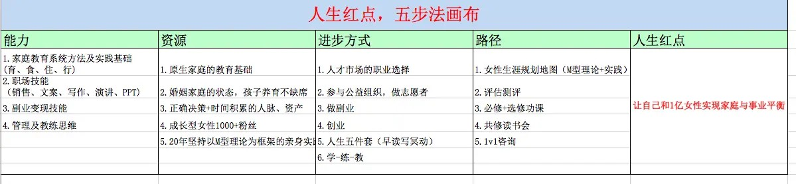

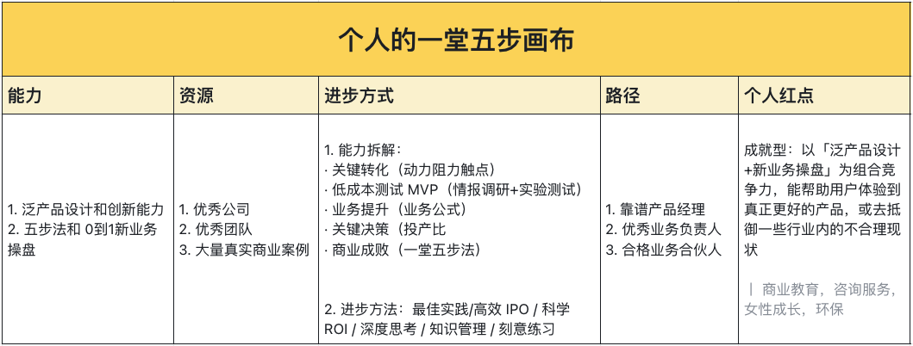

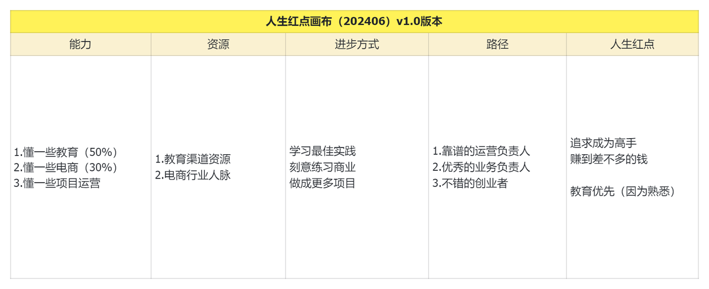

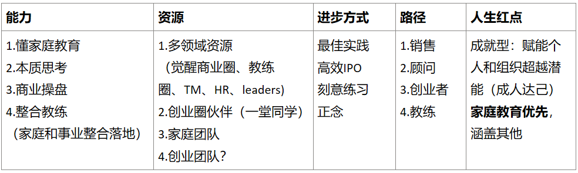

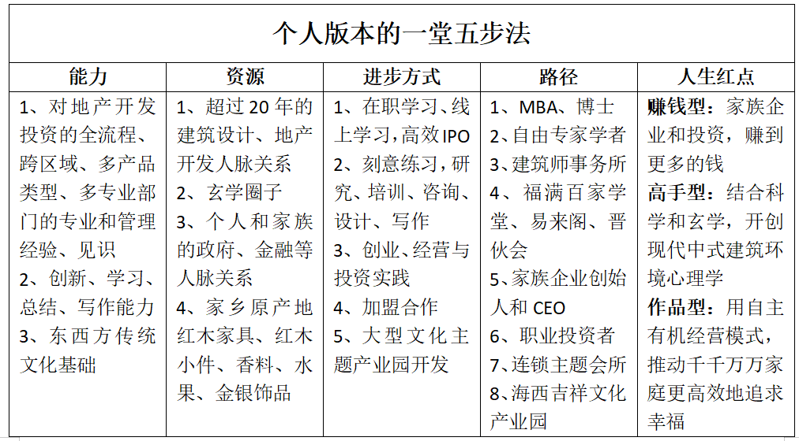

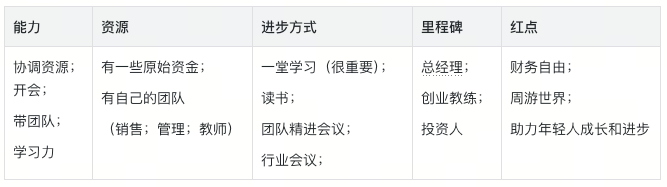

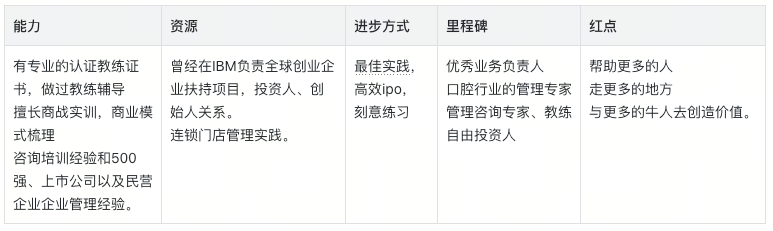

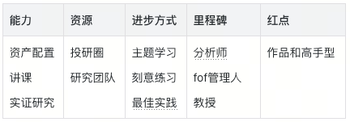

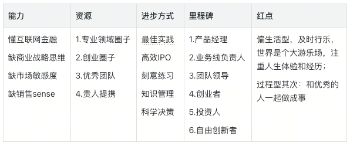

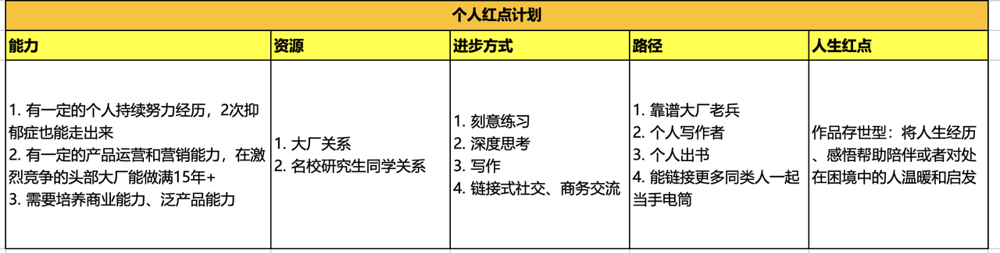

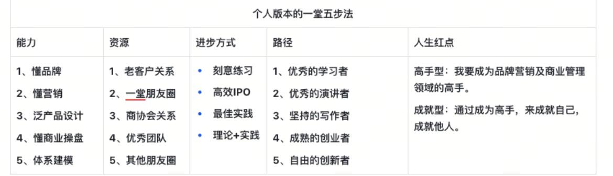

最后，一个自我修养，也是最难的一个：**拥抱变化，持续调整。**

#### 自我修养6：持续动态调整

所有关于"人生"课题的内容，最怕的就是"**贴标签**"，过于固化自己的选择，反而自我设限，堵死了很多的路。所以最后一个段位，也是我目前在探索的路，就是：**不设限，持续拥抱变化调整自己。**

这五步，或许第五步相对稳定的，越是靠前，越是容易变化，随着我们的认知变化，环境变化，自己的进步，可能每个阶段都是会不断调整的。

比如，2019年，我原本以为"创业的下一个里程碑是投资人"，后来发现一堂给我的成就感足够了，撤掉了。

比如：2020年，我才意识到，我还练习"泛产品设计"，那就加上。

在比如：2021年，我才意识到，极度复杂的管理能力"非必要"，那就撤掉了。

就像是我建议大家操盘业务，脑子里时刻装着一堂五步法，装着壁垒（规模经济对抗）一样，我也建议大家面对你最最最最重要的人生，时刻装着《人生红点五步法》。

哈哈，你们可能猜到我想说什么了，既然有三次飞跃，肯定是要有地图发布了，如果你长期想修炼人生红点，那么这张地图大家可以好好收藏，保存好。

### 发布：一堂人生红点修炼段位图

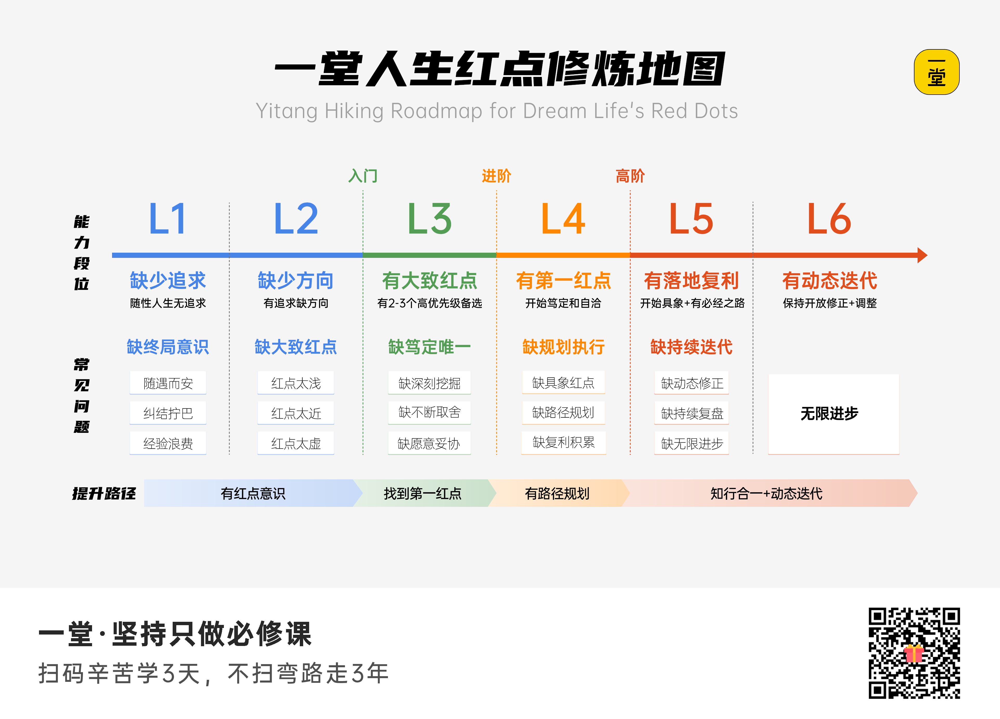

### 彩蛋：《人生红点》主题曲

很多人在思考人生命题和人生红点的时候，很难进入安静和专注的心流状态，经常性地被打断，然后完全无法深入思考。

哈哈，强烈、强烈、强烈推荐给大家一个工具。这是一堂的@思润同学用AI创作的一首「人生红点」的主题曲，歌词表达的就是这节课的魂儿。非常适合当做背景音乐来播放~

📹 0f68f790835074ce4aea0860270ec76e.mp4

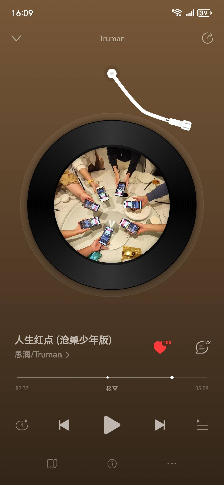

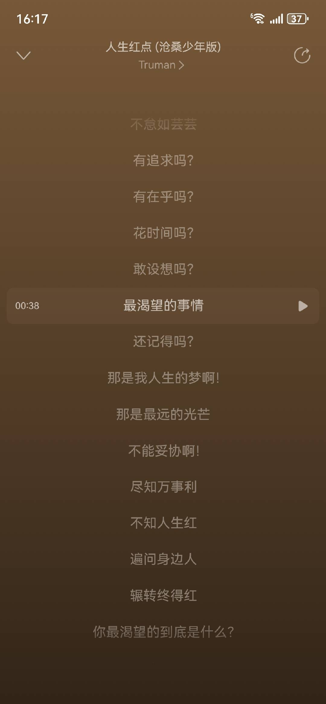

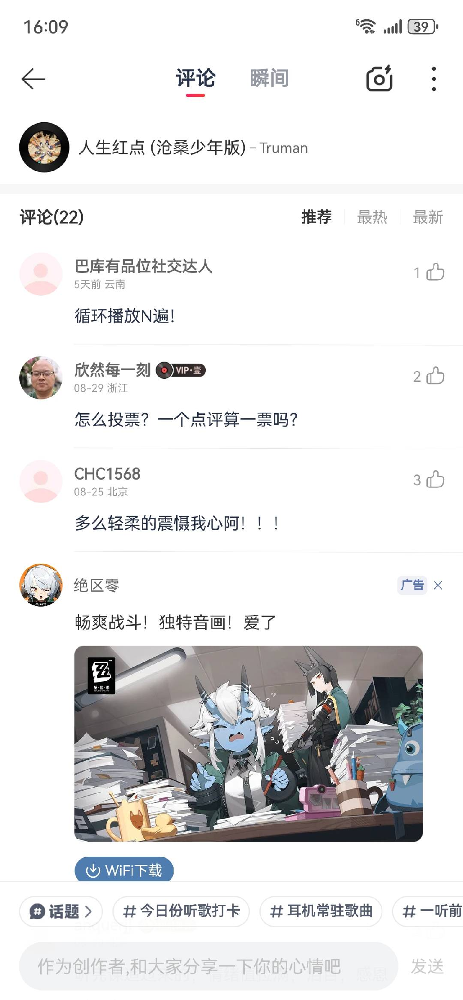

如果大家在思考自己的人生红点、写人生红点作业的时候，建议大家可以把这首歌当BGM循环播放，亲测有奇效。我自己在思考人生红点和做人生红点系列课的时候，至少单曲循环了500遍。

> **路径**：网易云音乐，搜索"Truman"，看到全面歌曲列表。

> **强推**：建议点击关注，关注Truman，发现更多一堂相关的好听歌曲；

> **场景**：课前热身，作业前复习，开车，**日常磨耳朵，氛围熏陶。**

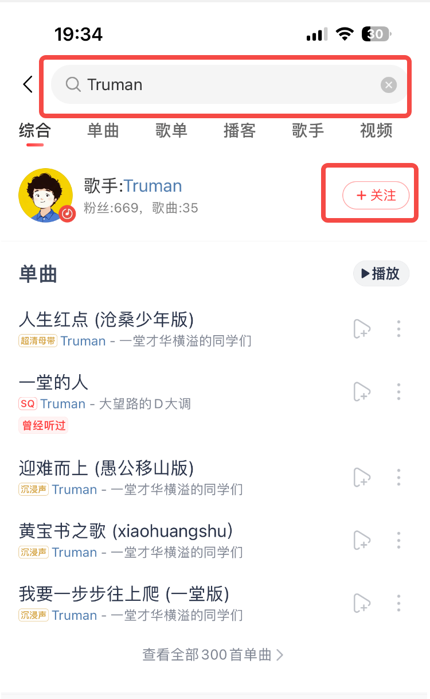

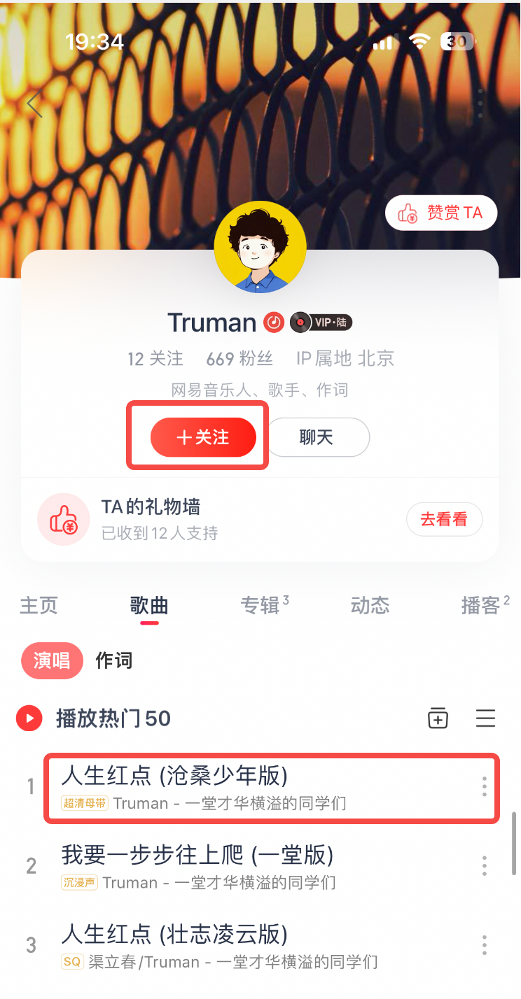

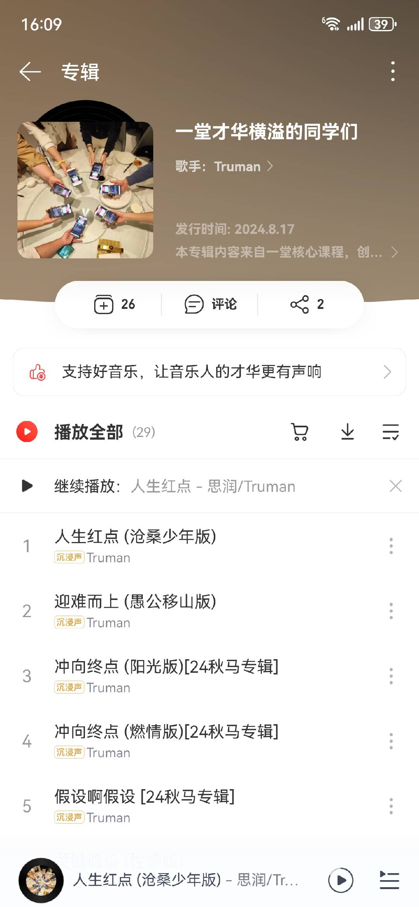
