## 开始上课

Hello，大家好啊，

我是Truman，许久未见~~

欢迎大家回来继续（来到）上课，进入**本周末的成长加速时间**。

这是我的介绍，如果直播间有新人的话，自己读一下吧：
> 1. **以太一堂CEO：**2016年加入以太创服，现为合伙人，兼一堂CEO。
> 2. **前美团产品专家：**擅长从0到1业务探索、产品快速起盘、商业分析。
> 3. **一堂课程总设计师：**研发100节创业实操课，收到50万份创业训练作业。
> 4. **曾创办“易项直通车”**：资本对接平台，帮助100+项目融资成功。

**【热场🙋‍♂️】**来来来，我们热个身吧，除了表面上的"**严肃教育课程**"，如果抽象一层，在你们心里，会把一堂理解/比喻成什么？我们提供的服务和价值，更像是什么？哈哈。

——————

哈哈，一堂很久没有研究过这样的课题了：本来不以为意，但随着研究建模和做课，大家的热情和反馈越来越高，我们被大家一路鼓励、推动着不断研究，细化课程。

> 上次有这种感觉，还是《一堂五步法》的各个阶段的专题课呢。

直奔主题，这节课我们来讲人生红点的第一节实操课：**挖掘第一红点**。

> 从上节课的段位图来看，这节课帮大家从L3修炼成L4。

> 目前看，暂定后续还有一个实操进阶《L5：红点路径规划篇》。

### 快速回顾

为了避免有同学还没上，或者断片儿了，我先用几分钟，给大家快速串讲一下前面认知篇的内容，帮助大家更好地承上启下。

第一节课，我们提到了大量同学在人生思考上的困扰和痛点：不敢直面内心，忙忙碌碌，没有思考过人生终局，大量的拧巴，经验的浪费，没有决心去思考长期的笃定……

然后我给大家完整地讲了讲我自己的红点故事，回忆了我一步步纠结，痛苦、又自洽的过程，让大家初步感受到人生红点的价值。

后来，通过和大量的同学聊，我摸索出了一套终局预判工具，餐巾纸问诊法，这背后有三层理解：**案例背后是状态，状态背后是理念，理念背后是取舍**。

我们正式提出了，针对一堂学员的人生红点 · **红九模型**。

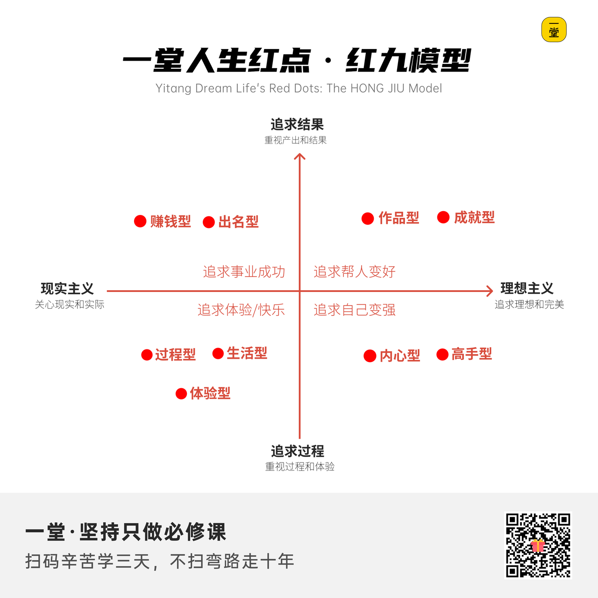

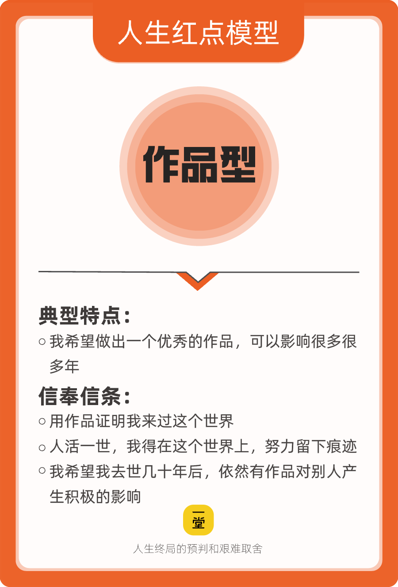

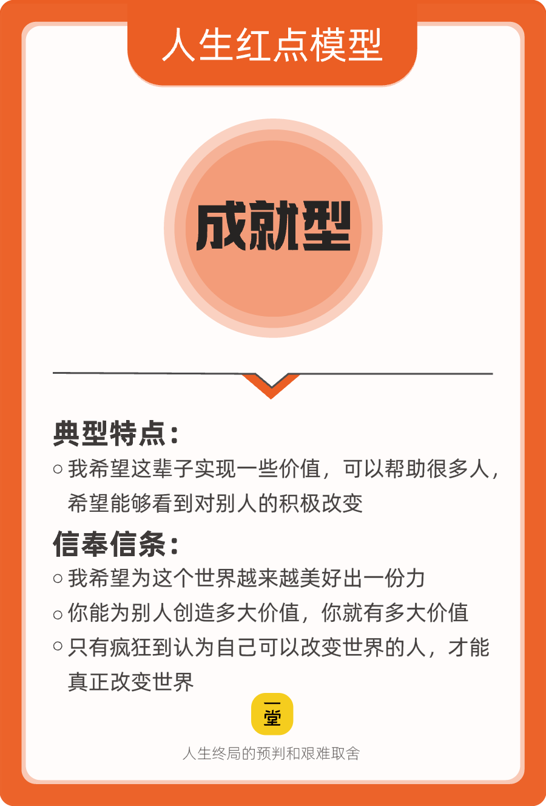

然后，我讲了掌握人生红点的三次飞跃：**从没有意识到有意识，从有意识到有红点，从有红点到有规划**。

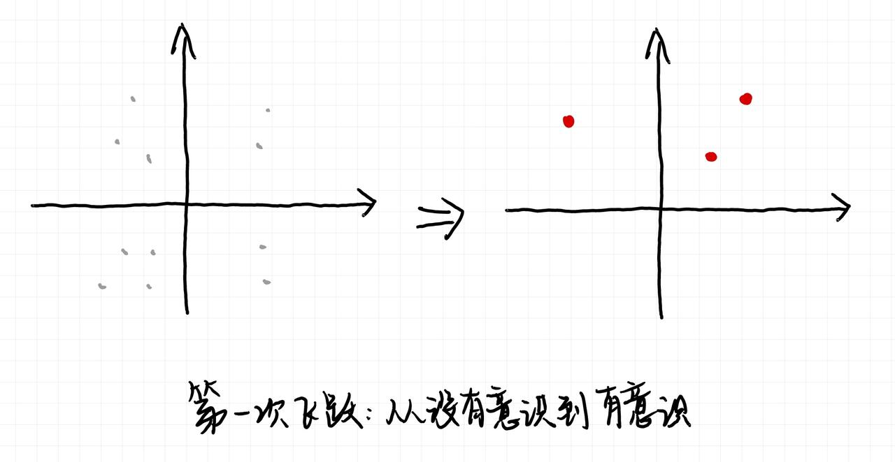

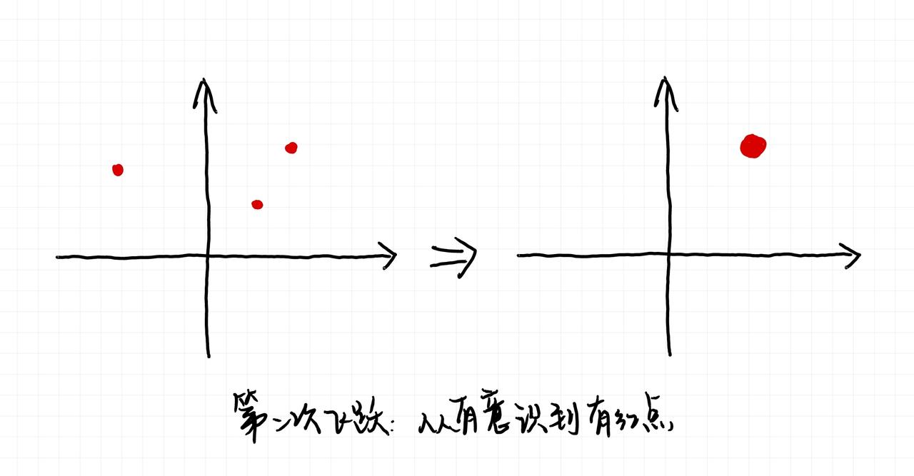

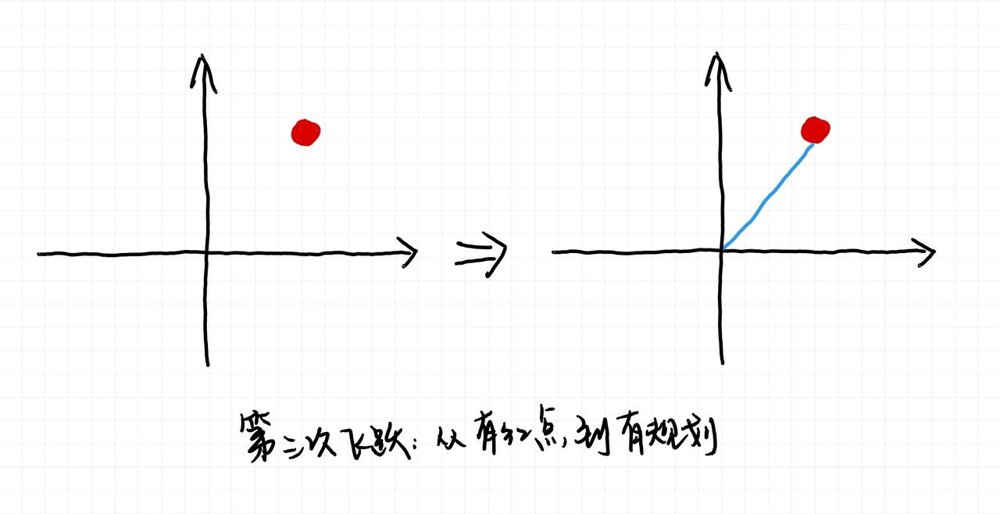

这里面，需要特别注意的一点是，人生红点可以兼顾，**并不是**为了追求一个红点，而极端舍弃其他所有，**而是**要**分清楚哪个红点要追求（90分+），哪些红点可以妥协（60分），而不是来回转圈，平均用力。**

所以，**找到红点之后的美好的自洽状态**，我画了一个图就一目了然了。

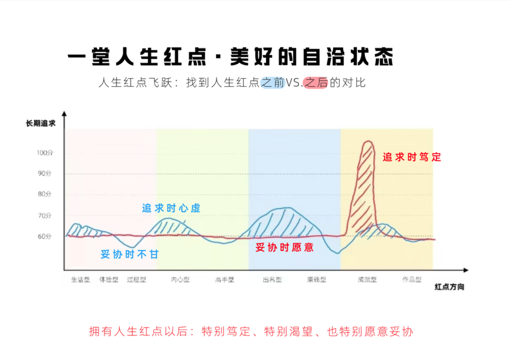

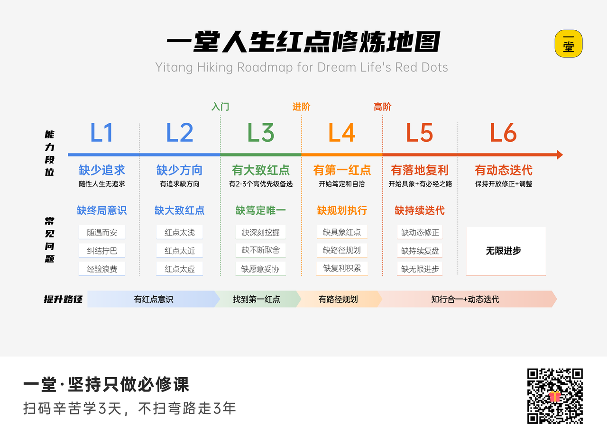

这就是我们在人生红点修炼段位进阶的一个里程碑：**有第一红点**。

这也是我们这节实操课的主题，**如何不断具象，去探索出人生笃定的第一红点**。

### 为什么要学

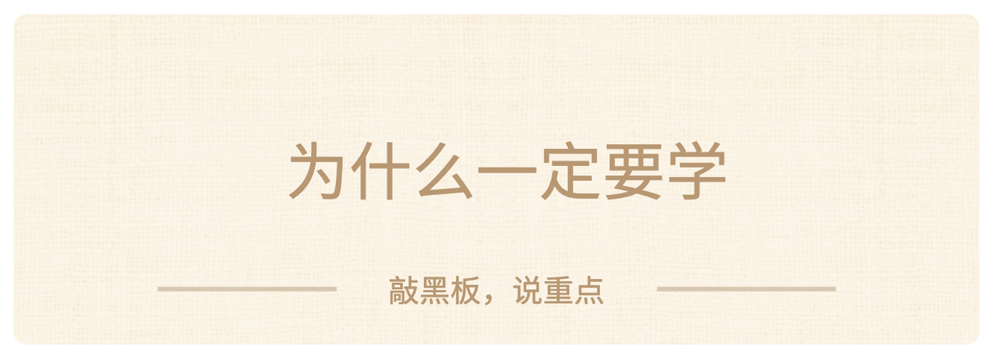

我们反复讲，关于人生终极目标的提前思考和预判，几乎是人生ROI最高的决策，自然也是最难，最具挑战的一个决策。

讲了人生红点认知篇之后，我们陆续收到了1万份红点作业，很多同学已经意识到，**找到人生红点的重要性和价值。**

而且对于大家来说，找到2-4个备选的红点是相对容易的，靠直觉，靠过去的经验，靠手感也能做的大差不差。但是，再往下一步，还是很难深度挖掘出自己的**第一红点**，还是容易反复纠结、拧巴和痛苦。

我们在作业中看到了大量的问题：想不明白、想法和做法南辕北辙、在两个类型中极端拉扯、分不清什么是目标什么是手段、自认为找到了也不太笃定……

响应大家万份作业的强烈呼吁，这周我们正式开启《人生红点实操篇》系列，用一节课，带你提升到L4段位，不断具象深挖，笃定人生第一红点。

**【划重点💡】**重点提醒，尤其是（自己认为）找到了红点的同学：这节课不仅适合于"**探索自己的红点**"，我也会交给你一套分析工具，可以"**帮助别人探索红点**"，这个能力在未来招聘、评估、咨询时候非常有用。

### 预热思考题

来来，照例，给大家两个预热思考题吧：

**第一个题目：你有多大的决心？**

我在认知课的作业里，看到很多同学的反馈说，“上完课之后一整夜没睡着”，“花了一晚上和一整个上午的时间去思考”，“又写了一个通宵的作业复盘”……

所以在长期和终局的思考上，你过去投入了多少时间和精力？你有多大的决心，去严肃对待这个问题？你真的愿意花足够长的时间，去纠结，去挣扎，不妥协，不凑合，努力想清楚吗？

你到底有多大的决心？你现在愿意用多少的纠结，去换取未来长期的笃定呢？这个问题背后，其实呈现了你对于人生积累、长期能力建设、复利的理解深度。

**第二个题目：实操能力题**

我们来想象一些场景：

- 个人年度复盘，你想思考一下长期发展目标，和最近的步调是否一致
- 育儿上，你希望你的孩子，人生尽量不走弯路，重大决策尽量都踩准
- 选择公司的重要合伙人上，你希望长期追求一致，有共同的决策基础
- 一些关键岗位的候选人，你希望比较稳定，彼此信任，协作有确定性

如果你想实现这些目标，你会怎么做？更进一步，假设你很清楚人生红点的重要性和价值，你很清楚通过诊断和明确人生红点，可以更好地自我复盘、育儿、识人用人，那你具体会怎么做呢？有哪些落地的探索红点的方法和工具呢？

这两个问题都有点难啊，你可以强迫自己做一个头脑实验，等到今天完整结束的时候，希望你对于这两个难题，能有一个笃定的理解和系统的段位提升。

### 提前划重点

提前划一下重点，大家不要迷路，今天我会讲4个话题：

**第一阶段：快速理解。**我会给大家回顾一下**核心的9大红点**，同时结合着大家的作业困扰，讲一讲常见红点之间的区别和必知必会。

**第二阶段：入门实操。**我会给大家讲讲探索红点的**入门级别的工具**，如何通过一种自下而上式的，发掘式的，涌现式的方式，尝试探索红点。

**第三阶段：进阶实操。**我会给大家讲讲**进阶的工具**，如何通过一种自上而下分析的，结构化的方式，来探索和回答第一红点的问题。

**第四阶段：高阶实操。**这是**高阶实操**部分，我会大家讲讲我这几年咨询过的几十个红点（候选人/GAP同学），以及背后的餐巾纸问诊经验，我给大家试着总结一套"非常值钱"的咨询工具包：）

总之一句话，这节课试图给你一套实操工具箱，帮助你来寻找自己和身边人的"第一红点"，不断探索，不断接近长期最核心的渴望。

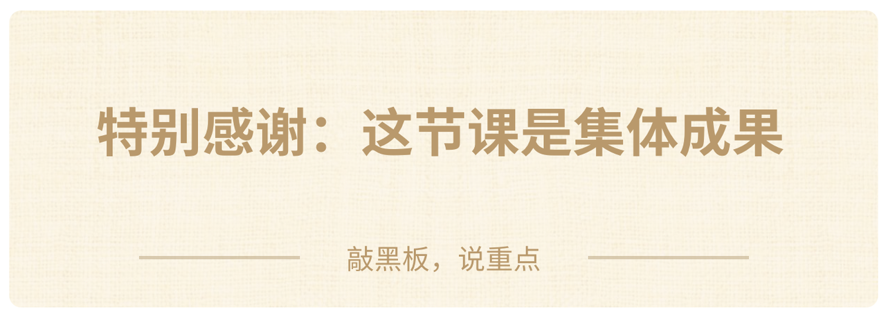

特别感谢下，这节课是集体成果，是一次**很特别的"GONGJIAN"**。

在交付完《案例探索营》之后的1年时间，我们收上来**1万份**人生红点作业，超过了**600万字**的案例思考。上次做完《人生红点认知篇》，又有接近**1500位**同学，提交了超过**160万字**的作业。

为了做这节课，我们整个教研团队都铺上来，把走心的作业几乎都逐字读了一遍，很多内部同学都看哭了，大家的人生经历都成为了这节课的共建内容，融入到这节课里。

### 本期磨课组成员名单

**角色**

**课题组成员**

**工作**

**主理人**

** 楚门Truman**

把控选题、课程方法论架构和教学设计。

**小组成员**

**产品经理：春萍**

- 课程支持：路禹，于陆，盈盈，Cherry，小云，兰毅，李頔
- 课程助理：刘倩，砻沣，Sherry

完成整个课题的拆解和落地：

- 案例调研，专家访谈、案例拆解。
- 参与方法论萃取、课后数据分析和迭代。

**【毛遂自荐🙋】欢迎大家主动报名“学习委员”，谁愿意？**在评论区扣一个：**我愿意**

> 请大家积极报名学习委员，提升上课质量、班级群氛围、督促选课和互帮互助。

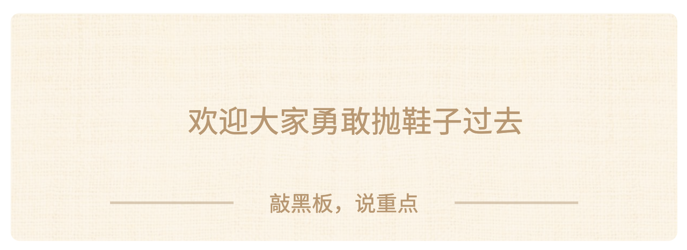

**"认真用一个周日写作业，换来未来10年的更好水平+持续做事复利"**

欢迎大家勇敢一点，把旗子插到山上，把自己的鞋子扔到墙对面去~！

来来来，希望大家一起立一个Flag（承诺），认真听课吸收，最后完成这次训练作业。

扣一句话吧：**一定作业！！**

OK，进入第一个话题。