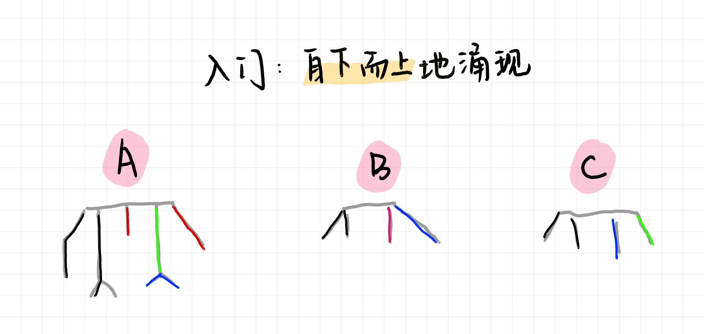
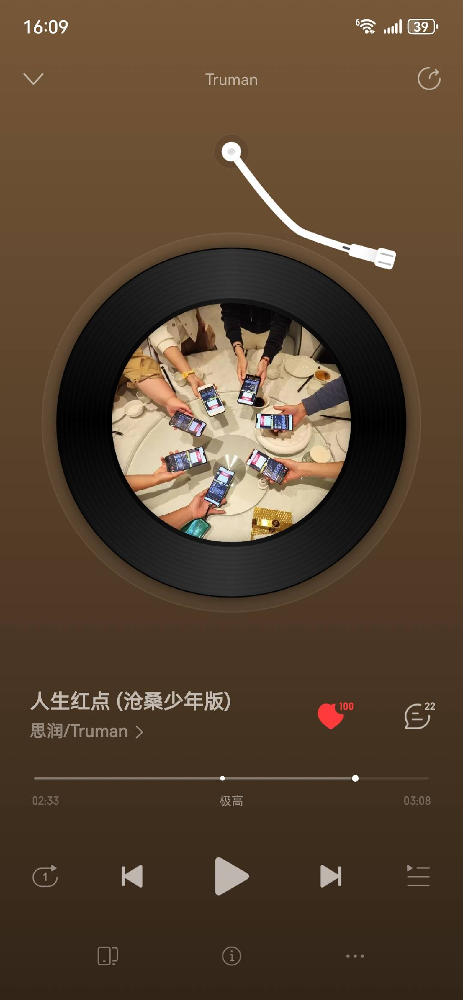
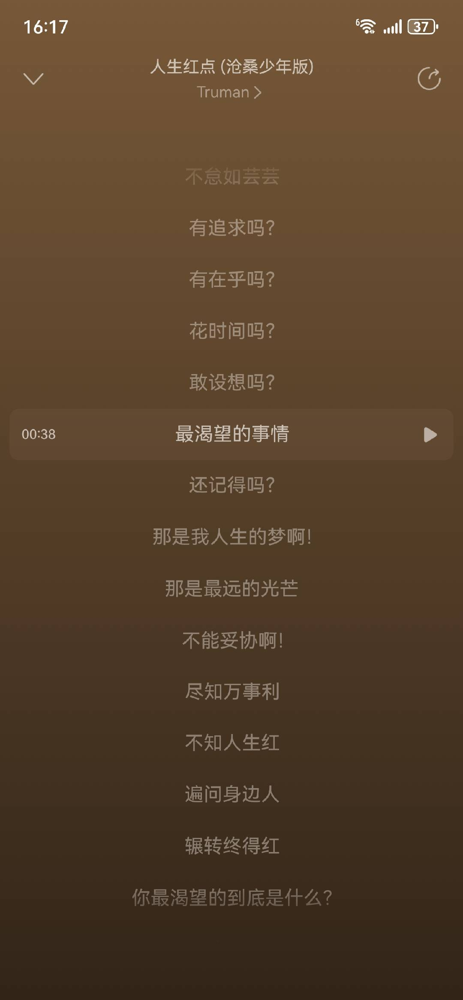
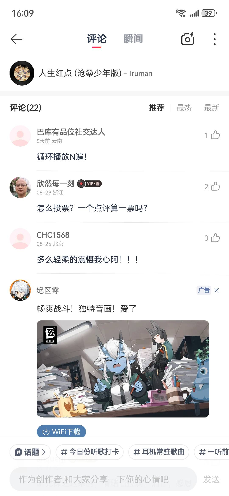
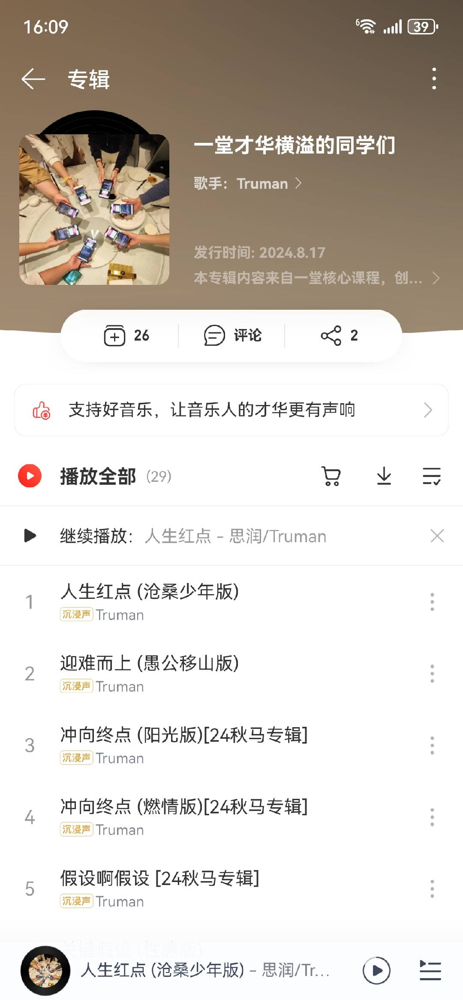

## 入门实操：自下而上涌现

寻找第一红点方法，最简单的思路，就是不断寻找感觉，寻找可能性，不断类比，不断产生灵感，然后体会哪些感受是**可以点燃**你的。



具体来说，有两个策略：

### 工具1：体验他人


这个策略的原理很容易理解，就是试着**站在他人的鞋子里**，进入他们的眼睛，然后去体会，去感受，去思考自己内心的感觉。

如果你想去N个不同的国家旅行，光看定义和百度百科是远远不够的，去看游记，看真实旅客的所思所想，他们的一个个画面，就会自然帮你完成旅行目的地的取舍和判断。


所以，在之前的课程里，我们给过大家一个超级大的Candy，包含了早期探索营的人生红点合集，包含了**366个**作业，共**75万字**的红点思考。

这份Candy活跃度很高，共有**3962人次**浏览过这个文档，我们教研团队内部的同学跟我说，有些同学的红点故事写的特别好，都看哭了，感觉经历了一个又一个的人生。

我们内部有一个同学，不点名了哈哈，之前人生红点一直很模糊，思考很少，上次上完课，觉得自己的红点是成就型。

然后开始处理作业，大量阅读大家的体验：

- 星期三说，我被点燃了，我的红点应该是"体验型"
- 周四又说，我又读了一批作业，发现自己浅薄了，我的红点还是"成就型"

哈哈，课上我曾说过一句话：模糊的正确比精准的错误更有价值，纠结和推翻的过程本身，就是很大的价值。

但是这个Candy作业合集内容太多了，而且没有逻辑结构，对人的阅读理解压力太大了，大家感受到了么？所以怎么办呢？

————

于是我们决定二次升级，这次教研团队全员出动，阅读了几千份作业，遴选出9个红点的分别11个有代表性的作业，分别提炼抽离了2-3句话体感表达，帮助大家理解。

这份材料，一共99个红点，加上我课上讲的人生红点，凑齐100个，我们给这个材料起了一个非常浪漫的名字：**《一堂人生百态：人生红点案例集》**


然后我们在文档开头，分别给大家提炼了红点速读，大家可以用最短的时间，感受这些红点的真实表达和体感：


相对于概念，这些体感的感觉，是不是具体多了？有哪一句、哪一页特别认同or点燃你么？

哈哈怎么样，香不香？

如果你对某一份作业感兴趣，可以根据编号，去阅读他完整的故事、取舍和思考作业。


**【使用说明🙋‍♂️】**特别说明一下，这个**材料比较特殊**：
1. 这些红点是动态的，不一定是"第一红点"，侧重点在体感和思考。
2. 仅限一堂大会员使用，谢绝外传，禁止一切形式分享给非会员。

好啦，工具箱里最简单的工具就讲完了，完整浏览，估计需要花大家30-90min，可以用《人生百态》的100个红点，试着点燃一下自己。

好啦，下一个工具。

### 工具2：红点涌现

这个工具很有趣，最近一堂教研团队招了一个实习生@砻沣同学（前MBA会员/在校生），发现了一个很有趣的人生使命探索方法。

最早这个方法来自Steve Pavlina（美国/2005）的一篇博客：How to Discover Your Life Purpose in About 20 Minutes。


> How to Discover Your Life Purpose in About 20 Minutes（英文原文网址在下面）

```
https://stevepavlina.com/blog/2005/01/how-to-discover-your-life-purpose-in-about-20-minutes/
```

这篇文章我们用AI简单翻译了一下：

> 如何发现你人生的真正目的？我不是在说你的工作、日常琐事，甚至不是你的长期目标。我指的是你存在的真正原因——你之所以来到这个世界的目的。

> 那么，如何发现你人生的目的呢？虽然有很多方法，有些还相当复杂，但这里有一个最简单的，任何人都能做的方法。你越开放，越期待它有效，它对你就会越快起作用。但如果你不开放，对它有所怀疑，或者认为这完全是愚蠢而毫无意义的浪费时间，只要你坚持下去，这也不会阻止它起作用——只是会需要更长的时间来见效。

> 在你忙碌的生活中找出一个小时的完全空闲的时间。**关掉手机，关掉电脑，关上房门，保证这一个小时没有任何打扰。这一小时只属于你，和你要找到人生理想这件事**。你要记住，这可能是你人生最重要的一个小时。你的生命可能在这一个小时后变得不同。如果一个小时的时间货币只能用来换一样东西，那么就是找到你的人生目标绝对是最值得的。
> 1. 拿出一张空白纸，或者打开一个可以打字的文档（我更喜欢后者，因为更快）。
> 2. 在顶部写上：“**你这辈子活着是为了什么？**”
> 3. 写下一个答案（任何答案）你脑海中冒出的任何东西。不一定要完整的句子，短语也行。
> 4. 重复步骤3，**直到你写下那个让你流泪的答案**。这就是你的目的。

> 就这么简单。无论你是咨询师、工程师还是健美运动员。对有些人来说，这个练习会非常有意义。对另一些人来说，这看起来完全愚蠢。**通常需要15-20分钟来清理你的思绪，摆脱你认为的人生目标的所有杂念和社会条件反射。**错误的答案会来自你的头脑和记忆。**但当真正的答案最终出现时，你会感觉它来自你的内心深处。**

> 对于那些深陷低意识生活方式的人来说，可能需要更长的时间来清除所有错误的答案，可能超过一个小时。但如果你坚持下去，**在第100或200甚至500个答案后，你会被那个让你情绪激动的答案击中，那个让你崩溃的答案。**如果你从未做过这个练习，它可能听起来很傻。所以就让它看起来傻吧，反正做就是了。

> 在你进行这个过程时，你的一些答案会非常相似。你甚至可能重复之前的答案。然后你可能沿着新的思路前进，**围绕其他主题再产生10-20个答案。这样很好。只要你继续写下任何浮现在你脑海中的答案**。

> **在这个过程中（通常在50-100个答案后），你可能会想要放弃**，看不到任何结果。你可能会有起身找借口去做别的事情的冲动。这很正常。突破这种阻力，继续写下去。那种抵触的感觉最终会消失。

> 你也**可能会发现一些答案，似乎让你有一点情绪波动，但还不足以让你哭出来**——它们只是有点不完全。在过程中把这些答案标记出来，这样你就可以回头对它们进行新的组合。每一个都反映了你目标的一部分，但单独来看并不完整。当你开始得到这些答案时，说明你已经接近了。继续努力。

> 重要的是要独自完成这个过程，且不受打扰。如果你是个虚无主义者，尽管以这样的答案开始：“我没有目的”或“生活没有意义”，然后从那里继续。如果你坚持下去，最终也会得到结果。

这个是不是听着很有趣？一直写，一直写，一直逼自己写，直到写到让自己**哭出来为止**。

我们内部也亲自做了一个这样的实验，发现实践挺难的，很难哭出来==，而且这种极致的自我封闭回答，对于大家的执行力要求也非常高。

于是，我们尝试保留了这个玩法最有价值的三个东西（专注沉浸/灵感闪现/评估打动），然后了一些改良和化简，发现好用多了，这就是第二个工具：


具体怎么做呢？我们起了一个名字：**《红点涌现：90分钟探索长期愿景》**

**《红点涌现》的具体执行和操作方法：**
1. **专注时间：**先在忙碌的生活中找到90分钟的时间。关掉手机，关掉电脑，关上房门，保证这一个小时没有任何打扰。这一小时只属于你，和你要找到人生红点这件事。
2. **前期准备：**

1. 准备几张大的白纸，或者新建一个电子版的云文档。
2. 锁定你备选，拿不准的3-4个人生红点。
3. 画几个格子，每个格子头部写下红点的名字。
4. **完成1.0：**每个红点写3-5个点，描述你这辈子特别渴望实现的东西。比如：

1. 赚钱：赚多少钱，买什么东西，过什么生活
2. 作品：做哪些作品，改变哪些行业，影响持续多少年
3. 成就：帮助哪些人，做成哪些事情
4. 高手：哪些能力，哪些素质
5. ……
6. **持续涌现：**不断榨取能力，充分的写。

1. 一直写，一直写，一直写
2. 持续逼迫自己写，再写10条，20条，30条
3. 每一个至少写5条，争取10条，而且越多越好
4. 写到3-5条可能没想法了，坚持写，你会再写出来10-20条
5. **最后评估：**评估哪个最多以及哪几条是你最渴望实现的。

1. 看数量多少：哪些凝聚了你更多的愿望和期待？
2. 看欲望高低：哪些欲望最高？你最渴望实现哪个格子？
3. 看妥协取舍：换不换？如果只选一列，换不换？

为了让大家更好的使用，我们做了一个画布，包含了9种红点的思考引导清单：


#### 人生红点· 愿景涌现画布

备选红点

**涌现画面/人生愿望清单（努力列5-10条，越多越好）**

____型

____型

____型

参考思考清单：
1. 作品型：请你描述你希望创造一个什么样的作品/模式/产品
2. 成就型：请你描述你希望帮助哪一类人群，实现哪一类价值
3. 赚钱型：请你描述你希望赚多少钱，过什么样的生活
4. 出名型：请你描述你希望在什么领域，因为什么事被大家所熟知
5. 过程型：请你描述你希望和什么样的团队一起工作
6. 生活型：请你描述你希望和谁一起生活，是什么状态
7. 体验型：请你描述你希望拥有哪些人生体验，过什么样的生活
8. 内心型：请你描述你希望在哪些领域保持长期好奇和探索
9. 高手型：请你描述你希望在哪些领域持续精进成为高手

你可以选2-5个备选红点，然后开始，只要是使劲奋斗，有哪怕1‰的概率能做成，就可以，只要不是100%天方夜谭就行（赚两万亿/成为US总统/娶刘亦菲），勇敢写，没关系。

比如，内部我们的XY同学代入自己这些年的愿景，列了一个很长的清单：

#### 人生红点· 愿景涌现画布（XY同学）

**备选红点**

**涌现画面/人生愿望清单（努力分别列5-10条，越多越好）**

** 成就 型**
1. 参与一件伟大创新型事业（如一堂的「把创业建成一个学科」）
2. 助力更多创业者获得商业成功
3. 用商业化思路解决更多环保领域的老难题（如限塑/垃圾分类/海洋垃圾）
4. 支持更多创新环保产品的商业化推广
5. 帮助更多环保创业公司商业成功
6. 启发更多女性「解放自我不设限」，找到红点，实现自我价值
7. 提升贫困地区女性受教育机会
8. 帮助抑郁症患者重建信心

** 作品 型**
1. 设计一款有效的助眠产品/解决方案
2. 编写一本少儿商业启蒙教材
3. 设计一款模拟商业设计游戏
4. 设计一款更普及的热水循环回水方案
5. 设计一次性筷子/勺子的最佳可替代方案
6. 设计一种国内海量快递包装的环保替代方案
7. 设计一款更普及的太阳能/动能便携充电宝
8. 设计一款自动分类垃圾桶
9. 合伙创立一家长期商业成功的环保产品公司
10. 合伙创立一家影响深远的环保公益组织
11. 写一本自我回忆录：「解放自我之书」
12. 用AI制作一个「平行世界的N个我」系列短片
13. 编写一本文集「影响世界的100名优秀女性」

有了这个单子，就可以观察数量、渴望程度和取舍了，如果保留一个格子，就可以思考选哪个了。

再比如，为了示范，我也尝试理了理我的备选红点：

#### 人生红点· 愿望涌现画布（T同学）

**备选红点**

**涌现画面/人生愿望清单（努力分别列5-10条，越多越好）**

** 成就 型**
1. 帮助中国的高潜力选手变得科学
2. 帮助创业者集体成长
3. 帮助中国人找到商业理论自信
4. 帮助人用教育激发潜力
5. 帮助解决遗失儿童找回的问题
6. 帮助足够多的人尽早探索人生红点

** 作品 型**
1. 建立早期科学创业/管理方法论体系
2. 探索一个严肃教育的创新模型
3. 把一堂五步法帮助N个国家的人平等对话
4. 探索出一个"广泛共建"的公司形态
5. 设计创新惊喜婚礼
6. 设计创新告别仪式
7. 写一首《张三的歌》级别的音乐
8. 拍一部中国版的《楚门的世界》
9. 写一篇科幻小说（近景科幻）
10. 做一个未来博物馆（广泛幻想思考未来）
11. 写一本回忆录

**高手型**
1. IPO认知迭代
2. 泛产品创新能力
3. 刻意练习高手
4. 从0到1创新做新业务
5. 成为知识萃取和建模的高手
6. 高阶商业分析能力

** 赚钱 型**
1. 财务自由（￥1个亿）
2. 自由全球生活（不考虑物质）
3. 全家住一个大别墅（市区）
4. 外太空旅行
5. 死亡后冷冻（N年后解冻）

我们内部根据作业和需求，推演了一个愿景画布：

#### 人生红点· 愿望涌现画布（QL同学）

**备选红点**

**涌现画面/人生愿望清单（努力列5-10条，越多越好）**

 **体验 型**
1. 去50个国家，体验当地的美食，感受世界各地的名山大川、风土人情
2. 关注每年最好的电影、电视剧、游戏、音乐会、演唱会等
3. 体验各种新鲜事物，比如最新的AI应用、最新硬件产品
4. 看完1000部最经典的电影，阅读最著名的100本小说
5. 学习一种全新的语言，与当地人深入交流，了解他们的生活方式
6. 参加极限运动，如跳伞、潜水、攀岩，挑战自己的极限
7. 在世界各地的音乐节和艺术展上感受多元的文化艺术氛围
8. 在海边小镇度过一段时间，体验悠闲的海滨生活
9. 学习制作各国特色美食，丰富自己的烹饪技能
10. 乘坐火车或自驾游，深入探索一个国家的风景和人文
11. 在不同的国家居住一段时间，融入当地的生活，结交新朋友

** 生活 型**
1. 一家三口，有猫有狗，住着空间足够的大房子（有院子）
2. 父母亲戚住的很近，走路能到，随时串门聊天
3. 居住在宜居的城市，有便利的生活环境
4. 每年全家旅游1-2次，隔年出国游，探索世界的美好
5. 家里安静整洁，有鲜花有音乐
6. 每天和家人共进晚餐，分享一天的收获
7. 有一群志同道合的朋友，彼此支持和理解
8. 住在安静的社区，孩子们可以自由玩耍
9. 家中常有欢声笑语，气氛温馨愉快
10. 有固定的家庭聚会时间，增进彼此感情

** 内心 型**
1. 我想知道人脑的心理学机制
2. 我渴望理解宇宙运行的规律
3. 我想了解意识与自我的本质
4. 我渴望发现治愈疾病的新方法
5. 我希望掌握人工智能的发展方向
6. 我想探索地外生命的存在可能性
7. 我渴望理解量子物理的奇妙现象
8. 我想知道人类历史上未解的谜团
9. 我希望发现可持续能源的创新途径
10. 我渴望理解文化和艺术的深层意义

好啦，这个工具就讲完了，这个工具如果完整使用，可能需要1-3个小时，而且可能不止一轮，可以持续重复进行。

哈哈，在入门阶段，强烈安利大家一首音乐，这首歌来自我的人生红点的魂儿，@思润同学用AI创作。如果你希望沉浸思考，自我激发，唤起思考，可以试试用这个作为BGM，效果很好：










这次做课，我全程单曲循环这首歌，至少听了200遍，给了我源源不断的思考和创造力。欢迎大家关注收藏这首歌，长期订阅，随时使用。

> **路径**：网易云音乐，搜索"Truman"，看到全面歌曲列表。

> **强推**：建议一键三连，关注Truman，订阅专辑，点赞&评论；

> **场景**：课前热身，作业前复习，开车，**日常磨耳朵，氛围熏陶。**

📹 0f68f790835074ce4aea0860270ec76e.mp4

自下而上的涌现，通常充满了随机性，偶遇到了某一个作业，偶遇了某一个灵感，这种思考很容易，但时常失效，下面我们进入进阶分析。