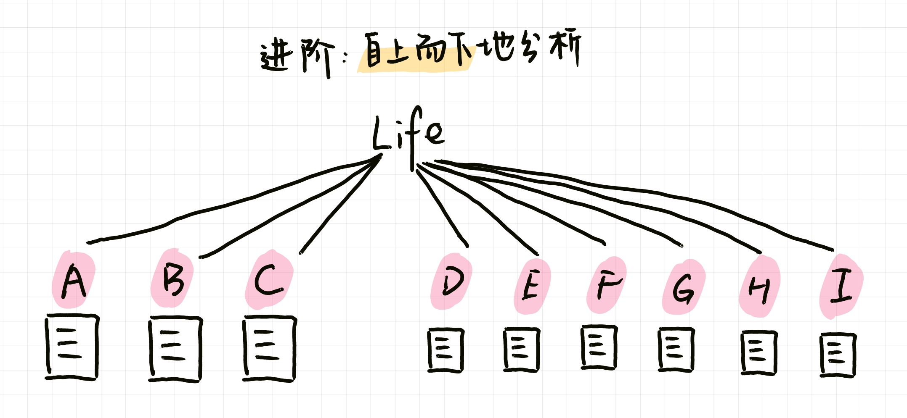

## 进阶实操：自上而下分析

第二种叫做自上而下（Topdown）的分析，就是从整个人生的全局，从9个红点进行综合取舍，不断深挖，不断排序，不断分析，不断纠结，最后完成排序。

我画了一个示意图，更像是下面这样：

一共有两个工具，从简单到复杂，我来讲讲。

### 工具3：自我诊断

这个策略，就是自己给自己诊断，看看不断通过深度思考，一轮轮思考，来不断洞察和接近自己的人生红点。

其实，当年我偶遇红点理念以后，我用的就是这个策略，有大概一个多季度，疯狂跟自己纠结，用各种角度，各种人，各种问题，来唤醒我的自我思考：不断提问，不断对标，不断幻想，不断逼问，不断复盘，最后才发现，我是作品型。

比如，张同学，一直纠结自己红点，后来开始寻找自己的**行业对标**，发现了头部的咨询公司"华与华"，发现这种有方法论+创作型的咨询公司是最渴望的，于是开始锁定为"**作品型**"。

比如，陆同学，在多个红点间犹豫，通过多角度的**无限想象**和**未来画面的具象**，发现自己希望体验不一样的人生，想体验各个地方的风土人情，想尝试各种新奇的运动和体验，想学习各种新知识和技能，最后笃定自己是"**体验型**"。

比如，李同学，不断复盘自己的**低谷瞬间**，发现小时候在农村穷怕了，再也不能忍受这种生活，笃定自己是"**赚钱型**"。

比如，马同学，在现实和理想间摇摆，她通过复盘过去的**冲突矛盾**，和对未来的**美好想象**，发现自己无法接受全职主妇的生活，必须有独立生存在这世上的方式，要有自己的事业，确定了自己是"**高手型**"。

比如，李同学，难以确定自己的红点，通过回顾**峰值体验**发现有结果的业务更让自己满意，发现周末闲不住喜欢不同的风景和美食，初步筛出"成就型"和"体验型"，然后通过**低谷瞬间**和**排除法**，排除了出名型、作品型等等**，**最后"**成就型**"是自己的Top1。

比如，欧阳同学，通过**问过往**，不停回顾过往经历，发现一直在追求让自己变强；并且希望未来在某个领域取得真正的大成果，成为一名高手；希望能站在舞台上发光，在出席活动时拥有自己的身份，而不再是默默无闻的观众；最后确定了自己是"**高手型**"。

比如，顾同学，毕业后曾经极度挣扎工作选择，通过问自己过往的**关键选择**，认可了自己的航空工程行业选择；然后找到了**对标标杆**，马斯克的SpaceX，用技术去改变世界的公司是自己向往的；通过**美好想象**，希望有充足的经费有自己的Team，能够通过科研落地来实现造福人类的图景，最后笃定了自己是"**成就型**"。

【自我诊断】这个策略的核心是，花足够多的时间，去多个角度去思考，去调研，去判断，去取舍，然后一步步让自己想清楚，完成自我说服。

具体怎么做呢？准备好，我们结合大家交上来的上千份作业，基于《认知篇》的12问，做了一轮升级，打磨了一个《人生红点12问第二版》：

**【重点💡】使用方法：**从上面的12个提问角度，选择至少3个角度，然后进行自我提问和学习，大概需要3小时-3个月不等的时间，来探索自己的长期追求。

这个版本基本上实现了Topdown，但是还是太难了，对于大家的深度思考+自驱自立要求很高。很多时候，用一张表来自我提问，大家往往很难想清楚，下面，我们继续来升级。

在去年11月，我第一次在小范围用探索营的方式，交付了第一次案例启发版本的《人生红点》，让我非常意外的是，在线下MBA三天两夜，场上很多人都在聊人生红点，大家互相分享，互相分析，聊得不亦乐乎。

### 工具4：相互讨论

这种讨论有个前提啊，就是大家认可"人生红点"的重要价值，以及有基本的认知基础（认识9个红点），然后可以进行讨论和交叉提问。

哈哈，这个讨论的重要工具，就是9个人生红点类型，全部摊在桌子上，进行排序，上移下移，通过可视化的工具进行讨论

> 你可以用一堂官方卡牌，也可以用餐巾纸现场手写，前者高级，后者值得收藏：）

给大家还原两个我看到的案例：

第一个案例：相对比较简单。

大概的交叉讨论流程是这样的：
1. **解读红点**：回顾9个红点的概念，快速对齐。
2. **同步边界**：

1. 目的和手段：要区分哪些是目的，哪些是手段。
2. 取舍和兼顾：可以兼顾，但需要做战略取舍，需要妥协。
3. **罗列红点**：把卡牌or餐巾纸铺在桌子上。
4. **划分象限**：把红点分成四堆，解释下四堆的区别，初步感受偏好。
5. **强行排序**：哪几个红点对你来说是优先级高的，哪些放弃，哪些是底线要兼顾。
6. **终极PK**：结合眼下困扰，现实问题，极端情况进行讨论。
7. **完成判断**：选出来Top3，甚至Top1。

这个讨论大概持续了30min，锁定了红点和大概的发展策略。

第二个案例：相对复杂一些（来自线下MBA追溯）

大概的交叉讨论过程是这样的：

> 李同学刚毕业2年，在一家互联网公司做运营工作，感觉对未来有些迷茫。

> **第一轮：优先选项**

> 我们聊到了人生红点的话题，李同学很感兴趣，于是我拿出九张卡牌，分别向李同学介绍每个红点类型的概念，询问李同学对哪几个红点最向往。

> 李同学思索了片刻，选择了赚钱型，高手型和成就型，其他感觉一般。

> 接下来，**尝试探寻李同学选择背后的思考**：

> - 赚钱型：大学就开始自己做生意，喜欢赚钱，也希望向家人证明自己的能力

> - 高手型：享受自己一点点变强的过程

> - 成就型：内心很渴望可以帮助到更多的人，享受这种成就感

> **第二轮：分析困扰**

> 接下来，我们聊了**很多这三个红点与当前困扰的关系**，并且结合我自己的感受和经历，给出了一些启发和建议：

> - 赚钱型：现在的运营工作未来真的可以赚到很多钱么？这条路的下一步是什么样的呢？

> - 高手型：现在的公司对你有哪些系统的培训或者能力锻炼么？运营高手是你想成为的么？

> - 成就型：现在的职业发展道路，未来是否真的有机会帮助到越来越多的人呢？主要是希望帮助哪类人呢？

> **第三轮：聚焦红点**

> 经过充分的探讨，李同学逐渐开始理解自己内心的向往：

> - 赚钱型：更多是为了证明自己的能力，其实够用就好

> - 高手型：这是一种路径，不断变强才能拥有更大的成就

> - 成就型：自己真正的追求，帮助他人，甚至改善世界，人生才有意义

> 最后，我也建议李同学，成就型最重要的是“**成事的能力**”，眼下的工作是否能够让你有足够的成长？是否可以让你锻炼闭环的能力？

> 如果是，那么也许可以踏踏实实再做一两年，同时更加具象自己的红点；

> 如果不是，那么先找到能够成长的路，红点是终局，先走好必经之路。

是不是沟通还不错？看到有同学，只是听了我的认知篇，就能给身边的人的提出有建设性的建议，真的很不错啊，红点模型给了大家一个**理性探讨、平等对话的工具**。

如果你参加一堂线下活动，或者本身就是带着团队学习，可以试着用纸巾or卡牌排排序，往上推一推，往下拉一拉，鼓励思考，提问引导，相互激发。

做到这个水平，基本上就算是**70分进阶**了。

这里，我也给大家讲讲，经过7年的自我红点迭代，聊过50+人红点，深度辅导过20+红点，我最近在练习什么。

前面不管是入门还是初阶，基本上都比较浅，其实我这几年的经验是，真正红点理清、击穿那一下，基本上都是+1+2+3层挖下去，才能发现一些规律。

下面我们进入高阶实操。