## 高阶实操：专家深度挖掘

### 工具5：专家辅导

这个和前面1v1讨论有什么区别呢？这个就不只是一个交叉讨论or互助了，而是要深入下去，有些像"教练/咨询师/人生红点指导师"的工作。

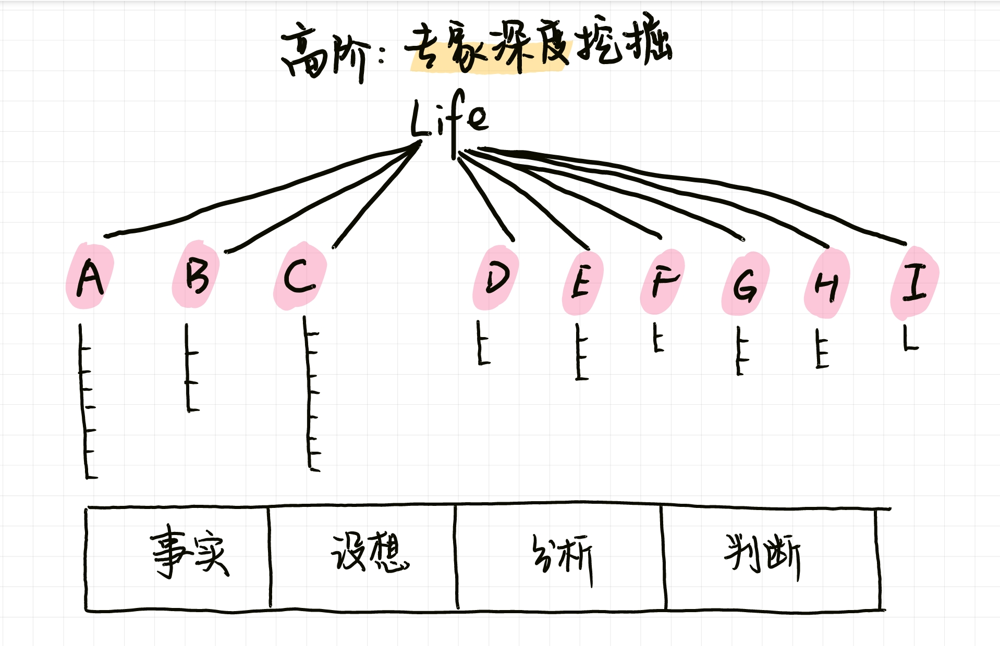

基本上，最近两年，面试沟通时候，如果是高潜力&跟我直接汇报的同学 or GAP同学，我基本都会聊一轮人生红点，少则90min，多则2-3个小时，全面聊一聊人生决策。

其实本质上，就是我们一起看一看，过往几十年的人生，到底是什么形状：

甚至我记得，我聊过2个妹子（考虑全职），发现是B/C，现场被我聊哭了，现场挖出了很多决策习惯的矛盾，以及工作经验的大量"浪费"。

大家是不是很难理解，红点这么简单的问题，为什么能聊2-3个小时？

我给大家还原一个最近做的比较透的一个真实的人生红点讨论过程：

这个同学，怎么介绍呢？背景非常好：
> 1. 一直在很好的学校、很好的公司，学习工作都比较认真负责，但可能因为责任感强，所以有一种“被推着走”的感觉
> 2. 每一次跳槽/换赛道都是因为发现了自己“不想做什么”，但一直对于自己“想做什么”没有明确的目标
> 3. 人生机会选择，感觉一直像个好学生在做题，但想从“做题的人”，变成“出题的人”，真正掌握自己的人生主动权

她之前对于成就型，体验型，作品型，内心型，甚至生活型都很想要，不想放弃。而且过往经历看来，赚钱也不少，也有很强的好奇心， 而且一直感觉不够笃定。

因为要来一堂GAP（未来可能很长期），所以我做了一次1v1的深度面聊。

**第一阶段，我会先对齐认知和营造氛围（3-5min）**

我会比较正式坐在会议桌上，找一个时间充裕，头脑清醒的长时间段，清空桌面，准备几张A4纸张用来记录关键要点。然后提前热身铺垫：

- **明确价值：**人生红点的讨论价值，挖掘背后的动机和决策逻辑。
- **基本原理**：分析你的一系列决策习惯和思考，来观察你的"真正的红点"。
- **铺垫姿势：**足够开放，我会简单直接提问，希望不要介意。

**第二阶段，还原过去的每一段经历。**

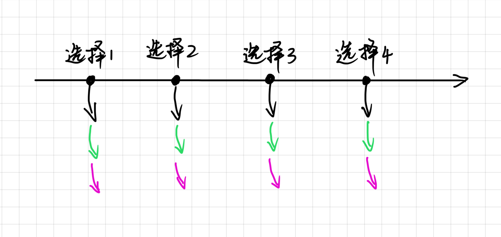

我从高中文理分科开始问起，到大学选专业，学生时代的关键选择到底是因为什么？

> 这是作为一个独立成年人真正开始的**第一个自主的选择**。

> 主动选择了文科，考了Top2大学，后来选择了政治科学。

我感觉她逻辑性很好啊，不像是文科生，有些矛盾，于是追问：你不像是典型的文科生啊，这个决策背后，到底是什么为什么呢？

这时候她才说出了原因：

> 实际上，从小就特别注重逻辑和因果关系。

> 物理很好，但因为化学不够好，于是选了文科。

> 为什么选择政治学而非经济学，是因为感觉经济学过于注重定量的相关关系，而非因果关系。

怪不得，这个才是她真正想要的背后动机。

**第二个重要的选择：**于是继续追问，后来去英国读了研究生，为什么本来的道路是学术/PHD，而毕业以后去了头部快消公司，做了营销？

她说：觉得做学术研究，根据当时的情况可能研究话题会越来越窄，同时看到一些前辈的生活状态也不太理想（焦虑、压力大等），虽然我不知道我想要什么，但我知道这条路，不是我长期想要的。

我追问：那具体是什么契机，你会有快消品的想法呢？

她说：我开始观察自己在学术外喜欢干什么，我发现逛超市时候就挺开心，所以后来有快消行业的面试机会就去了——这个选择**比较随机。**

> 背后，可能代表了“生活型”可能是某种底线。

**第三个重要的选择，**做了几年，为什么从头部消费品公司的营销方向，换到了咨询公司？薪酬，机会，老领导推荐，城市，还是什么？

开始她说：我觉得咨询行业看的东西比较多，更有新鲜感。

然我追问：这个背后是什么呢？你到底背后的原因，图什么？

这时候，她才说：营销中主观的成分过多，很多规律都没办法证伪，而我对其中的一些偏策略的内容（市场预判、消费者研究、品牌策略）等更感兴趣，所以选择换到咨询赛道。

**第三阶段，我开始挖掘背后的偏好和追求。**

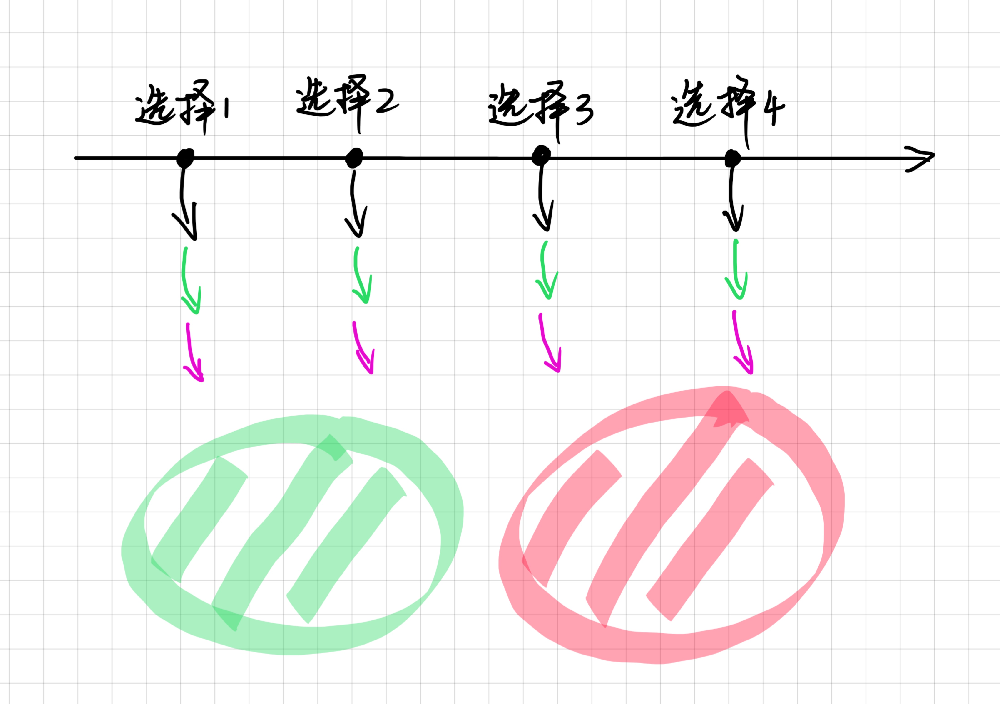

我尝试问了"一对截然相反的问题"：

- 过往工作里，哪个环节/项目/瞬间你特别享受，有成就感？如果未来几十年，全是这种工作你会非常开心？
- 过往工作里，哪些环节/项目/瞬间你特别难受，非常痛苦？持续消耗你，你在持续忍耐，未来再也不想遇到？

这时候，她敞开聊了一些主观感受：
1. **喜欢的时刻：**例如一次咨询项目中，帮客户指出一个长久以来的卡点，客户非常感激，后来成为朋友。例如在一些时刻用逻辑改变他人的想法，让他们觉得有收获，帮他们解决问题
2. **不喜欢的时刻：**例如一个问题大部分是因为内部的政治斗争而产生，而咨询项目作为背书去做的时候，就觉得很没有价值感；例如花很多时间去研究一个影响不大的、鸡毛蒜皮的决策

这时候，我们一起新发现了一个新洞察：**解决有意思的新问题**，会唤起她极大的热情。

我记得我追问了一个问题：解决问题有很多手段，靠融资，靠资源，靠管理，靠努力...我发现她内心非常笃定一个事情：她对于洞察本质，找到因果关系来解题，有极大的热情。

然后对于未来的期待，如果能持续解决新问题，能持续洞察因果规律，持续把事情想透，然后来解题，这件事情她有极大的自驱力，但这些年，真正花在这件事情上的"高质量训练时间"并不太多，不到工作总时间的20%。

**第四阶段：开始尝试建模，给人生偏好建模。**

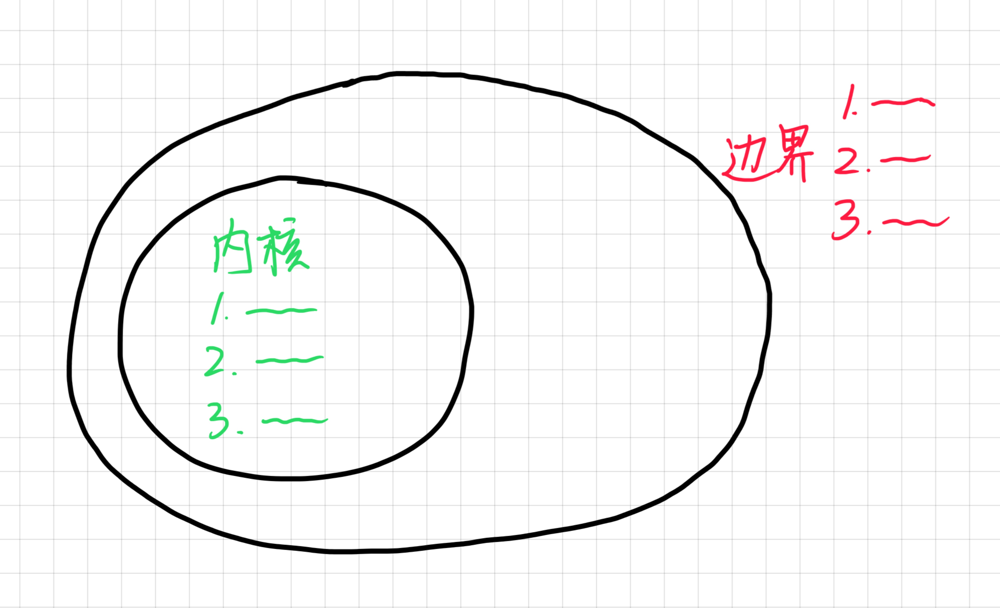

今天我讲的比较粗，当天1v1，我记得我记了满满登登3页纸，每一个决策的事实，背后的原因，以及底层的规律。

然后我尝试给她的偏好（过去/未来）建了一个模型，画了一个有了一个初步的内核&边界：

- 内核：规律，因果，解决问题。
- 边界：关系，政治，重复，扣无意义的细节。

**第五阶段：开始尝试用红点取舍。**

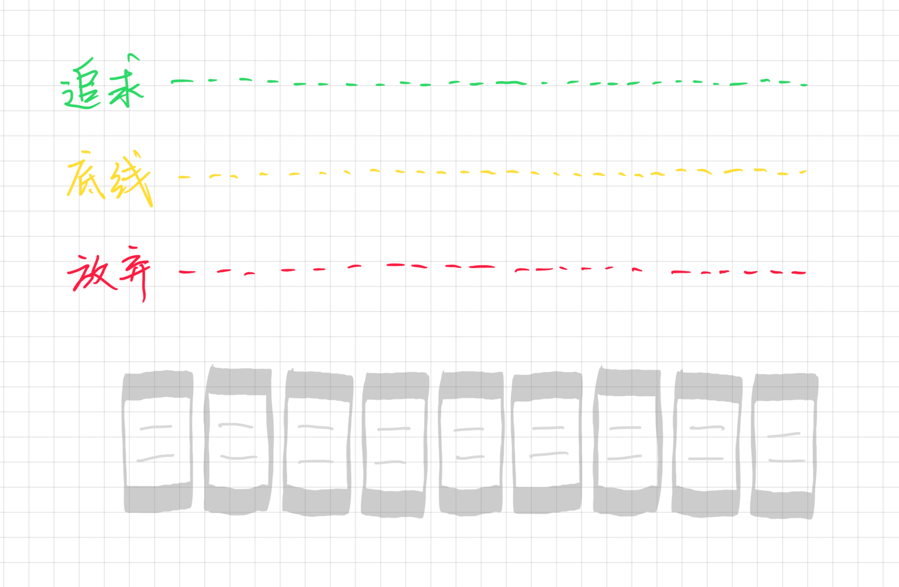

我抽出一沓餐巾纸，然后每个餐巾纸写下一个红点，码成一排，用刚才的信息，开始试着取舍吧。

- 第一步：先排除掉一些**肯定不是**的（如赚钱型、出名型）
- 再确定一些是**底线的**（如生活型、过程型、内心型），要兼顾，但不是核心追求。
- 最后的**核心追求**，几个选项进行两两PK（成就型vs作品型）

在这个阶段，【成就型】和【作品型】挣扎了很久，左手右手感觉1v1，一直不愿意妥协。

然后我鼓励她说：趁着跟我讨论，你最好现场努力想明白，你现在的犹豫不决，会在未来几十年持续的困扰你，持续的让你摇摆不定，然后鼓励她不断纠结。

这个阶段，我开始给她补充例子，用我过去的见识给她一些场景的**画面描述**：她所在的行业/赛道，常见的作品型、成就型一般什么样，有什么能力，厉害的人一般什么样子。

例如在咨询行业，“做出一家有自己方法论的企业（例如华与华）” vs “对每个客户都有不同的解决方案，也能很好解决问题，但不一定有一套统一的东西”

然后我试着把她逼到墙角，给她举了一些**极端的选项**：

- “如果现世完全没有成就，但死后作品流芳百世”
- “现世非常成功，但死后没有任何痕迹”

然后一路追问，一路补充信息，一路"强迫"思考，最后她发现，她其实还是很希望长期的影响这个世界，不只是眼下，更在乎对这个世界长期积极的影响（身后依然很重要）

终于，在聊了差不多两个小时以后，初步达成了自洽：**作品型（自洽）**

如果未来，为了实现更长期的美好作品，她愿意妥协眼下的很多选项（赚钱、过程、体验甚至成就），希望长期可以成为一个优秀的作品型选手。

**最后一步，第六阶段，我展开拆一轮作品型的子类型和路径。**

我尝试给了作品型的"二级目录"：
1. 按作品方向：商业范式，学术，底层理论，规律建模，文学艺术作品，传统文化。
2. 按行业/类型：教育，金融，医疗，消费品，2B，2G。

于是又迭代了一轮【内核/边界】，最后给她画出了一个图：

不只是完成了自我自洽，也找到了自己实现路径上的两个短板：

- **不够笃定：**过去很多选择，看项目太多，看背后能力积累不够。
- **缺少练习：**作品型必须要长期刻意练习，但之前的练习意识不够。

下一步要逐步调整，补齐对于作品型长期能力的"构建"，以及对于"核心能力"的刻意练习，争取每年/季度以肉眼可见的速度，在提升自己建模/做产品的能力。

于是，这次1v1沟通，大概2-3个小时，愉快结束~~~

哈哈，大家发现这个过程中，我起到的作用了么？相对于同学之间1v1交叉讨论，一个偏专家、教练式的沟通，有什么区别呢？

我们简单总结一下：

**第一个价值：追问。**

答案不是靠对方主动说的，而是靠深挖出来的，你可能发现了，通常问到背后的WHY一层，两层，三次，甚至找到彼此的相同点和矛盾点，才会知道她真正怎么想的。

因为我非常笃定人生红点的价值，以及对于职业发展的笃定，我自己一直这么做的，也聊过很多人，所以会非常笃定、自信地挖掘和追问，不轻易妥协。

**第二个价值：补充。**

很多时候对方见的不够多，我会现场补充一些优秀对标、画面、选项，如果现场去调研显然来不及，而如果我能直接吐很多信息出来，把开放选择题，变成封闭选择题，就能大幅提升讨论的效率。

很多时候对方做不出选择，我说一句话：

- 做一个华与华，但短期营收并不太高。
- 做一个赚钱的咨询公司，关系和销售体系搭得很好，规模是5倍，但没有模型/方法论。

你愿意做哪个？

往往一个具象选择题，就能"逼着"Ta想清楚，找到更具体的体感。

**第三个价值：建模。**

2个小时的信息量是很大的，正常智商（我）是很难靠记忆力记住，并且理解内在逻辑关系的。通常我会现场记笔记，画图，甚至建新模型，来进行深度解读。

> 背后能力：《知识萃取》上面的那些练习的方法。

正是因为我有了**追问，补充，建模**三个价值，我可以在3个小时内挖掘过去5-10年经历，包括未来10-20年的设想，以及背后的洞察和原因，而且现场建模，现场得出结论。

> 客观来说，现场得出Top1并不是所有，大概70%的概率吧。

我不知道对于大家来说，这种深度的2小时的沉浸专业辅导探索，对你的人生值多少钱（支付），但说实话，目前除了跟我汇报的关键角色，我真的很难提供这样的支持。

> Sorry 1v1私聊咨询默认都会拒绝，除非你的报价超过N万，让我足够心动再议。

**【提问🙋‍♂️】**那怎么办呢？

————

哈哈，那下面一个有意思的问题来了：

我这两年，一直在刻意练习这个能力，在招聘面试，内部员工重用之前，人生红点是我考虑最重要的维度之一。

这次磨课，教研团队做了一个非常艰苦的工作，我们尝试做了一套辅导问题清单，把我大概几十次沟通的逻辑，抽象成了4步/12组/36个问题库，形成了一套**《人生红点教练CoachKits》**

还不够，既然叫工具箱，还是要更落地一些，除了之前我们的9张**红点卡片**，我们又做了12张**提问卡片**，类似于高中时候，我们老师那个"偷偷在用"的教辅书。

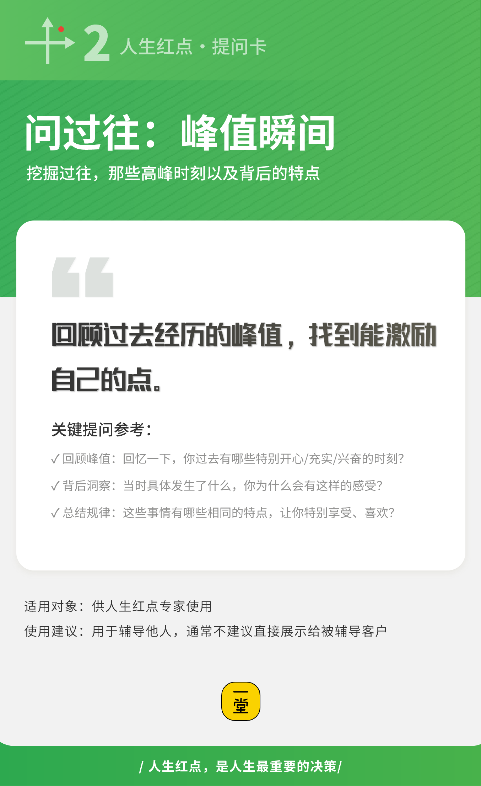

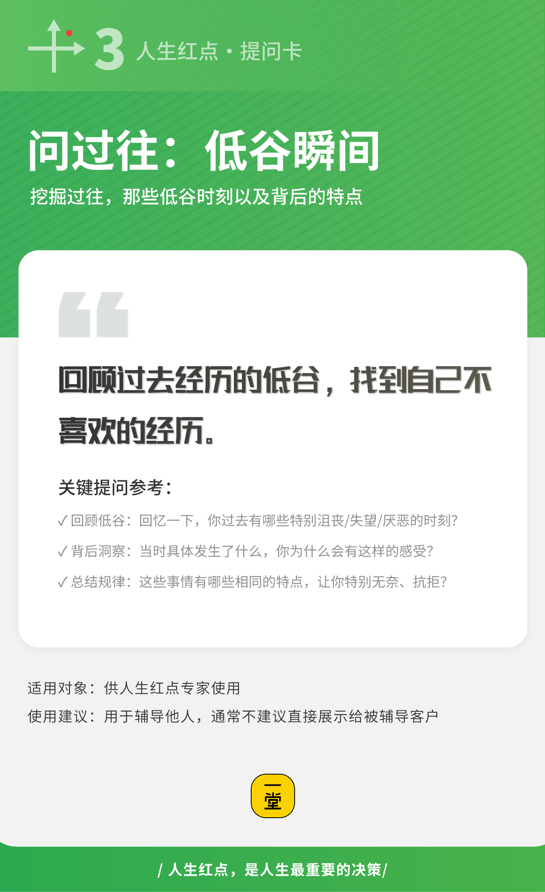

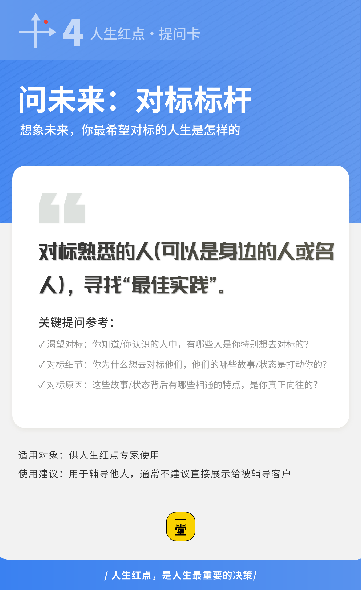

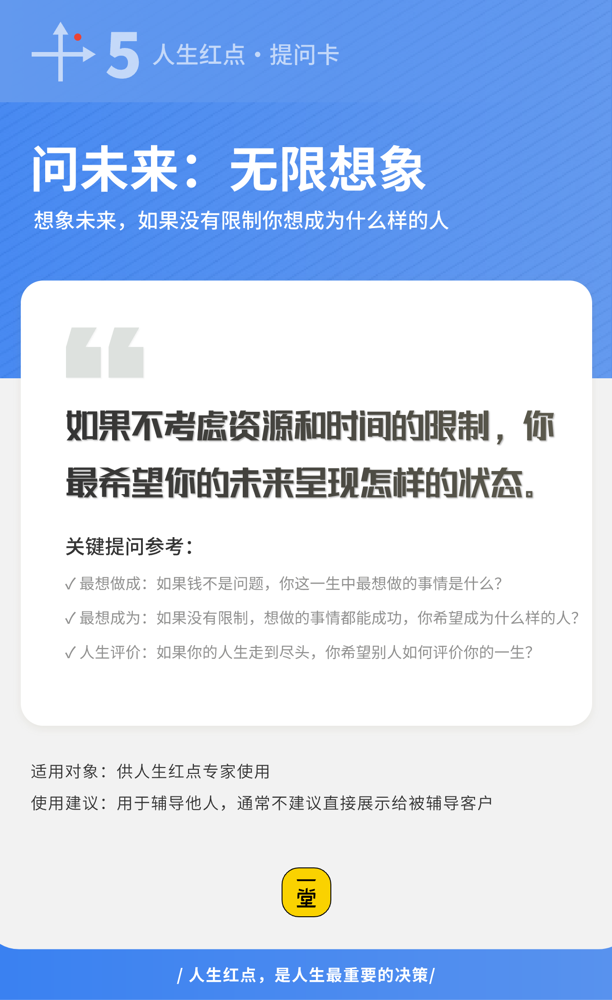

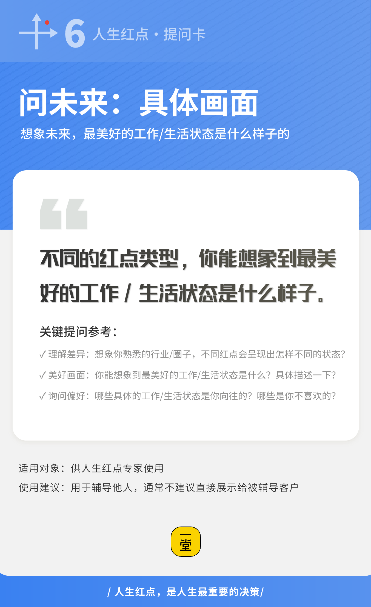

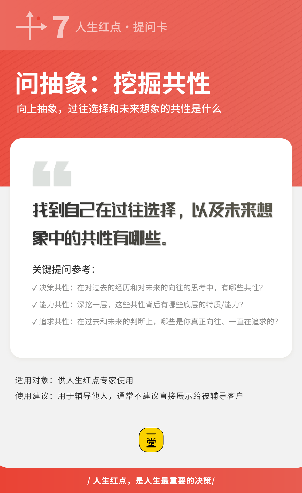

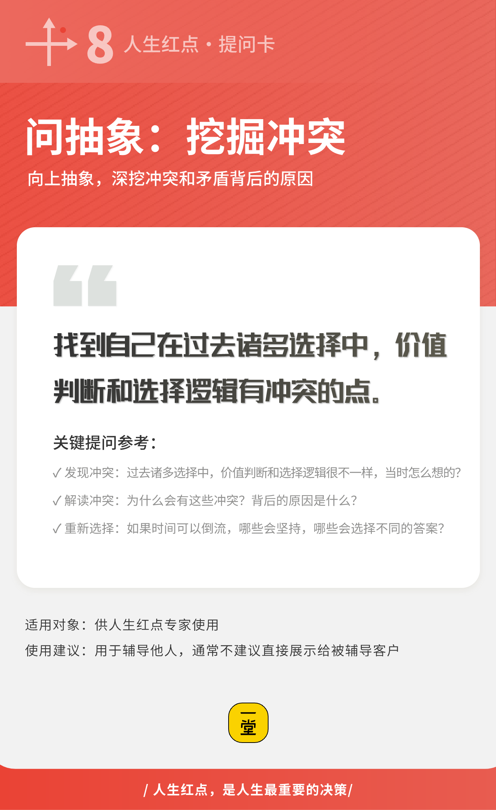

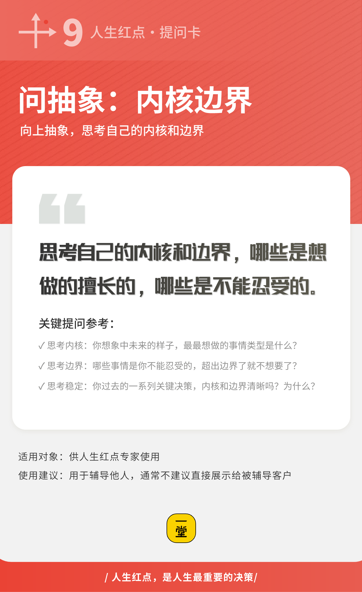

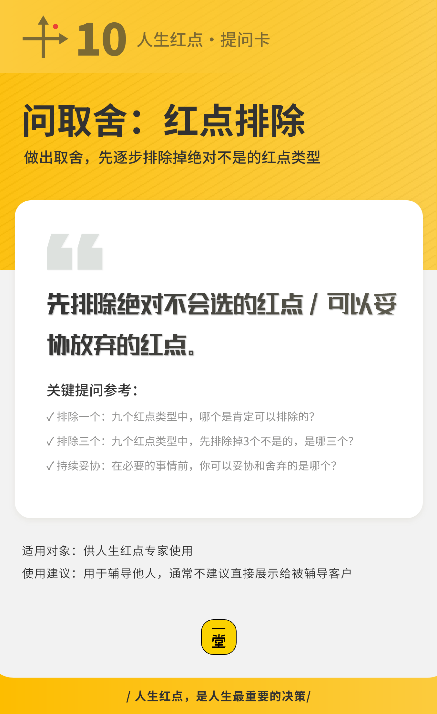

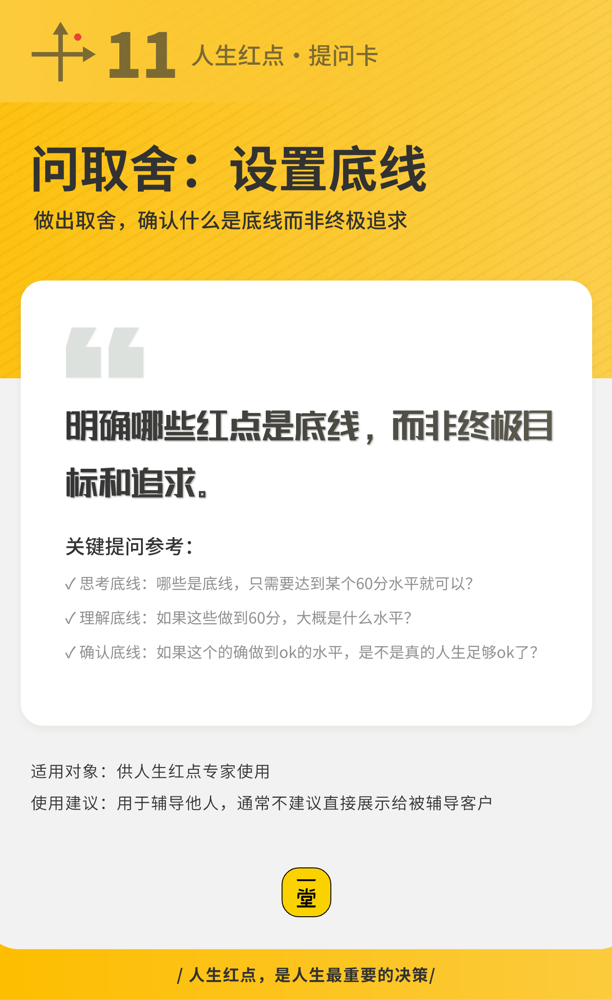

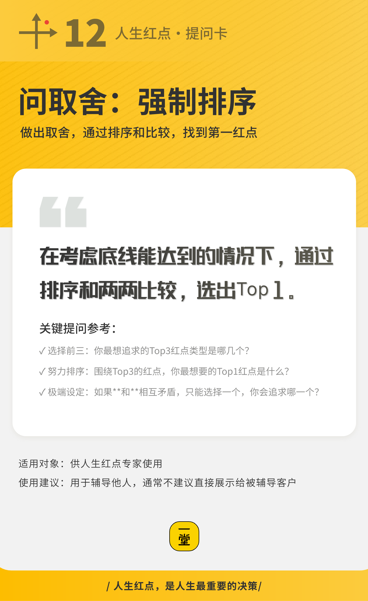

**【使用建议💡】**这个卡片的使用建议：
1. **努力记住：**每个卡片是个独立策略，重点熟悉or背诵其中的关键提问。
2. **不必展示：**这是自我练习卡片，不建议直接展现给用户（显不出价值/出戏）
3. **谨慎使用：**人生红点不要轻易探讨，要充分理解价值再挖掘（不然很尬）

期待未来大家可以更多地挖掘你身边人的红点，更好拉起认知吧~~~

哈哈，出于逻辑完备性（不能只是1v1）和同行最佳实践考虑（人生设计工作坊），我们应该也有一个1v多版本吧？

### 工具6：集体工作坊

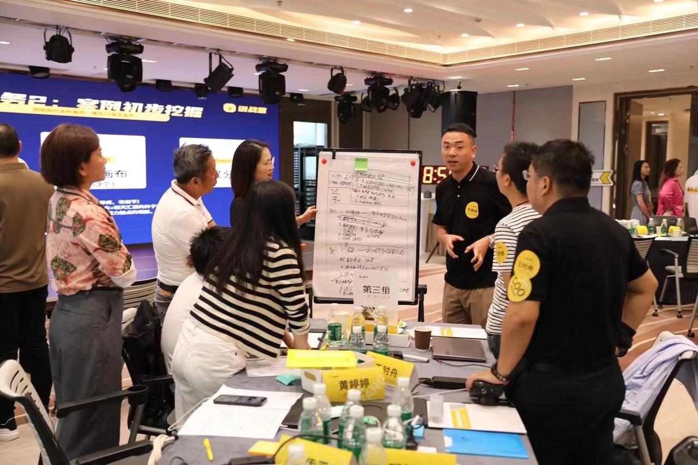

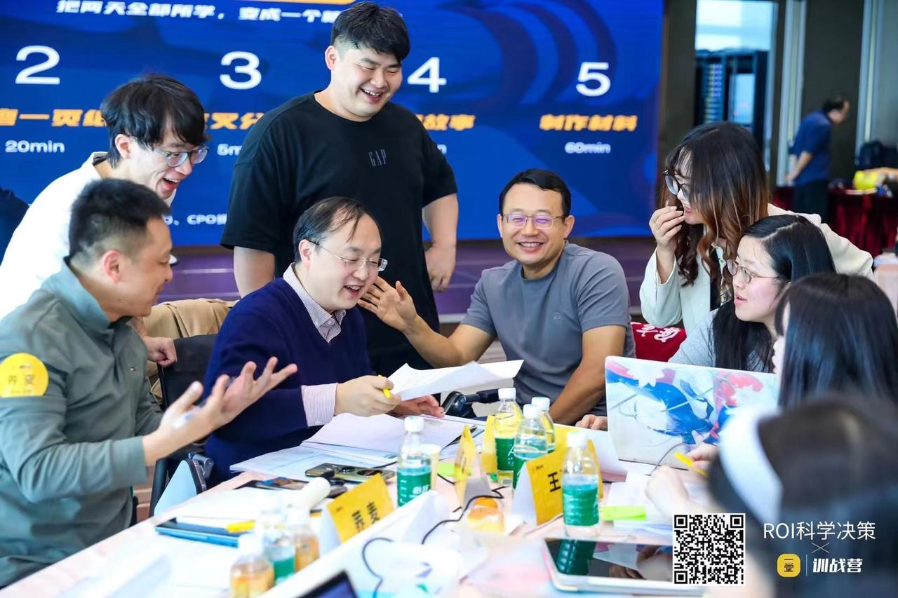

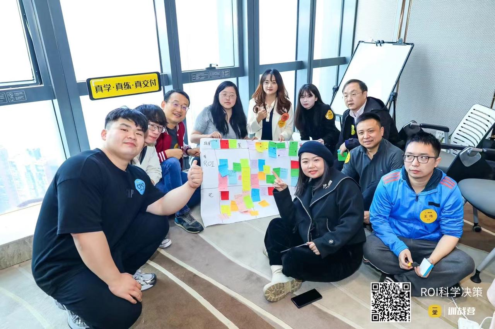

你们觉得，这个能做成工作坊吗？

————

我先说结论啊，不知道。目前没有计划做成一个长期正式产品，目测这个产品并不会卖的太好，太虚太空，很容易被Diss（触发"不空杯"技能）。

不过，我们内部的确提出了个大致的设想：
1. 画像：自我探索 or 练习帮别人探索。
2. 人数：做一个40-60人的工作坊。
3. 练习：红点辨析，氛围营造，深度追问，现场建模。
4. 机制：我来1v1示范，然后大家临摹Before，练专项，再临摹After。

哈哈，这个完全是臆想（YY）出来的模型啊，只是粗看方向可行，没有任何的测试和验证，我们就默认它们失败 or 大调整吧。

如果《人生红点》这个课题持续超出预期，或者大家作业热情比较高的话，我们倒是可以考虑在北京一堂实验室，做一个"实验性质"的人生红点工作坊（2天），看看能不能显著提升大家的探索能力。

埋个伏笔，以后再说吧。