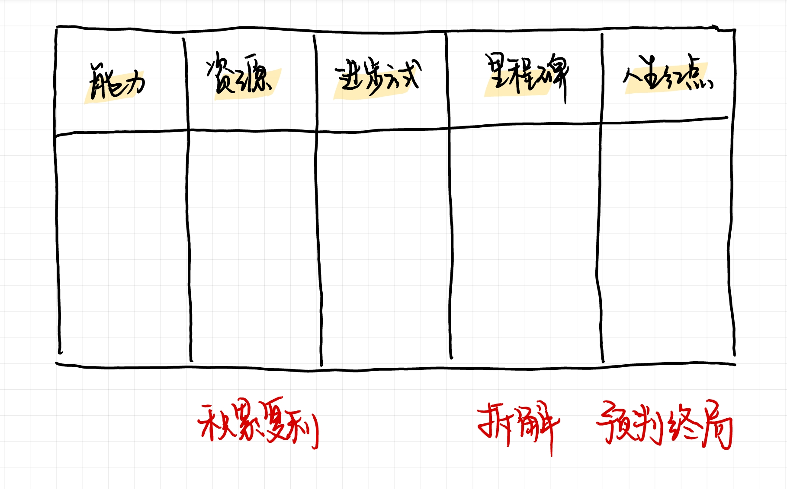
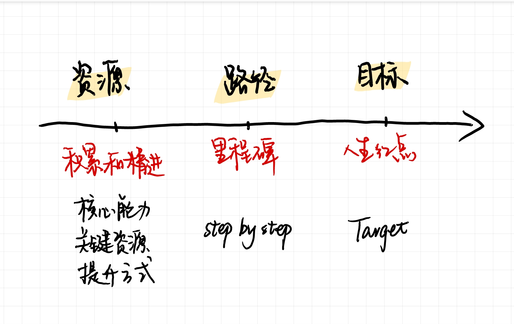

## 80分 框架：人生红点五步法

在2018年底，为了回答"商业成败"，我总结了一个定理级别的因果模型"一堂五步法"：**需求，解决方案，商业模式，增长，壁垒。**

那么站在更大的人生10年尺度上，如何理解和建模呢？

我曾经在《认知篇》给过大家五个关键词，在之前的作业里，不少同学都表达了好奇甚至挑战，没理解背后的价值，今天我尝试带大家推理一遍吧。

从科学角度出发，很多人生维度的模型都来自于商业和管理，比如知名的《斯坦福大学人生设计课》，其实是从**设计思维**出发，展开出了人生的探索方法。

> 两位作者是来自于美国的比尔·博内特和戴夫·伊万斯，都曾是苹果的明星设计师。

下面，试着大家推理一下我们的思考过程。

### 理论来源

**【提问1🙋‍♂️】**如果我们面对一个遥远，宏大的，艰难的**目标**，难以完成，我们该用什么策略，来让它变得可控、有机会完成？

————

答案是：**拆里程碑。**再大的目标，各个击破，就会大范围降低难度。

**【提问2🙋‍♂️】**如果我们要把人生当做一个"**核心项目**"来理解，我们做业务管理，最常见的三段论是什么？

————

答案是：**目标=>路径=>资源。**

目标决定路径，路径决定资源，这是个基本的思考逻辑。

**【提问3🙋‍♂️】**如果站在1年内看，会看到机会/项目/升职加薪，如果站在10年为单位看，人生中有哪些要素是可以持续积累、跨越岗位、职业形成复利的？

————

答案是：**内部能力和外部资源。**

内部能力是一轮轮练出来的，外部资源是一次次攒出来的。

**【提问4🙋‍♂️】**能力和资源相辅相成，但站在更加合理和靠谱的角度看，能力和资源哪个决定哪个？

- A：有了更强的能力，才更有资格拥有更强的人脉社交圈。
- B：进入更强圈子，才有资格拥有更强的能力。

————

在一堂，答案是A，社交的前提是价值交换，成长是长期解决问题的唯一方法。

我们试着组合一下：

- **共识1：分解里程碑，各个击破。**
- **共识2：目标，路径，资源。**
- **共识3：能力=>资源。**

### 新模型：红点五步法

然后组合一下，就可以形成一个模型了：

**【划重点💡】**人生红点五步法：**能力，资源，进步方式，里程碑，人生红点。**

大家现在可以理解这个模型背后的逻辑了吧？

**【提问🙋‍♂️】**这个表按照什么顺序填呢?

### 建议思考顺序

你可以自由填写，因为彼此是有相关的耦合关系，如果从0开始思考，更丝滑的话，建议大家可以按照倒拆的方法（54123）来填：

1. **先具象红点：**给自己的红点一些具象的限定和标签。
2. **再规划路径：**实现一个更远期的红点，一步步里程碑如何扩大。
3. **再积累复利：**你需要积累的能力、资源和依靠的进步方式。

这个也是目标，路径，资源的顺序，相当于给人生建一个模型，写一个《人生顶层方案》。

> 解释：因为阅读顺序12345更丝滑，起点到终点，所以我们这么设计了方法论。

> 从后往前做倒拆，从前往后做推演，从事实出发（类似于需求），往往决策更扎实。

ok，讲完了60分体感，70分逼近系数，80分框架，最后进入90分，更专业的实操，如何规划路径。