## 90分 实操：如何规划路径

在上一节课和GONGJIAN计划里，作为热身，我曾经抛出过这个模型，简单给了几个关键词，以及自己的示范，收上来了几百个画布，我们做了一次Review。

发现大家理解还是太浅了，虽然很多人都填写了表格，但也只是停留在"完成作业"，"照葫芦画瓢"的阶段，很难真正发挥出红点路径规划的价值。

大家对着这两张图看看，能理解里面的必然联系吗？

为什么这五列的表格，把人拉开了一倍，三倍，甚至十几倍的"逼近速率"？真正的差异体现在什么地方？

你能理解这张表背后的技术含量吗？哈哈哈？

**【划重点💡】**注意啊，实操前请调整姿势，重点提醒一下：
1. **面向未来**：这不是面向过去汇总过去（拥有），而是思考未来（需要）。
2. **宁缺毋滥**：不必追求太多/多完备，每一条都极其重要，想不清就空着。
3. **动态笃定**：需要呈现目前最好的思考形成笃定，但是动态调整的，不必固化守旧。

总之一句话，你就把它当做"**过去的最好的认知，未来的最好的假设**"就好了。

下面，有了这个基础，我一个个来讲。

### 难题1：具象红点

上两节课，我们给了大家9个红点类型和一套探索人生红点的工具箱，很多同学已经有了自己笃定的第一红点了。

比如，你说：我是**成就型，作品型，赚钱型**，就够了吗？

你们感受一下区别：

- 我是作品型。
- 我希望通过创新的手段，在教育+商业模式创新上创造作品。

再感受一下区别：

- 我是成就型。
- 我是成就型，希望帮助K12阶段孩子提升基础教育质量。

再感受一下：

- 我是赚钱型。
- 我是赚钱型，希望在生物医药+AI赛道，赚足够多的钱。

大家能感受到区别么？

我们上面说，红点的特点是**足够抽象+足够具象**，那么符合这个条件的话，能不能再加一些限定词，划分一下边界，更加专注呢？

比如，我（作品型）选定了**创新+商业模式+教育**的关键词，那么医疗，金融，二级市场，艺术创作....就跟我关系不大了。

比如有同学（成就型）选定了**K12+基础教育**的关键词，那么成人，NGO，兴趣教育的成就感，就跟他关系不太大了。

比如有同学（赚钱型）选定了**生物医药+AI**的关键词，那么投资，炒股，比特币的赚钱型，就跟他没什么关系了。

**【划重点💡】**人的决策机会和精力是有限的资源，把时间拉长，你就会发现我们有大量的决策：

**维度**

**参考**

**频次**

工作上

行业/岗位/项目选择

几十上百次/人生

生活上

城市选择/伴侣选择

个位数/人生

时间上

看书/思考脑力/难题攻坚

几百次/年

对比一下，你会看到明显的区别：

> 说明：为了更好理解，划分成了8个区间，示意而已，并未对应9个红点。

如果人生是360°的话，假设分成了9个角度（红九模型）：

- 如果你漫无目的，可能有5个红点难以取舍，那你的注意力会被分散到200°的扇面上。
- 如果你锁定了第一红点，就会集中在40°的扇面上。
- 如果你还能加1-3个限定词，那么你可能聚焦在5°-20°的扇面上。

伤其十指，不如断其一指，同样的积累，同样的工作，你的积累速度，就会比别人在这个方向上，积累的快几倍不止。

下面，我们搜集了一些同学的红点限定具象：
1. C同学：我是**成就型**，希望通过洞察因果关系，持续解决产品和商业模式难题。
2. 岑同学：我是**作品型**，希望用产品和服务创新的方式，为提高幼儿及老年人的生活质量而努力。
3. 何同学：我是**高手型**，希望成为项目管理领域和投资项目领域的高手。
4. 道同学：我是**赚钱型**，希望在科技行业做成一家优秀公司。
5. 刘同学：我是**内心型**，希望在人文哲学领域不断深入思考和探索。
6. 李同学：我是**过程型**，希望在生物医药领域和最优秀的人一起伟大的事情。
7. 丁同学：我是**成就型**，希望提升财务人员商业思维，重塑财务管理价值。
8. 王同学：我是**体验型**，希望主要是在心理咨询、教育、社会工作这三个方向的体验。
9. 杨同学：我是**成就型**，希望以餐饮作为成就起点，推动餐饮行业科学体系的建设。
10. 郝同学：我是**体验型**，希望开始聚焦商业，优先考虑在新材料领域探索商业。
11. 荒同学：我是**赚钱型**，希望通过电商领域的项目实现财务上的成功。
12. ……

**【划重点💡】**再次强调，我们鼓励大家增加**1-3个限定词**（行业/模式/特点），但请不要过度细化，一旦非常具体了，就会很容易变，而且会限制你发挥。

比如，有同学把红点具象成：
1. 做一个年产值超3个亿的供应链金融公司。×
2. 写一篇300万字的小说，改编成影视剧。×
3. 完成一本有关数字化领域的方法论书籍。×
4. 通过抖音直播带货赚到3000万。×
5. 在餐饮行业，开500家烧烤店，服务一千万人。×
6. 成为大型公司数字能源领域产业线负责人。×
7. 建立一家自己的人力资源咨询公司，年薪达到200万。×
8. ……

判断逻辑很简单，**是不是10-20年大概率很笃定，不会轻易变？**如果是，就还可以；如果拿不准，那就抽象一些吧，抽象总不会太错，但过于具象反而有害。

> 实操Tips：非常具体的目标 < 简单红点 << 带标签红点。

红点不是一蹴而就地发射火箭，而是鸟枪换炮式地打怪升级，你这个红点，是一个方向、一个容器，要能容纳你在里面不断积累，从小到大，持续拿到结果。

我们专门做了一张卡牌：

好啦，具象红点的原理和案例我就讲完了，我们来看第二个：

### 难题2：里程碑

**【灵魂拷问🙋‍♂️】**里程碑重要吗？需要划分里程碑吗？好处是什么？

对于人生红点来说，"里程碑"是一个非常神奇的工具，它会瞬间让一个看似虚无缥缈的，甚至过于宏伟、羞于启齿的红点，变得一步步有"**实现的可能性**"。

来，我们看一些同学的里程碑，大家感受下价值，以及划分得足够好吗？

袁同学：第一红点是**高手型**，软件测试领域1%的人，成为这个领域的超级个体。

他的里程碑是：**高级软件测试工程师->软件测试部门负责人->软件质量管理领域解决方案专家->有自媒体平台的软件质量管理专家->AI时代的软件质量专家**

杨同学：第一红点是**体验型**，希望可以探索未知的世界，包括内心世界和各种行业。

他的里程碑是：**提升投资能力，源于一堂等专业领域的学习->尝试进入投资类公司或持续接触更多的项目，同时努力赚钱减少开支->完成一定量的投资，拥有可观的税后收入->活的足够久，见识更广阔的世界**

胡同学：第一红点是**体验型**，希望能够做自己想做的事情，环游世界。

他的里程碑是：**35~40岁，在公司独立操盘一个业务，成为一个合格的操盘手 ->40~45岁，创业（或合伙创业）做一家公司，做自己感兴趣的业务 ->财务自由，去不同的国家旅行**

马同学：第一红点是**作品型**，希望可以在中医正骨或传统武术领域，通过一个作品帮助很多人。

他的里程碑是：**找到有正宗传承的老师，拜师学习->以产品思维，学习中医正骨或传统武术->经营一家中医馆或武馆->做一个优秀的ToC作品**

张同学：第一红点是**成就型**，希望帮助更多管理者、企业领导团队和组织实现能力提升、状态改善和业绩突破。

他的里程碑是：**问题分析与解决高手->优秀的团队管理者->靠谱的团队陪跑顾问->优秀的组织经营者**

这些哪些是比较好的里程碑，哪些还有修改空间？

这个就得回到里程碑的底层逻辑来回答，最理想的里程碑，应该是怎么样的？划分里程碑最大的意义在于什么地方？我画了一个示意图，大家能看懂么？

最好的情况是每一个里程碑都是实现了红点，而且是循序渐进，为下一个红点做准备。

比如我的里程碑：

每一步都是后一步的重要前提，当我每完成了一个里程碑，我就距离下一个近了很多，我可以把我大量的经验，认知，资源带到下一个里程碑。

**【划重点💡】**如何设计里程碑呢？我们总结了5种里程碑的常见范式：

- 里程碑类型1：职业里程碑
- 里程碑类型2：升维里程碑
- 里程碑类型3：难题里程碑
- 里程碑类型4：资源里程碑
- 里程碑类型5：人生里程碑

为了大家更实操落地，每一个我们给大家准备了一个实操卡片：

好了，继续，讲完了54，下面我们来讲123，下一个部分。

### 难题3：能力

人生红点还需要思考能力？能力的思考重要吗？

————

不止重要，甚至是整个人生红点画布，最值得花时间研究的部分。但我看了一圈大家的作业，发现大家填得五花八门。

**【思考💡】**来，做个测试，这个画布里填的能力，你们认为哪些对人生红点有**特别好的指导意义**：
1. 泛产品设计能力。
2. 共情能力。
3. 学习能力。
4. 懂生物医药。
5. 思考能力。
6. 面试提问能力。
7. 大客户销售能力。
8. 电销快速建立信任的能力。

哪些是很好的颗粒度，有指导意义？

————

**有指导意义**：**泛产品设计，懂生物医药，大客户销售。**

**过于虚**：**共情能力，学习能力，思考能力。**

**过于细**：**面试提问能力，电销快速建立信任的能力**。

为什么呢？

————

我总结了一句话：

所以红点的能力有三个重要的原则：

**原则1：修炼原则。**可以比较具体有段位/方法，可以以年为单位进步。

=》不能太粗，太虚，太依赖所谓的天赋。

**原则2：关联原则。**感兴趣 < 想获得 < 重要 << 大概率必要 <<< 必经之路。

=》不能太绕，太远，太追求光鲜亮丽。

**原则3：上限原则。**不是底线，而是持续推高天花板的核心能力。

=》不能太简单，太细节，太底线，太容易停下来。

理解了这三个原则，再看我的画布，有没有感觉清晰了很多？

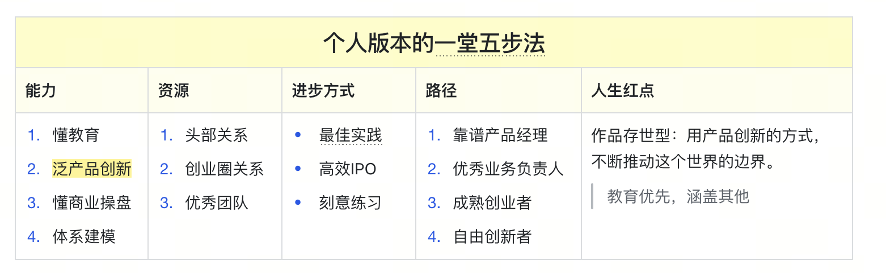

这就是为什么很多跟我比较久的员工，经常非常兴奋地跟我分享：我发现你就那几个模型啊，反复用，反复重复，哈哈哈。我让教研团队画了一个示意图，你们感受一下：

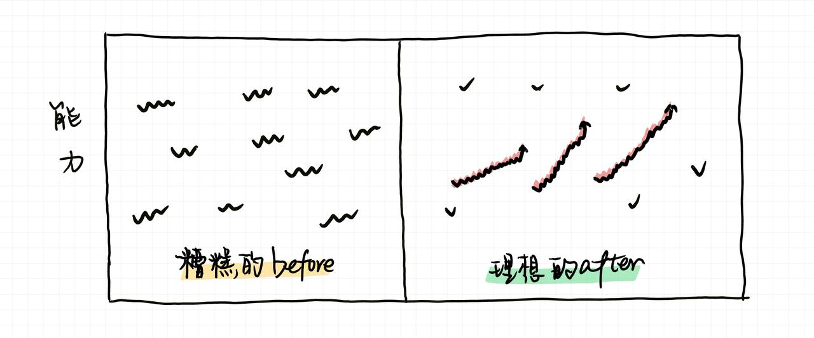

> 能力积累最忌讳眉毛胡子一把抓，浅尝辄止，全部入门，无一长期修炼。

> 尤其是业务负责人/CEO，应该追求有一技之长+没有太大短板；长板帮你成事儿，短板不至于让你失败。

能力是需要不断洞察的，非常考验大家的见识。为了让大家更好地理解，我们搜集了一些GONGJIAN同学洞察的一些关键能力，大家可以参考：

> 方同学，探索到自己的人生红点是**成就型**，希望通过将游戏和个人成长相结合，给人带来启迪、激励和力量。要一步步达到这个人生目标，他剥离出来一个绕不开的、需要长期修炼的能力是**讲故事的能力**，就是把一些认知、情绪和激励人心的力量融入到游戏中，让游戏融入灵魂。

> C同学，探索到自己的人生红点是**成就型**，对洞察本质找到背后的因果关系非常笃定，所以她发现**建模能力**就是她实现人生红点绕不开的一个能力。

> 沈同学，探索到自己的人生红点是**生活型**，希望通过自身能力为家人创造更好的生活，给孩子树立独立的人格，所以他剥离出来一个必备的、需要修炼的能力是**教练型家长的能力**。

> 李同学，探索到自己的人生红点是**成就型**，希望通过社区赋能的形式帮助他人，所以他剥离出来一个必不可少的核心能力是**运营能力**，未来会覆盖包括公域获客、私域社群、KOL背书等运营的全流程。

> 李同学，探索到自己的人生红点是**高手型**，希望在某个领域不断精进成为高手，所以他发现，**写作能力**是他的基本盘，他需要通过不断的阅读、深度思考、提炼、写作输出来形成复利，来不断地逼近红点。

**【划重点💡】**为了大家更好学习，我大家两个建议吧：**找对标 + 用工具。**

- **找对标：**搜集3-5个你想对标红点的榜样，分析他们身上的**3-5个硬本领**。
- **用工具：**使用一堂提供的工具清单，花1-3个小时自我探索和尝试吧。

**【划重点💡】**哪些能力值得积累呢，我们总结了5种积累的能力：

- 关键积累1：领域能力
- 关键积累2：业务能力
- 关键积累3：管理能力
- 关键积累4：技术能力
- 关键积累5：专项能力

于是我们也准备了几张卡片：

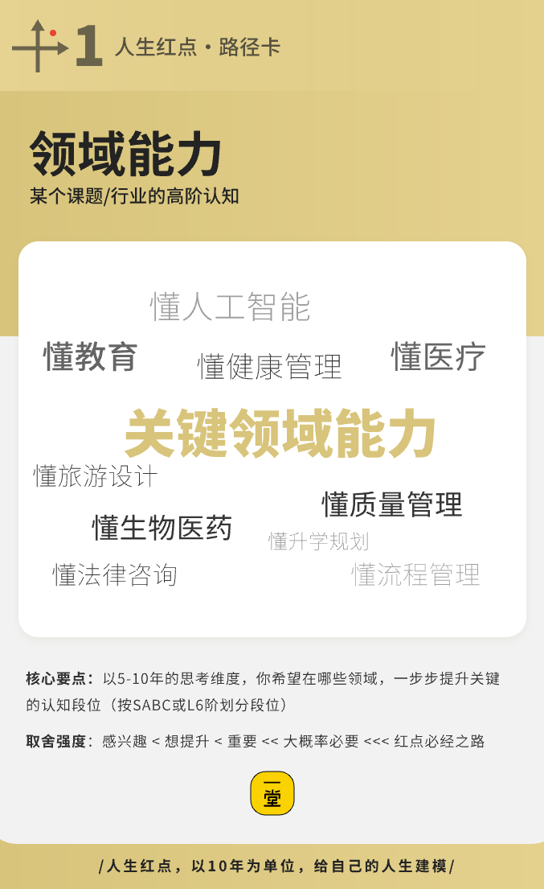

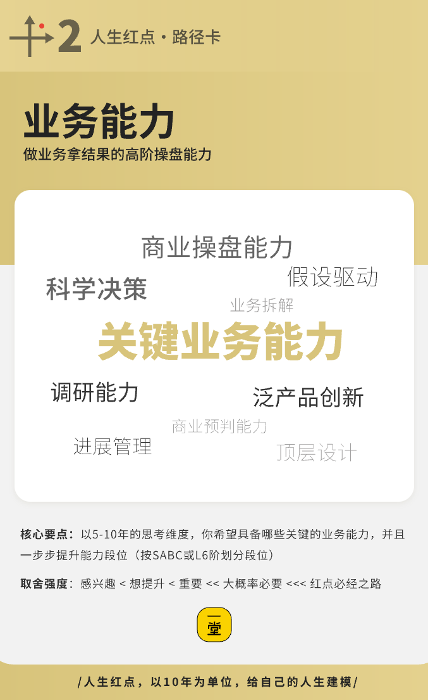

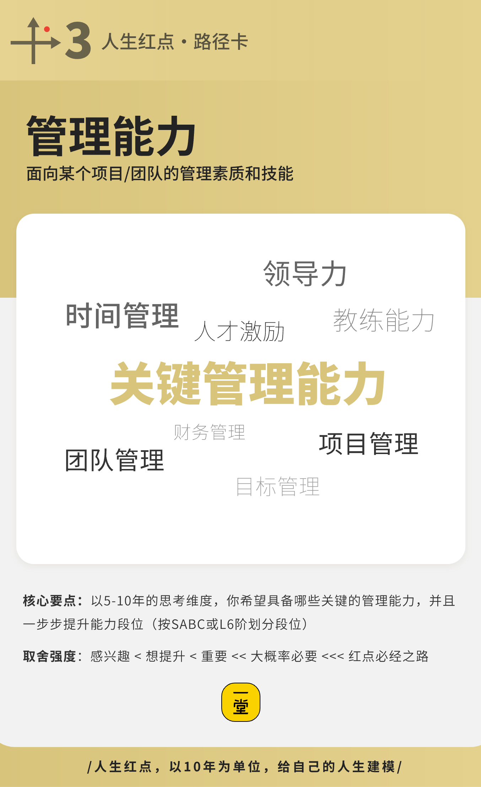

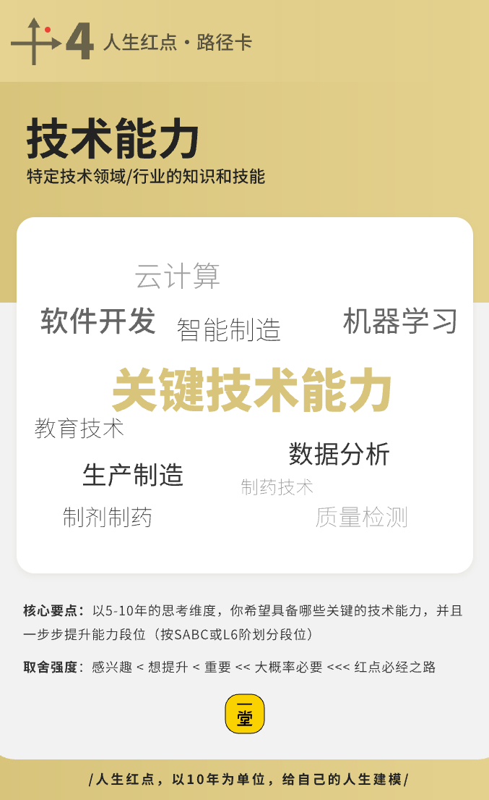

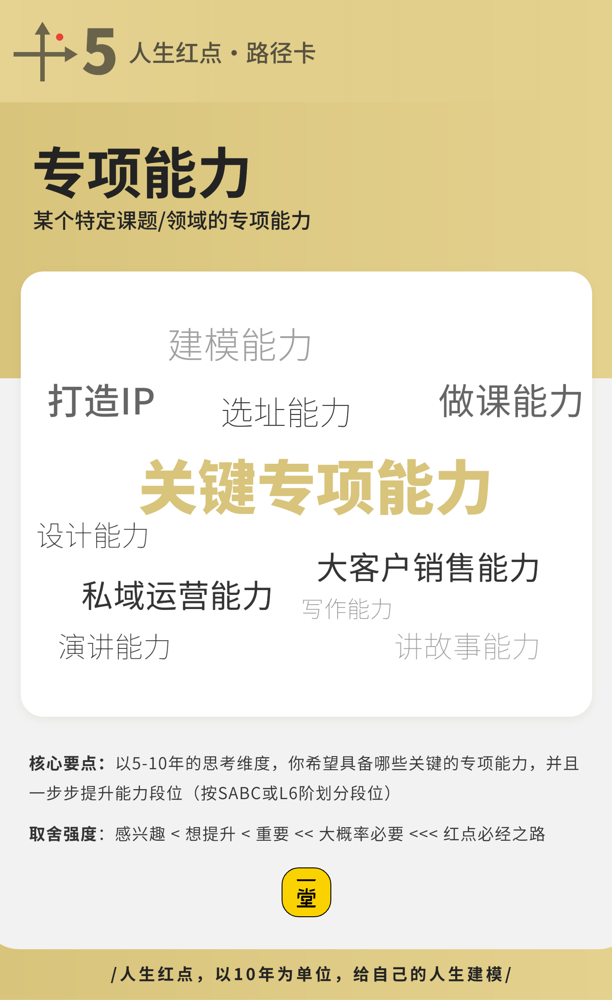

作为加分项，简单提两句，能力如果你长期笃定了，可以拥有高配版本：

**【高配1💡】**给一个**复杂的综合能力（如果太大）**，进行二次拆解，按照SABC划分段位和二级基本功。

比如一堂，给很多岗位，划分了SABC段位：

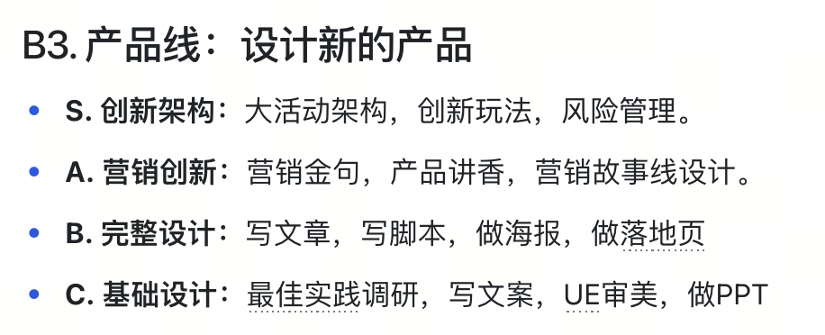

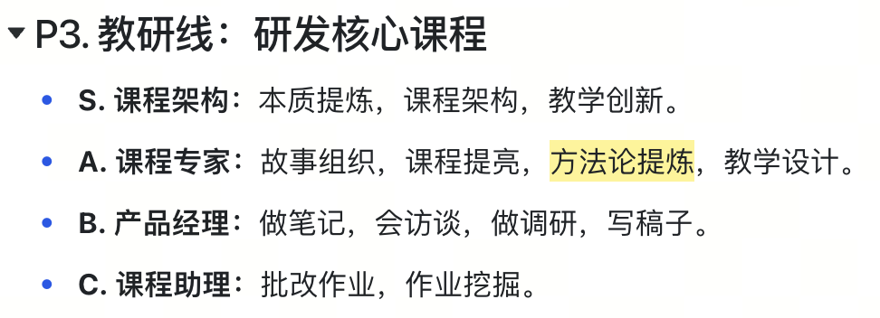

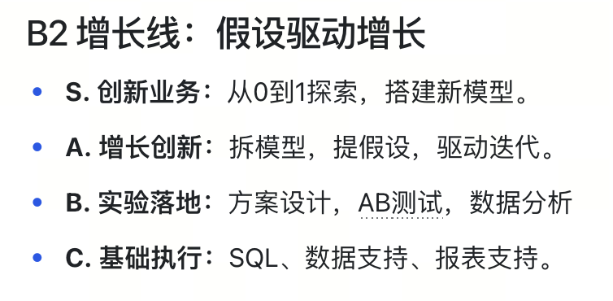

> 关联课题：一堂《苦练基本功》系列课。

**【高配2💡】**给一个**很难的核心硬本领（如果太难）**，从最弱到最强，划分6个段位，年为单位爬山。

比如一堂，就有很多现成的段位图，你可以使用or改版or自己创造：

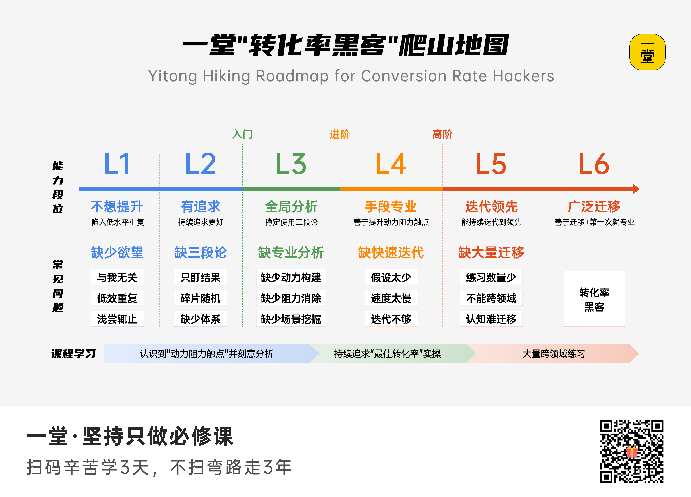

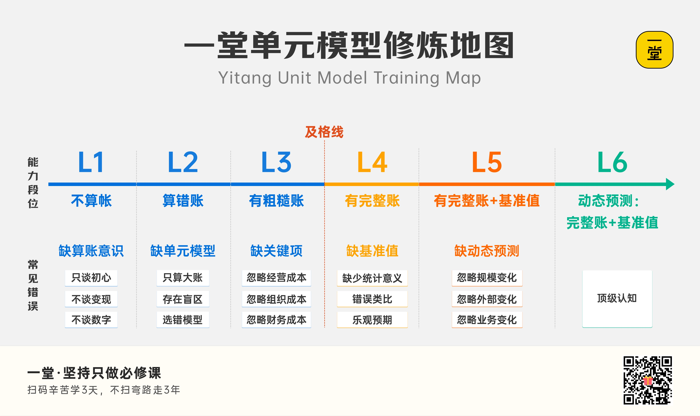

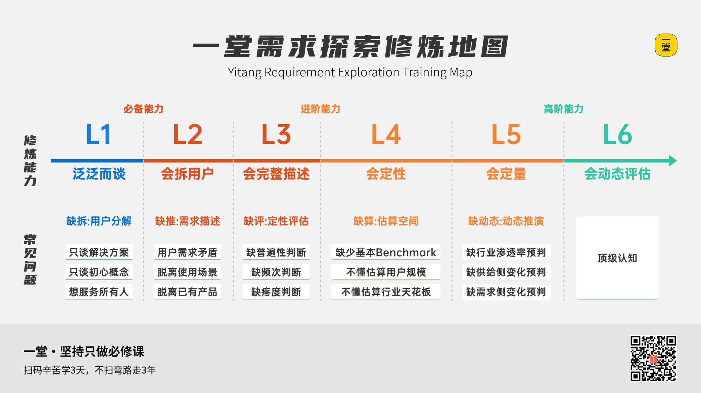

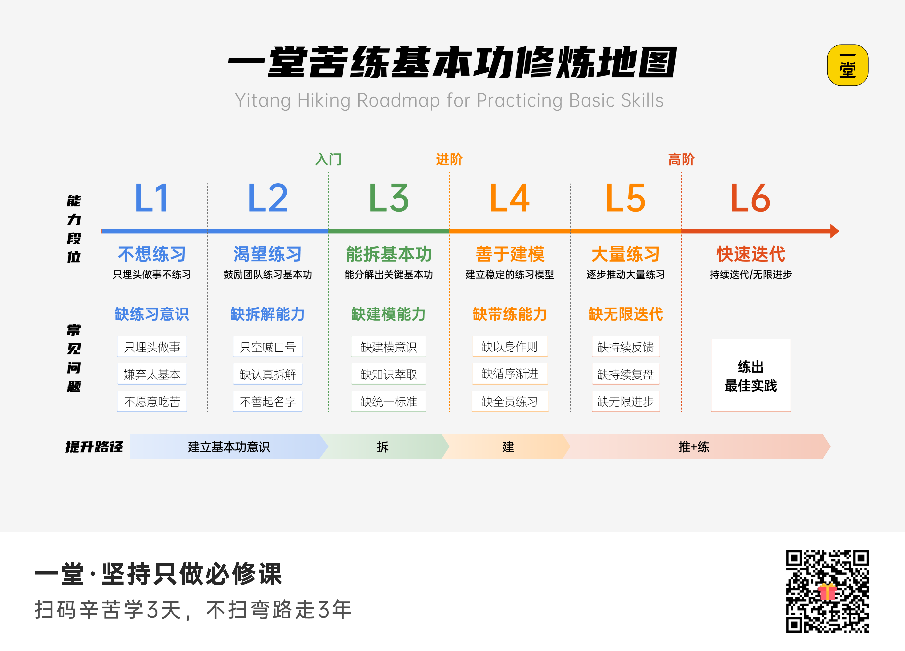

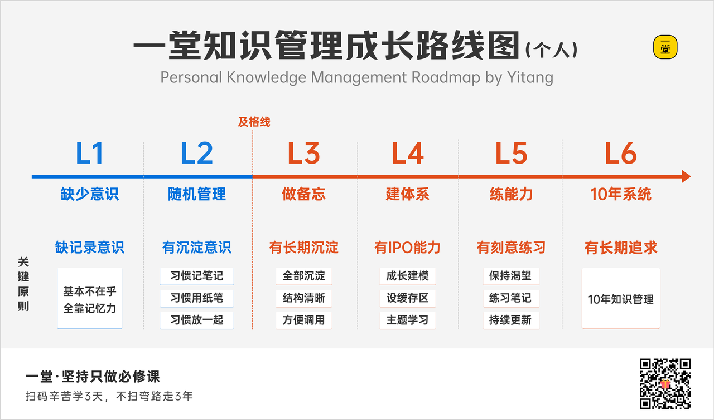

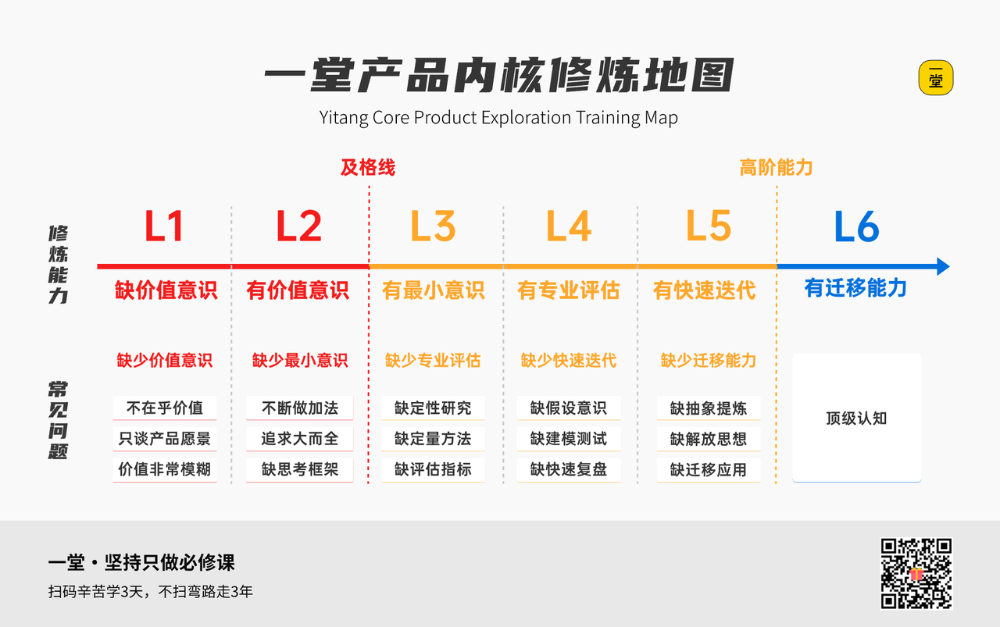

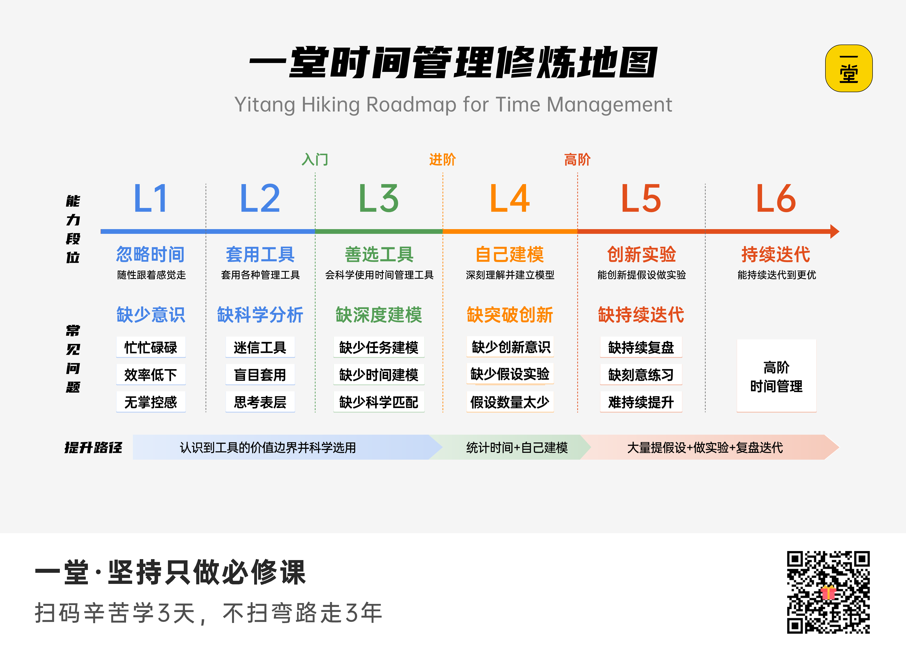

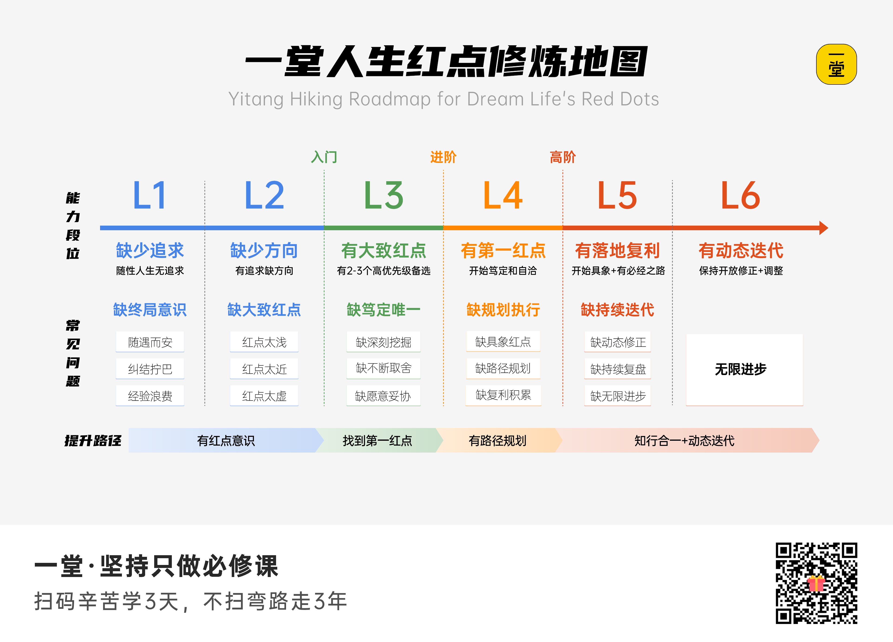

好啦，能力偏内部，偏长期修炼，长到自己身上的。下面来看外部的，依赖关系的资源。

### 难题4：资源

关于资源典型的特点是什么？如果以10年为单位，资源典型的特点是什么？

有些资源是稀缺的强资源，往往外部的资源机会是无穷多的，每一个朋友，每一次约会，每一次阅读，每遇到一个合作机会，都是一次资源的机会，你抓住什么呢？

这次我们直接上图，大家能看懂区别么？

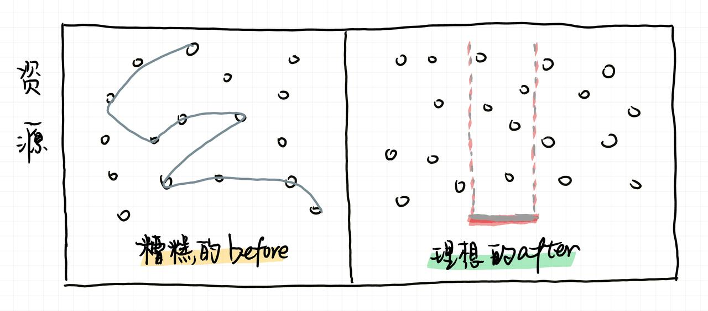

**【划重点💡】**核心自我提问：我该积累什么稀缺资源，可以让我一步步接近我的远大红点？

这是我暂时的答案：

> 最近反思，可能缺了一个，更高势能资源（形成品牌）。

必须要强调一下，包括在《调研专项：高质量的专家访谈》里我也提到，我们并不倡导那种单纯的人脉术奇技淫巧，也不鼓励单纯的抱大腿社交，人脉的基础是对等，最好平等对话，至少价值交换。

有哪些常见的稀缺资源呢？

**林同学，红点是作品型，**希望做流体行业的小米，推动行业教育，让更多工厂理解好产品，让好产品服务更多行业，所以他认为最重要的资源是优秀团队，流体圈人脉和创业圈关系。

**何同学，红点是作品型**，希望给这个世界留下至少50部作品，其中有1~2部在这个世界上留下一点点足迹，所以他认为最重要的资源是出版社资源和抖音达人推书资源。

**林同学，红点是作品型**，希望成为一名优秀的插画师，有受喜爱的绘画作品以及自己的个人文创设计品牌，所以他认为最重要的资源是专业教育背书，圈内出版社&经纪公司，文创产品供应链和团队。

**刁同学，红点是成就型，**希望在生物制药研发领域，创建一家公司，能不断地在某些细分领域提供有价值的产品或服务，为行业做出贡献（至少能小小地影响整个行业，小而精专的公司），所以他认为最重要的资源是科研领域大拿，投资圈子有能力者和上下游客户圈子。

**张同学，红点是成就型**，渴望帮助更多管理者、企业领导团队和组织实现能力提升、状态改善和业绩突破，所以他认为最重要的资源是培训圈累积、企业家圈子。

**杨同学，红点是成就型**，希望以餐饮作为成就起点，推动餐饮行业科学体系的建设，所以他认为最重要的资源是餐饮行业的人脉圈，能力互补的团队和餐饮服务商的资源。

**张同学，红点是成就型**，希望在医疗美容整形行业推动行业有序发展，让客户得到满意的服务，所以他认为最重要的资源是医疗圈的头部资源（特别是公立和民营机构的头部关系网），医生资源。

**孙同学，红点是赚钱型**，希望资产不计算在内可以拥有1亿现金，所以他认为最重要的资源是加入成功的商业社交圈，优秀的合伙人及团队，良性的资金来源和优质的商业信息网络。

**郝同学**，**红点是体验型**，希望开始聚焦商业，拟通过新材料领域探索商业实现家庭新路径的开辟，从他的里程碑倒推，他认为科技人才资源，高校和科研机构的关系，一堂作为学习资源给予一致的陪伴与信息输入，都是必不可少的。

**刘同学，红点是高手型，**希望成为出海产品管理的顶尖高手，在国际化产品项目管理方面取得显著成果，尤其是针对物联网类/APP产品，从创意到落地都能进行独立操盘。所以他认为，和海外的供应链、分销商、合作伙伴建立紧密的联系，形成自己的“出海资源库”是必不可少的。

**【提问🙋‍♂️】**对于你未来的红点，你最需要的核心资源是什么？

————

**【划重点💡】**有哪些常见的关键资源呢？我们总结了7种值得积累的关键资源：

- 关键资源1：人脉资源
- 关键资源2：团队资源
- 关键资源3：认知资源
- 关键资源4：商业资源
- 关键资源5：资产资源
- 关键资源6：声誉资源
- 关键资源7：证书资源

我们给大家准备了一组卡片，大家可以参考使用：

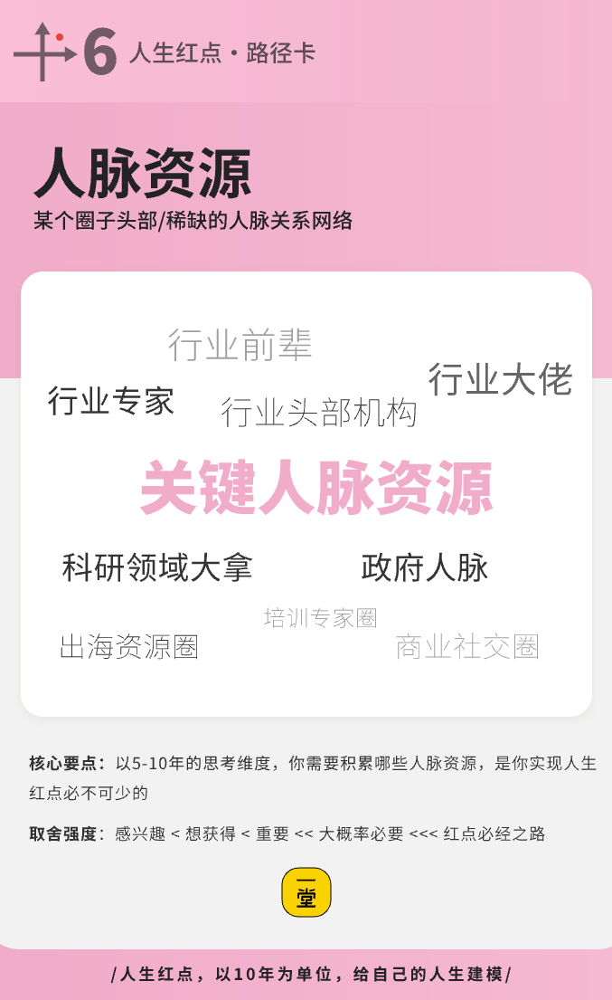

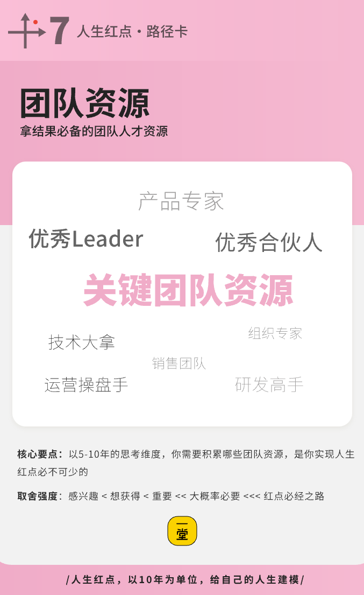

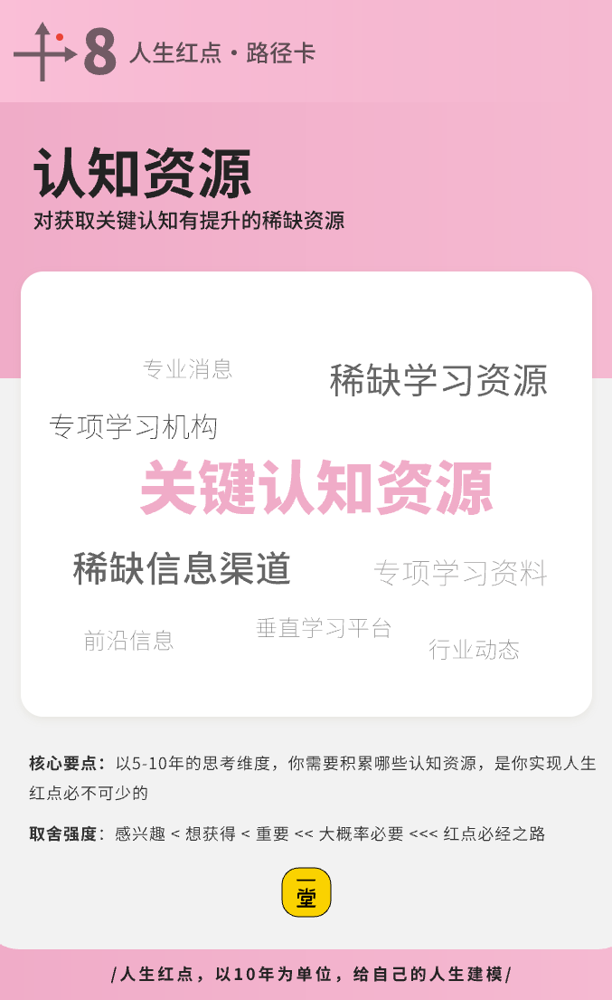

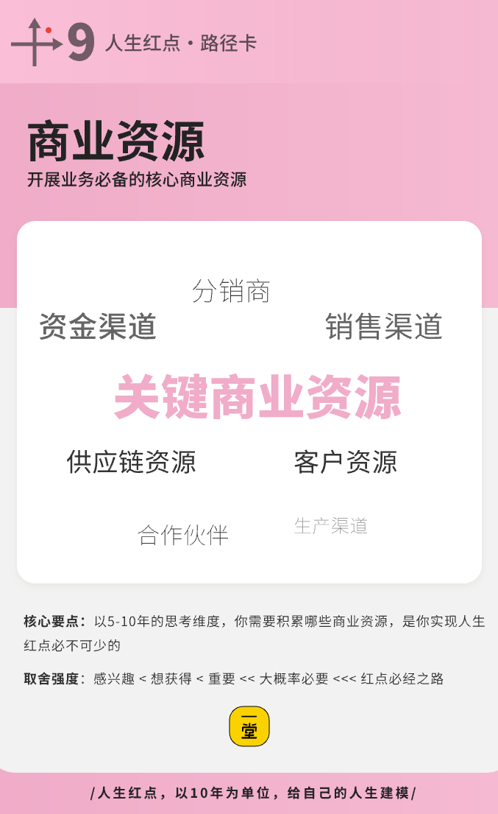

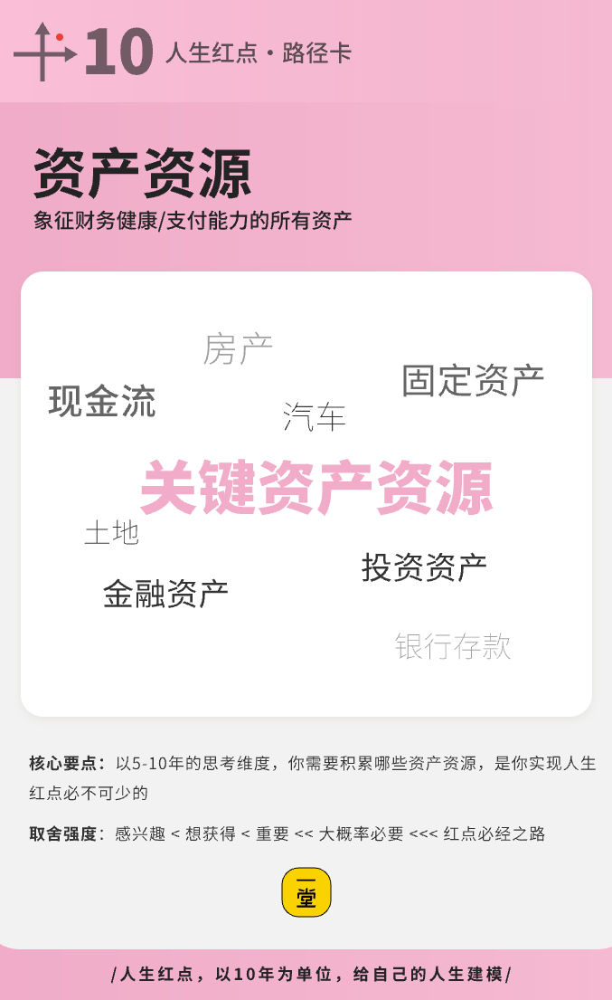

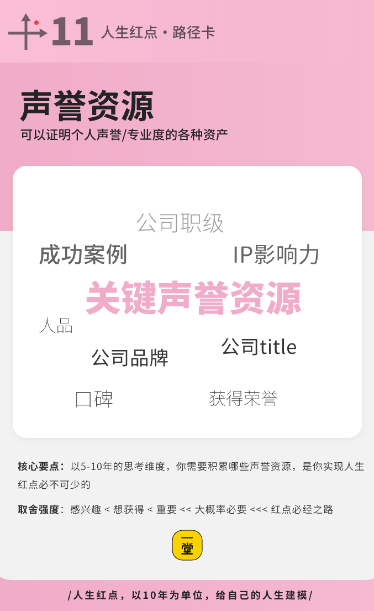

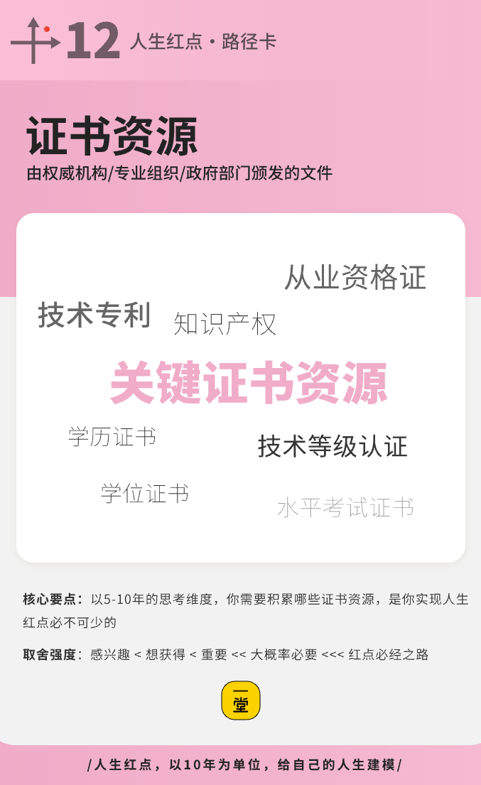

资源最重要的是，资源有针对性的积累，能力会带来能力，资源会带来资源，能力也会带来资源，资源同时也会带来能力，一旦滚起来，往往复利效应会更明显。

ok，最后一步：进步方式。

### 难题5：进步方式

我们内部犹豫了很久，要不要保留这个环节，因为这个环节，本质上和前面的能力，资源不是一个维度的，我们内部纠结了很久。

但是最后我问了一个问题：不考虑形式，从实质有效性上来说，是不是很多人"红点逼近速率"低的卡点？是不是非常有效地可以积累复利？

答案显而易见，是YES，于是，保留了下来。

什么是进步方式呢？就是如何驱动你自己进步？而不是浅尝辄止，这学学，那看看，如何形成一个学习的飞轮，能够持续进步，获得正反馈，最终做到无限进步？

我让团队画了一个示意图：

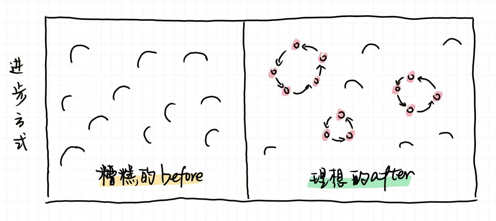

**【提问🙋‍♂️】**哪些学习进步的方式，可以有效地提升红点的逼近速度呢？

————

这是我的个人想法，大家可以想一想，如果我不笃定这几个，完全是盲区，一堂的产品质量会下滑百分之多少？

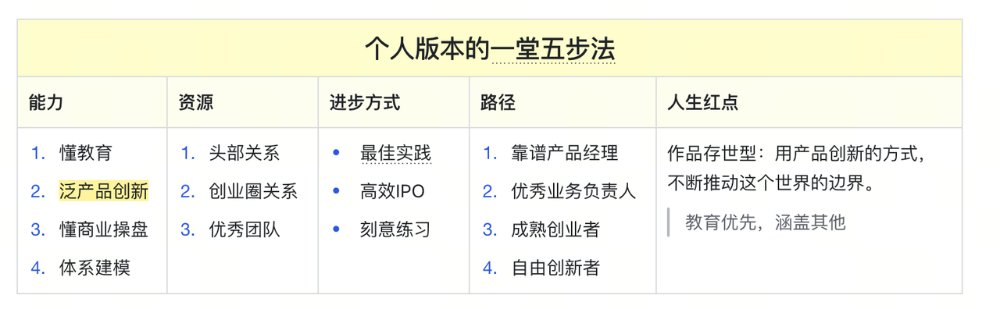

**【提问🙋‍♂️】**那你呢？你觉得你的核心进步方式是什么？

————

还是那句话，宁缺毋滥，不追求多，你重点要去思考，无论如何都绕不开的必经之路。

**陈同学，红点是成就型**，希望让华风时尚成为世界潮流。他的进步方式是：最佳实践，高效IPO，刻意练习。

**岑同学，红点是作品型**，希望用产品和服务创新的方式，不断为提高幼儿及老年人的生活质量而努力。他的进步方式是：最佳实践，高效IPO，刻意练习，知识萃取，前辈指导，实战练习，复盘迭代。

**姚同学，红点是成就型**，推动实验室成果落地产品，从而造福社会，也创造个人价值，他的进步方式是：最佳实践、高效IPO、刻意练习、知识萃取和管理。

**欧阳同学，红点是高手型**，我希望N年后，我能成为一个商业高手，能解决很多商业难题，能带团队打仗，能从0到1操盘商业，他的进步方式是：精益创业，刻意练习，高效IPO，最佳实践。

**林同学，红点是高手型**，希望成为索罗斯、林奇、巴菲特那样的大师，他的进步方式是：读书+实践，尤其是实践。

**何同学，红点是作品型**，希望写一本原创非虚构类作品，他的进步方式是：日更写作，周更公众号，中视频周更，最佳实践，刻意练习，高效IPO，制作分享课程。

**孙同学，红点是赚钱型**，希望拥有1亿现金，搭建能够不断产生现金流的生意模式，摆脱用自己的脑力和体力赚钱的状态，他的进步方式是：大量吸收最佳商业实践，高效IPO，开放的心态，快速试错快速迭代。

**李同学，红点是赚钱型**，希望企业成为行业Top3，拿到融资上市，财富自由，他的进步方式是：学习一堂课程、找行业大拿专家、从底层逻辑复盘推导。

**成同学，红点是成就型，**希望用我学到传统文化知识、商业知识，帮助很多人，他的进步方式是：系统学习商业知识，提升商业认知和技能；多跟高手交流；高效IPO。

**丁同学，红点是成就型**，希望提升财务人员商业思维，提高创业老板数字管理能力，重塑财务管理价值，他的进步方式是：深度思考、最佳实践、IPO、刻意练习、知识管理、知识萃取。

**【划重点💡】**有哪些进步方式呢？我们总结了6种核心的进步方式：

- 进步方式1：做事进步
- 进步方式2：能力进步
- 进步方式3：认知进步
- 进步方式4：跟人进步
- 进步方式5：建模进步
- 进步方式6：管理进步

于是我们也准备了几张卡片：

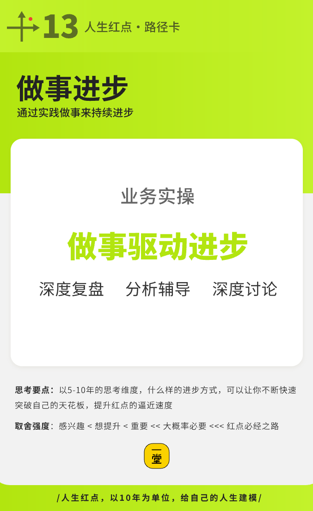

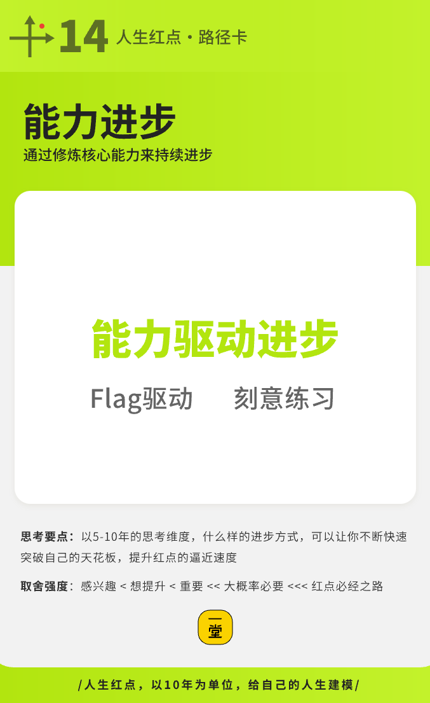

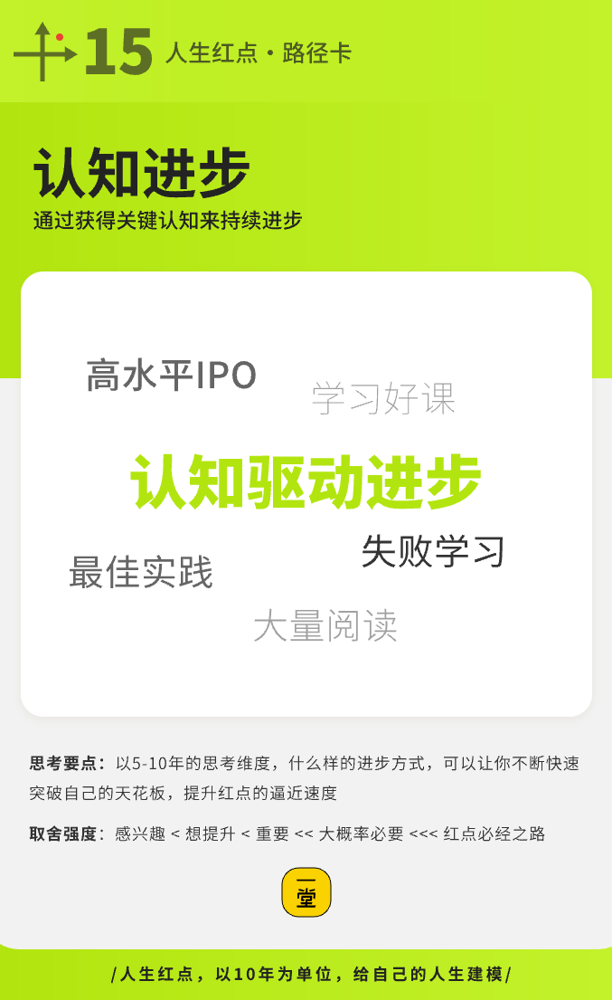

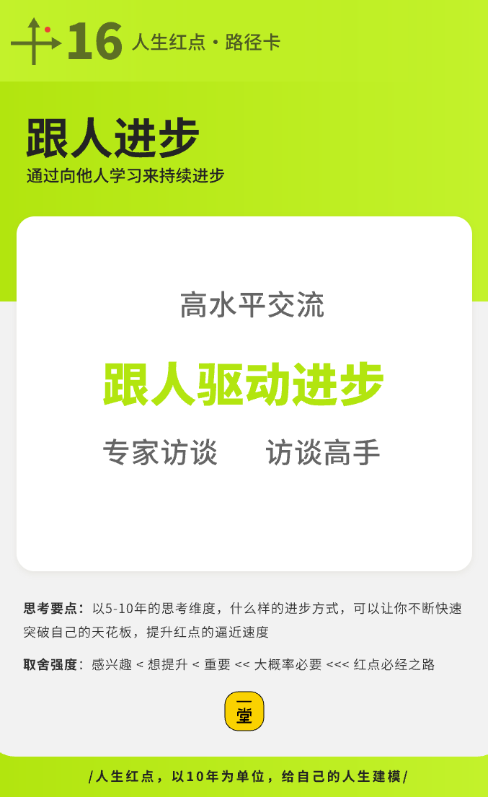

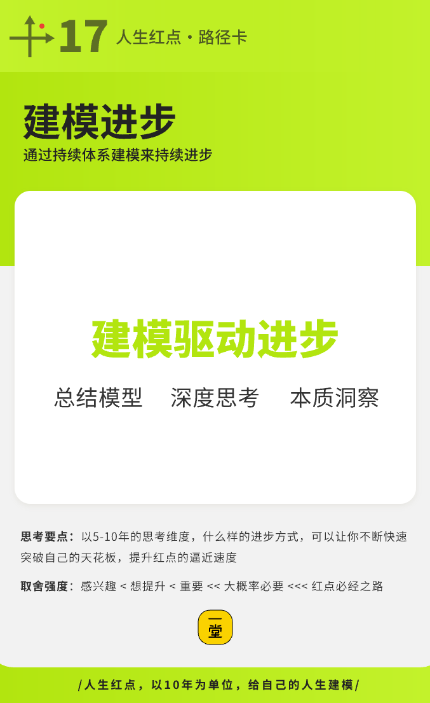

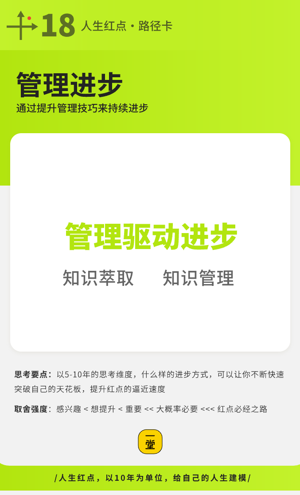

好啦，终于，这五步都讲完了，当你再看一次我自己的路径规划，是不是发现其实专业性其实还挺高的啊哈哈哈哈。

> 关键词：面向未来，宁缺毋滥，稀缺复利，拉天花板，持续信心。