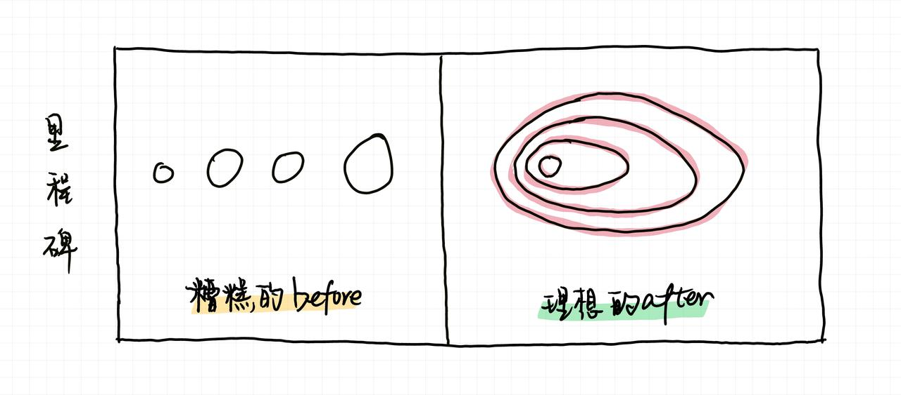
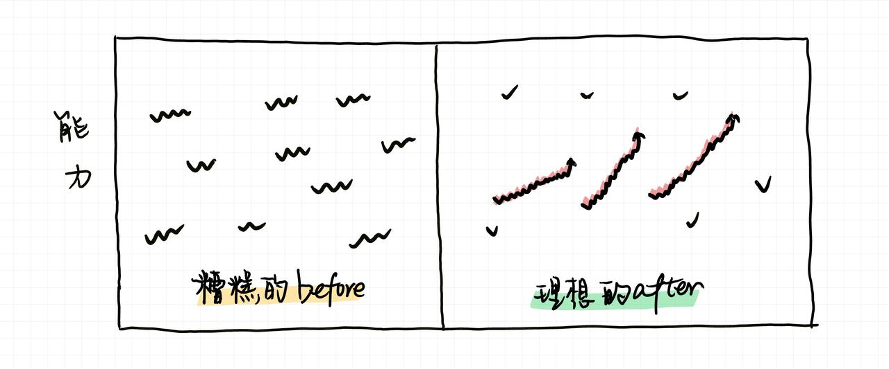
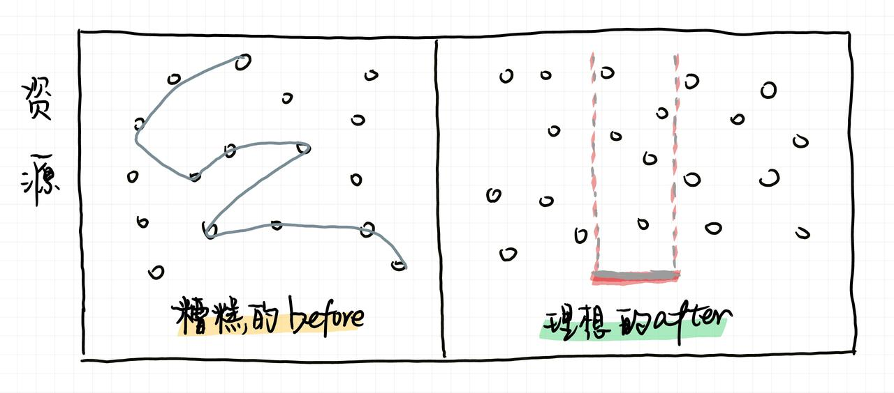
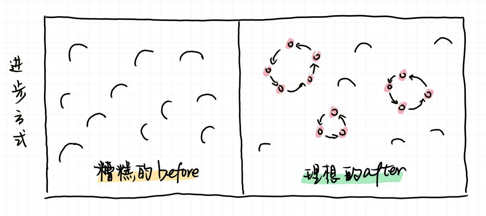
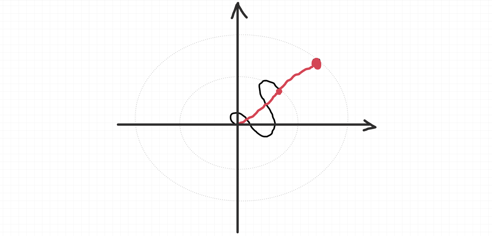
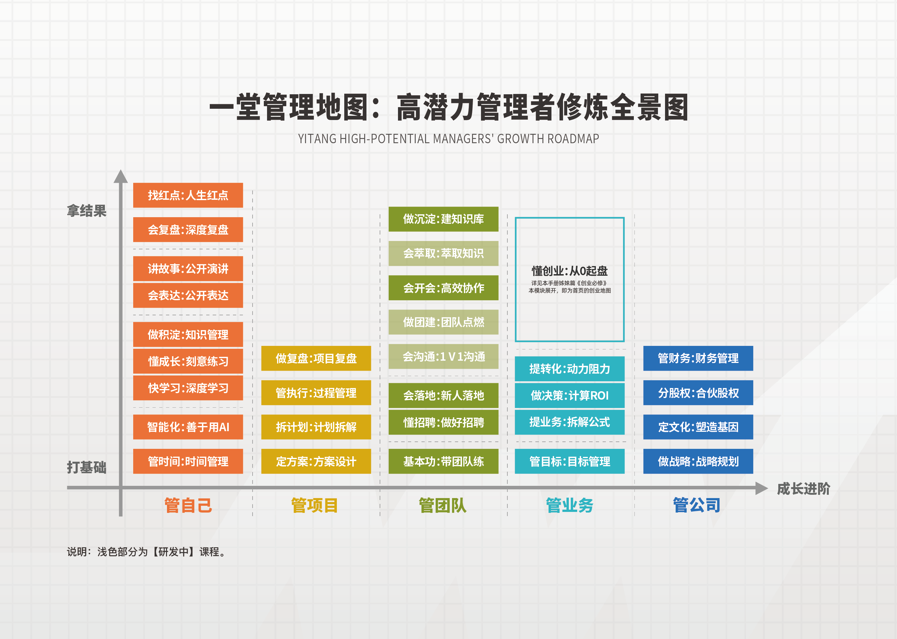
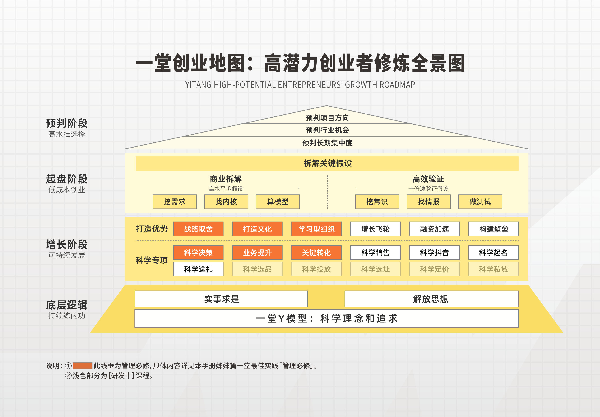
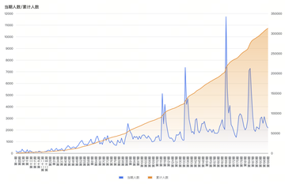
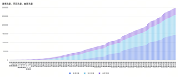

## 重新理解"人生红点"

作为（计划中）人生红点系列课的最后一节课，终于要结束了。

说实话，今年正式立项，我是有些排斥的，一方面担心太虚做不到一堂的Style和质量线，另一方面，有一些"不要干预别人人生"的评价也让我有些望而却步。

感谢大家一路的支持，这个课题，不管是招生、学习作业数，还是Candy使用率，都达到了一堂史上的最高峰值。

感谢大家的一路学习，应该算没有辜负，平稳落地了。

### 感谢大家的支持

一年不到，人生红点，我们累计收了15000份作业，感谢各位对这个课题的认可：

### 上升视角复习

如果总结一句话的话，我觉得这套课最核心的理念是：

下面，我们挑出这节课的一点篇幅，再看一下这门课最重要的一些图：

我们决定把《人生红点》放到管理地图里，在【管自己】最上层的位置，和时间管理遥相辉映，

再上一个维度，你会看到整张地图：

哈哈哈，铺垫了一晚上，终于可以问出这句话了：**坚持科学体系，正统商业管理教育的一堂，是你实现你未来人生红点的必经之路吗？哈哈哈。**

终于，至此已成艺术。

### 我们的十年之约

2024年年中，你可能知道，各种短视频，知识付费，在线课程普遍下滑甚至血崩，大家都非常悲观，甚至有人认为知识付费整个行业都消失了。

但是令人欣慰的是，一堂扛着"**严肃教育+科学体系+长期主义**"的大旗，不止没有下滑，马拉松基本上那个按照前三年的Benchmark在稳步增长。

这个就是长期主义者的一点点奖励吧。

**"复利"**的特点就是，早期并不显著，甚至毫不起眼，但是一旦长期滚起来，别人坚持一周，一个月，你坚持5年，10年；别人执行3-10轮，你执行100-500轮，人跟人的差距就会快速拉开。

这就是为什么我说：**五年一堂做成了这个样子，我们对于未来五年，无比期待。**

五年前，我很难想象，我做了一个万人学习组织，上千人共建课程，能做一场几万人的共学马拉松，Top大佬过来交朋友，我竟然敢公开把"建学科"的愿景(牛)，公开吹出去。

当我个人五步法再翻3-5倍，当一堂的基本功，核心能力再翻5-10倍，我们真的做不成那些"**梦想级别的巨大红点**"吗？

未来五年时间，等我的能力，资源再迭代500-1000次，我的人生红点会变成什么样子？

我们的真的不能去清华，去全国，甚至全球最高的大学开正式课吗？

我们真的不能把一堂带向国外，推动中东、欧洲的科学创业进程吗？

我们真的不能和周杰伦一起创作流行音乐吗？哈哈哈哈哈

我们真的不能像德鲁克一样，开创一个学科，留下几百年的作品吗？

只要我们红点的路径上不断进步，保持『红点逼近速率』<=1年，再走5年，10年，20年，真的实现不了吗？我们一直在造的这艘大船真的，真的不可能找到新大陆吗？

最后送给大家一句话吧：

