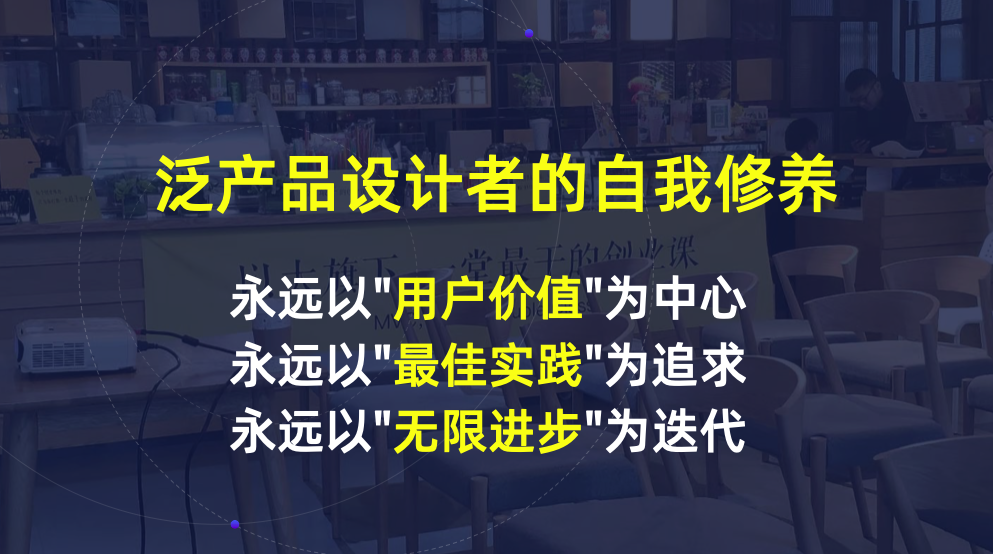
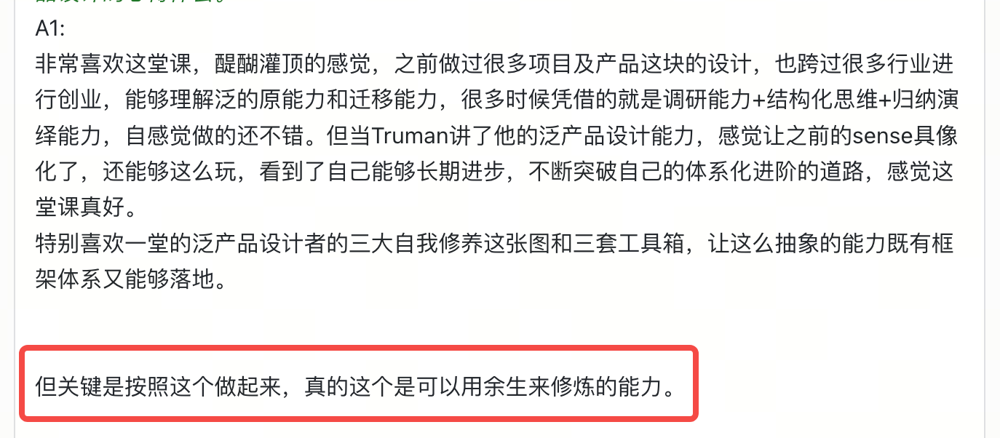
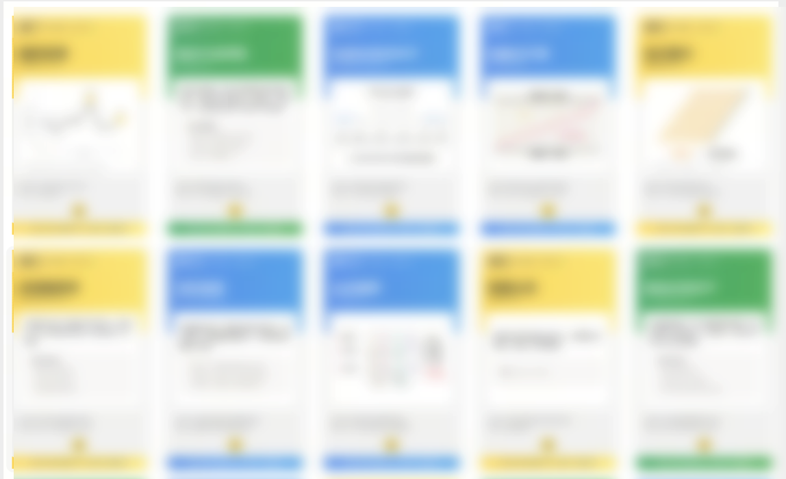
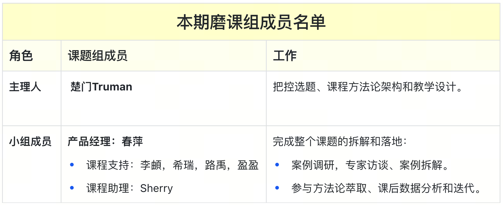
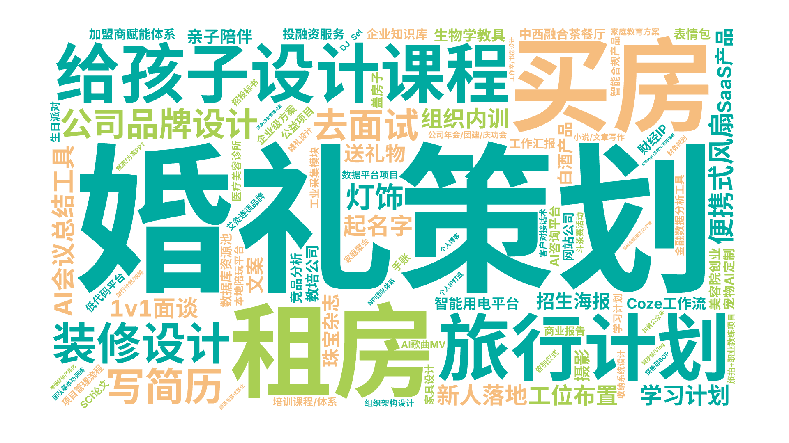
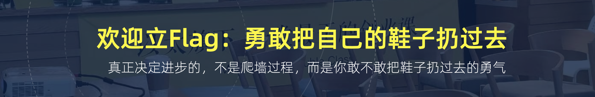

## 开始上课

Hello，大家好啊，

我是Truman，许久未见~~

欢迎大家回来继续（来到）上课，进入**本周末的成长加速时间**。

这是我的介绍，如果直播间有新人的话，自己读一下吧：
> 1. **以太一堂CEO：**2016年加入以太创服，现为合伙人，兼一堂CEO。
> 2. **前美团产品专家：**擅长从0到1业务探索、产品快速起盘、商业分析。
> 3. **一堂课程总设计师：**研发100节创业实操课，收到50万份创业训练作业。
> 4. **曾创办“易项直通车”**：资本对接平台，帮助100+项目融资成功。

**【热场🙋‍♂️】**来来来，我们热个身吧，你在一堂上课，发现有哪些很特别的产品设计（课程、直播间、活动，周边）很有趣or很打动你 or 很想掌握同样的能力哈哈哈？

————

第一节认知篇讲完之后，我们收到了大量同学在各种场景应用泛产品设计的案例，大家的思维被充分打开了。

我们收到了大量的思考和案例分享，看来同学里藏着很多**高手**啊，也收到了很多"设计科班出身"同学的认可和感慨，而且上节课的活跃率和NPS出奇的高，达到了最近一年的新峰值。

直奔主题，这节课，我们开始探索落地的部分：打造一套自己趁手的**设计工具箱**。

预告：这节课是**实操框架篇**，给大家一个完整的思考结构和武器库。如果大家反馈很好or需求旺盛，后续我们考虑围绕每一组武器给大家展开讲一系列《实操专题篇》，还在讨论中（目前大概40%概率）。

### 快速回顾

为了避免有同学还没上第一节课，或者断片儿了，我先用几分钟，给大家快速串讲一下前面认知篇的内容，帮助大家更好地承上启下。

在第一节课上，我分享了我是怎么开始"意识到"泛产品设计能力的，最早追溯到什么时候，我偶遇了什么，纠结了什么，最后才形成现在的样子。

并且带着大家**代入我的视角，感受一下我一步步的转型**。

通过我的经历抛砖引玉，带大家理解，其实我做过的所有产品，背后都是一套能力：**泛产品设计**。

我一直追求的，并不是某一个领域的产品能力，比如C端互联网产品经理，工业设计专家，SaaS商业产品经理，而是**用"一套通用产品能力"探索业务价值的能力**。

这其实是完全不同的两种发展路线：垂直设计 or 泛化设计。没有严格意义上的好坏，一个更容易上手，学起来容易；一个更难掌握，但更容易迁移，一通百通。

接着，我讲了作为一个长期有产品追求的人，我时常告诫自己的三句话，正式提出泛产品设计者的三大自我修养：

最后，我给了大家一张**十年修炼爬山地图**：用10年的心态练基本功，不断重复，不断精进，直到形成自信，变成专家，甚至形成职业和创业的核心竞争力，最终推高我们做事的天花板。

第一节课，我带大家**从L2到L3段位**：开始有泛产品设计的敏感性，可以识别大量应用场景。

这节课，我带大家**从L3修炼到L4段位**：开始积累和沉淀，打造一套属于你自己的工具箱。

### 为什么要学

讲完上一节课，很多同学在作业中表示，泛产品思维被充分打开了，我们也收到了大量同学在各个领域的泛产品设计案例，甚至有不少专业设计出身的同学表示，第一次有底层逻辑被打通的感觉。

那么有了泛产品设计的思维，有了大量场景的敏感性，大家被我充分调动起来了，那么下面问题来了，在面对各种不同领域，我们如何长期练习、长期持续进步呢？

从刻意练习效率出发，最理想的情况，就是**有一套固定的套路和方法。**

但是真的有一套固定的套路吗？从一张海报，到一个婚礼，一套软件系统，到一个公开演讲，貌似用的方法差异极大，而且无穷多啊。

怎么办呢？

于是，这里两年我带着团队，一直在试着收集和复盘我们这些年"高频使用"的一组泛产品设计的通用工具箱：**足够底层，足够体系，足够高天花板，足够能迁移。**

帮大家建立专业意识，补齐思考盲区，并且给大家一个可以持续修炼、无限进步，不会轻易满意的工具箱。

初期阶段，大家可以借用这套卡牌，等到长期熟练以后，你甚至可以开始，搜集、积累、打造你自己的工具卡牌库。

未来当面对一个不同难度的产品任务，我们多出一张卡，我们的产品质量，就可以拉升一分，随着你搜集的卡牌越多，能用的卡牌越多，精通的卡牌越多，你的产品能力，就会一点点进步了。

### 预热思考题

来来，照例，给大家两个预热思考题吧：

**第一个题目：习惯复盘题**

回忆一下，你设计过的产品/服务，不管是一个文档、一个PPT，一个短视频，还是一个活动、一个空间，你是怎么提高你的设计质量和效率的，你用到过哪些手段或者技巧？

重点是这些工作完全不同，你能想到几个通用的工作方法和技巧？有3个吗？5个？10个？有哪些是你习惯用、且效果很好的方法？你会有意识地把这些方法总结、沉淀下来吗？

**第二个题目：设计挑战题**

请正在听课的你，观察眼前的布局，环顾你四周的听课环境，看看自己的工位or书桌。在这个环境下，你给自己的学习状态、学习效率打个分，你会打几分？

现在，如果要求你把学习效率提升一倍，你会怎么做？具体如何设计？如果要提升3倍、5倍呢？有机会能实现吗？答案不是最重要的，你可以想想有什么手段可以不断精益求精，尽可能地不断提升自己听课体验和效率？

请大家努力做个头脑实验，想一想你现在会怎么做，希望今天这节课结束的时候，你对这两个问题的答案能明显高一个段位。

### 提前划重点

提前划一下重点，大家不要迷路，今天我会讲3个大话题：

**第一部分：初步认识框架。**我会举2个小例子，大家感受一下，我们给大家准备的泛产品设计的工具箱是什么？初步认识一下。

**第二部分：逐步出牌练习。**我会从简单到复杂，从入门到高阶，分别给大家看大量的例子，然后感受一下如何靠出牌持续提升工作质量。

**第三部分：重新理解课题。**我们停下来，想一想自己长期的追求、手里的工具以及成长的必经之路，希望能给大家更多的笃定和自洽吧。

预告一下：这次我们准备了500套礼物，最后发给大家，大家可以期待一下。

特别感谢下，这节课是集体成果。而且，这是一次**很特别的"GONGJIAN"**。

在交付完第一节课认知篇之后，我们教研团队全量阅读了收上来**1294份、超过了1531691字**泛产品设计的作业，我们看到大量同学在各种领域、各种场景下的泛产品设计应用，教研团队都表示“审美被进一步拉升了”，大家对于产品设计的思考、分享的案例都成为了这节课的共建内容，融入到这节课里。

**【毛遂自荐🙋】欢迎大家主动报名“学习委员”，谁愿意？**在评论区扣一个：**我愿意**

> 请大家积极报名学习委员，提升上课质量、班级群氛围、督促选课和互帮互助。

**"翻过一个墙，最好的方式，就是先把自己的鞋子，勇敢扔过去"**

来来来，希望大家一起立一个Flag（承诺），认真听课吸收，最后完成这次训练作业。

扣四个字吧：**一定作业**

> 我们正在持续升级作业陪伴&督促服务，口令代表有更高配的周末学习服务：）

**【划重点💡】**欢迎大家勇敢一点承诺，这四个字代表：
1. **给自己的一个预期：**把这个收录进你的10年进步练习清单。
2. **倒逼自己一定进步**：提高优先级，帮你排除杂念进行学习。
3. **享受更高配的服务：**更完备、更好的班班周末督促服务：）

哈哈哈，欢迎大家**一定作业**，未来在这个课题上，持续享受持续进步的滋养和复利。

OK，进入第一个话题。