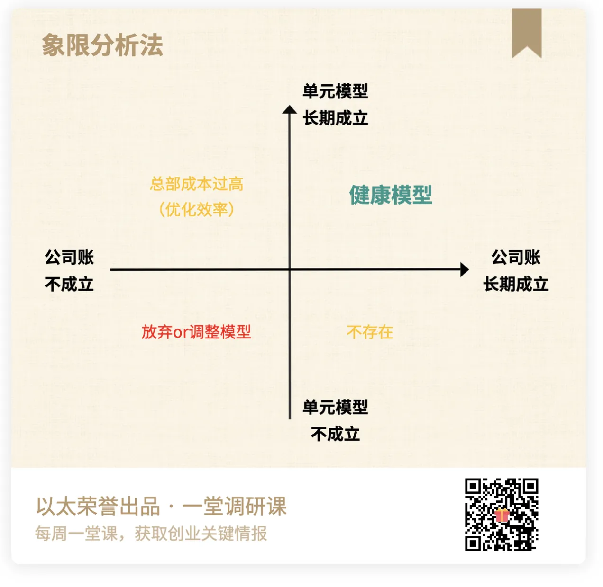

# 单元模型 · AI 落地篇 · 课程文档（01章节样稿）

> 本文档由课程截图转录整理而成。**文字内容完整保留**，截图中的图片、金句卡片、
> 案例封面等视觉元素已从正文中分离，单独存放于 `images/` 文件夹，并在原位置以引用形式嵌入。
>
> 整理原则：
> - 讲课正文逐字转录，保留原本的口语表达
> - 原文中的红字/黄字强调，用 **加粗** 标示
> - 案例代入、互动等标签保留为引用块
> - 截图中的图片只保留图像本身，alt 文本为简短提示

---

## 01 单元模型定义

---

关于商业分析，大家的3个困扰

**情况1：过大。** 聊起"商业模式"总是很宏大模糊，动不动就是谈行业趋势、平台、免费模式、PEST，对于商业模式单元缺少具体的分析能力。

**情况2：很玄。** 平时会听到一些特别碎片、特别直觉式的商业博主观点**"商业赚钱的本质是利他"**，**"商业赚钱的本质是红利"**，**"商业赚钱的本质是效率"**，总被带着走，缺少一个统一的底层逻辑。

**情况3：难练。** 缺少一个简单有效的工具，可以用来评估、算账和做决策，而且可以不断迭代、甚至可以在不同业务修炼基本功。

提到商业模式评估，市场上用得最多的算账方法，就是"财务报表"（资产负债表/利润表/现金流量表）。但是这三张表，用于指导业务决策，有几个明显的短板：**不适用于早期业务(缺数据)** ，**财务报表过于专业（有门槛）**，**偏重结果而非过程（反馈慢）**。

所以，我们在2021年研发了一套课，帮助大家系统建立对于『**科学商业分析**』的审美，修炼商业分析的预判能力、建模能力和验证能力。同时，我们也提炼了一个相对简单、科学、普适的分析工具，就是**单元模型**。

---

到底什么是单元模型

好，那到底什么是单元模型？

我们讲的单元模型，是一个业务视角的商业分析工具，**通过分析最小的『商业单元』，来评估商业的盈利性、持续性和规模经济。**

说得直白一些，单元模型就是你业务可运营、可复制的一个最小商业单元的帐。你业务未来规模化的核心，就是不断复制这个模型。计算这个模型，你可以来判断商业模式可行性，预测公司财务状况、判断能不能持续扩张。

任何一个单元模型，最基本的构成就是关键收入和关键成本。评估一个单元模型是否值得复制，核心就是判断，**关键收入是不是大于关键成本。**

---

一个业务表面上可能很复杂，但最终都可以拆到一些最小的经济循环。

比如，**在线教育**，你可以看一个用户，从第一次看到广告，到留下线索，到上体验课，到转化正价课，到后续续费，这一个用户生命周期里，公司到底赚了多少钱、花了多少钱。这就是**单用户模型**。

比如，**直播带货**，你可以看一笔订单，客单价多少、毛利多少、平台扣点多少、投流成本多少、退货率多少、客服成本多少、物流成本多少。这就是**单订单模型**。

比如，**连锁奶茶店**。你可以看一家门店，一个月收入多少、房租多少、人力多少、原材料多少、水电多少、折旧多少、总部管理分摊多少、最后净利润多少。这就是**单门店模型**。

比如，**扭蛋机**。你可以看一个柜子，一个月能卖多少、租金多少、玩具成本多少、损耗多少、补货成本多少、机器折旧多少、BD成本摊多少。这就是**单柜子模型**。

我们爆炸式研究了典型业务，最后得到了一个十大单元模型清单：

所以，单元模型不是公司总账：

- 公司总账是**从公司层面**看收入、成本、利润。它当然重要，但它经常**太大、太粗、太晚**。
- 单元模型是**从最小复制单元**上看收入、成本、利润。它**更小、更细、更早**，也更适合做预判。

如果公司总账像体检报告，单元模型就像你把身体拆到一个个关键器官去检查。你不能只看体重、血压、总分，然后说身体很好。你要知道到底是心脏、肝、肺、血糖、血脂，哪个地方出了问题。

公司账和单元模型账在长期判断上的关系：当我们把公司账成立还是不成立，单元模型账成立还是不成立分别画在一个矩阵的时候，你就会发现有四种情况出现了。

---

### 图注台账（01章节）

| 编号 | 实际画面 |
|---|---|
| 01-01 | 米色横幅卡片「关于商业分析，大家的3个困扰 / 敲黑板，说重点」 |
| 01-02 | 最简化的单元模型示意图（A+B 关键收入 <>= C+D 关键成本） |
| 01-03 | 十大单元模型清单（深色标题横幅 + 彩色三列表格） |
| 01-04 | 象限分析法信息图（单元模型 × 公司账 四象限） |
