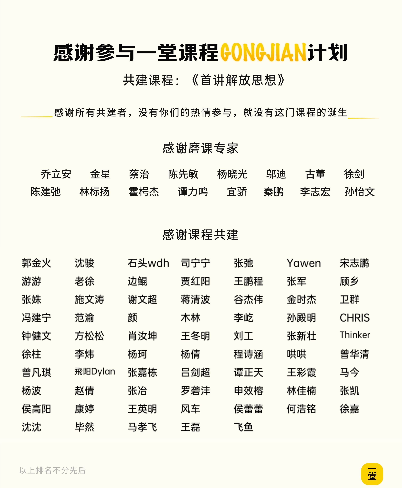
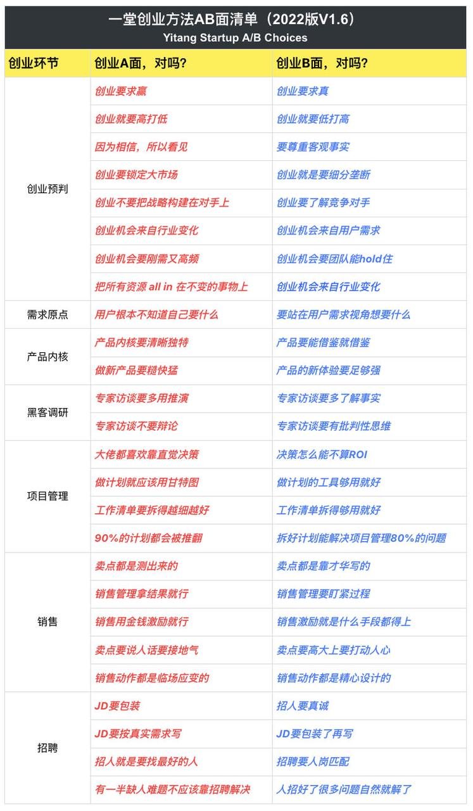

## 开始上课

Hello，大家好啊，

我是Truman，许久未见~~

欢迎大家回来继续上课。

这是我的介绍，如果直播间有新人的话，自己读一下吧：
> 1. **以太一堂CEO：**2016年加入以太创服，现为合伙人，兼一堂CEO。
> 2. **前美团产品专家：**擅长从0到1业务探索、产品快速起盘、商业分析。
> 3. **一堂课程总设计师：**研发100节创业实操课，收到28万份创业训练作业。
> 4. **曾创办“易项直通车”**：资本对接平台，帮助100+项目融资成功。

**【热场🙋‍♂️】**来来来，我们热个身吧哈哈，签个到，如果一句话总结一堂最核心的价值观和文化，你觉得最大的特色是：__________

——————

终于到了这节课了，解放思想。今天这节课非常非常难，终于跟大家见面了。

『**实事求是**』是一堂2019年开始做的课题，几经升级，现在成为了一堂最核心价值观和底层方法论。其实从当时做这节课开始，我就在选题池里留了一个选题：**解放思想**。

既然讲了硬币的一面，那另一面是什么？只有实事求是够么？只尊重事实，遵循已有的客观规律够吗？如果面对一些新情况，如何摆脱禁锢，摆脱已有规律的束缚，如何科学、高效、甚至高成功率地提出一些新解法，有效创新呢？

这个课题实在是太太太难了。

它关乎创新，关乎科学，关于勇敢，关乎我们如何打破一些规矩，拓展我们的认知边界。

经过了这两年我在一堂内部不断地做事、实践，我大概喊了100遍+"**我有一个大胆的想法**"，我大概提出了几十个各种新的假设，并且开始习惯性建模、深度思考，终于慢慢摸到了"**有效创新**"的解放思想内涵。

作为首次独立讲课，今天尝试跟大家进行第一轮新课程交付。

### 为什么要学

关于课题背景，之前已经铺垫很多了，这是一堂创业地图最下面，最重要的底层逻辑之一。我曾经说过一句话：

> 如果你的经验、悟性和耐性足够强，你只需要真正掌握最底层的《实事求是》和《解放思想》，一堂的课程和市场上的商业规律你可以不用学了，你可以自己一点点花时间、把它们动手萃取、推理出来。

因为这是最底层的科学做事姿势，我们平时做事、做课，招人、带人，都是每天反复在实践和应用这两个重要的原则。

时隔三年多，终于今天我们一起把这张图补全了。

### 预热思考题

来来，照例，给大家两个预热思考题吧：

**第一个题目：现象观察题。**

你有没有观察过，身边总有一批人，哪怕在一个非常固定的小团队，他们也总是善于发现新问题，提出新解法，不管是小到一个小流程、小功能，大到一个新业务、新平台，他们总是能有很多"比较靠谱"的新想法。

他们为什么总是有源源不断的新想法，习惯打破旧习惯，提出新解法，而且成功率往往也是显著高于常人呢？以你的观察，他们有什么样的思维习惯？

你可以停下来15秒钟，试着能不能总结出1-3句话，他们的核心共性。

**第二个题目：真实操盘题。**

假设时间回到2019年初，你穿越进入我的角色，希望围绕"创业者/高潜力管理者"做一个规模化的课程平台，作为一个行业新人，你提出了非常多的设想：轻培训、自组织学习、教科书式课程、摆脱个人IP、严格系统化课程。

但是你调研了很多同行做法：
1. "同行都是4-6周的训练营。"
2. "同行都是头部IP的经验课程，IP远大于内容。"

一些资深的圈里人给了你非常多的行业常识：
1. "课程诙谐幽默很重要，要轻松，要短，要有段子。"
2. "线上课程普遍20-30min/一节课，用户耐心很少。"
3. "不要给逐字稿，而且PPT要给一半，更利于保护版权。"

这些常识和规律，哪些该遵守，哪些该无视？我该怎么开展我的工作？ok，如果换做是你，你该如何思考123步骤，来大幅提升你的做事科学性和创造性，有效创新？

是不是很难？希望今天这节课结束，对于这两个难题，你能有一个全面、系统的认识，甚至可以带走一个长期的训练计划。

### 提前划重点

提前划一下重点，大家不要迷路，今天我会讲3个话题：

**第一关，心态关。**我先带大家回顾一下"实事求是"的上文，然后做做心态准备，讲讲什么是解放思想，明确下课题。

**第二关：认知关。**如何科学、有效地创新呢？核心的策略是什么？我会用一堂为例，给大家讲讲核心策略。

**第三关：修炼关。**如何长期不断解放思想、持续提升创新的素质呢？我会给你一个工具地图，这张图可以指导你长期精进。

最后，我会带你重新理解一下"解放思想"的内涵，并且串一串和一堂其他课程的关系。

来来来，希望大家一起立一个Flag（承诺），认真听课吸收，最后完成这次训练作业。

扣一句话吧：**一定作业！！**

对了，同时向大家介绍一下本期磨课研究组的同学：

### 本期磨课组成员名单

**角色**

课题组成员

**工作**

**主理人**

** 楚门Truman**

把控选题、课程方法论架构和教学设计。

**小组成员**

**产品经理：春萍**

- 课程支持：李頔，轶初，于陆
- 课程助理：Sherry，倩倩

完成整个课题的拆解和落地：

- 案例调研，专家访谈、案例拆解。
- 参与方法论萃取、课后数据分析和迭代。

**共建小组**

本期GONGJIAN小组，共64个同学

参与内部抛砖引玉，贡献自己的案例和观察

- 贡献观察：自己的观点和理解
- 贡献案例：过往踩坑经历和最佳实践
- 贡献故事：成长的纠结和重大反思

OK，进入第一个话题。

### 回顾实事求是

**【热身💡】**到底什么是"实事求是"？含义是什么？真实地问自己一个问题，它真的重要吗？它真的跟我们相关吗？
1. 还不理解。
2. 认识到很重要，但用的不太多。
3. 极其重要，跟我们每一天，每一个决策息息相关。

————

**我们曾有一节一堂全体会员必修课《全员必修：重新理解"务实创业"》**

实事求是，是我们做事、创业的第一原则。

甚至周子敬在线下场说过一句话：

> "实事求是，是我们做投资判断的0号原则"

它也变成了我们做课、招人、判断一个人的做事姿势的最基础原则。

周子敬围绕商业和管理，给了一个非常简洁清晰的表述：

其实，「实事求是」的定义，就是字面意思： 

- **实事 ：就是要理解真实的事实，难点在于定量。**
- **求是 ：就是要基于事实找规律，难点在于边界。**

说起来是不是特别简单，来测试一下：

**测试1：**请用数字严格讲清楚你的：①项目大小空间  ②盈利可行性  ③增长指标  ④行业集中度  ⑤规模经济要素

**测试2：**请清晰描述这几个观点的边界：
1. 单点击穿，舍九取一 VS. 矩阵打法，不要把鸡蛋放在一个篮子里
2. 创业要高打低  VS. 创业要农村包围城市
3. 因为相信所以看见 VS. 创业要尊重客观事实，不要臆测

哈哈，怎么样？你能准确描述清楚么？这节课给了大家很多案例和工具：

如果大家还没选过这节课，希望大家务必开课，多听几遍。

但是，大家认真思考一个问题：**如果一个人做到了100%实事求是，就够了吗？足够应对商业、管理、决策的形形色色难题了吗？为什么？**

作为一堂核心课，三年前我们发布了这节**《实事求是》**，一直有一个心愿，希望做一节姊妹篇**《解放思想》**，来讲清楚如何打破一些常识和规律，解决一些新问题。

下面，我们来探讨硬币的另一面。

我们发现，大量的人是没有刻意训练过"解放思想"的素质的：

- **第一关 心态关**：对齐概念，而且准备好心态，正确认识它。
- **第二关 认知关：**意识到有效创新的核心思考策略是什么。
- **第三关 修炼关：**掌握"有效创新"的成长地图，长期精进，不断训练。

ok，下面，我们进入第一关。