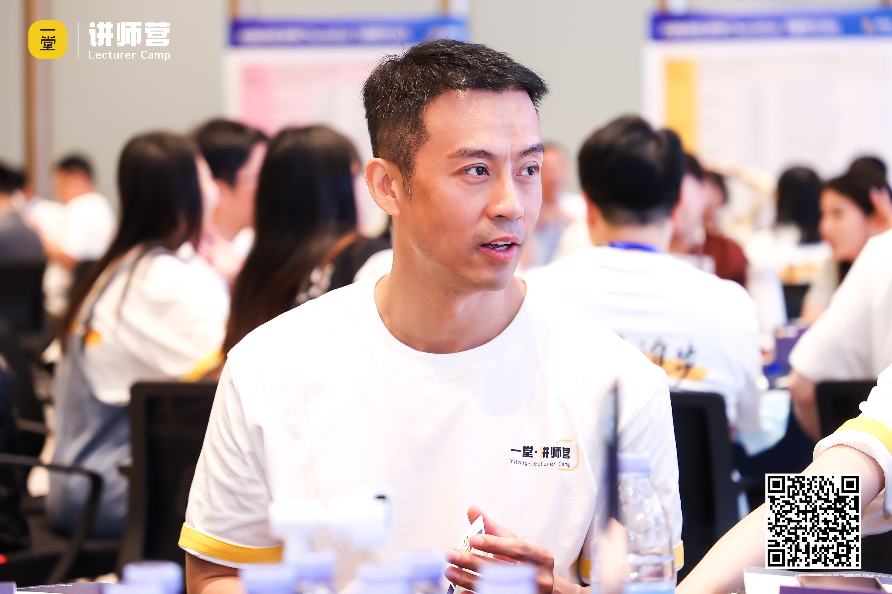

## 第二关 认知关：创新核心策略

为了大家更好理解，我先用一堂的例子，给大家讲讲背后的思考过程：

### 一堂面临的难题

我给大家举一些例子，这是这些年我们收到的很多"**过来人经验**"，的确过往绝大多数的公司，也基本都是这么做的。那我们该怎么理解呢？尊重常识吗？

**如果换做你，你会怎么思考和应对呢？**

**挑战1**：**线上做商业严肃培训不靠谱**，我们之前派团队试过了，根本不行，一堂不可能的。

> 来自2018年，某知名教育培训同行的前辈。

**挑战2**：做教育，**怎么能给逐字稿？**就得做PPT录播课，这是主流做法，对于版权保护更好。

> 来自2019年，当时我纠结了两个月，要不要给出逐字稿。

**挑战3**：做教育，**最重要的就是老师IP**，要寻找NB老师，要包装，要重点营销老师背景。

> 来自2019年，一个非常资深的知识付费做课专家，给的内容心法。

**挑战4**：做教育，**线上学习用户注意力的时间很短**，一般就是10分钟，最长40分钟，你们2-3个小时很扯啊。

> 来自2020年，一堂开始测试『直播互动课』模型。

**挑战5**：做成人培训，**会员制学习就很扯**，用户学习都是反人性的，最多学6-8周就冷了。

> 来自2020年，国内知名头部职业培训公司某总监。

**挑战6**：做教育，**就要做立刻变现的商业课**，科学管理、ROI、知识管理这种不好卖的课就不做了吧。

> 来自2022年，某头部在线教育公司业务负责人。

还有很多类的"过来人"非常友好的经验：**不要9点上课、不要拖堂、不能没有专家讲课、不能做专家销售、不能不给讲师钱啊....**

如果你是我，这些业务经验和规律，你会怎么对待？

说实话，在2021年之前，我遇到这些问题还是很纠结的，很多问题我都是纠结了两三个月才想清楚。这两年，随着我开始有意识地练习"**解放思想**"的基本功，我的这类决策越来越快了，而且做起来越来越简单了。

下面，我给大家分享一下这两年，在"解放思想"上，一堂做过哪些探索和尝试。

也请大家思考一个问题：什么是**解放思想**的核心精髓？

等我讲完故事，我来尝试给你们一个答案。

### 一堂实践和思考

大家都在呼唤"解放思想"的课程，今天我先简单讲讲我们内部的实践吧。

**同行规律1**：别人都是7点或者8点开课，这个更早，更合适啊。

**我们深入理解一下背后的原因：**为什么呢？通常一些职场人、比较简单的直播开播比较早。

但一堂做的是必修课，鼓励所有有痛点的人都可以听直播课，不是追求【对于某些人特别舒服】，而是希望【对所有人都可以安排】，就算是加班、有事应酬，9点也是一个基本可以安排协调的时间。

**为了稳妥，我还真的测试过：**我曾经做过3轮直播间调研，多数人还是投了【9点】，而且我们还测试了一期复盘营8点开播，到场率没有显著提升，请假率明显提升，的确很多人遇到了撞车问题。

所以最近几年，我们就固定在了9点开始，用录播回放来解决一些早睡的问题。

**同行规律2**：讲课不能给逐字稿啊，我们平时连PPT都不给全，因为会很容被抄袭的。

一堂早期内部就有逐字稿，但是早期是不对外给逐字稿的。很多同学听完课自己敲字留存，甚至在私下偷偷传，既担心被我们发现，又的确需要用这个来学习和复习。

怎么思考呢？这问题我的确纠结了挺久，很多人都给我建议是：**不能给**。

**最后我认真坐下来算了算这个决策的ROI：**
1. **负收益**：**提升了被同行抄袭课程的风险。**
2. **正收益**：

1. 大幅提升同学们学习、复习的体验。
2. 更方便同学带走课程，回去落地。
3. 大幅降低做课和讲课难度，大家都能讲课了。

防止被抄袭到底有多大作用呢？理性评估一下：如果同行真想抄，真的不差2个小时转成逐字稿的功夫，没多大差别，而且我还能用更强的ABCD策略来防止抄袭，所以**ROI显著为正**啊。

> ABCD策略简单说明：1）大体系  2）品牌化  3）规模化   4）共建化  

我记得当我想到这一层以后，我就果断给了逐字稿，获得了一堂大量老同学的热烈好评，后来也的确如我预期这样，很笃定，不再犹豫和后悔。

**同行规律3**：做教育，最重要的就是老师IP，要找大背景老师，卖课就是卖老师背景。

这个我也纠结了很久，最重要的是老师Title吗？

一堂最早的确也很努力打讲师背景IP、找畅销书作者，找有大公司鲜亮背景的讲师来讲，但这几年越来越少了，甚至最近我们推荐课，有时候都不提讲师名字，就一句话：**如果你有这个问题，这是节必修课，你上就对了。**

我后来才意识到一个问题：大家之所以不断强调老师IP，是因为课程往往都是老师个人经验/成功履历，所以履历本身就特别重要。

但是一堂正好相反，我们鼓励问题驱动、科学体系，在科学逻辑面前，讲师自己的观点不重要啊。我们甚至经常跟老师拍桌子：**老师不重要，客观事实和道理大于天！**

所以，当我悟到这一层以后，我就非常爽了：我才不管讲师IP、我才不管讲师有多少成功经验，一切以逻辑和辩证讨论为评价指标。

这个背后的逻辑又是什么呢？

### 一句话核心策略

**【体会🙋‍♂️】**大家体会到了吗？解放思想的关键是什么？

————

看上去的"创新"，其实深入1-2层思考，并没什么创新，我只是遵循了一些基本的商业、决策、用户体验、规模经济原则而已。

所以总结一句话，大家试着理解一下：

我们经过了几轮提炼，目前我对于解放思想的核心策略，就总结了一句话：**如果你能真正找到底层规律，你就可以在上层突破规律，完成创新。**

理解本质逻辑，就可以不再拘泥于已有的手段和经验。

规律越底层，越可以解放思想。

解放思想不是空中楼阁瞎创新，解放思想也不是投机、碰运气，而是洞察到了更底层、更本质的规律，基于更本质的规律做事情。

当你一旦找到了底层规律，上层的各种表层规律，你可以解释、可以打破、可以提出全新解法。

社会主义经济是不是市场经济？僵化的思维，社会主义经济是不是计划经济。但是，更底层一点，社会主义经济应该是老百姓过上好日子，且实践是检验真理的唯一标准。

1992年初，邓小平在“南方谈话”中提出：“社会主义的本质，是解放生产力，发展生产力，消灭剥削，消除两极分化，最终达到共同富裕”。

提炼更本质的方法论，指导上层的实践。

从底层逻辑出发，大胆创新。

不用**拘泥**于上层的手段，敢于打破。

来，我们回顾一下刚才的例子：

**【案例💡】关于上课时间，如何解放思想，寻找新解法？**

- 规律1：同行的普遍时间。
- 规律2：一堂用户需求 + 必修课的特性。

**【案例💡】关于逐字稿，如何解放思想，寻找新解法？**

- 规律1：不给详细内容，是保护版权重要的手段。
- 规律2：给逐字稿的ROI分析。

**【案例💡】关于讲师IP，如何解放思想，寻找新解法？**

- 规律1：讲师背书和IP是最重要的。
- 规律2：营销卖点之一而已；教科书要客观问题驱动。

**【案例💡】关于线上一节课时间，如何解放思想，寻找新解法？**

- 规律1：知识付费一般10分钟，课程一般40-60分钟。
- 规律2：取决于课程教学体验设计（足够有价值/成体系/循序渐进）。

哈哈，当我们有意识地从底层规律分析以后，很多答案就一目了然了。你会消除很多的执念，很多的创新就很容易做了。

所以最近两年，因为公司要做的新事情越来越多了，为了提升团队，我一直努力在内部鼓励大家"**深度思考**"、"**底层思考**"，基于底层规律做事，而不是基于表面经验重复执行。

一般来说，底层规律其实很少，它们就像是数学的公理，你掌握一些底层的规律，然后一步步推出来你的答案就好了。

下面我来讲讲，在一堂这两年，我们内部用到的几个底层的规律：比如这一大类创新，往往来自于投入产出比分析，归为底层的ROI分析，很多表层的规律就不重要了。

**比如，一堂有一些很特别的现象：**
1. "**线上大课讲师**"没有薪酬，大家是自愿来讲课，我们没给过一分钱。
2. **一堂逐字稿**：直接把课程逐字稿开放给大家学习。
3. **一堂GAP Month**计划，来工作一个月，不付学费，不发薪资。

当我们看到ROI这一层规律的时候，对于表层的很多的事情，就可以选择性忽略了。

**【一段故事】**当时在磨课时候，我突发奇想：我感觉有一个新的磨课手段，貌似非常有效：

> 你们来围观我做课吧，我写稿子，你们就在旁边观察、记笔记、观察我写课的心路历程。

讲到这，没想到春萍（一堂课程专家）非常激动，闪着泪花跟我说：

> "我也想过这个手段，但直接被前老板狠狠喷了，我还一直在反思，我到底是哪里错了。。。"

我说：真的没关系啊，创新试试呗，评估下ROI，的确不用拘泥于过去的手段啊。

于是，最近一年，这种流程创新，教研至少摸出了10几种有效的创新手段：mini访谈、交叉写课，审美提升会，种子用户面对面激发，标签头脑风暴等等....

好了，下面开始上难度，如何更好地解放思想呢？如何一步步挖掘背后的底层规律呢？