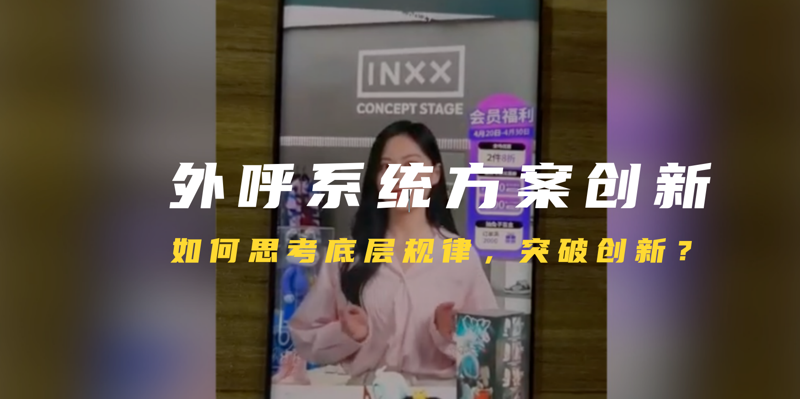

#### L3.方法模型

这一层开始进入了方法和原理层，开始完整理解整个事情的设计和思考框架。

为了避免纠缠概念，我这里统一叫做：方法模型。

> 类似的同义词还有：方法论、思考模型、思维框架、思考框架，思考结构，在这里，我都统一叫做方法模型了。

什么是方法论？我之前分享过一个朴素的定义：

> 让80%的人在80%的时间，可以拿到80分的结果，这个东西就是方法论。

有一些事很具体的方法论，比如投放公式，销售N部曲，也有一些是比较底层的方法，比如一堂五步法、ROI等等。

下面，给大家看几个例子，感受一下：

同样来自我们做汉堡的先敏同学的案例。汉堡快餐里面，泼翻可乐是常见的客诉。

怎么处理呢？

- 是分顾客原因还是门店过错，看情况赔？
- 还是离店脱手概不负责，只要不是操作问题一律不赔？
- 是只能由管理层来决策赔偿方案，还是一线员工也可以？

大家怎么思考这个问题？

————

我们试着推演一下：

**【L1.事实和经验】分析**：参考下KFC，麦当劳怎么做。

**【L2.常识】分析**：了解同行常规操作，一般是了解原因分析责任，由经理或老板来决定是否赔偿。

大家想想，如果从这两个层级分析，到底怎么做，是不是都很没有说服力。

那到底怎么分析这件事呢？先敏的做法是：

**【L3.方法模型】分析：再深入一层，计算ROI——**
1. **负收益：**

1. 失去一个顾客（拉新成本平均要达到二十元以上，但一杯可乐成本其实不到一元）
2. 对应的工资成本高（花十几分钟调查，经理层至少10几20块，普通员工也要4块）
3. 失去品牌口碑（损失不可估量）
4. **正收益：**顾客良好体验带来的复购和口碑宣传。

你看，想到这一层，先敏同学就很笃定了，不管同行怎么做，他的解决方案是：**一线员工直接操作，不论顾客有否要求，无论是谁的原因，一律无条件主动赔偿可乐！**

好，我们来看下一个案例。

这个案例来自于我们的学员陈建弛，他之前曾经在ROI案例课上讲过自己的创业项目。

建弛是英国布里斯托大学、香港科技大学双硕士，主修的是环境毒理学专业，主要研究的是海水鱼体内金属汞的毒性和代谢动力学。因为实验的要求，他掌握了一套鱼苗在实验室的孵化的技术，可以**比传统孵化率提升20%-30%**。

于是，他就想把这套技术商业化，就创业做了水产养殖业务。

但是毕竟真实的业务场景里，可能和实验室的环境条件有非常大的不同。所以他们觉得有必要去看看真实业务场景里，同行都是怎么做的。

于是，他们参观了非常多的养殖场后，不仅仅是水产养殖，还包括两栖类养殖、禽类养养殖等等，发现了一个现象：

**除了必要的养殖操作，这些养殖场都要求员工没事不要进入养殖区域，且在养殖区域附近活动时都要减少响动。**

有了这个发现，他们就也模仿同行的做法，将观察、检测等动作减少到最少。

**【互动🙋】**你们觉得他们的这个事实经验层的学习，会有效吗？

——————————

的确有效，按照同行的做法，他们**把已经领先的孵化率又提升到50-70%**。

仅仅是事实经验层的学习就够了吗？可能对于一般人够了，但是对于他们这种“专业”出身的人来说，还可以继续**深一层**探索。

他们结合以前学的原理基础，理解了**减少打扰是改善了鱼苗的生理状态，减少了应激损害。**

但理论上讲，并不是所有响动都会引起应激损害。**如果过度保护，其实也会影响后续养殖流程的存活率。**

所以他们又通过定位关键环节，远程观察，实时检测等手段，优化了操作，孵化率**又在原来的基础上提升了2-3倍**。

这个小例子就讲完了。

在这节课GONGJIAN试讲的作业里，陈建弛写了这么一段话，做了一个深入思考和创新的案例推演，非常有意思。

这里也分享给大家：

> 举个简单的例子，你看到一朵紫色的玫瑰，从未见过这个颜色，你想得到。

> **表象层：**你知道有紫色的染料，你可以通过染色获得紫色的玫瑰；

> **深一层：**你知道嫁接的方法，你可以通过嫁接获得自然的紫色玫瑰；

> **深两层：**你知道花朵的颜色由什么因素影响，通过调查实验得知了紫色玫瑰产生的所有环境和生物因素，那你不仅可以通过营造相同的条件培养出紫色玫瑰，甚至是通过调节影响因素培养出蓝色、橙色、甚至各色玫瑰。

> **再深一层：**你摸清了原理，可以种出了各色玫瑰，但是因为各种原因，很快这个方法泄漏了，大家都能种出来了。但这时候，你又突破了一层，理解了原理的动态变化。从短的时间尺度来说，或许原来你的办法只能在特定的季节种出特别颜色的玫瑰，但现在你可以一年四季都种出各色玫瑰；从长的时间尺度来说，原来你的办法其他人种了5年，发现种不出各色玫瑰了，可能是某些颜色种不出来了，可能是颜色本身不像以前那么纯那么鲜艳了，但是不管过多久，你依旧能够种出各色鲜艳的玫瑰。

> 从创业和操盘业务的角度来看：

> 做到表象层创新或许可以实现突围，做到原理层或许可以实现胜出，做到本质层或许可以实现长青。

回到鱼苗孵化的案例里，如果仅仅是从事实经验的层面照抄，大概率孵化率就停在了领先的阶段，

但是由于又深一层去看事实背后的方法原理，就可以在养殖条件上再做创新，达到遥遥领先的水平。

下面我们再来看一个例子。

这个案例来自于徐剑。

现在AI很火，而且越来越火，甚至身边逐渐形成了不谈AI就落伍的氛围。徐剑也一直对人工智能保持着密切的关注，也希望在业务层面做一定的探索。

背景是他们想做一个电话外呼系统，看有没有机会和AI做一些结合。

首先，他先去做了很多调研，他发现大家的观点和解决方案都不太一致。

**【观点1】**有的人认为，**外呼系统还是需要用真人**，因为真人才更有**真实感**，才更有可能让接电话完听率提升，另外真人的好处是，可以随机应变，可以及时调整沟通的话术，**用AI肯定不行**。

> 教研备注：完听率不同行业标准不一致，一般是指接听时长超过XX秒。

**【观点2】**有的人认为，**外呼系统用真人的成本太高，效率太低。**先不说招聘管理的成本，标准化可能也很难达到，对于沟通的技巧要求非常高，即便是相同话术，不同人的表达，可能因为情绪和声音等情况也会有差别。

**【观点3】**有的人认为，**AI可能是个解法**，但是要想取代现在的语音机器人外呼，不仅是听到人声，还要看到人像，甚至模拟直播间效果，但是**需要AI足够仿真，需要用实时拟态的技术实现，但是成本可能比较高。**

> 教研备注：实时拟态技术需要更仿真，对算力要求高，所以成本相对较高。

听了这么多不同的声音，他开始尝试自己理一理底层逻辑。他发现：主张真人的，更多的是**从价值出发**；主张不用真人的，更多是**从成本出发**。这背后应该是一个**ROI的判断逻辑**。

那有没有可能兼顾“成本低”、“标准化”和“真人感”呢？能不能在成本可控的情况下，既能标准化，又能兼顾到真人感，然后进一步提升转率？

他最后找到了一个解决方案，就是**用视频切片技术的数字人+常见问题回复的FAQ**。

> 教研备注：对比实时拟态技术，视频切片技术对算力要求相对较低，进而成本相对较低。

**【L3.方法模型】最后他认真坐下来算了算这个决策的ROI：**

- 正收益：提升转化率（真人，模拟直播间互动）
- 负收益：降低标准化，提升微微的成本

初步测算过之后，他认为转化率收益能够Cover掉成本的增加，他就开始笃定地投入研发，而且取得了不错的效果。

📹 数字人外呼.mp4

目前，这个技术已经开始在一些车险续保、游戏唤醒沉默用户、电商优惠券发放的场景应用，都取得了不错的结果：
1. 从完听率上来看：

1. 老用户：完听率超过70%，**增加了20%**
2. 新用户：**完听率翻倍**，超过50%
3. 从营销效果上看：

1. 车险续保：一次AI电话转化率达到80%，和人工外呼两次销售效果持平
2. 游戏行业：沉默用户唤醒率超过70%
3. 电商行业：优惠券领用率由原来的30%提升到80%

好啦。这个案例就讲完了。

大家可以想一下，如果徐剑只是简单调研同行的经验，没有深入底层去思考，没有用ROI的方式评估，很可能这个项目要么就是投入非常高的研发成本，要么可能就胎死腹中了。

思考模型就有很多了，比如书里有很多模型，一堂也有很多模型，你也可以自己总结一些框架和模型。

如果钱够券够的话，**建议多学一堂吧**，只要一堂有对应的课题，建议你都学一学，应该不会辜负你。我们管自己叫一堂，就是想给每一个难题，设计一套相对底层的、普世有效的的课程。

如果实在是没有趁手的模型，或者一堂还没有做课，你可以试着自己提炼模型，可以提炼方法论，甚至下一层的本质理解。

**【延伸分享💡】**我自己，总结底层规律常用的三个方法：
1. **辩证讨论**：不断找反例，追问Why，总结规律
2. **爆炸性研究**：大量寻找案例和样本，汇总，总结规律共性

3. **要素拆解**：围绕产品价值，拆解底层的关键产品要素

比如一堂的五步法、拆推评算、预判五部曲、科学开会地图，都是这么出来的。