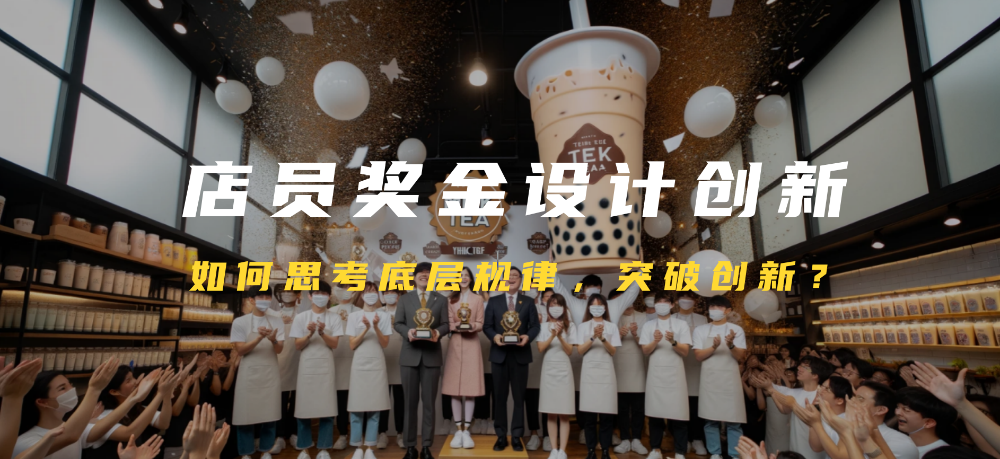
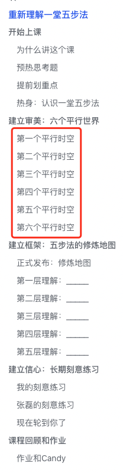
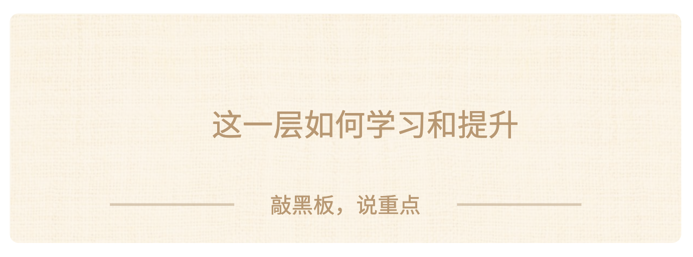
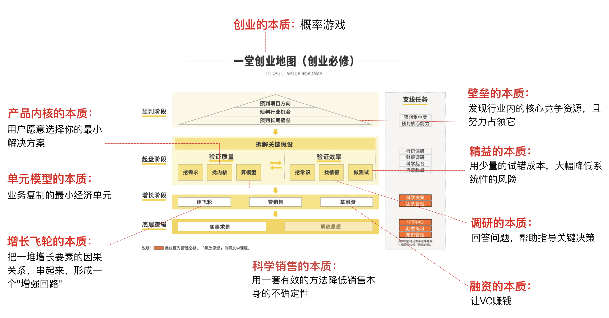
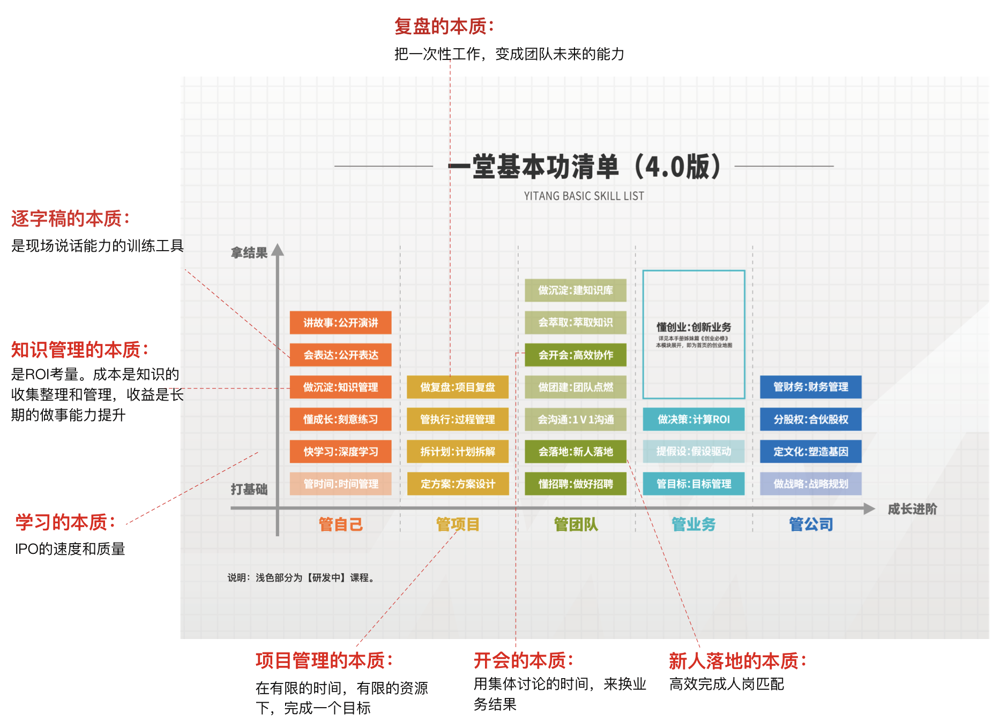

#### L4.本质理解

这句话被各种人引用，我听过不下100次了“花一秒钟就看透事物本质的人,和花一辈子也看不清事物本质的人,注定是截然不同的命运”。

本质，就是一个复杂现象，能看到最底层逻辑，用一句话or几个要素，就能够把所有事情讲明白。

**你有「不断追问事物的本质」的习惯吗？**

我刚刚提到，王兴思考非常深入，总是不断追问本质是什么？我在美团做产品，也沿袭了美团一脉相承的思考方式。

我们在工作中，总会探讨：
1. **产品**的本质是什么？
2. **运营**的本质是什么？
3. **融资**的本质是什么？
4. **品牌**的本质是什么？
5. **烧钱**的本质是什么？

你们体会过本质通透以后，带来决策质量、上层创新的大幅破除禁锢、规律祛魅吗？

> 产品的本质，产品经理的本质，融资的本质，pitch的本质，严肃教育产品的本质，续费的本质。

一旦想清楚，就会带来上层工作的稳定和可靠。

我们看两个例子：

**【互动🙋🏻‍♀️】**假设你是一个**连锁奶茶店**的老板，面临一个很具体的问题，奶茶门店店员奖金怎么设计，你觉得应该跟什么指标挂钩？

————

我们推演一下，通常的做法。

**【L1.事实和经验】分析**：调研下，附近隔壁几个奶茶店店员的奖金由什么构成的，直接抄过来。

**【L2.尊重常识】分析**：调研行业惯常做法，发现店员奖金都跟门店业绩挂钩。

怎么样，如果只分析到这，那是不是就直接可以定了，按业绩高低来？

这个案例来自古董同学，下面我给大家讲讲他的思考深度。

面对这个问题的时候，他首先问了自己一个问题：发奖金到底是为了什么？

——

**【L4.本质理解】分析**：**发工资不是为了员工开心，不是奖励销售，本质是为了激励员工身上那些与业绩高度相关的特定行为，进而提高门店业绩。**

但是，盯着业绩是出不来业绩的。只有盯着“因”下功夫，才能出来相应的“果”。

所以基于这个底层本质去思考，紧接着的问题就是：

门店业绩高低的核心影响因素到底有哪些，真的跟员工关系很大吗？

结果发现，影响门店业绩最高的几个因素分别是：

- **选址：**选址是他选的，他负主要责任
- **品牌：**品牌影响力，店员能起的作用真不大
- **QSC：**品质、服务、清洁，确实，这个点店员100%责任
- **高峰期产能：**高峰期店员操作熟练度，店员负大部分责任

思考到这一层，他做奖金设计就笃定了：**要把影响业绩的那些“因”找出来，而且得是那些主要责任在员工身上的“因”，然后做奖金的强关联**。

首先，门店业绩大小，真赖不上店员，真要归因，也是他自己的选址问题。但是运营一段时间后，**每个月、每年的业绩增量，可以跟店员的奖金挂钩啊。**

其次，QSC确实影响门店业绩，也确实跟店员表现强相关，**所以QSC的评估结果可以跟奖金挂钩。**

最后，高峰期的产能，这主要跟店员的操作执行度和员工成熟度息息相关。所以，这个纬度，又进一步拆成了2个直接因素：

> **1）员工的执行结果。**拿门店当月的生产力结果（一个衡量门店生产效率的指标）直接挂钩奖金。

> **2）人才的复制，**也是连锁经营需要解决的一大难题。所以每个店员的本职工作之一，就是带教店员。所以，门店各级员工的带教成果也可以跟奖金挂钩。

好总结一下，现在他们店员的奖金设计，是跟这些指标挂钩：

- **业绩增量**：看YOY（今年同期比去年同期）/MOM（这月比上月）的业绩增量
- **QSC**：品质、服务、清洁度
- **生产效率：**生产力达成结果
- **带教成果**：门店各级员工的带训过程和成果

最后，业绩结果只是作为一个辅助指标，会小小地关联一下奖金，但是这部分更多是作为**“成果分享”**的性质，而非“激励员工行为”的性质。

这个薪酬设计，**员工满意度都比较高，大家都很认可这个规则的合理性和公平性**，而且对于业绩目标不会抵触、也不会无视，不太会出现那种“目标由你老板随便定，反正我也完不成”的消极心态。

所以大家感受一下，这就是思考了底层本质之后，然后从本质往上一层层推，推出了跟行业常识完全不同，更多的创新方案。

好，我们再来看一个案例：

**【提问1】**关于设计课程（严肃培训类），最底层的规律是什么？

——————

**【划重点💡】**我曾经写过一个公式：**教育（积极改变） = 教材 + 教学 = 问题 + 解法 +  教学**

- **问题**：待提升的现状（目标用户 + 普遍的真实难题）
- **解法**：提升的方法（最佳实践的见识+方法论+工具箱）
- **教学**：循序渐进地讲明白（唤醒+规划地图+讲清楚+督促学习+给反馈）

当你理解到这一层以后，各种教育模型，各种课程服务你都可以抛开，你就可以解放思想，构建属于你的新产品：

- **线上能不能做严肃培训：**唤醒+预热思考题+钩子+体系，来解决学习的耐心问题。
- **工作坊能不能没教练：**极限挑战换成自学+PK互评+最佳实践答案。
- **时间能不能很长：**解决体系+休息问题就行，可以连着讲10个小时的必修课。
- **如何从案例中学习：**案例大爆炸，大家一起贴100个标签，相互教学，层层筛选PK。

所以我们线上设计了【段位打分模型】【平行时空模型】【停车场模型】等等教学方法，看似创新，其实没什么新鲜的，我只是遵循了【**循序渐进讲明白**】的底层规律而已。

未来一年，我会带着团队挑战一些更大的难题：线下2天1夜训练能不能脱离线上讲师（用教练）？公司内训能不能全部标准化，脱离教练和讲师？

这些教育模型的创新，背后就来自于对于上面的那个底层模型的拆解和理解。

最近我们又在思考新的产品，优秀的公司内训的产品本质是什么？

**【初步答案💡】**理解内训产品本质：逐步落地。
1. **统一话语**：对齐话语体系 **#现场讲**
2. **动手实践**：带着员工用一次 **#给工具**
3. **持续落地**：下周交作业，三个月之后汇报 **#留作业**

如何学习本质呢，教研团队做了一个有趣的工作，回顾了一下我们在各个课上，总结的本质清单，非常有趣。

除了课上常提到的本质，我本人还有一些常用的本质，没有放到课上：用户激励的本质，Pitch（说服）的本质，招聘的本质，续费的本质，补贴的本质。

如果你想自己**总结本质**非常非常难，而且不同行业人总结的完全不同，它需要你一遍遍深度思考，不断推翻、修正、不断推演使用，才能慢慢做出来。

**【礼物🎁】**我和教研商量，要不要梳理一份我这几年总结的、持续在用的本质总结，作为这节课的Candy奖励？叫做《Truman的本质思考清单》，那就放到正式课里吧。

到复杂事情的底层要素和本质够了吗？还不够，最底层的、最稳定的，其实来自于经典学科的经典理论。