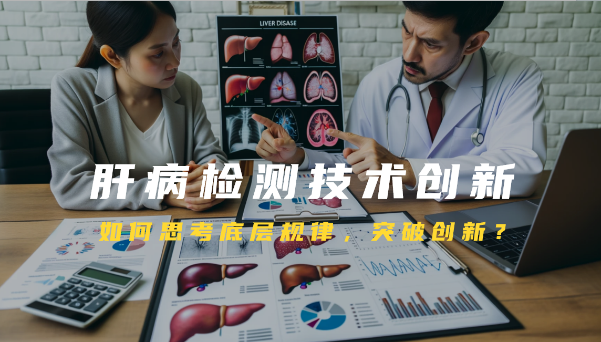

#### L5.经典理论

讲到思维模型，最有名的就是一本书就是查理·芒格的《穷查理宝典》，他提出了「多元思维模型」的概念。

什么是多元思维模型呢？就是重点学科的重点概念。

在数学、工程学、生物学、物理学、化学、统计学中，有很多经典的思考框架，**拥有这些思维模型，对于90%以上的问题，都可以做出优秀的决策。**

**你有学过「思维模型」吗，掌握了多少个？**

《穷查理宝典》中，芒格极为推崇的就是如下的几个：
> 1. 复利原理
> 2. 排列组合原理
> 3. 费马帕斯卡系统
> 4. 决策树理论
> 5. 会计学
> 6. 复式簿记
> 7. 质量控制理论
> 8. 后备系统
> 9. 断裂点理论
> 10. 理解质量概念
> 11. 误判心理学
> 12. 微观经济学
> 13. 规模优势理论

这就是一定程度上，**民科**为什么往往不行，无法证明自己不对，只在闭门创新上自我证明，甚至无法理解同行说的证明方法不对。

一旦回到基本的理论、学科里的规则讨论问题，往往很多底层创新就容易出现了。

Elonmusk造火箭大家都清楚吧？为什么他的"**第一性原理**"这些年广为流传，因为这些年，他一直在用这些方法在创新，并且连续成功了多次。

最早，Elonmusk想实现**“火星绿洲”**计划，简单地说，就是把一个能自我运转的实验温室送到火星上去，在火星上培育植物。

这个计划，需要火箭啊。但是，当时发射一次火箭的成本巨高。而且直接购买火箭，买回来自己发射，成本也很高。

所以，他认真思考了一件事，**能不能通过自己造火箭把成本降下来**，把发射成本尽可能降低。

要知道，当时，做火箭发射火箭这个事，几乎只有国家才有财力干。

所以，**Elonmusk为什么敢挑战这个巨型项目？**

好，Elonmusk的“第一性原理”登场了。他说：

> “第一性原理”的思考方式是用物理学的角度看待世界的方法，也就是说**一层层剥开事物的表象，看到里面的本质，然后再从本质一层层往上走。**

所以，他回到物理学原理开始思考。

> 他问自己：火箭是用什么做的？

> 答案是：**航空航天级铝合金，加上一些钛、铜和碳纤维**。

> 接着问自己：这些材料在大宗商品市场上值多少钱？

结果发现，火箭的材料成本约为通行价格的**2%左右**。而且燃料的成本更低，成本大约是火箭成本的**0.3%**。

那为什么现在的火箭贵，因为现在的火箭大部分是外包了之后组装的，**经过层层外包之后，成本就越来越高。**

所以当马斯克从底层的物理学原理出发，拆解火箭的基本材料之后，他发现：

**基础材料成本，竟然比火箭成品的成本低这么多，**

**那么在上层，一定可以通过规划设计、改造制造方式等，来大幅降低成本。**

所以，他就有了一系列可创新的动作了。

比如他决定自己切割金属，尽量不外包，**80%的零部件都由自己生产**。他说：

> 你得往下走四五层，才能找到真正做实事的人，比如切割金属、聚合零件等。

再比如，他提出回收火箭，尽量重复使用火箭；

再比如，他灵活采购其他行业低成本的零部件，甚至到废品厂去买二手零部件；

再比如，他尽量简化制造流程，用一样的发动机来组装，量产降低成本且增加可靠性……

这就是他造火箭的第一性原理。**从最底层的物理学原理出发，他就可以一层层往上走，突破所有的表层现象和规律，**造出成本极低的火箭。

再看一个真实的、同学的创新例子：

这个案例来自今年我们的一堂Y30学员林标扬（浙江大学教授，博导，国家特聘专家）

他是一个医学遗传学博士，之前一直在国外求学和研究，曾经在《Science》《 Nature》这样的顶级期刊上**发表论文90+篇**。还曾经和美国三院院士Leroy Hood 教授一起提出过3P医学概念（预防、预测、个体化医疗，后期加上参与，变成4P）。

后来他希望自己的研究除了做研究、发论文，还可以做出更多的贡献。于是就开始研究中国的疾病情况。

他发现，中国每年约有38万人死于肝硬化和肝癌，占全球肝癌死亡的51%，所以有了一个非常宏大的想法，**希望可以通过技术帮中国摘掉肝病大国的帽子。**

他先研究了中国在肝病治疗上的普遍情况，发现临床上检查肝脏功能，**主要是通过血液肝功检查和B超检查。**

**通常血液检查**，主要是看转氨酶等指标，如果出现问题，就诊断有损伤，如果结果没问题，就不会考虑损伤问题。而**通过B超检查**，如果能看出“纤维化”，大概率已经意味着出现了肝硬化，进入晚期。

临床上这种检验和诊断在医疗领域**已经应用了二三十年**，但是造成的结果是，很多人血液检查一直没问题，医生和病人都觉得没问题，结果真的有了症状再去做B超的时候，已经晚了。**肝癌死亡率居高不下。**

**这种情况下，这种级别的问题，还能怎么通过创新突破？**

于是他决定要再深入一层，从**系统生物学**的深度来探寻可能性。

> 教研备注：系统生物学，简单理解，主要研究的是生物系统内的**组成部分和各部分之间的关系。**

他从细胞生物学的角度，肝脏主要由三种主要细胞组成（肝细胞，巨噬细胞，星状细胞），**传统的血液检查的指标都只来自于其中的一种细胞**（肝细胞）。

接下来，他用了将近3年的时间，研究了几百例临床样本的数据分析（活检）。从分子生物学的角度，研究三种肝脏细胞，相互之间如何作用、促进肝脏纤维化形成的过程。

最终发现了一种物质，叫做**壳酶蛋白**。

他发现这种壳酶蛋白会出现在肝病非常早期的时候，可以通过检测这种物质，更早地发现肝癌和肝硬化病变，在最好的治疗阶段干预，达到更好的治疗效果。

这项技术后来又花了1年多的时间，在医院临床上做验证，目前已经在国内80+家三甲医院临用于临床诊断，3年内检测突破了100w人次。

不仅在国内，在国际上这个技术也得到了认同。被同行称为**诊断领域内第一个由中国贡献给世界的指标**，是诊断领域“**指南针式**”的中国贡献。美国最大第三方实验室Lab Corp.也引入作为脂肪肝、肝纤维化的检测指标之一。

这个案例我也讲完了，大家还是可以反过来想一想，如果面对行业沿用二三十年的现状，面对已经相对底层的规律，林标扬没有深入到更底层，这个案例的结果又是什么样。

这一层如何学习呢？推荐大家可以重点关注一下《穷查理宝典》，关注一下查理·芒格的多元思维模型观点，市场上有非常多人都在研究，自己拉一拉单子补补课吧。