## 未来展望和作业Candy

### 重新理解"解放思想"

ok，课程马上尾声了，最后总结，送给大家四句话吧：

**【划重点💡】**第一句话：**解放思想和实事求是要同时修炼。**

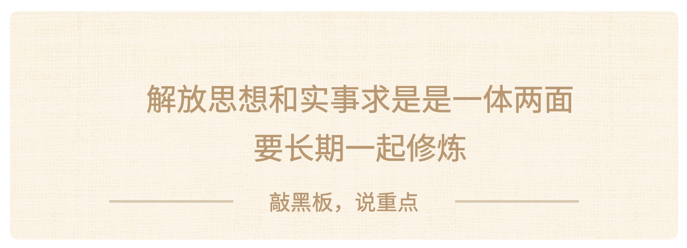

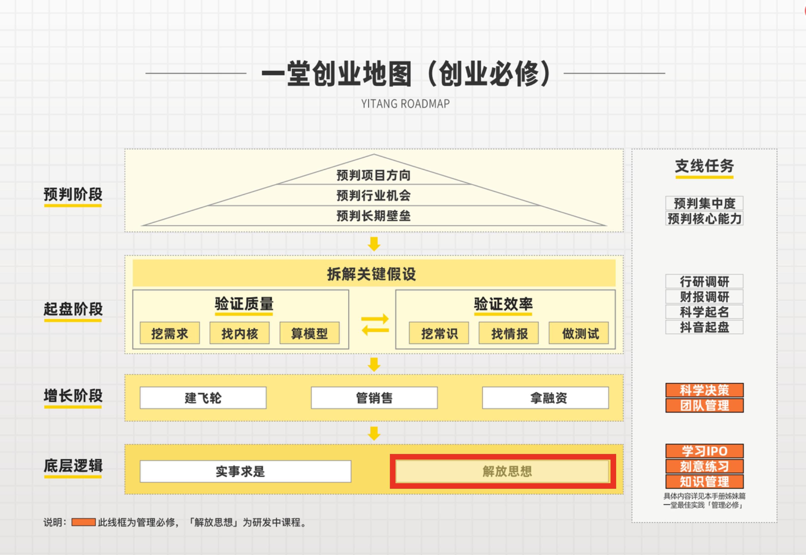

**解放思想VS.实事求是的关系：**互为一体，**解放思想是实事求是的更高要求**。

- 实事求是，讲的是要通过观察客观的现实情况，找到客观规律。
- 而解放思想，是要在充分了解底层规律的基础上，提出新问题，找到新规律。

蔡治给了一个很有趣的描述：
1. 解放思想，对应**「放不开手脚」**，核心需要对抗惯性
2. 实事求是，对应**「看不清形式」**，核心需要对抗主观

在主观世界，活的太久了，要客观， 要实事求是。

解放思想，要对抗惯性，对抗个人和组织的惯性。

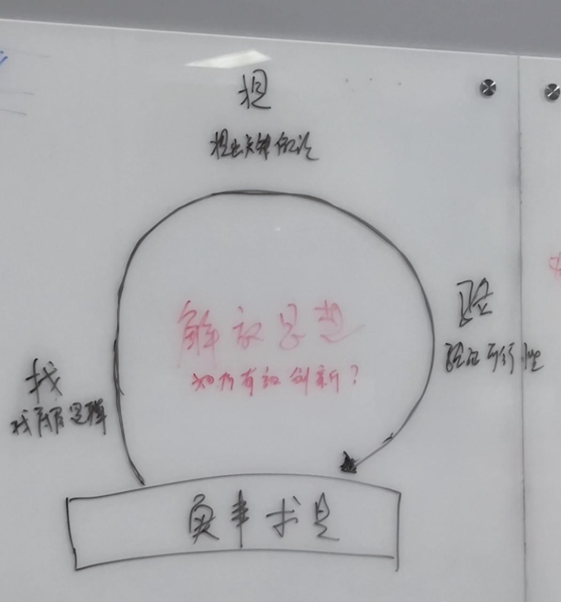

实事求是的动态过程，从实事求是出发，最终回到实事求是。

保持足够强的"**敬畏心**"，尊重常识和已有规律，但也要有"**创造力**"，敢于挖掘更底层规律，打破现有规律。

**【划重点💡】**从思考能力到创造力，这是一个扎实的成长路径。

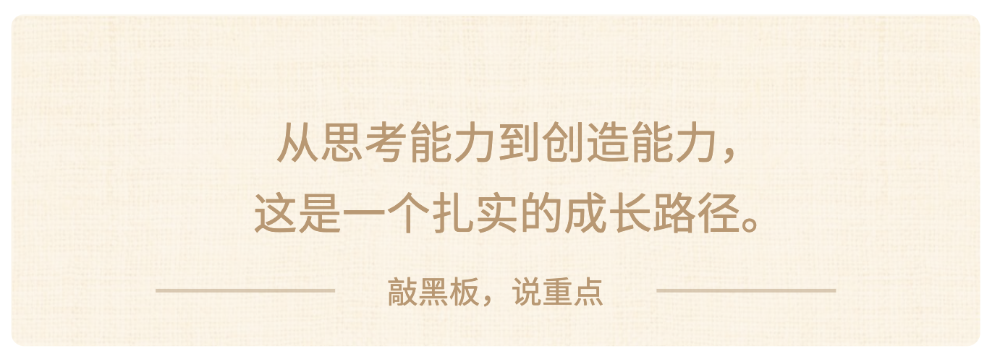

这是很多年前，我用来准备大公司面试的一个梳理：**什么是好的PM/业务负责人**？

你们会怎么回答？具体了吧有点显弱，模糊了吧，有些好高骛远，怎么办？

最好还能呈现出价值观、踏实做事和长期追求，怎么回答？

——————

我准备的答案（很多年前随手印象笔记的图）：

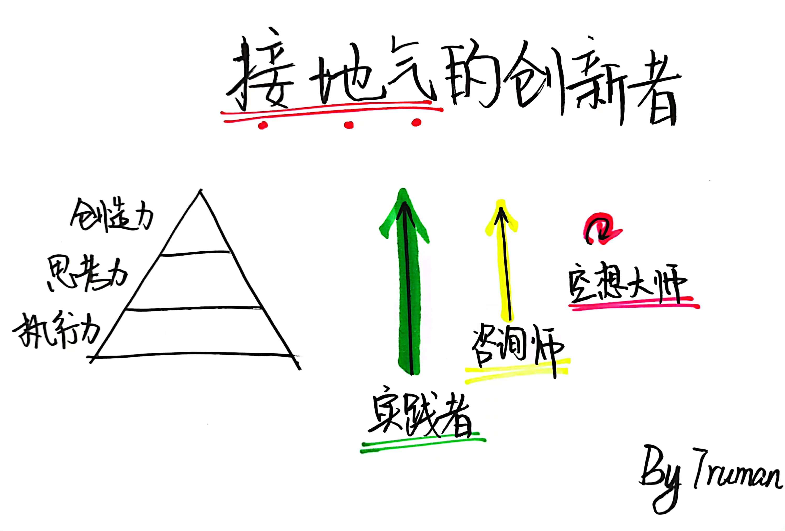

只有『创新』基于『常识』，才能理解普遍的现象。

只有『常识』基于『事实』，才能证明自己做得对不对。

**【划重点💡】**深刻理解**惯性存在**，营造氛围，持续突破。

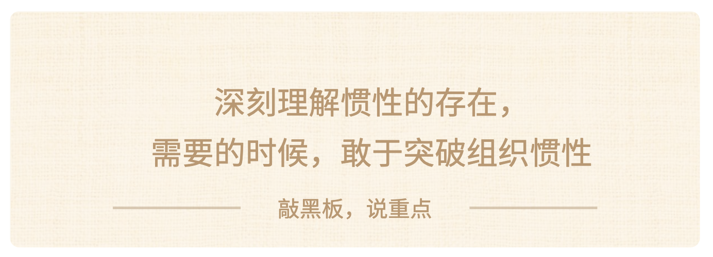

我们必须要承认，改变惯性，去想新东西、测试新东西是很难的。

**【思考🙋‍♂️】**大家平时会遇到哪些常见的惯性，成为了解放思想的敌人？

————

惯性普遍存在：人有惯性，公司组织有惯性，业务有惯性，常识有惯性。

这个必须要承认，克服惯性是很难的，所以作为团队甚至公司一号位，就必须要主动站出来，挑战这个解放思想的敌人，营造一个开放思考的环境，甚至让你的核心团队相信：我们都是普通人，但我们渴望做出来一些不普通的事情。

1997年，在苹果的一次内部会议中，回归后的乔布斯做了苹果史上最具标志性的品牌宣传：Think Different。

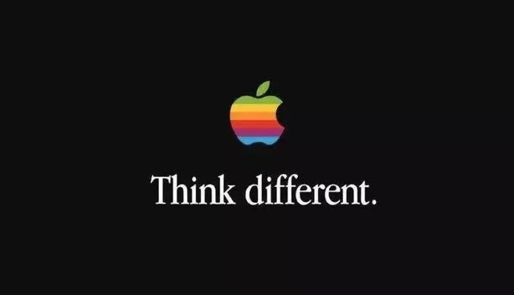

乔布斯有个名言，很多人都在引用：**只有疯狂到认为能改变世界的人，才能真正改变世界**

如果你的公司/某些团队也需要持续解决问题，就需要营造一个积极的、不设限的公司价值观。

我这两年，养成了一个口头禅：**我有一个大胆的想法**。

甚至不断鼓励、公开赞扬提假设的人，营造一个氛围"提出想法本身"就意义非凡。

**【练心态】**为了鼓励大家不要怂，我还专门在公司刷了超大口号：）

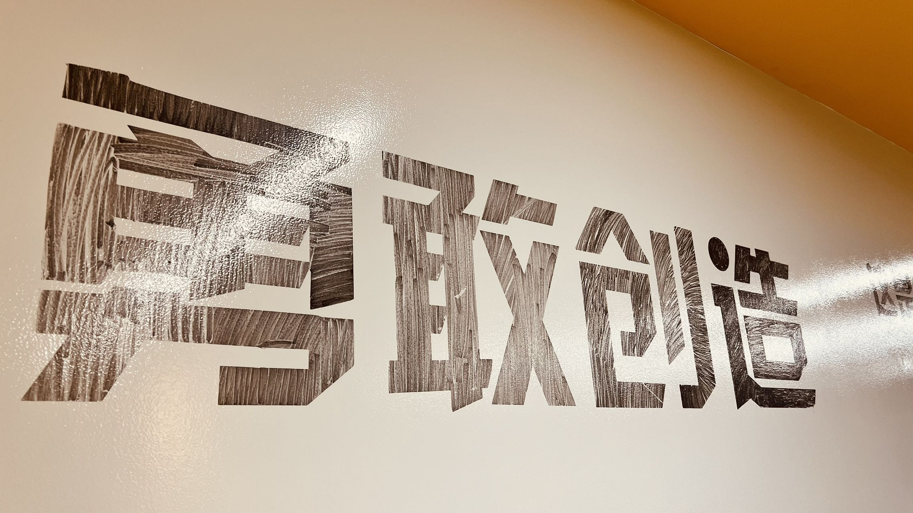

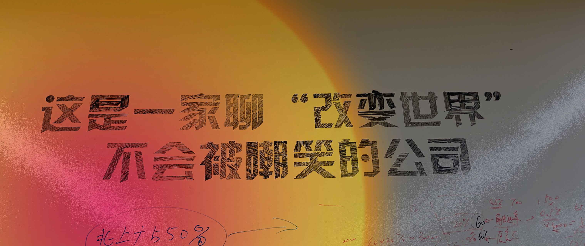

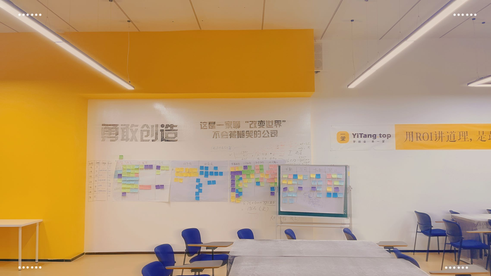

然后在公司内部，开始鼓励大家提想法，开头脑风暴会议，项目灵感攻坚会，于是内部一大批奇思妙想出现了：神奇搜索、神奇穿越、直播间选课、一堂大地图、课程内容进度条、一堂GAP计划、讲香基本功训练......

要敢于解决新问题，善于思考新问题，能够解决新问题。

如果只有实事求是，大家都很老实，都很固守规律，这个世界该多么没意思。

历史和新的规律是由我们一次次动手创造的，

我们需要慢慢拥有勇气，拥有力量，拥有足够解放思想的认知和落地能力。

**预告：**我们还在实践一些具体的工作流程方法

**【划重点💡】有一些实操的团队协作工具，可以团队苦练基本功。**

**这两年，我带着团队努力修炼，最常见有三类：**
1. 日常工作：关键假设池
2. 专题任务：头脑风暴会
3. 关键卡点：**项目攻坚会**

一堂最近一年，做了很多头脑风暴和攻坚会：训练题目头脑风暴、抖音选题头脑风暴、招生渠道头脑风暴、创新礼品攻坚会、马拉松选题攻坚会、线下共学玩法设计攻坚会、销售策略攻坚会等等。

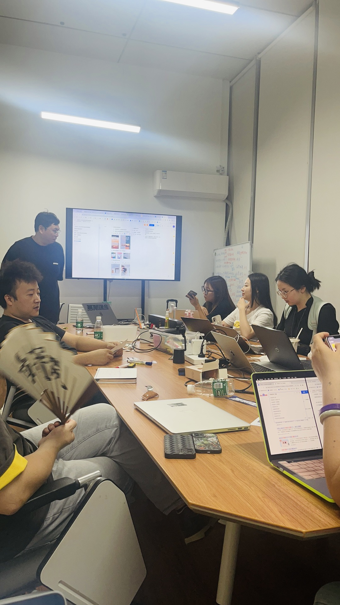

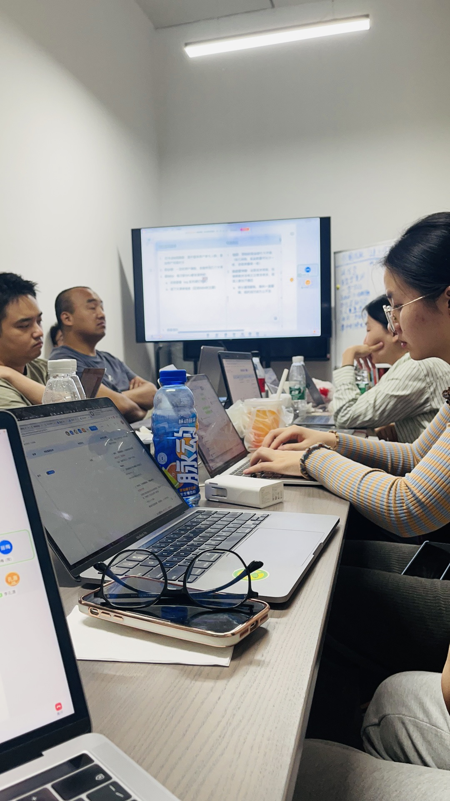

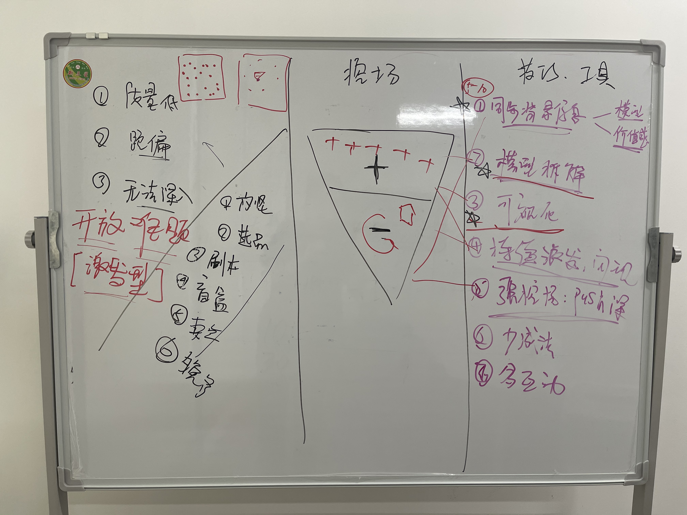

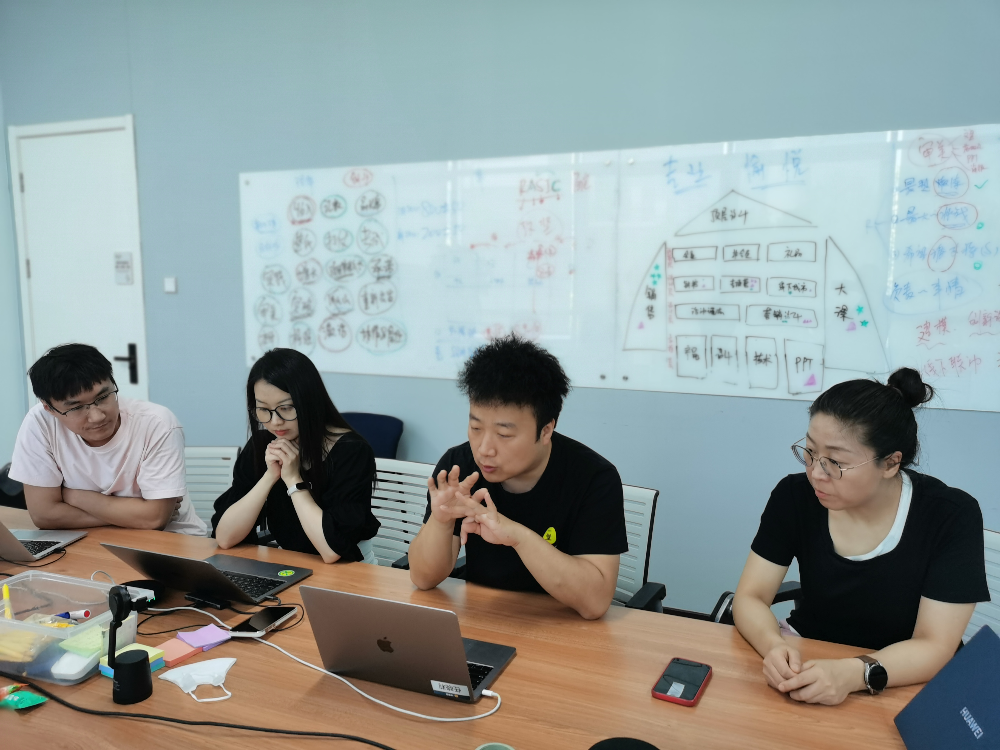

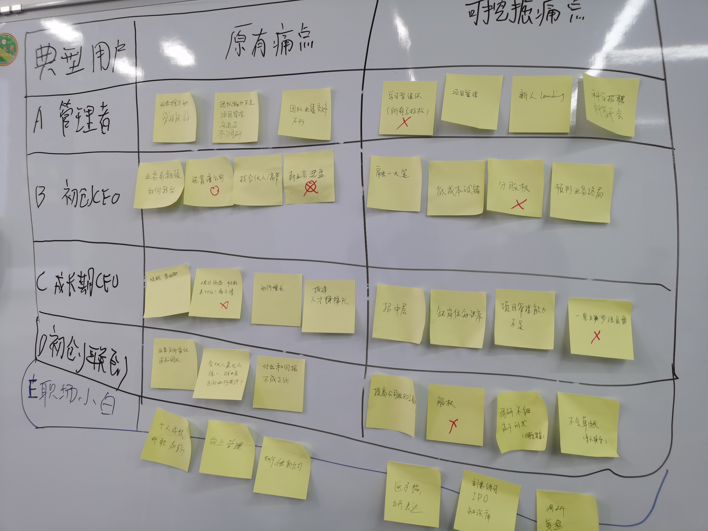

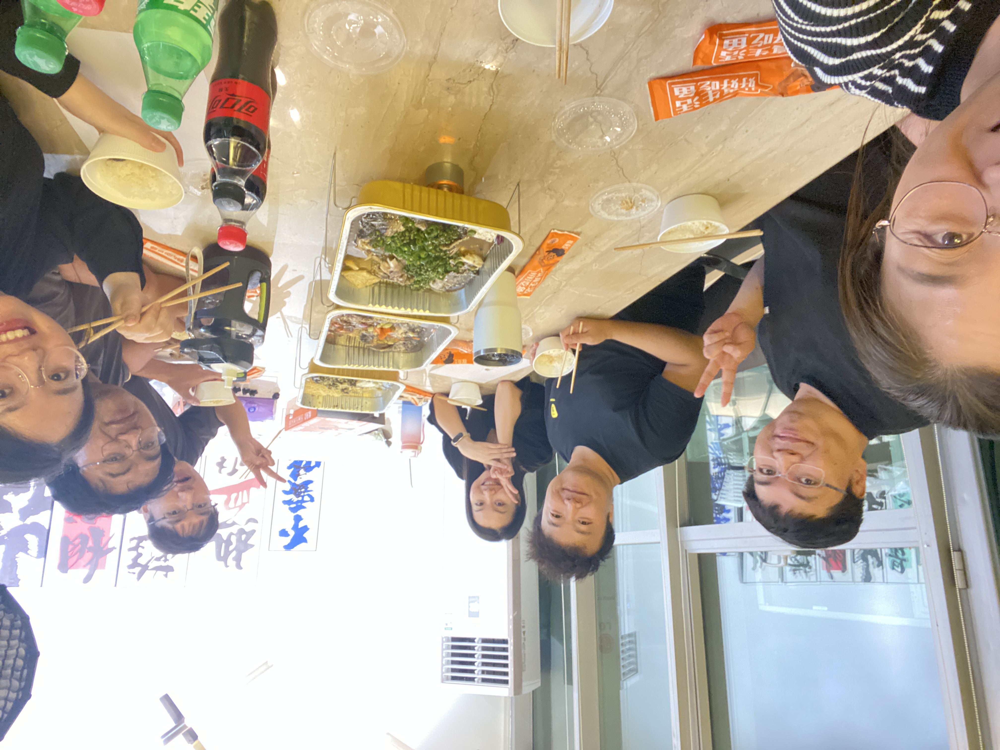

等我们内部试药结束，后面争取做一套标准课吧，给大家讲讲如何鼓励全员提想法，一起解放思想，大胆设想。

这节课，我给大家留了3个作业，你可以3选1完成。当然我鼓励你听完课后，都尝试写一写。

**第一个作业：心得总结题。**

请围绕"解放思想"这个课题，讲讲你的观察和心得，以课上的模型和标准，你觉得自己可以打多少分（百分制）？你有哪些比较擅长的，哪些是你的短板甚至盲区？期待你的观察和思考。

**第二个作业：深度案例题。**

能不能围绕今天讲的"**基于底层规律，在上层打破规律做创新**"这个本质策略，讲讲你参与的案例和实践。你们遇到了什么新情况、新问题，找到了什么底层规律，然后如何解放思想、突破表层规律的？

**第三个作业：底层规律题。**

这些年，你用过哪些底层规律做上层创新？类似于一堂五步法、科学决策ROI、规模经济分析等等。欢迎大家写一写务实有效的一些底层规律，**越多越好**，我们考虑汇总一个小抄，放到课里。可以是你自己总结的，可以是学到的模型，也可以是经典学科的理论。

**【Flag🙋】**这节课做起来很辛苦，希望大家不要辜负。

来来来，希望大家一起立一个Flag（承诺），认真听课吸收，最后完成这次训练作业。

扣一句话吧：**一定作业！！ ** Or  **一定挑战！！**

提醒：新课免费内测，请务必按时学习提交作业，3次报名内测不写作业，后面不会再邀请。

**🎁 作业奖励Candy**：这节课，教研团队整理了一份**《一堂方法论清单》《一堂本质清单》**，方便大家随时查看最新的一堂模型。如果这期有特别优秀的作业，我们也会附进去。

此外，我和教研商量，要不要梳理一份我这几年总结的、持续在用的本质总结，作为这节课的Candy奖励？叫做**《Truman的本质思考清单》**，那就放到正式课里吧。

### 下节课再见

好啦，这节课就到这里了，我们下节课不见不散~~~