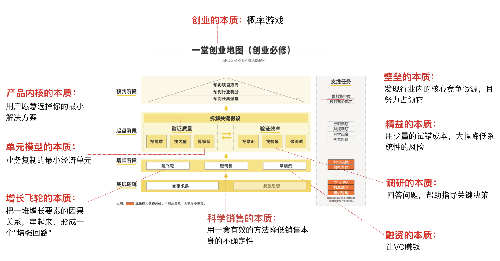
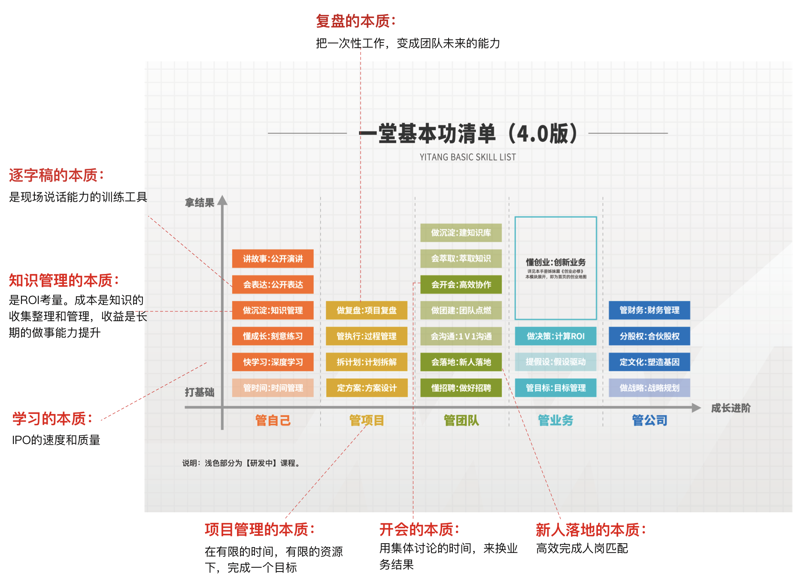

## **Truman的本质思考清单**

Hey，我是Truman，

感谢你完成了一节课，《解放思想》这节课异常艰难，不管是做课还是听课，都很考验大家的深度思考能力，感谢你完成了这节课。

作为如约Candy，这份笔记是我个人这些年用过的一些常用"本质理解"，这些本质指导我日常做了很多工作和决策，开放给大家参考。

**我确保这些定义是我日常真实实践有效的，但还是提前做两个说明：**
1. **谨慎借鉴：**应用场景不同，尽信书不如无书，场景不同，大家批判性借鉴。
2. **严禁转载：**作为Candy和内部教材，严禁一切形式公开和转发，请内部学习。

Ok，以下是正文，Enjoy~

### Part I. 课上的总结

这一部分是课上已经发布的"本质定义"，相对稳定和可靠，很多这么多年我常用的一些理解，已经都陆续放到了课程里了。

你可以重点体会一件事：如何从这一句话本质定义，推导出一堂方法模型，进而推导出整个课程出来。

站在整个过程来看，你可以理解一堂追求的是"道法器用"链路的统一和自洽，就很容易看懂了：『道』就是本质逻辑，『法』就是方法论框架，『器』就是工具小抄，『用』就是思考作业和刻意练习。

这是一个很有趣的过程，大家可以试着体会一下当初我们提炼这些本质定义的过程。

### Part II. 日常工作

下面这些是我日常高频使用的，能够熟练掌握，指导日常工作和创新，但没有封装进课程里，边界尚未清晰，所以大家可以参考，自行取用：

**1）教育的本质是"积极改变" = 教材 + 教学**

- 教材 = 问题 + 解法
- 教学 = 制定学习计划 + 解读教材 + 督促学习 + 给予反馈..

**使用场景：**这个适用于严肃教育类产品的拆解和创新重构，都用这个模型来指导。

**2）知识付费的本质：商品逻辑。**

- 知识付费的本质是商品逻辑，卖完结束，对于履约没有强预期。
- 教育VS.知识付费本质不同：用户出发&解决问题 VS. 内容质量出发&保证品质

**使用场景：**抛开表象，区分线上各种平台、各个流派的课程本质区别。

**3）说服的本质是三要素：动力，阻力，触点**

- 动力：用户Why做的原因，常见的是名利权情+稀缺性+影响力要素。
- 阻力：用户Why不做的原因，常见的是贵/不懂/没时间/怕被骗等等。
- 触点：接触用户的关键节点，推动动力阻力的场景。

**使用场景：**任何销售类、BD、转化率提升类的工作，都可以用这个拆解和创新。

**4）续费的本质：构建脱离成本。 **

- 课程脱离成本
- 活动脱离成本
- 数据脱离成本
- 社交脱离成本

**使用场景：**设计续费产品时，不是看服务好坏，而是构建脱离的损失厌恶。

**5）产品的本质：一切以用户价值为依归。**

- 商业价值的前提是产品价值
- 产品价值的前提是用户需求

**使用场景：**任何泛产品创新，都回归到用户画像+场景问题+价值点来分析，可以做底层创新。

**6）产品运营的本质：做对 VS. 做好。**

- 产品经理的本质是把事情最对：难点在于开放性难题，提升创新成功率。
- 运营经理的本质是把事情做好：确定的目标和路径下，更专业把事做好。

**使用场景：**用于区分产品和运营岗位，剥离具体表象理解底层工作目标，识别核心能力点。

**7）系统性增长的本质：找到并推动系统中正向的增强回路。**

- 线性增长：要素是因果链条，缺少增强回路闭环
- 增强回路：系统动力学，可以自增强，迭代N轮以后形成核心壁垒

**使用场景**：规划业务的增长战略，试着找到增长的因果链条，试着闭环。

**8）公司内训的本质三要素：形成话语体系、练习一次、持续落地。**

- 形成话语体系：形同统一的观念、话语体系、方法论认知。
- 练习一次：现场动手，实操新方法的执行过程。
- 持续落地：期待未来持续融入工作，改变绩效。

**使用场景：**做2B内训类的工作创新，拆解要素，重构整个产品模型。

**9）招聘的本质：补认知，补操盘，补做事。**

- 补认知：补齐一号位的认知短板，替代方案：外部求教，顾问，咨询；
- 补操盘：补齐业务操盘能力，替代方案：一号位顶，培养，外部顾问。
- 补做事：补齐具体做事能力，替代方案：实习生，外包，兼职，GAP。

**使用场景**：对于初创团队来说，招聘全职成本很高，非必要不招聘，可以绕过直接解决问题。

**10）战略会的本质：关键生死决策的艰难选择。**

- 关键词1：选择。战略的本质的选择，是作取舍和排序。
- 关键词2：生死。一定是重要的，影响公司未来能不能达成商业目标的，才值得叫战略问题。
- 关键词3：艰难。做加法没啥意义，一定是ABC选项都很想要/渴望，艰难选出来排序才有价值。

**使用场景**：业务的一些阶段性（年/半年）的里程碑讨论，形成共识，凝聚决策方向。

### Part III. 更多总结

好啦，最后送给大家一些我这些年理解过的本质吧，使用频率不高，但可以解释很多复杂的商业和管理现象背后的底层逻辑。
1. 补贴的本质：是一种临时增长手段（在第四步；前面测试内核和单元模型时慎用，容易死）
2. 竞争方向：高打低 VS. 低打高的本质，看壁垒要素（规模驱动低打高，品牌驱动高打低）
3. Cheatsheet和Checklist的本质：前者是备忘（全部都在），后者是检查（一个都不能少）
4. 激励的本质要素：名利权情。
5. 产品起名字的本质：好的名字，是为了帮助目标用户和产品持续沟通，促进交易，最终形成品牌。
6. 问题的本质：预期和现实之差（可以理解"不满"/"惊喜"等心情）
7. 长期主义的本质：愿意在更长的时间跨度上，持续积累复利的要素。

好啦，这篇笔记就到这里了。

作为《解放思想》的Candy收尾语，送给大家一句话吧：有能力在底层思考，有能力在上层创新。

当你们持续理解底层的"本质"，并且真正能掌握它，用来解读案例、指导实践、完成创新，你就可以在未来忘掉一切工具、技巧和具体招式，做到"**无招胜有招**"，用这几句话就能解决海量的各种工作难题。

我们一起共勉吧，诸位一起加油~~