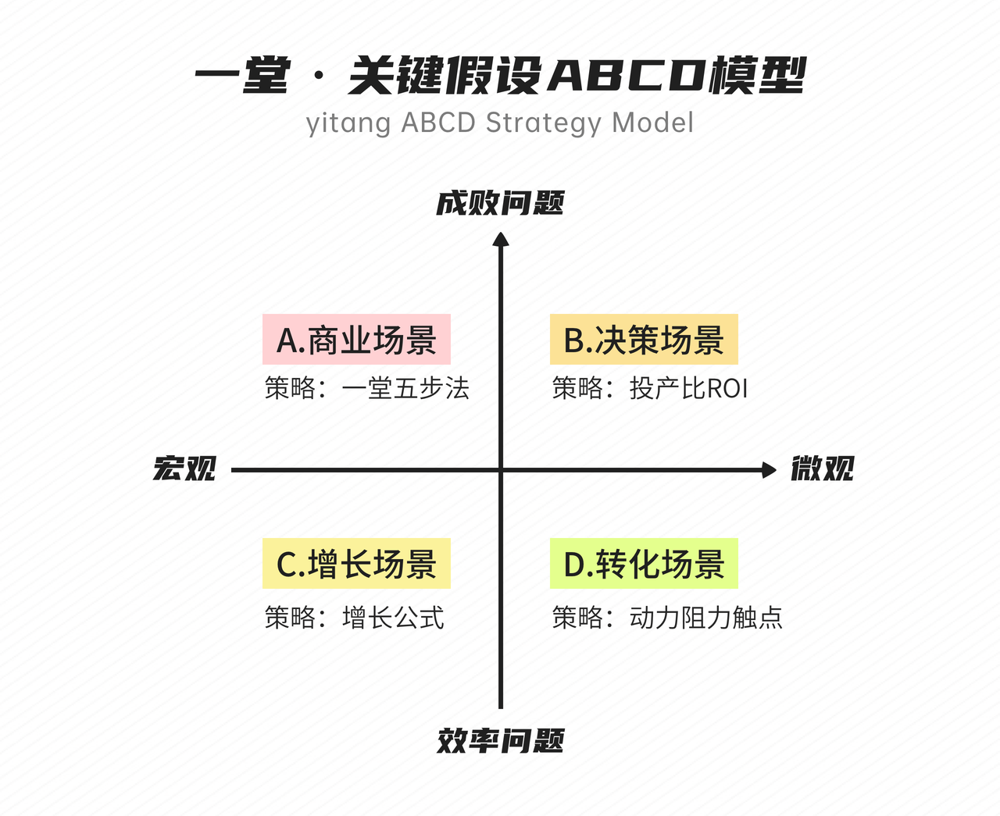
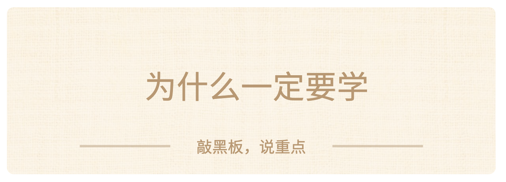
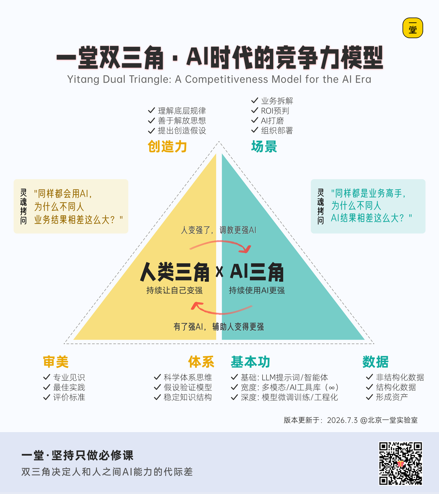
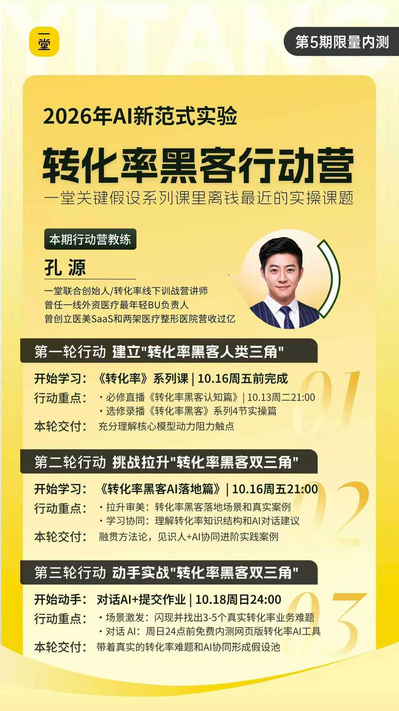
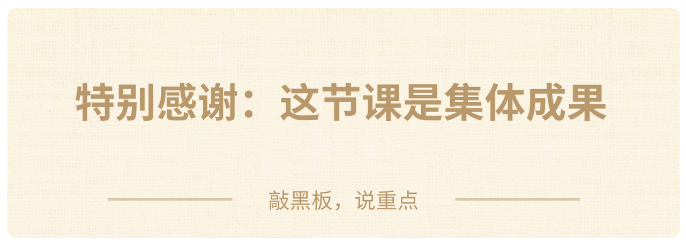
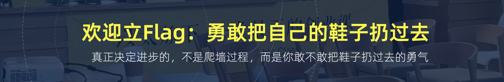

## 开始上课

Hello，大家好啊，我是孔源。

欢迎回来继续（来到）上课，进入**本周末的成长加速时间**。

考虑到可能有同学是第一次见到我，所以我还是做一下自我介绍：

我是一堂的联合创始人李孔源，主要负责一堂的城市中心建设，是**一堂22个城市中心的负责人**。

今天能有机会给大家讲这节行动营，主要是因为我过去这些年，一直在业务、销售、管理和线下交付里，反复处理各种转化率问题。

在加入一堂之前，我曾经是一线外资医疗企业最年轻的 ToB 销售负责人。后来我自己出来创立过 SaaS，也做过两家医疗整形医院，算是从销售、业务到创业，都踩过一些坑，也拿到过一些结果。

因为我长期做销售管理和业务管理，所以在一堂开始研发「转化率黑客」这个课题的时候，很多过去的经验和教训，都被带进了这套方法里。

「转化率黑客」这套课题研发之后，我们就设计了配套的线下训战营。而我呢，就是**转化率主题训战营的教练**，累计有**几百个小时**的线下交付经验。

在线下辅导的时候，我经常会遇到一个很有意思的情况：**大家听模型的时候觉得很有道理，回到自己的业务里，还是不知道从哪里开始。**

所以今天我希望做的事情很简单：

**我们要的不只是把模型讲明白，更重要的是让大家用明白。**

**让大伙尝试拿一个真实问题，把它完整地做一遍。**

**【热场🙋‍♂️】**来来来，我们热个身吧，大家觉得关键假设ABCD四个系列课里，大家日常使用频率最高的是哪个系列？

————

哈哈，如果我来回答，我的答案很明确，是关键假设D：**动力阻力触点。**

我在线下训练的时候，曾经说过一句话：**但凡你的工作中、生活中有想要推动别人去做一个动作，那这个背后一定有转化率，**而但凡涉及到转化率，你就都可以用“动力、阻力、触点”这个框架来进行分析。

### 为什么要学

「转化率黑客」这套课推出已经两年多了，但是在线下训练的时候，我发现一个很有意思的现象：很多同学上完课之后，还是没有真正把转化率带回自己的业务。

这背后可能有三个卡点：

**卡点1：缺少转化率场景敏感性。**

有些同学第一步就卡住了。他看不见，觉得自己的工作就是执行、通知、写文案或者做产品，不觉得背后有什么转化率。

**卡点2：没有真正的应用闭环过。**

有些同学听过动力、阻力、触点，知道这三个词，也能在作业里列一些内容，但没有真正拿一个业务难题，沉浸式地拆完、用完、验证一次。

**卡点3：不能熟练应用模型并迁移。**

还有一些同学其实用过这个模型，在听课、写作业或者某个案例里用过，但是过一段时间以后，遇到新的业务问题，还是不会自动调用。换一个用户、换一个场景、换一个触点，就不知道怎么重新组织了。

所以，知道一个模型，和真正把它用进业务，是两回事；用过一次，和以后遇到问题能够条件反射地调用，也还是两回事。

这就是为什么我们要做这次行动营。

转化率是一堂**最经典、最实操、离钱最近**的核心课题之一。它直接连接销售、收入、交付、续费、推荐、招聘，以及我们日常工作中大量的用户行动。

但这一次，我们的目标不是再给大家增加几个名词，也不是把前面几节课重新从头讲一遍。我们希望每个人都拿一个自己的真实业务问题，沉浸式地、拉满地做一次完整应用。

简单回顾一下行动营，不同于原来周五直播课模式，这是一个大胆的新教育实验。

2026年，我们预判大家的学习和决策方式会出现一次重大的变革：

过去很多课程，大家的学习方式是老师讲、人来听、人来理解，再回去自己想办法使用。

- **原有范式**：一切教育以人为主，“**100%人学-人用-人解决问题**”。

**现在 AI 带来了一个很大的变化：它可以同时帮我们打开更多维度，补充更多可能性，调用更多具体策略。**

- **新的范式**：人类把精力放在更高价值的判断力上，提供审美、体系和创造力，而其他的执行工作（分析/调研/执行）争取让AI来做。

但这里要跟大家**强调一下**：你自己得有体系和审美，你得先知道这是一个转化率问题，你能调用动力阻力触点的模型，甚至是更进一步的策略。问题越清楚，上下文越充分，AI 才越可能真正帮上忙。

所以这次行动营，也是一次人和 AI 协同完成真实业务行动的实验。

今天是第五期"AI落地行动营"，这次营会让大家用一周时间，完成三轮行动：

说得更具体点，今天这次行动营的直播课之后，我们不安排大家听完一堆内容以后各自回去消化。**我们从简单到难，只做三个高价值行动，也对应了前面大家落地的3个卡点。**

**行动1：形成转化率清单。**

把所有跟你自身利益相关、可能影响你业务结果的转化率机会，先拉一张清单，保30争50，你先把可能性全部拉出来。先不要急着判断对不对，先不要急着排序，也不要刚想到两个就停下来。

这一项行动，主要是为了打破一个错觉：觉得“我的工作和转化率没关系”。主要是帮助那些还看不见转化率的同学，先把业务背后的机会看见。

**行动2：找到关键转化率。**

从行动1产生的这张清单里，选出 Top 1 到 3 个你现在最关心、最值得解决的关键转化率。因为机会一多，新的问题就来了：到底先做哪个？我们不可能同时把 30 个问题都做好。你要集中到一个具体、可分析、自己能够影响，而且近期可以推动的目标上。

而且，后面无论是自己推演，还是和 AI Partner 对话，都必须先有一个足够具体的转化率目标。

**行动3：拉满拆解假设池。**

挑出关键转化率之后，按照你现在已有的认知，把它拉满推演一次。你要把目标、前后状态、动力假设、阻力假设、触点假设，以及第一轮验证行动，都尽量想清楚，最后写出一份可以带回业务执行的行动计划。

这一步，主要是帮助听过模型但没有真正用过的同学，完成一次真实应用；也帮助那些以前用过、但还没有形成肌肉记忆的同学，重新完整调用一次，并且想一想以后遇到类似问题怎么复用。

希望这次行动营之后，大家慢慢养成一种习惯：以后遇到类似问题，你会自己想到去找转化率、定义前后状态、拆动力阻力触点，再去验证。

### 预热思考题

来来，照例，给大家两个预热思考题吧：

**第一个题目：场景回顾题。**

你能不能找到几个你负责的关键转化率。这些转化率显著影响你的工作结果，并且你很渴望提升；你能找出几个？1 个？3 个？10 个？30 个？

**第二个题目：提升实操题。**

你在分析这些关键转化率、想要提升它们的时候，都是怎么思考的？背后有没有模型和方法？每次用的都是一样的模型和方法吗？

或者换个问法，你过去有用“动力、阻力、触点”这个模型去分析转化率吗？用过几次？1次？3次？10次？30次？

### 提前划重点

提前划一下重点，大家不要迷路，针对开篇说过的本次行动营三个高价值行动，我们今天会讲下面几个内容：

**第一部分，做加法，识别转化率。**我会带大家提升对场景的敏感性，认识工作中的常见的转化率类型，帮大家找一找自己可能曾经忽略过的转化率。

**第二部分，做减法，找出关键转化率。**我会给大家一套找出关键转化率的原则，帮大家在众多的转化率工作中，找出优先级最高、ROI最高、最值得关注的转化率。

**第三部分：练专业，形成大量假设。**我会讲讲，具体怎么用一套底层的、通用的思考分析框架去拆解这个关键转化率，提出大量的假设，形成假设池，并且最终形成对业务的认知。

**第四部分：我会发布一个我的 AI 分身。**我会给大家一个转化率咨询教练 C partner，来帮助大家更好地去应用转化率系列课背后的核心模型和上百个策略。我会给大家一些案例的展示，同时也给大家一些在具体和 AI 协作上的 tips。

**最后，**为了帮助大家更好地理解，我会带大家**重新理解一下「转化率黑客」**这套课题的价值。

特别感谢下，这节课是集体成果。

### 本期磨课组成员名单

###### **角色**

###### 课题组成员

###### **工作**

**行动教练**

** 孔源**

把控选题、课程方法论架构和教学设计。

**小组成员**

**产品经理：李頔**

- 课程支持：砻沣，希瑞，盈盈
- 课程助理：Sherry

完成整个课题的拆解和落地：

- 案例调研，专家访谈、案例拆解。
- 参与方法论萃取、课后数据分析和迭代。

**【毛遂自荐🙋】欢迎大家主动报名“学习委员”，谁愿意？**在评论区扣一个：**我愿意**

> 请大家积极报名学习委员，提升上课质量、班级群氛围、督促选课和互帮互助。

**"翻过一个墙，最好的方式，就是先把自己的鞋子，勇敢扔过去"**

来来来，希望大家一起立一个Flag（承诺），认真听课吸收，最后完成这次训练作业。

扣四个字吧：**一定作业**

> 我们正在持续升级作业陪伴&督促服务，口令代表有更高配的周末学习服务：）

**【划重点💡】**欢迎大家勇敢一点承诺，这四个字代表：
1. **给自己的一个预期：**把这个收录进你的10年进步练习清单。
2. **倒逼自己一定进步**：提高优先级，帮你排除杂念进行学习。
3. **享受更高配的服务：**更完备、更好的班班周末督促服务：）

哈哈哈，欢迎大家**一定作业**，未来在这个课题上，持续享受持续进步的滋养和复利。

OK，进入第一个话题。