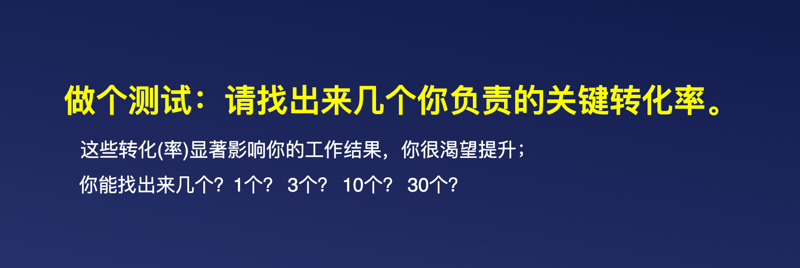
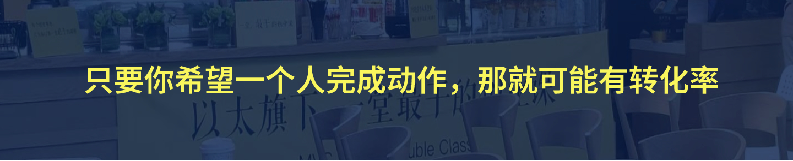
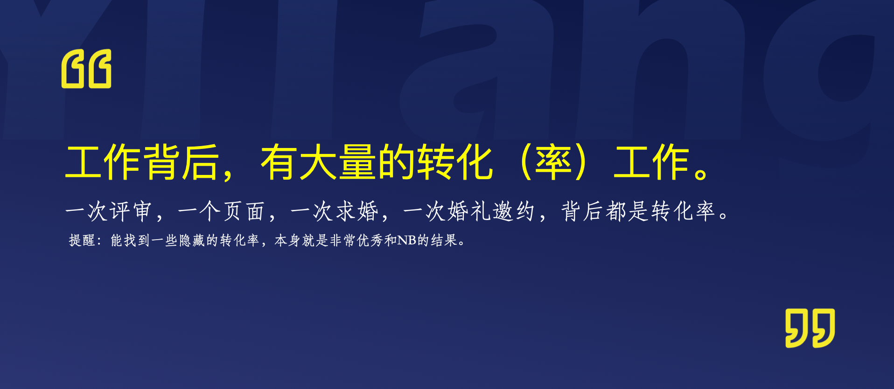
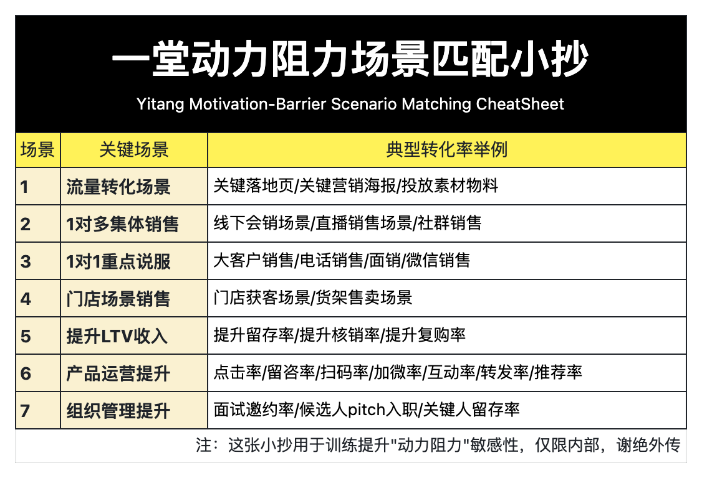
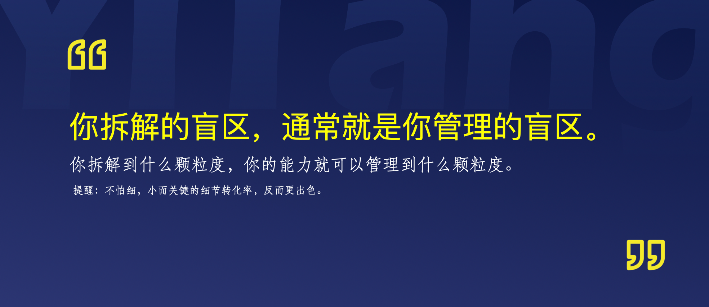

## 第一关：做加法，识别转化率

接下来我们进入第一关：做加法，识别转化率。

### 问题1：你的工作中有哪些转化率

我在线下训练的时候，开场经常会让大家做一道很简单的题：

今天也把这个问题带到线上，也是我们开篇的预热思考题。请你回顾一下，自己最近在工作和生活中做过的事情，哪些可能涉及转化率？大家可以把自己能想到的数量打到评论区。

有没有同学写了5个以下？甚至一个都没有？

我在线下见过太多这种情况了。很多人写着写着就停了，甚至有人会说：“孔源，我好像没有负责转化率。”我当时其实挺意外的。**你但凡需要说服或者推动别人做某个动作，怎么可能没有转化率？你只是没有把它识别出来。**

你把自己的工作叫写通知、做执行、做设计、面试、写内容、做产品、处理流程。你觉得自己只是在把一件事做出来，却没有看到**自己其实一直在推动某个人，从一个状态走到另一个状态。**

这就是很多业务结果不好的起点：**可能都谈不上没有方法，而是完全没有意识到，你的工作本身背后就是一个转化率问题。**

接下来我带大家看几个例子。你会发现，很多你平时认为和转化率无关的工作，其实都在做转化。

我举一个大家熟悉的例子：组织一次线下活动。

比如你想组织同学聚会，或者邀请大家到店里体验一个新产品。表面上看，你好像只是在群里或者电话问一句：“大家有没有时间？愿不愿意来？”

但对方为什么愿意来？为什么愿意专门留出时间？为什么愿意从线上走到线下？这里面全是转化。

对方要先理解这次活动有什么价值，觉得它和自己有关；还要相信现场体验不会浪费时间，不会尴尬，也不会让自己承担太高的社交成本。

如果你只把它当作“问一下大家来不来”，最后没人报名，你可能就觉得大家没兴趣。但如果你意识到这是一个转化率问题，就会继续追问：是活动价值没有讲清楚，时间地点不方便，大家对现场不了解，还是他们觉得去了也没有什么收获？

所以，组织聚会、邀约到店、邀请大家参加活动，都不只是发通知和统计人数。你其实是在推动一个人从“看到邀请”，走到“愿意报名、按时到场，并真正参与进去”。

这件事看起来很生活化，但它和销售、活动运营做的是同一类事情：让对方理解价值，降低顾虑，最后愿意完成下一步行动。

我再举一个大家很容易漏掉的例子：设计。

很多初阶的设计同学会觉得，做设计就是让画面有美感、颜色协调、排版舒服。这个当然重要，但它只是手段，不是这张图最终要完成的任务。

在磨课的时候，课程 PM 给我举了一个例子，之前在设计课程海报的时候，大家一开始也很容易陷在颜色、排版和信息是否完整里面，每次都靠这些设计原则去做海报，去找Truman确认。

但问题来了：**这张海报的目标到底是什么啊？**

**是只负责通知时间，还是要推动大家报名参加课程？**

这两个任务如果不一样，后面的设计判断就完全不一样。

如果它只是通知，用户可能需要快速找到时间、地点和入口；

如果它要推动报名，用户还要看懂价值，觉得这件事和自己有关，并且愿意现在就报名。

大家想一下，你最近做过的一张图，真正希望用户完成的下一步动作是什么？如果这个动作没有发生，这张图只是被制作出来了，还是完成了任务？

不是说设计不重要，也不是说以后做图都要机械套一个转化率模型。设计的美感是手段，具体的人有没有完成具体动作，才是这张图承担的业务任务。

**你以为自己在做设计，实际上你可能正在做一次用户决策推动。**

再看招聘面试。

我见过很多面试，现场聊得特别开心，面试官出来以后说：“这个人不错，沟通很顺。”但最后 offer 不接，或者接了也不来。为什么？因为聊得开心，不等于完成了转化。

候选人可能喜欢你这个人，但没听懂岗位；可能认可公司，但不相信自己能做成；可能愿意入职，但对收入、地点、发展或者实际工作还有顾虑。

所以面试不只是信息收集，也包含说服、表达价值和推动决策的工作。本质上，它带有 pitch 的属性，也是一段转化过程。

类似的场景还有很多：

- 老师布置课程任务，背后是学生打开、理解、开始并完成。
- 产品经理上线功能，背后是用户发现、尝试、理解，并持续使用。
- 管理者发布新流程，背后是团队理解、执行、反馈，并形成习惯。
- 内容创作者发布文章，背后是读者看到、点击、读完，并采取行动
- ……

所以，转化率绝不只存在于销售、投放和成交里，**只要你希望一个人完成下一步动作，那里就可能有一个转化率**。

**【划重点💡】**给大家一个小抄吧，帮大家练敏感度，下面这7大常见转化场景背后，都是转化率问题：

### 问题2：转化率到底该拆多细

在线下训练的时候，我发现有些同学能够意识到很多业务背后是有转化率的。他们可能会说：

> 我负责招聘，对正式入职率负责

> 我负责会销，对线下销转率负责

> 我负责招商投放，对线上留资率负责

> 我负责课程运营，对作业率负责

> 我负责会员运营，对会员续费率负责

> ……

大家觉得这些转化率的回答有什么问题吗？

在我看来，这些转化率太粗了。换句话讲，**如果只看这些转化率，大家都只能看到一个结果**：入职率低、销转率低、留资率低、作业率低。**但你不知道问题究竟发生在哪里。**

我的判断是：**很多业务结果不好，恰恰是因为问题拆得太粗。**

其实，**大结果通常由多个小转化率连续构成**。

怎么理解呢？我们来看几个例子。

如果把“正式入职率”当成最终转化率，看起来好像只有一个结果。但在入职之前，至少还有一串前置转化率：

> 看到职位信息 → 愿意投递；

> 投递简历 → 愿意参加面试；

> 面试结束 → 愿意接受 offer；

> 接受 offer → 按时入职。

入职之后还没有结束：

> 入职 → 完成融入和基础训练；

> 遇到问题 → 愿意求助和反馈；

> 完成试用期 → 愿意继续留下；

> 留下之后 → 愿意承担职责并稳定产出。

新人离职了，大家第一反应通常是：“这个人不合适。”但他可能不是入职时不合适，而是第一周没人告诉他该做什么，遇到问题也不知道问谁，或者一直没有拿到有效反馈。

如果新人最后离职了，你不能只在结果发生之后说“他不适合”。你要尽量找到：他在哪一个具体环节开始失去留下来的意愿？

再看会销。

很多人会把会销理解成一个问题：今天来了多少人，最后有多少人买，现场销转率是多少。

但现场销转率前面，至少还有这些环节：

> 目标用户被识别 → 收到邀约 → 愿意报名 → 报名后愿意到场；

> 到场后愿意留下 → 愿意听完整场内容 → 对方案产生兴趣；

> 愿意咨询或进一步沟通 → 愿意现场下单或预约后续动作。

如果只看现场销转率，前面大量流失已经被隐藏了。

现场销转率低，很多人的第一反应是改话术、换老师、加优惠。但可能根本不是现场的问题，而是邀约来的用户就不对；也可能是到场的人没有听完；还可能是大家听完了，但没有理解方案的价值。每一种情况最后都会表现成现场成交变少，但真正该解决的问题完全不同。

所以如果现场销转率下降，你会只改现场话术，还是先确认问题发生在邀约、报名、到场、听完，还是决策环节？

**加盟投放的"留资率"也一样。**

> 曝光 → 点击 → 进入落地页 → 理解加盟价值 → 开始填写 → 填完提交 → 接听电话 → 进一步沟通 → 参加考察或签约。

最后的留资率只是其中一个结果，中间任何一步掉下去，都会影响最后的数字。

**作业的"作业提交率"也不是一个孤立的结果。**

> 看到通知 → 点开链接 → 成功加载页面 → 看懂要求 → 开始撰写 → 完成内容 → 成功提交作业。

如果最后只有 30% 的人交作业，到底在哪一步掉下去了？可能是链接点开率低，甚至可能点完之后没有成功加载，也又可能是要求没有被理解，可能是开始撰写太难，也可能是写完之后没有提交。

**拆开之后，你才知道下一步应该观察什么、管理什么、行动什么。**

那么问题又来了，到底要拆多细呢？

这里有一句话送给大家：

你没有拆出来的东西，就没有办法观察；没有办法观察，就没有办法判断；没有办法判断，就没有办法管理。

所以，**拆解到什么颗粒度，业务就能管理到什么颗粒度。**

当然，拆得细，不代表每个小转化率都要马上优化。拆出来之后，你完全可以先放着，去权衡投入ROI，判断它值不值得投入资源。

但你不能连它存在都不知道。因为你不知道它，就永远不知道结果为什么会这样。

### 回到行动：写出清单

所以回到这次行动营的第一个高价值动作：保 30争 50。请尽量列出和你自身利益相关的转化率机会。

**【划重点💡】**请大家回去之后仔细思考几个问题：

- **第一，我的工作中有哪些动作可能和转化率相关？**
- **第二，这些工作表面上在做什么？但真正希望谁完成什么下一步行为？**
- **第三，这个结果发生之前，还有哪些小转化率？哪一步最容易被忽略，或者最容易流失？**

这一关先做加法，不急着排序，不急着判断哪个最重要，也不急着设计解决方案。

你可以从用户、客户、候选人、学员、同事、下属、合作伙伴，甚至生活中的家人开始想。只要你希望对方完成下一步，就把它记下来。