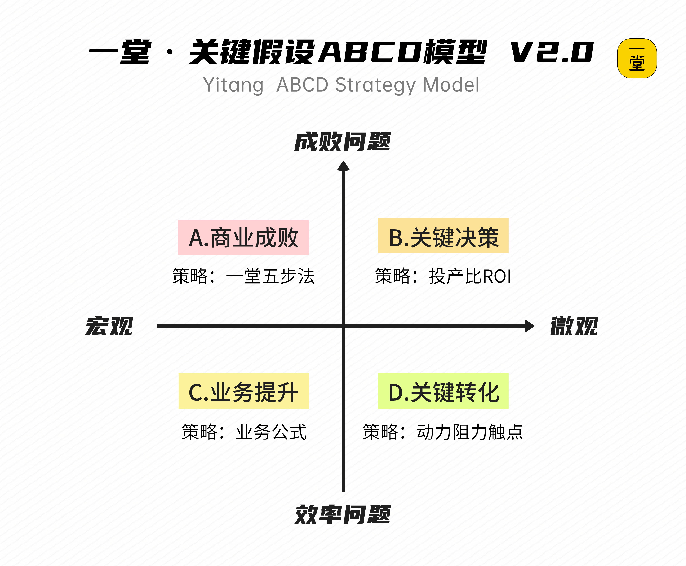
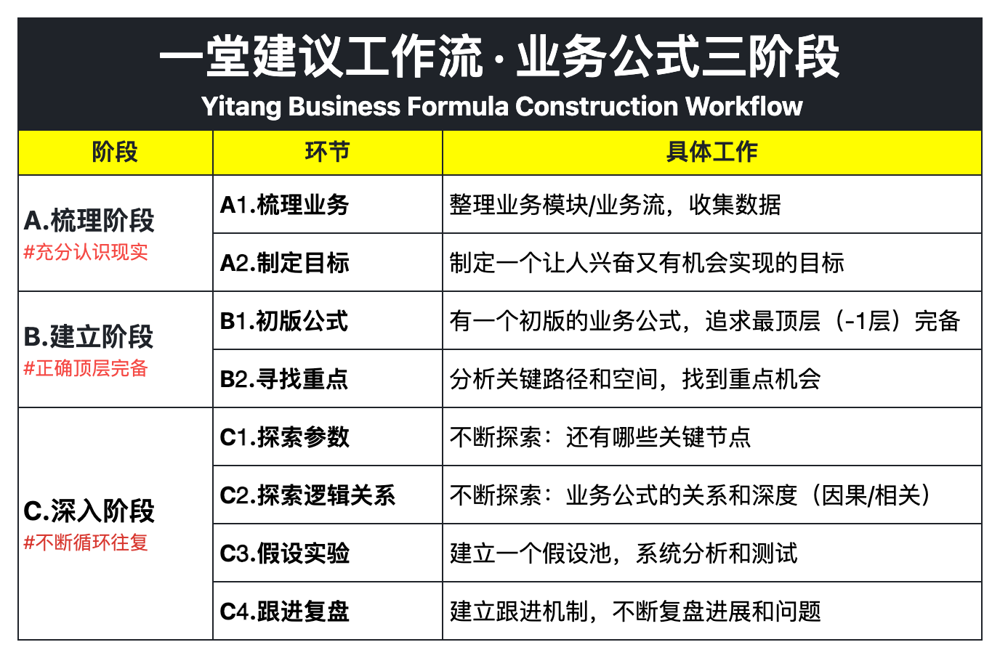
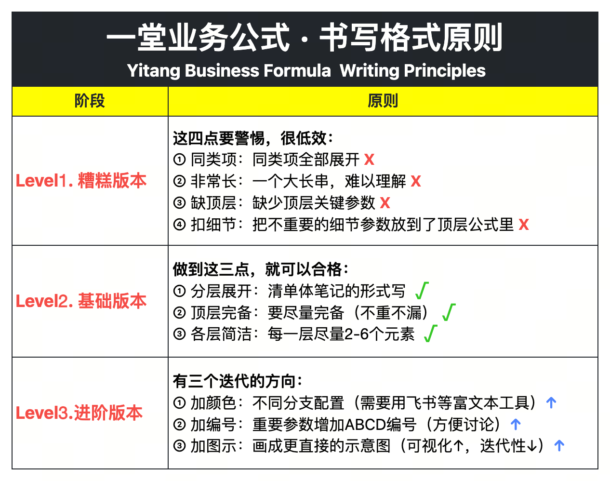
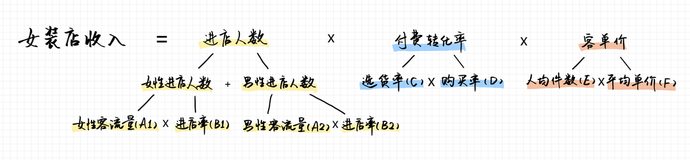
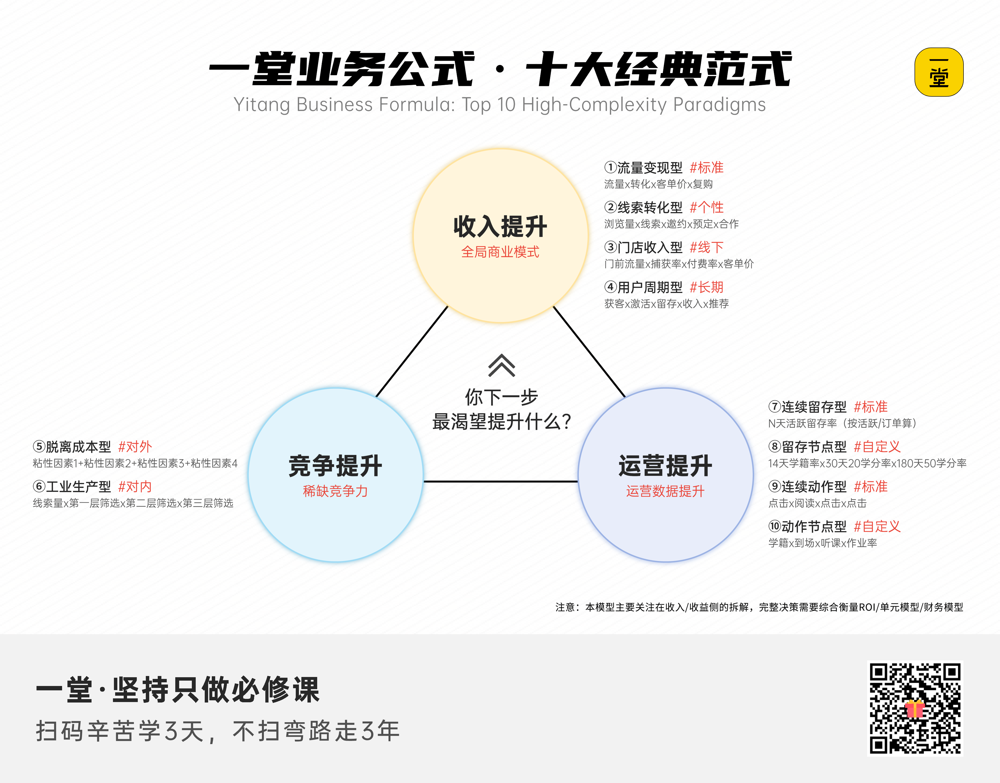
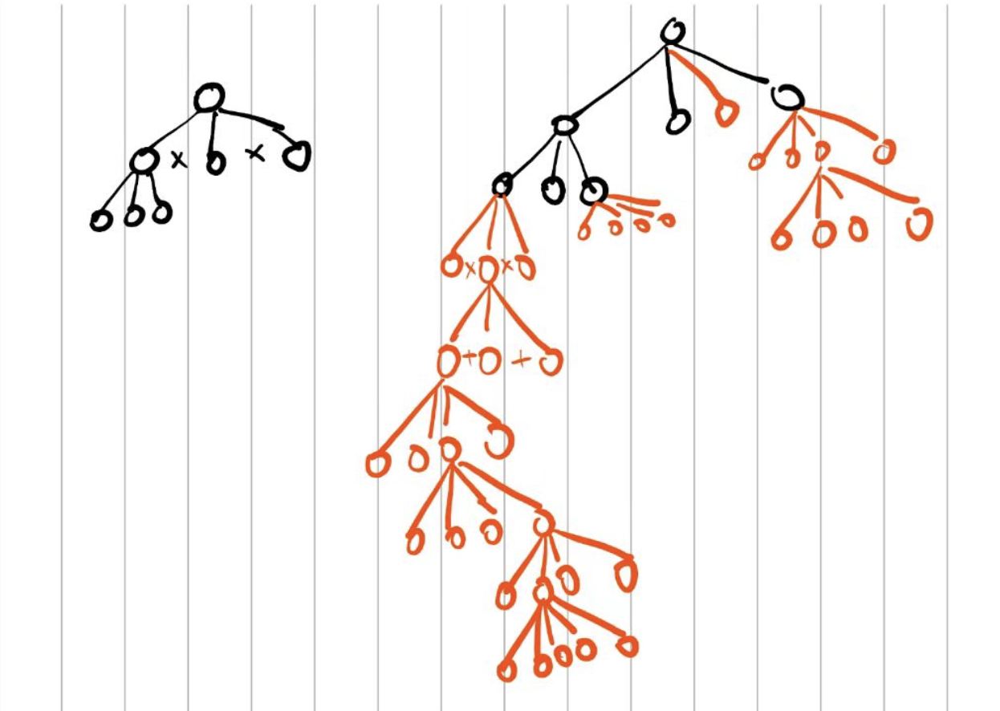
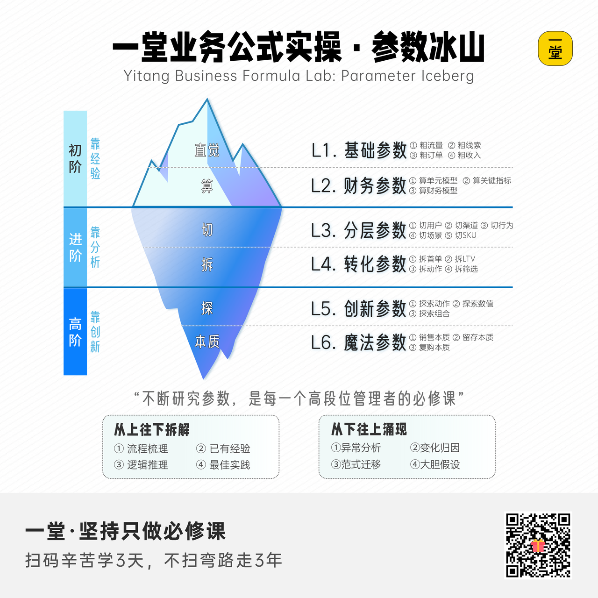
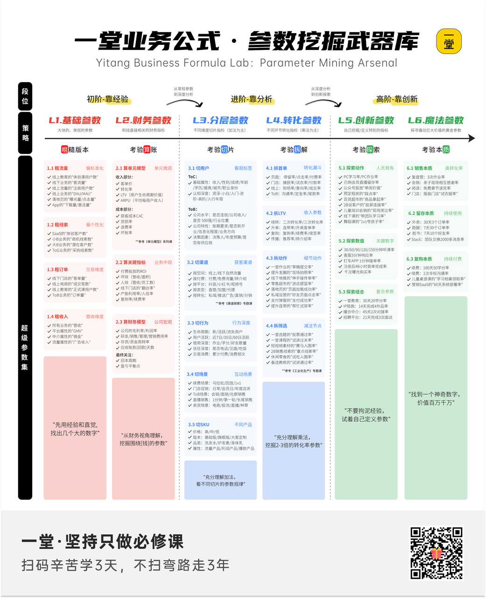
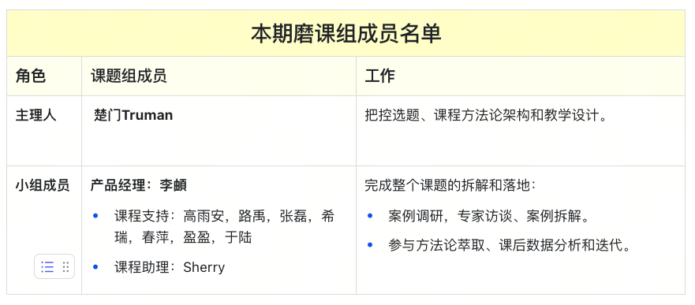

## 开始上课

Hello，大家好啊，

我是Truman，许久未见~~

欢迎大家回来继续（来到）上课，进入**本周末的成长加速时间**。

这是我的介绍，如果直播间有新人的话，自己读一下吧：
> 1. **以太一堂CEO：**2016年加入以太创服，现为合伙人，兼一堂CEO。
> 2. **前美团产品专家：**擅长从0到1业务探索、产品快速起盘、商业分析。
> 3. **一堂课程总设计师：**研发100节创业实操课，收到50万份创业训练作业。
> 4. **曾创办“易项直通车”**：资本对接平台，帮助100+项目融资成功。

来来来，我们热个身吧，关键假设系列课，我们从宏观（全局）和微观（关键环节），决定成败&决定效率两个维度，把关键假设划分成了四个维度：

**【热场🙋‍♂️】**哈哈，关键假设ABCD四套课，你们觉得对你来说，对业务最有帮助、最有价值的、或者个人最喜欢的是哪套课？**一堂五步法、ROI、业务公式、转化率**，扣一个**关键词**吧！

————

今天凌晨3:00的时候，我还在和团队磨课，磨到最后的时候，我们才反应过来：今天的内容，竟然是一堂关键假设ABCD系列核心方法论课的最后一节课了。

这节课非常非常难，经历了三轮启动磨课，遭遇卡点，搁置暂停....这节课实在太高阶、太抽象了，涉及到了因果逻辑分析、统计学、建模、定量分析、动态预测等等课题。

但是我们这一轮也还是咬着牙先交付一次，先完成再完美，关键假设ABCD的课程拼图，也算是终于拼上了：）

### 快速回顾

为了避免有同学还没跟上，或者断篇儿了，下面我给大家用几分钟，快速串讲一下前面课程的精髓和必知必会，帮助大家更好地承上启下。

《导入篇》的课程里，我们**开篇**给了大家两个建审美的案例，分别是一堂的复盘营业务和我的合伙人张磊的线下漫展的业务。用这两个案例，带大家感受了一个系统的、假设驱动的业务增长是如何完成的，培养一下初步的体感。

接下来，**第二部分**，我们基于假设驱动本质的定义，和大量业务公式的爆炸式研究之后，我们给了大家一个底层的、普适的思考模型，就是**业务公式ABC模型**。

业务操盘中所有的工作，无外乎如此：

围绕**目标**，你可以展开一系列的工作：梳理业务流程，设定有挑战的目标，不断细化、拆解子目标。

当有了更高的目标，你要去研究**参数**，有哪些指标、关键动作、要素、运营节点会影响这些目标？你要努力地把它们一个个挖出来。

最后你还得不断理解参数之间的**逻辑关系**，是相关性还是因果性？是+-x÷？是不是决定性的关键路径？是很强的数学关系，还是比较弱的相关关系？

从简单到复杂，从粗犷到精细，从直觉到科学，从借鉴（实事求是）到创新（解放思想），随着你目标越来越高，你对于参数、逻辑关系的理解越来越透，就能不断推高结果，然后循环往复，不断进步。

**同时**，我们还按照了Ω模型的5个环节展开，给了大家一套策略集，就是我们假设驱动业务提升的降龙十八掌，把每一条都做了详细的展开。

- **1套本质：**一套足够本质、底层的业务公式ABC模型（目标+拆解环节）。
- **5个环节：**围绕关键假设三段论，完整的每一步可以做什么。
- **降龙18掌：**拆成具体18招（关键建议），这节课给大家准备了招式卡片。

业务公式可以说是每一个业务负责人、操盘手必须具备的基本功，是一个持续修炼，无限进步的过程，所以我们也给了大家一个爬山地图：

**最后**，我们重新理解业务公式，送给了大家三句话：

在之前一节《实操篇1》的课程里，我重点讲了4个内容。

课程**开篇**，我带大家见识了三个典型的业务公式构建案例，分别是：**复盘营我请客K系数、会员周五我请客、儿童记忆力线下会销业务**。这三个案例都是经过一轮轮业务公式的迭代，最终实现了目标翻N倍的结果。

三个案例之后，我们给了大家一个背后的工作流。

**接着**，我重点展开了工作流的第一个阶段：**梳理阶段**。这一步通常有两个关键动作，分别是**梳理业务**和**制定目标**。

梳理业务是业务公式的基础，先梳理业务的环节和要素。我们给了三个梳理业务的方法：
1. **入门上手：**简单**示意图**（追求简单易用，自由画）
2. **进阶完备：**完整**模块图**（追求完整清晰，方框图）
3. **专业训练：**规范**流程图**（追求规范协作，UML图）

> UML：Unified Modeling Language，统一建模语言

而在目标制定这个动作上，我们给了大家三种制定目标的策略：

**【划重点💡】**抛开KPI、OKR、OGSM这种工具不说，一般来说，目标有三种常见策略：
1. **必胜型目标**（严格完成，需要严格管理和跟踪，类似于KPI，适用于确定性工作）
2. **挑战型目标**（努力完成，需要激发大家动力，类似于OKR，适用于自主性工作）
3. **探索型目标**（试着追求，需要大家保持专注，保持开放性和动态调整）

> KPI、OKR、OGSM：几种目前常见的商业目标管理工具

**然后**，我又展开了第二个阶段，**建立阶段**。这一步也有两个关键动作，分别是**写下初版公式**和**寻找提升重点。**

在写下初版公式这个环节，我们给了大家两个小抄。

第一个，是一堂官方给大家一个**统一的业务公式书写原则**：

第二个，是一个**三维10大经典的业务公式**，按照业务提升的3个类型：**收入提升、竞争提升、运营提升**，列出了十种经典业务公式范式，同时也给出了一些适用的业务类型。

我带大家重新理解业务公式的6个关键价值。

**【划重点💡】**用业务公式**理解和表达规律**，有几个明显的好处：
1. **面向现在：**

1. **维度上，从局部到全局：**维度很多，基于维度找到忽略的参数
2. **效率上，从直觉到高效：**沿着公式提假设，才不是散点的，能判断是不是主要路径
3. **面向未来：**

1. **迭代上，从卡住到突破：**可以源源不断的优化、迭代和创新
2. **想法上，从临时到持续：**系统性的分析方法，可以大量涌现
3. **面向协作：**

1. **协作上，从独立到协作：**可以用来说服团队，形成共识，协作
2. **心态上，从焦虑到笃定**：能解释业务，能说服自己，有了信心和笃定

上节参数探索篇，我们给大家讲了3大块内容。

**第一部分，**我用一堂复盘营和杜金科西安地区门店运营2个案例给大家热身，带大家体会业务公式的“参数”的价值，为什么需要不断挖掘和探索参数，核心价值是什么。

通过案例代入，我们给大家总结了一个业务迭代的过程：

> 这是大概的经验值，不同业务、层级的具体数量都不太一样。

> 通常中长周期，需要1-10个季度来迭代。

同时给了大家参数挖掘的五大价值：

**【划重点💡】**挖掘参数，更高水平公式的五大价值（3个业务+2个管理）：

- **价值1 激发假设**：可以大量提优化假设，无限提&轰炸假设；
- **价值2 辅助决策**：辅助定价、用户、重大策略调整。
- **价值3 预测复盘**：可以提前做预测，事后做复盘。
- **价值4 专业分工**：可以更好地做目标管理和组织分工。
- **价值5 专业协作**：可以更好向上汇报，靠谱同事协作。

**第二部分，**因为不同业务、不同阶段业务太非标了，我们提出了一个"**泛业务负责人**"的概念，希望提炼出一个各个岗位都能用，足够系统，足够底层本质，能够长期修炼和跨领域迁移的框架模型。

我们把各类业务、各个岗位合并同类项，做了一次爆炸式研究，发现各类业务，从初阶到进阶；从靠经验，到靠深度复盘分析、到创新；从实事求是到解放思想，一共有六类大参数的类型：

- **L1. 基础参数：**大块的、常规的参数。
- **L2. 财务参数**：和钱直接相关的财务指标。
- **L3. 分层参数**：不同维度切片指标（加法为主）。
- **L4. 转化参数**：不同环节转化指标（乘法为主）。
- **L5. 创新参数**：自己挖掘/定义的特别的指标。
- **L6. 魔法参数**：探寻撬动巨大价值的黄金参数。

再进一步优化，我们加入不同的阶段不同的侧重点，和可以挖掘参数的核心动作，最后形成了一个参数冰山模型：

**第三部分，**为了给大家更好落地的参考，我们又把这三个阶段、**六个策略**，一展开，就变成了**22个**具体动作，以及**上百个**典型参数参考，从浅层到深层，从借鉴到创新，从心法到策略，基本都在这一张图里了：

好啦，前面课程的内容，我们就复习到这里。

今天我们要讲的是业务公式实操的最后一节，这是业务公式在深入阶段，确定了目标之后，在探索参数之外，对业务公式的另一个非常关键的探索要素：**逻辑关系探索。**

### 为什么要学

上一节课，我们用一种观光式的方式，沿着参数小抄，带大家拆出了几十上百个参数。

那问题来了，拆出来的这些参数都和我的结果有关系吗？应该是大还是小？时间有限的情况下，哪个才是我当下这个阶段应该主要关注的参数？我应该围绕着哪个参数来提假设、做验证？

如果说上节课是带大家给参数**做加法**，那么这节课，就是来带大家给参数来**做减法**，加法考验见识，减法考验专业。

我准备了50-100个备选参数，哪些重要，哪些可以暂时丢掉呢？哪些是做功点，而哪些该忽略呢？哪些应该拉满了疯狂提升打磨细节，而哪些做到60分就行、差不多就得？

我这节课，试着带大家去判断这些参数和结果之间的“**逻辑关系层级**”，找出这些参数中对结果提升最明显的那些Top参数，找到最高效的做功点，激发高价值的假设。

这节课很难，但是很高阶，这基本上是成熟业务负责人最核心的能力了，即便一堂，也很缺，我也很渴望培养更多能不断探索业务因果关系、不断提假设、学习认知的业务负责人。

希望大家保持最高脑力，努力听懂啊==。

### 预热思考题

来来，照例，给大家两个预热思考题吧：

**第一个题目：参数减法题。**

我们来做一个有趣的推演：假设你负责一堂复盘营视频号新渠道的投放工作，目前每个月都能稳定获客300人左右，但是我们希望把这个目标翻5-10倍，也就是说，每个月能稳定获客1500-3000人，同时ROI能持续为正。

通过上节课的学习，按照参数小抄，已经拆出了20+个参数：脚本数量，点击率，3s停留率，投放金额，转化率，客单价....等等。

但是，时间有限的情况下，我们接下来，到底要围绕哪几个参数提假设、做实验，能够更快地达成目标、拿到足够多的业务认知？你会怎么去思考这件事？你脑子里的操作系统什么样？

**第二个题目：因果敏感性题。**

大家过去思考过一个东西叫做"因果逻辑"么？：）

我们经常会在一些地方读到一些新闻，比如：

> 研究发现，越是成功人士，睡眠时间越短；

> 研究发现，女人结婚后变得更加贫穷，男人结婚后变得更加富有；

> 研究发现，越富有的人越幸福；

> 研究发现，儿童时期吃西兰花越多，成年后往往职业收入越多；

> ……

大家经常在新闻上刷到这些"自媒体观点"，大家过去怎么理解的？针对上面这些新闻，你一般的思考逻辑和习惯是什么？我们该怎么解读这些"数据规律"？

这节课是一个优秀业务负责人的高阶必修课，希望你强迫自己做一个头脑实验，等到今天晚上睡觉的时候，你的思考结构、深度能有一个全面的升级。

### 提前划重点

提前划一下重点，大家不要迷路，今天我会讲4个话题：

**第一部分：快速热身。**我会给大家通过一个小例子，带你们理解一下，"逻辑关系"的理解有多重要，以及我们到底在追求什么。

**第二部分：逐步展开。**我从简单到复杂，从入门到高阶，给大家讲一讲，每一类逻辑关系的内涵，典型案例以及专业的分析过程。

**第三部分：案例推演。**我给大家完整讲两个案例，带你们推演一下，从入门到进阶，一步步推演，我们可以怎么一步步提升。

**第四部分：重新理解。**最后给大家讲讲，业务公式为什么如此重要，以及作为一个业务负责人/总监级别的操盘手，在做事层面，我们最核心的任务到底是什么。

预告一下，为了降低难度，这节课我们给大家准备了2张"挺值钱"的工具图，带走即用，大家可以期待一下。

**【毛遂自荐🙋】欢迎大家主动报名“学习委员”，谁愿意？**在评论区扣一个：**我愿意**

> 请大家积极报名学习委员，提升上课质量、班级群氛围、督促选课和互帮互助。

**"翻过一个墙，最好的方式，就是先把自己的鞋子，勇敢扔过去"**

来来来，希望大家一起立一个Flag（承诺），认真听课吸收，最后完成这次训练作业。

扣四个字吧：**一定作业**

> 我们正在持续升级作业陪伴&督促服务，口令代表有更高配的周末学习服务：）

**【划重点💡】**欢迎大家勇敢一点承诺，这四个字代表：
1. **给自己的一个预期：**把这个收录进你的10年进步练习清单。
2. **倒逼自己一定进步**：提高优先级，帮你排除杂念进行学习。
3. **享受更高配的服务：**更完备、更好的班班周末督促服务：）

哈哈哈，欢迎大家**一定作业**，未来在这个课题上，持续享受持续进步的滋养和复利。

OK，进入第一个话题。