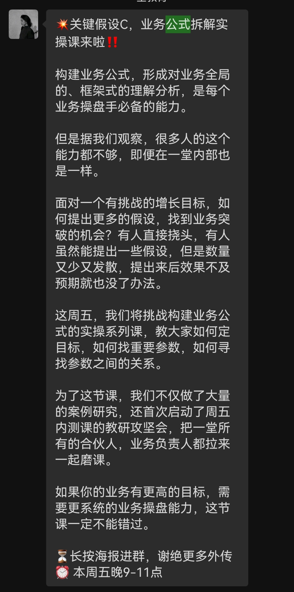
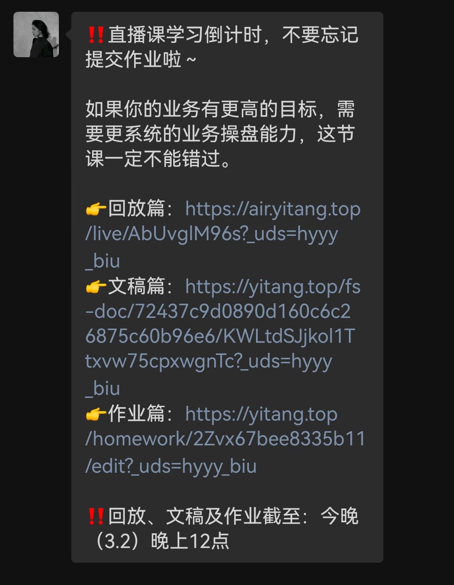
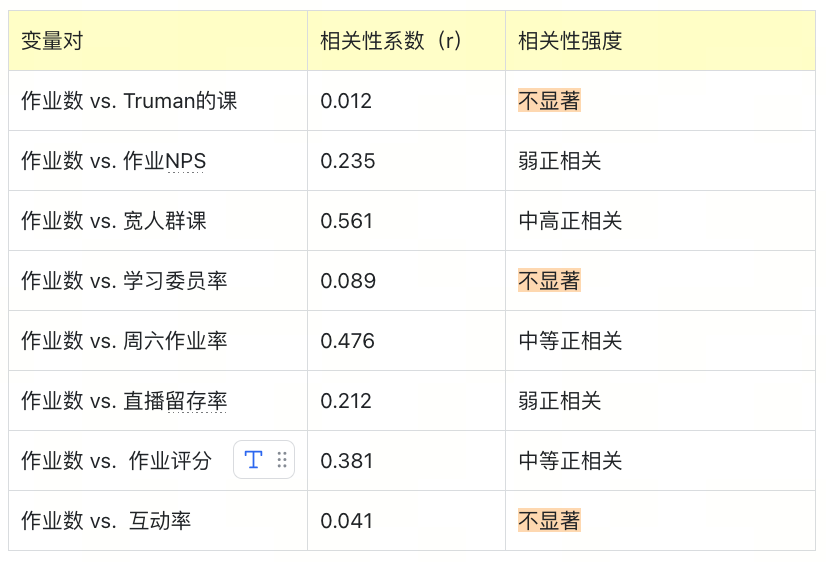

## 开始认识：逻辑关系很重要？

业务公式，作为一堂新提炼的分析框架，估计很多人没有很强的体感，我们先回顾一下：

大家天然应该认为**A-目标**很重要，上节课我也充分带大家理解了**B-参数**很重要，很多同学表示很爽，原来做业务还能这样，还能有这么多参数、甚至自定义创新参数、魔法参数，我帮大家提了见识。

哈哈，参数只是热身和前菜，这节课我们来理解**C-逻辑关系**，这才是业务公式真正的集大成核心。

看图，不就是挺简单的？

**【思考🙋🏻‍♀️】**大家觉得，高水平管理业务，不断理解逻辑关系对你来说是________
1. 没感觉
2. 感兴趣，能做就做
3. 重要，开始重视
4. 非常重要，认真研究
5. 必经之路，认真修炼

大家过去带团队和带业务，会有意识地思考"逻辑关系"，"因果强弱"这些问题么？那价值是什么呢？

抛砖引玉，我带大家初步建立一个基本的体感。

### 看一个体感案例

这个课题实在有些过于抽象了，为了让大家形成基本的感受，我试着开源一个你们最熟悉的案例吧，带你们一步步推演一下，你们感受一下，不同段位的业务负责人大概能做什么水平。

这个案例就是：**周五直播作业量。**

我们来做一个有意思的决策推演：

这是一个**全新的案例教学**：我们假设是一个Boss，你招募一个业务负责人帮你提升这个核心指标，我会讲6个不同的业务负责人，你感受一下，哪个更专业，以及你更认可、信任、喜欢哪个业务负责人。

在一堂真实情况下，我们做一些简化和架空，下面我们来假设一个背景：

> 每周五直播课的学习和作业规模，是一堂最重要的活跃粘性指标，这个直接通向了口碑、品牌和续费收入。

> 假设现状是2022年，每周学习人数是**1500人**，作业是**750份**，你希望提升**50-100%；**

> 这个对于整个平台的活跃度、收入和一堂长期发展，都是一个很好的促进。

> 于是你招募了一个业务负责人，来全权负责这个事情，他会怎么操盘呢？

注意：为了简化思考，假设教研每周稳定做课、会员在籍规模稳定。

大家可以想想，你一般会怎么思考，你过去带过的业务负责人，**大概会怎么做呢？**

停下来10s，思考一下你过去的业务管理习惯和逻辑。

下面，我们试着带你推演一下，不同水平/段位/年薪的业务负责人，在管理业务3-6个月，充分了解熟悉业务以后，大概是什么状况：

第一个同学呢，叫Leo，非常认真、勤奋和努力，为了提升“**每周新课作业数**”这个业务指标，想了很多办法：去看数据、去聊朋友、头脑风暴，找了很多增长的机会。

经历了3个月的摸索，找到了非常多的增长机会和“抓手”：

- **课程上：**是否新课，课程宽度，系列课，Truman的课。
- **运营上：**招生文案，招生海报，课前提醒，打电话。
- **产品上：**直播留存率，完课率，作业点击率。
- **社群上：**听课群人数，听课群活跃，提醒消息条数。
- **质量上：**作业字数，作业NPS，作业评分和回复。

学了上节课《参数篇》，于是大受震撼：

- **分层参数：**新人、老人；近期活跃、近期不活跃。
- **转化参数：**入群，互动，学习委员，Flag，留存，我请客。
- **创新参数：**周六作业率，1000字作业率，连续3周作业率。

....

通过学习一个叫做Truman的人的课，找到了大量各种各样的参数，一夜之间，就拆出了50个可能的重要参数，大幅找到了增长机会，非常刺激非常爽，兴奋无比。

然后Leo就在这些参数上，不断努力，不断提升，不断提假设，不断优化，进而推动整个业务不断进步。

大家觉得怎么样？

**【互动🙋🏻‍♀️】**这个业务负责人足够OK么？你评价的话，大概给他的水平能打多少分？

> 注意满分100分，且只评价这个业务逻辑深度的环节。

如果给提改进优化建议，你觉得这个阶段，最大的问题在哪里？如何升级？

——————

我来打分的话，大概是**20-30**吧，有一些辛苦分，但是具体真正的高水平操盘和入门，还有非常大的一段差距，如果不会减法，**加法越多，执行效率越差。**

这么操盘效率太低了，会导致三个问题：
1. **模糊理解**：这么多参数，哪些有关，哪些重要？很难有优先级判断。
2. **无从下手**：加法做得太多，注意力越分散，你的用力越失控。
3. **无效太多**：这里面多数参数都帮助不大，怎么判断呢？

OK，我们来继续看第二个：

第二个业务负责人叫Joe，相对于Leo，很善于观察、总结规律。

他第一步也找到了各种各样的参数可能性，运营上的，产品上的，社群上的，直播间的，课程上的，和Leo一样找到了50-70个各种各样的参数和优化可能性。

但是他多做了三个工作：
1. **观察规律：**每周作业率时高时低，和哪几个参数有关系呢？
2. **数据埋点：**重要的社群活跃率、回复率指标，增加了数据统计。
3. **数据分析：**试着分析不同参数和“周五作业数”的相关性。

....

观察了几周，然后发现一些很有趣的现象：

其中一半的参数，和结果**关系很大**，而另一半，**关系不大**：

他PM出身，很善于数据分析，还用Excel对比了不同参数和作业率的"相关性系数"。

比如，这是他做过的一些分析：

∴ 有了基本的认识，就可以优化、提假设的侧重点了：

- **不显著则低优先级**：Truman的课，学习委员率，互动率；
- **显著则重点研究**：宽人群课 >  周六作业率/作业评分 > 作业NPS/直播留存率。

.......

然后把重点的精力，放在了相关性更强的参数上，去分析，去研究，去提假设，去提升。

**【互动🙋🏻‍♀️】**这个业务负责人足够OK么？你评价的话，大概给他的水平能打多少分？

> 注意满分100分，且只评价这个业务逻辑深度的环节。

如果给提改进优化建议，你觉得这个阶段，最大的问题在哪里？如何升级？

————

如果我来评价的话：好了一些，有了减法意识，开始分析优先级了，但是还没真正合格。

我会给个40-50分吧。

这个阶段的问题是：只考虑了相关性，其实很多“**相关参数**”没有大用。

- **还是太多：**参数可能从50-100个，变成了30-50个，还是太多了。
- **真假难辨：**这些真的能提升业务么？其实很多参数对于作业数并没有帮助。

OK，终于第三个业务负责人出场了：

第三个业务负责人叫Tom，相对于Joe的工作，他还有一个很重要的思考维度：**找到关键因果规律。**

什么意思呢？虽然看上去有些**参数A**和**结果R**有关，但是真的是"原因"吗？A提升，R真的会提升么？

他深刻知道一件事：做业务就像你在执行一个战略级别的战争任务，用轰炸机投放炸弹，其实绝大多数看上去的高价值目标，其实都是伪装的，只有找到了真正的军事战略要地，才能集中优势兵力，实现战果最大化。

于是他针对一系列的重点参数，进行了各种深度理解：

有些参数，用过去经验和常识判断，就是显而易见的"因果关系"，比如：听课率，宽口径的课，电话提醒数，Flag率等等。

但是还有一些呢，就很不容易判断了，比如典型的：**课程NPS。**

**【思考🙋🏻‍♀️】**运营设法提升NPS，来提升作业率有没有用呢？

————

乍一看，看似很有道理啊，好的课程，作业率高，但是稍微一动脑子，就会发现这两个根本不是因果关系：先写作业，最后提交的NPS啊，顺序都是反的。

这两个虽然有相关性，是由于一个共同的“因”导致的：**课程更好，更适合我。**

更好的课程，同时导致“作业率”和“NPS”，这个才是合理的常识因果关系。

> ∴ 重心还是提升课的质量，而不是单纯提升NPS指标。

这种指标非常多，甚至Tom还做了一些数据AB测试：**三次督促率。**

有一些同学督促两次，而按照ID分两组，给实验组增加一轮"三次1v1提醒"，对照组不增加，看数据变化。最后发现不显著，于是得出结论：

> 督促基本两条消息就够，前两条很重要，第3轮消息价值很低，对结果不显著。

> ∴ 只提醒两次，第三次消息机会省下来给别的业务用。

经历了几个月的任务不断观察、总结、实验，基本上能够找到10-20个很强的因果关系指标了。

**【互动🙋🏻‍♀️】**这个业务负责人足够OK么？你评价的话，大概给他的水平能打多少分？

> 注意满分100分，且只评价这个业务逻辑深度的环节。

如果给提改进优化建议，你觉得这个阶段，最大的问题在哪里？如何升级？

————

我评分的话，基本上可以有60分-合格了，这个阶段是一次重要的飞跃：**有做功点。**做业务最怕的还不是无能为力，而是做了一大堆工作，XYZ提升了，但是最终结果R没啥变化。

而一旦有了这些稳定可靠的"因果关系"，就会有一个非常重要的结果：穿透直觉和表象，化简为繁、从三五十个参数里，又进一步锁定了业务关键的做功点ABCDEFG，对于结果R有显著的、决定性影响。

我只要提升和优化ABCDEFG，就能**持续显著地**提升R，这就是**因果性**的价值。但是不足也是显而易见的：就是参数太散太局部了，缺少一个更全局、更系统的参数整理。

下一步，怎么进步呢？

下一个业务负责人来了：

这个业务负责人叫Jason，相对于Joe的相关性，Tom的因果性，Jason还非常渴望追求因果完备性，希望找到一个完备的业务公式来支撑业务。

他做了三个重要的工作：
1. **整理认知**：整理过去的认知、总结因果的当前理解。
2. **学习范式**：学习了一堂的《十大业务公式范式》。
3. **借鉴经验**：参考复盘营、同行的运营经验。

然后写出了一组相对可靠的业务公式，比如整体的**作业数**，可以分为三个维度： 
1. **按漏斗拆** = 会员规模 x 近期活跃率 x  上课率 x 完课率 x  作业率
2. **按要素拆** =  f（课程宽度，招生强度，提醒强度）
3. **按人群拆** = 纯新作业数(<20) + 新人作业数(20~50) +  老人作业数(>50)

然后继续展开，比如

- **上课人数 = 直播听课人数 + 纯回放听课人数 + 纯文稿学习人数**
- **作业人数 = Flag人数 x Flag作业率 + 非Flag听课人数 x 非Flag作业率**
- **作业率 = 作业入口曝光率 x  进入作业页面率 x  停留3min率 x  提交率**

...

这个阶段的Jason，把业务的关键环节、节点和因果认知，组织成了一套稳定的业务公式，这套公式可定义，可复盘，可定量，可统计。

而且这套公式，每一个要素的提升和进步，都能或多或少提升整体的作业率。

**【互动🙋🏻‍♀️】**这个业务负责人足够OK么？你评价的话，大概给他的水平能打多少分？

> 注意满分100分，且只评价这个业务逻辑深度的环节。

如果给提改进优化建议，你觉得这个阶段，最大的问题在哪里？如何升级？

————

我来打分的话，大概70分吧，略好，有了一个稳定的认知结构，大概率可以大量提假设、并且有效通过提升业务公式的参数，来驱动业务进步了。

这其实是一个挺大的飞跃：

有了完备性，有了加减乘除，有了参数之间的顺序和关系，整个业务管理的水平就会更强了。

**【抢答🙋🏻‍♀️】**当我们有了一个完备的公式，最大的价值和业务的帮助是什么？

——————

有了加减乘除，就可以分清楚主次，可以分析是不是实现目标的**关键路径**了。

- 有些参数，和结果是等比关系：DEFGH提升了30%，结果预期可能会提升30%；
- 而有些参数，和结果不是：ABC、G123提升了30%，结果最多会提升5%-10%；

如果需要提假设，成本确定性差不多前提下，我们要先把注意力放在前者，更容易拿到好的结果。

这个业务负责人够强了么？还有更强的么？

下一个更强的业务负责人上场了：

第五个业务人叫Peter，除了Joe的相关性，Tom的因果性，Jason的因果完备性，Peter还很明确的希望达成一个更高的目标：**尽快找到各个环节的关键数据，找到定量的决策参考。**

什么意思呢？

比如通过上一轮找到了一个重要的核心参数：**听课90min留存率。**

上一轮分析得出，这是一个必经之路的关键参数（创新参数）。

不满足于Jason同学的"抓住主要矛盾"，Peter从一开始，就试图用"数字"来描述这个参数：

最开始，刚接手业务，他发现这个数据基本没有统计，于是就开始观察数据，访谈内部班主任，试着拿到了一个基本的认知：大概在**40-60%；**

于是他开始在直播间埋统计参数，开始统计不同人/不同时刻的各种留存率，两个月后，得到了一个相对准确的值：**50-55%；**

这个留存率够不够好呢？

于是他调研了一些业务最佳实践同行（直播在线的留存），也试着问了两个专家，发现空间很大：业内最好水平能做到**80%**；

看来空间很大啊，于是Peter还是围绕这个环节，展开了集中的假设轰炸：讲透课题价值，提前讲路线图，埋钩子，加礼物，增加Flag.....

经历了一系列的优化，这个90min留存率一路从50%+提升到了85%，提升了35个点，这一个参数，就直接把整体的作业率提升了20%+。

> 解释：不会完全线性，这个还会影响其他的参数，一会会讲。

于是围绕这版公式的主要矛盾，一个个去定量，分析提升空间，轰假设，去一步步提升最终的目标。

**【互动🙋🏻‍♀️】**这个业务负责人足够OK么？你评价的话，大概给他的水平能打多少分？

> 注意满分100分，且只评价这个业务逻辑深度的环节。

如果给提改进优化建议，你觉得这个阶段，最大的问题在哪里？如何升级？

————

我来打分的话，大概可以有80分了，围绕最重要的5-10个参数，深度定量，分析，然后不断围绕重点参数，更准确地评估资源投入。

在上一轮，我们会把主要精力放在乘法上，这样影响更直接，对吧？

如果你能从定性切换到定量，你可能会得到完全不同的结果：

- D虽然是关键主路径，但提升空间只有**5%；**
- B虽然是分支路径，但是提升空间有**50%**（**x30%**占比），依然有更高的ROI；

比如，如果纯定性，你会发现：**提升作业提交率 >>> 纯新人作业率；**

因为作业提交率是主要路径，对吧？

但是现实情况是，这个已经没啥空间了（很高/迭代很多），最多**5-10%**的空间。

而纯新作业率空间很大（没怎么关注/绝对值低），有**50%-100%**的提升空间。

如果假设机会有限，你把精力放在纯新人的运营上，短期的ROI最高。

到了这个阶段，你的脑子会越来越清楚，你的决策精准程度、ROI评估的准确度就会获得全面的提升。

到这个阶段，已经很强了，还有更高的业务规律理解段位吗？

有，还有最后一个段位，前面的段位都是对于业务公式的"**静态理想模型**"，而真实的情况是，各种内部外部变化，参数彼此耦合，需要用动态视角理解作业率。

终于，最后一个业务负责人出场了：

假设，最后一个业务负责人叫Jay，能完成前面所有的工作。

当然，他也不是一蹴而就，而是一步步迭代出来的：

- 刚开始接手，第一周，可能他也就是一些松散的相关，因果关系；
- 一个月后，他有了一套相对可靠的业务公式；
- 又半年后，他有了相对稳定的定量值、基准值和空间判断。

一轮轮，假设的价值、稳定性和ROI都获得了越来越高的提升。

到了后半年，他开始思考一个新问题：**站在动态视角上来看，这个公式和模型会有什么变化呢？**

比如，从逻辑上，90min留存率是主要路径，如果能提升35%，按理说整个作业率会提升35%对吧？

而实际只提升了20%左右，为什么呢？

————

因为参数有耦合：

**作业率  =  ①听课人数 x ②90min留存率 x  ③留存作业率 x  ④作业提交率**

当你针对②做了一堆假设：Flag，划重点，悬念，钩子等等；

③和④会逐步下降：原来用户靠自驱学习，现在增加了一堆玩法，抓进来了更多学习的用户，很多用户是为了听故事，为了悬念而留下来的，所以整体用户的主动作业欲望就降低了。

再比如说，里面最重要的环节：**作业提醒。**

提醒几次效率最高呢？

这个数据太重要了，于是你大概做了几周的不断测试：

你会发现，提醒到第1-3轮还是显著有效的，到了第四轮就价值很低了，不显著有帮助了。

甚至在有一些业务里，更真实的结果可能是这张图：

诶，为什么超过一定阈值，反而越来越差呢？

————

带过孩子的可能都知道：**过度提醒，过犹不及。**

本来用户是靠自驱力、兴趣学习的，你一直push，push，push反而会激发用户的逆反心理，不断降低用户的学习兴趣和欲望，这个是非常可能的。

总结一下，到了第六个Jay同学，不只是有因果关系，业务公式，定量空间，甚至还围绕一些特别重要的、增加空间比较大的环节，自己写了公式、建了模、画了图，用来描述参数的变化过程。

哈哈，甚至业务管理了一两年以后，可以动态预测、勾勒出一条抖动曲线了：

你们猜猜看，ABCD四个阶段，分别代表什么情况哈哈哈?

__

分别是：正常，案例课，马拉松，春节/黄金周；

好啦，六个业务负责人的故事我终于讲完了，大家能感受到区别了么？

如果你想找一个业务专家/总监级别的人，来负责你们公司的这种核心项目，这几个显著的差距大家感受到了么？背后的逻辑是什么呢？