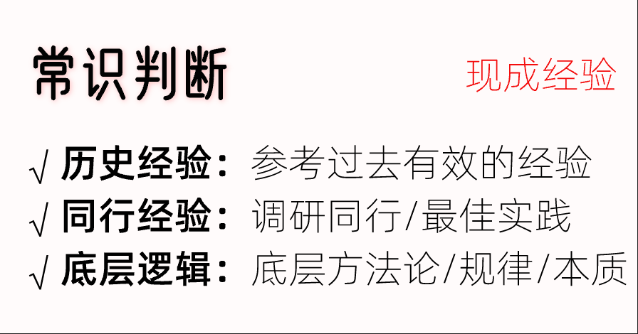
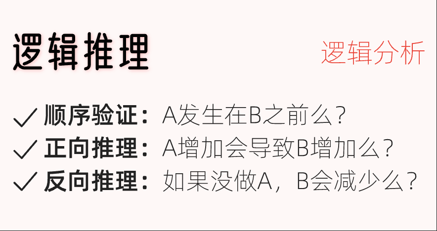
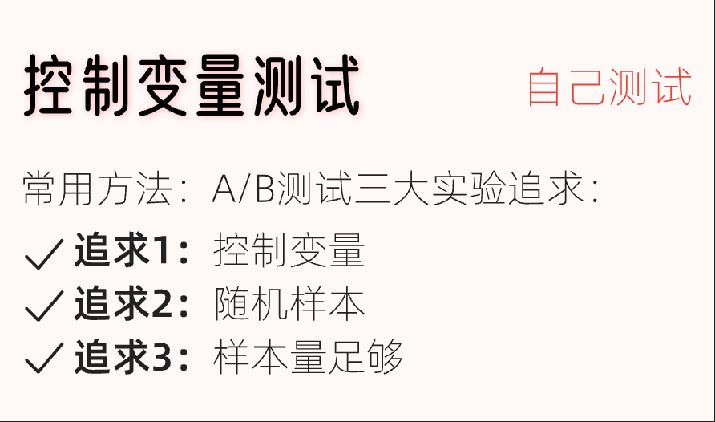

### **第二次飞跃：从相关到因果**

飞跃之前呢，我们可以有一定客观的相关性理解：

比如我有20-30个各种各样的参数，都很相关，但是我改变哪一个呢？改变哪一个可以直接提升最后的目标呢？往往很难分析。

飞跃后，能够找到比较明确的因果性理解：

大家能理解“**相关性-体温计**”和“**因果性-方向盘**”的区别么？

- 可以测量，分析取舍，可以预警，但是不能干预驱动改变。
- 可以改变，可以推动，可以导致，是更高层次的相关关系。

我发现AI在解释这种区别还是挺擅长的：

在公司内部，我经常提一句类似的话：

是不是听着挺简单的？有什么可以判断的？来，我们来出几道题，测试一下，现场练习，这些哪些是因果关系，哪些只是相关关系？

上了上节课，大家信心满满提了一堆的参数，而且分析数据，都很靠谱，都是强相关，于是我们准备展开迭代和测试，来驱动业务进步了。

到这里我们先停留一下，要**警惕误判**，导致提假设和验证方向完全错误，下面我们来考验一下大家的直觉和敏感性，能不能识别出来真正的因果规律：

**【抢答🙋🏻‍♀️】**来来来，考验大家思考能力，这里面哪个应该是因果规律？

1. 健康，去医院越多 VS. 越容易生病。
2. 夏天，穿裙子数量 VS. 溺水死亡率。
3. 成年人，咖啡消费量 VS. 心脏病风险率。
4. 老年人，红酒消费 VS. 健康水平。
5. 冰激凌店，门口摄像头数量 VS. 门店销量。
6. 电商网店，好评率 VS. 复购率。
7. 电商APP，APP停留时长 VS. 购买率。
8. 西装店，试衣镜数量 VS. 门店月销售额。
9. SaaS产品，上门服务次数 VS. 续费率。
10. 周二直播，Truman开心 VS. MBA销售数量。

————

这10个，在绝大多数场景和业务，（基本上）都不是因果。

我先说方法，我们试着理解一下：

下面，我们一个个来看：

第一个相关性很强，是因果么：

这是明显的因果倒置啊，正是因为容易生病才去医院的啊。大家是不是觉得这是段子==，但是很多人就是会容易犯类似的错误：**把结果反过来了。**

如果实在想判断，怎么判断呢？你可以试试逻辑推理的“**方向推理**”：如果不要医院，生病会减少么？

就一目了然了。

这个相关性也很强，是因果么：

有啥练习呢？背后什么逻辑呢？

这个背后是共同因导致的：

- ∵ 天气热
- ∴ 穿裙子变多，溺水死亡率变高

**同理，这三个都是类似的：**
1. 成年人，咖啡消费量 VS. 心脏病风险率（更辛苦更累）
2. 老年人，红酒消费 VS. 健康水平（更有钱）
3. 冰激凌店，门口摄像头数量 VS. 门店销量（人流量更高）
4. 西装店，试衣镜数量 VS. 门店月销售额（门店更大）

**如果不改变真正的因的话，光改变前面的话，价值是不大的：**
1. 同样很累的时候，少喝咖啡：并不会显著减少心脏病。
2. 同样生活水平时，多喝红酒：并不会年年益寿。
3. 同样人流量情况，多安摄像头：销量并不会上涨；
4. 同样门店平米数，多摆试衣镜：并不会显著提升销售额。

当然，这只能说明“**暂时没有找到**”显著因果关系，未来可以提更多的假设验证，或许在有些场景下会呈现很显著的差异：

- 比如：营造找人排队景象，对门店ABC可能有效，对DEF可能就无效。
- 比如：主动刷电商好评，对于新人/闲逛用户可能有效，对于复购/搜索用户可能就无效。
- 比如：摆大镜子对服装店可能无效，但大输入框对于电商UGC评论框就很有效。
- ......

核心还是三种验证方法：**常识判断，逻辑推理，控制变量测试。**

我们来看下一个，这个估计很多人选错：

某电商 APP 通过相关性分析发现，用户在商品详情页的停留时长与购买率的皮尔逊系数达 0.68，停留时长超过 30 秒的用户，加购概率是 10 秒以下用户的 4 倍。

这个相关性很强啊，而且符合逻辑啊：**逛门店时间越长，越容易购买。**

能断定是因果关系么？

————

这表明两者存在较强的相关性，但不能就此认定停留时长就是加购率高的原因，可能是**商品本身吸引力大，既让用户愿意停留更长时间，又促使其加购，或者是用户本身购买意愿强烈，才会花更多时间了解并加购**，它们之间不一定是因果关系，只是有相关联系。

**换个问题**：如果我想一些办法，各种琢磨拉高用户停留时长，我能想什么办法呢？

————

增加加载延迟，一页变三页，增加两次点击，这些都会显著增加停留时长，但是会增加购买率么？

大概率不会，而且会下滑。

这个相关性背后的本质，可能是

- 商品推荐很好，用户愿意多逛。
- 商品匹配度高，用户愿意多看。

所以应该去研究“**匹配算法**”和“**展示效果**”，而不是停留时长这种相关指标。

同样的案例：**电商网站的好评率 VS. 复购。**

**现象**：店铺数据显示，好评率≥95%的商品复购率远高于好评率较差的商品。

可以断定是因果关系么？

————

理解有点浅了，如果我想提升好评，当做KPI？最简单的方式是什么？

想尽办法刷好评（找用户、找服务商），真的可以提升复购率么？

大概率没什么帮助，背后的逻辑：

- **本身筛选**：差评商品已被低复购用户淘汰，剩余样本全是高复购商品。
- **统一原因**：复购率高的**商品本身质量过硬**，自然获得好评（好评是结果而非原因）

所以如果强行刷好评，把低质量产品刷上来，复购并不会显著提升，长期甚至会下滑。

还有一个案例：**SaaS产品，上门服务次数 VS. 续费率。**

某 CRM 厂商发现，**客户续约率与客户成功团队的上门服务次数呈正相关**（相关系数 0.72），这个可以基本认定是因果关系么？

————

一样的道理，太浅了，如果我把KPI定成客户成功的上门次数，会发生什么呢？

你是我的运营总监，聪明的你会怎么做呢？

————

没事去拜访，去聊天，去遛弯；

把一次服务拆成三次，每次都蜻蜓点水。

这些的确可以增加拜访数量，但真的会增加续费率么？

NO...背后真正的驱动力很可能是“**客户成功团队的解决方案部署深度**”。

因为有行业资深知识库，能够落实深度部署的方案，才会进行多轮部署，并在过程中维护好的关系，才能提升满意度和续费率。

诶，遥想当年，我做一堂之前，参与过一个学习社群业务，当时业务一号位有一个非常笃定的预判：**社群活跃度 和 社群未来变现能力是因果关系。**

> 统计指标：社群发言+听分享报名+进入讨论群。

最后你们猜猜，这个团队执行变成什么样子了？:(

_

随着团队扩张，导致整个运营姿势快速变形，比如：
1. 拉听课多难，于是每天早晨发红包，引导大家群里发早安。
2. 做内容多难，反正把用户拉到群里够了，于是把90%的精力都放在了海报上。
3. 做运营多难，维护越精英的用户越难，他们多忙，那就鼓励"有闲时间"的人在群里灌水……

一些女生，开始发自拍，喊哥哥，发语音....

一年多时间，数据越来越好，但社群全部崩坏。

> 这就是为什么，一堂从一开始就不鼓励闲聊or扯闲篇，宁愿冷群也不要灌水。

> 市场上不缺灌水群，缺少高质量的严肃课程和高质量的信息通道。

最后一个，最有迷惑性的逻辑：

怎么理解呢？的确，每次我们发现，我状态好的时候，开心，笑，兴奋，卖的都不错。

这是强相关，但是一个因果关系么？

这个认知需要很大的样本量，一度困扰了我们挺长一段时间，怎么判断呢？

套进去这套方法：

经历了几十期的个人观察，发现：**不太显著。**

- **同一原因**：因为第一轮卖得好，同时导致了我开心+第二轮卖的好。
- **实验测试**：我不止三四次，打起精神，强迫自己假装卖的特别好而开心，数据不显著。
- **底层逻辑**：开心增加了"喜欢"和"感情"，但延时降低了"触点"，得不偿失。

最终我们还是暂时放弃了“开心愉快”的假设，而提了更多更精细的动力阻力触点假设。

我们过去做过很多大大小小的实验，测试有效性：
1. 同一个脚本不同【标题+3s】，分组跑5组，看差距，发现显著影响投放ROI。
2. 新人跳过手机号注册，用id奇偶分组，发现少一步转化显著更好。
3. 测试复盘营不同定价对收入、获客数量及 ARPU 值的影响，发现有显著波动。
4. 直播课开始时间，按不同期数，从8点，9点，10点分别开始，测试到场人数，发现9点到场人率最高。
5. 以为直播发言率和转化率相关，按照不同期数一组引导互动，一组不引导，最终发现影响不显著。
6. 在不同期数的复盘营测试，测试做不做班级作业PK动作对作业率的影响，发现PK机制显著有效。
7. 复盘营我请客，不同时间给不同分组学员提供素材，发现直播次日17点邀请效果最好。
8. 测试进群率对转化的影响，分组一部分拉群，一部分人未拉群，最终转化率对比变化不显著
9. .....

> 1）大样本：需要足够大的样本，才有统计意义。

> 2）随机：需要随机抽样，样本才有代表性。

> 3）双盲：严格控制变量，避免其他变量干扰。

> 早期实验采用 “单盲”（仅病人不知真假），但发现医生因知晓分组情况，态度差异可能影响结果（如对真药组更关切，安慰剂组更敷衍）。为消除医生主观偏向，“双盲” 应运而生 —— 由独立第三方分配药物，医生与病人均不知分组信息，数据统计也由第三方进行，进一步确保实验的客观性。这一进化是对单盲方法的完善，成为双盲实验的关键特征。

好啦，第三次飞跃：