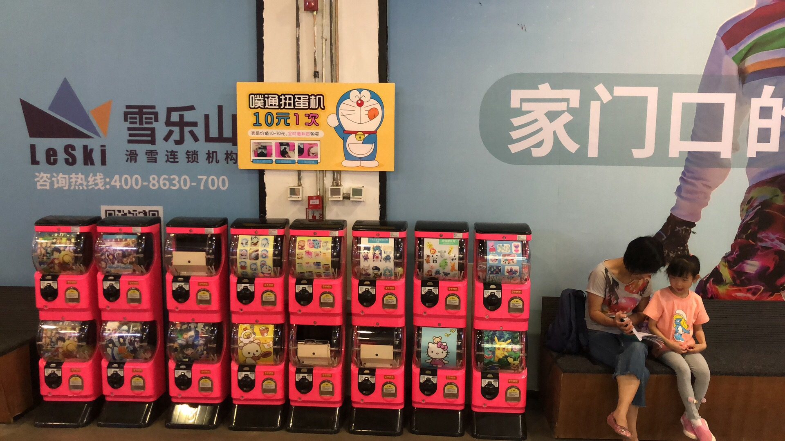
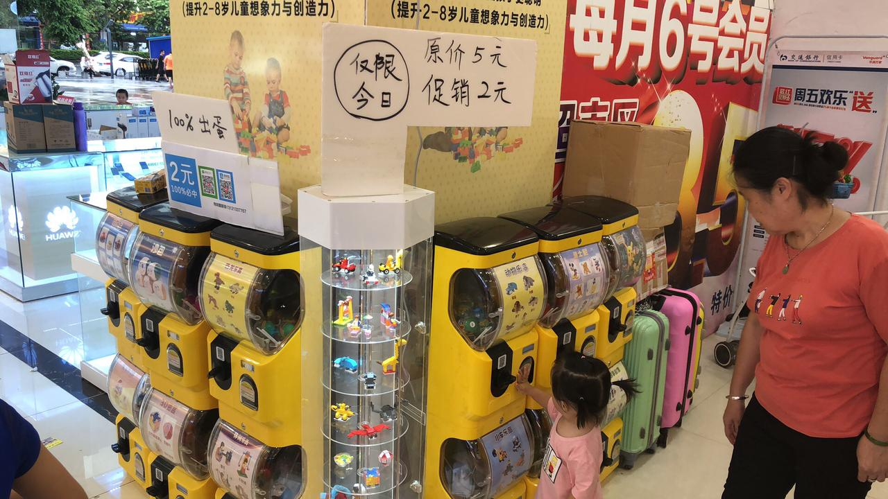
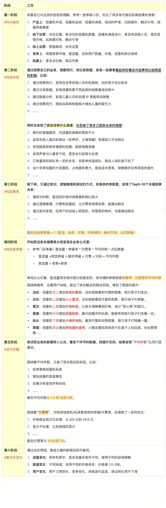

## 现场推演：推演两个案例

### 第一个案例：视频号投放

我们来看第一个案例，这个是目前一堂面临的一个非常真实的问题。

从23年开始，我们开始探索视频号获客。经过一段时间我带着大家探索，我们已经初步验证了视频号的渠道。每个月能够相对比较稳定的获得300个左右的复盘营新客，首单ROI基本在1.5-2，显著高于其他渠道。

接下来，我要把这个项目转交给你，并且给你定下了一个更高的目标，有没有可能把获客人数在当时的基础上，**再翻5-10倍**，同时还能够保证规模化毛利，也就是同时**保证首单ROI不明显下滑**。

那么问题来了，如果是你，你会怎么去实现这个业务目标？

————

实际上这个业务的实现：

### 第二个案例：扭蛋机订单量

好，下面我们来看第二个案例，这个其实也是一个大家非常熟悉的例子，来自我的合伙人张磊，他在加入一堂之前，做过扭蛋机的业务。

在他业务的某个阶段，他初步跑通了业务，有5个点位，平均每个点位的单日销量在100单左右，利润可以在20%左右。下一个阶段，他的目标是在**利润不下滑**的基础上，把扭蛋机的**订单量提升到当前的3-5倍**。

那么问题来了，如果是你，你会怎么去实现这个业务目标？

————

好啦，两个推演案例也就带大家快速串完了。