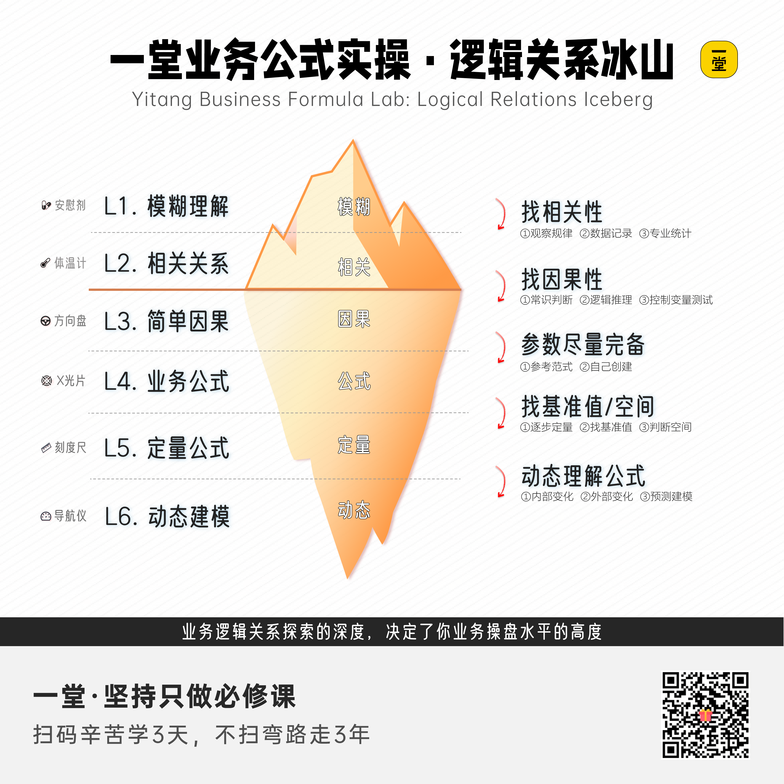
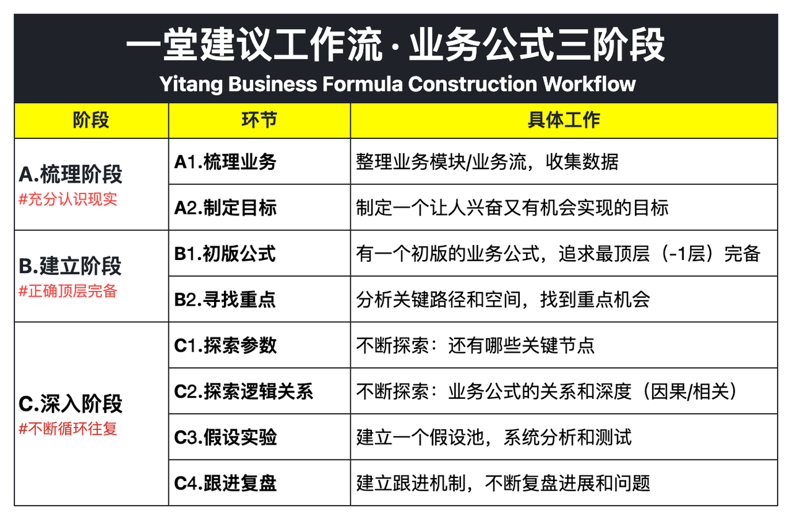
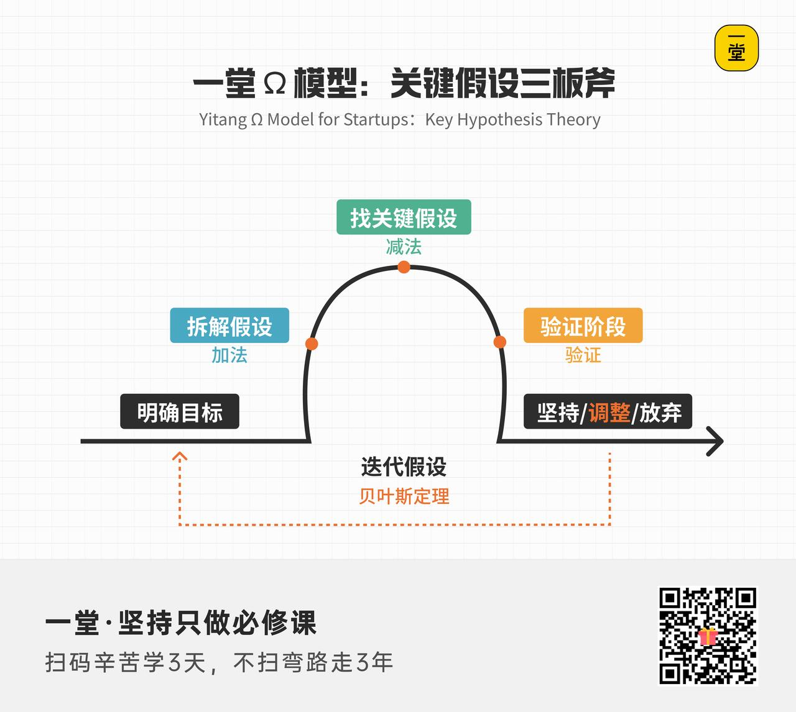
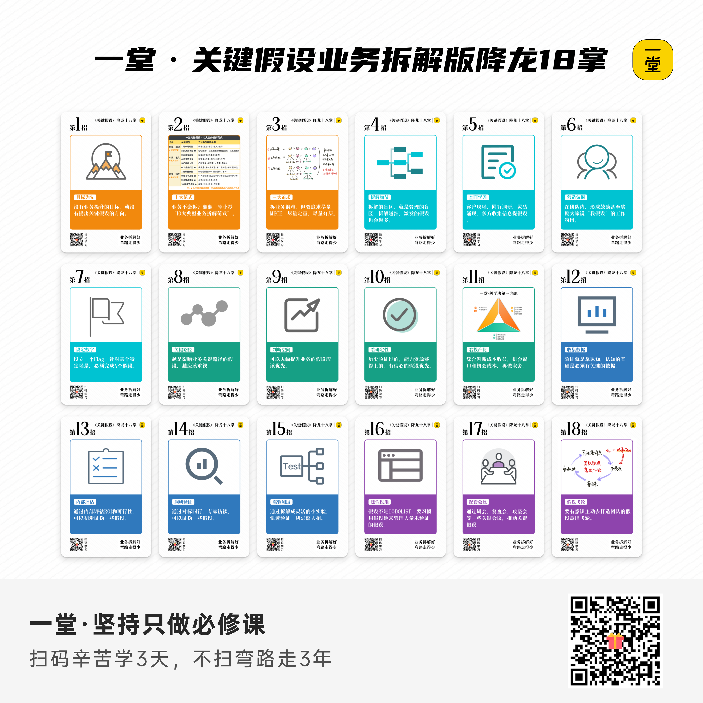

## 重新理解"业务公式"

### 快速回顾

终于接近尾声了，下面我们快速回顾一下这节课的内容：

再上升一个维度，我们会看到一个完整的模型：

背后是一个完整的业务公式工作流：

而你的业务，就是一个不断螺旋上升，不断进化，不断叠加的过程。

宏观上来看，可能就是一个参数和逻辑关系构建一个"业务公式树"的过程（上图右），而微观上来看，其实就是用几个月，几年的时间，几十上百、成百上千次不断地探索参数、探索逻辑关系，用一次次假设分析，最终构建出整个业务的决策树。

### 重新理解"业务公式"

最后我们再点一下题，回顾一下业务公式的存在的核心价值。

黑盒的思维，只有输入/输出，盒子里面的逻辑并不能理解。

白盒的思维，盒子里面的假设、逻辑、规律我们也要理解。

一旦把业务提升转化成了白盒，才从"运气/玄学"转化成了"体系/科学"，变得**可以证伪、可以讨论、可以沉淀、可以迁移。**

那这个背后又是什么呢？说到根源，业务公式只是一个科学的分析工具，用来建立一个客观的、科学的、长期稳定的业务因果关系：

做不做是ROI的问题，能不能做到高段位，这是能力问题：我们要有能力，在日常工作里不断迭代核心认知，积累对于业务更本质的因果关系的理解，然后靠高水平的业务认知，获得持续的决策成功。

背后的核心逻辑，还是相信"**客观存在的因果关系**"，不要只盯着结果+碰运气，而是把业务提升的结果拆解成一系列的前提假设，每一个假设又有前提假设。

**不奢望运气，甚至不屑于投机取巧，而是用一套科学的认知框架，从胜利走向胜利。**