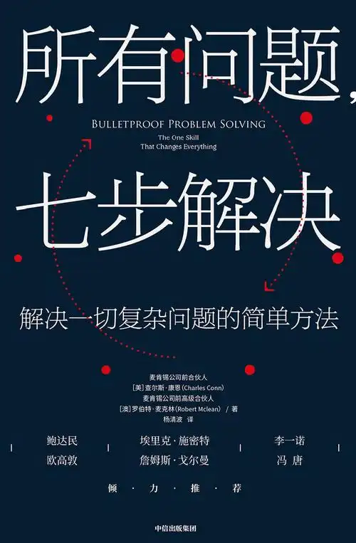

## 作业与Candy

这节课，我给大家留了两个作业，你可以2选1完成。当然我鼓励你听完课后，都尝试写一写。

**第一个作业：学习心得题。**

这节课讲了面对一个业务提升场景、一个有挑战的业务目标，如何通过对业务逻辑关系的不断探索和理解深化，提出更有价值、更精准的假设。同时，课上给了一个关于逻辑关系探索深度的冰山图，并且在此基础上展开了升级的常见策略。

你可以说说，这节课的内容引发了你哪些回忆和思考？哪些内容对你比较有触动和收获，可以展开写一写。

**第二个作业：案例分析题。**

请你挑选一个你管理的业务，描述一下你的业务背景，想要提高的业务目标，以及你目前为这个业务目标构建了哪些不同维度、不同深度的业务公式，找到了哪些参数假设。

参考今天课上的案例，展开说一说，你的参数假设是怎么找到的，当被提出以后，优先去围绕哪些参数提假设做实验了？为什么？以及哪些参数被证实了，哪些参数被证伪了，是如何验证的。

你可以判断一下，你目前对某个参数的逻辑关系的理解达到了什么水平，还有哪些进一步提升的空间。

注意：作业**默认公开**，如果有特别具体&敏感的信息，请提前脱敏。提交作业会进入我们的案例库。

**【Flag🙋】**这节课做起来很辛苦，希望大家不要辜负。

来来来，希望大家一起立一个Flag（承诺），认真听课吸收，最后完成这次训练作业。

扣一句话吧：**一定作业！！ **

提醒：新课免费内测，请务必按时学习提交作业，3次报名内测不写作业，后面不会再邀请。

**🎁 作业奖励Candy**：

这节课很难，背后其实有很多逻辑、概率相关的理论支撑，我们在课上很难讲。

但是之前读书俱乐部有拆过一些相关的内容，我们从中挑了3场，作为这节课的candy。

