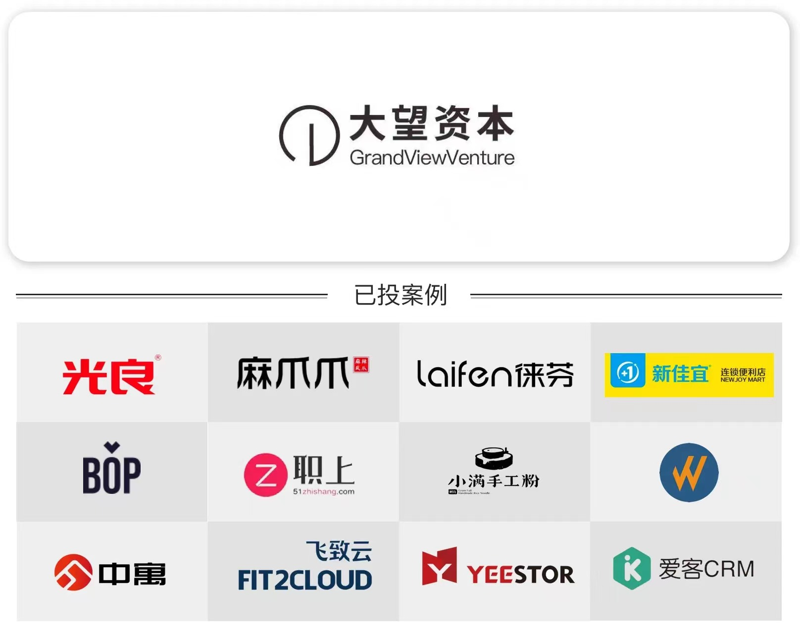

# 认识我们

大家好，我是本期的班主任👩。

欢迎大家开到一堂学习，这是一个6天体验营，快速帮大家梳理一轮业务，进一步梳理你项目的核心。

今天是训练营的第一节必修课，为了最大程度提升学习效率：

给大家很多过来人的第一条学习建议：请尽量用电脑学习！！！

【💡**高能提醒】**课程时长预计2小时+，全程直播无尿点，连续高密度干货输出

1. **避免打扰：**电脑更有利于沉浸式学习，避免微信消息等打扰划走，错过知识点
2. **便于记录**：密度太高，电脑便于截图&敲字，边听边记，后续复习更有针对性
3. **节省时间：**过来人都说内容硬核，要反复学习，认真听直播，省下更多时间学更多课
4. **体验更好：**课程大量实操清单/小抄，手机端无法横屏，字小不清晰用眼易疲劳

未来6天，我们一共准备了**2节直播必修课（今天和下周二），1节专题必修课，还有1节加餐福利课**，希望大家务必认真阅读这次学习时间表：

| ⏳ 时间安排 | 💻 事项 | 📌 特别提醒 |
|-|-|-|
| 今天晚9-11点 | 直播课 | 即将开始学习 |
| 今天直播结束后 | 完成训练闭环 | 使用班主任发给你的 ai 工具完成课后训练，再完成本节课的课后作业 |
| 周六-周日 | 专项必修课学习 | 完成《科学决策》专项必修课听课-训练-作业 |
| 周六-周日 | 加餐福利课学习 | 完成《直播课》和《专项必修课》2份作业，找班主任领取一堂加餐课《人生红点》 完成《人生红点》加餐福利课听课-训练-作业 |
| 周日晚12点 | 作业提交截止 | 提交作业，直播必修课+专项必修课+奖励课 |
| 下周二晚9-11点 | 直播必修课2+复盘+毕业典礼 | 点评作业/评选/抽奖，务必留好时间 |
| 下周二晚12点 | 课程截止学习，无法回听 | 请在本周按时学习 |

## 简单介绍一下一堂

> **<em>以太创服（ETHERCAP）</em>**<em>是国内知名的创业服务机构，帮助1800+项目拿到风险投资；一堂做的是以太旗下的早期创业者/管理者培训服务，采用创新的"体系课+作业训练"模式，帮助各个行业、各个公司的高潜力管理者提升核心能力段位，发布了商业分析、情报调研、转化率、基本功、项目管理、知识管理等系列课程，累计帮助11W+同学加速成长。</em>

我们的课程，源码资本、顺为资本、启明创投、梅花创投这些顶级机构的合伙人也都在积极推荐。

## 本期课主讲：许楚Truman

这是Truman的介绍：

> 1. **以太一堂CEO：**2016年加入以太创服，任副总裁，兼一堂CEO。
> 2. **前美团产品专家：**擅长从0到1业务探索、产品快速起盘、商业分析。
> 3. **一堂课程总设计师：**研发100+节业务实操课，收到5万份业务训练作业。
> 4. **曾创办“易项直通车”**：资本对接平台，帮助100+项目融资成功。

我的微信：欢迎链接~

> 这是我的个人微信，你可以直接扫码添加
> 平时比较忙，回复不及时，请见谅❤️

