# 启动拆解：训练科学拆解能力

我们要有能力，把一个项目拆成一系列独立判断，而且它们是**极度关键的、影响成败的、逻辑完备的、前后依赖的，可以用来指导决策的**。

——————

怎么拆？今天我打算讲三个拆解的工具，其中两个是书里的经典方法，我建议每一个创业者都应该熟练掌握。还有一个是我们一堂教研组讨论了很多轮提炼的，是一个原创的思考框架。

【记忆 💡】从简单到复杂，我总结了一个口诀，叫做：259。

【互动🙋】这是一堂最知名的一句“同学圈内黑话”，也是一堂最需要记住的三个字。来，一起多扣几遍，加深点印象吧。

下面，我们先来看259中的2。

## 第一种拆法：2部分

《精益创业》这本书有同学读过吗？记得如何把业务拆两个部分吗？

————

【工具🔨】任何一个业务，都可以拆成两个最基础的假设：价值假设和增长假设。

**第一个假设：价值假设。**首先你提供的这个东西，到底对于消费者有没有价值，大家会不会为此而买单？或者你的一个门店，长期能不能盈利？这些都是价值假设。

**【案例❤】樊登读书会，什么是价值假设&增长假设？**

举个例子，樊登读书会，是一个带着大家读书的APP。最开始樊登也不清楚，提供一个帮大家拆书和讲书的服务，真的有价值吗？

樊登读书会的第一个版本，其实就是一个一个PPT，定期整理读书干货，做成一个PPT，看看大家愿不愿意直接付费买单。

最后发现，即便是这么糙的方案，很多人依然愿意花300块钱买这个PPT，说明这个事情有价值。正是因为证明了价值，所以樊登才一步一步地把这个产品做起来。

**第二个假设：增长假设。**你这个业务如果有价值的话，能不能快速地复制、快速地扩张、快速地传播开，让大家都用起来。

这两个假设是创业最重要的两个假设，我平时会聊一些创业者，如果是一些商业模式创新的项目，如果对方一直跟我讲营销策略，我会说：你的价值假设验证了么？如果没有验证价值假设，聊太多后面的增长假设其实意义不大。

因为增长的前提是，你的产品得有真正的价值，不然过早复制，你的扩张越多，你的亏损也就越多，反而创业失败也就越快。

总之一句话：不要过早复制，未经验证的商业模式。

为了方便大家理解，我整理了一个画布工具，你填一遍，就可以整理好思路。

【工具🔨】《关键假设拆解画布（2分法）》

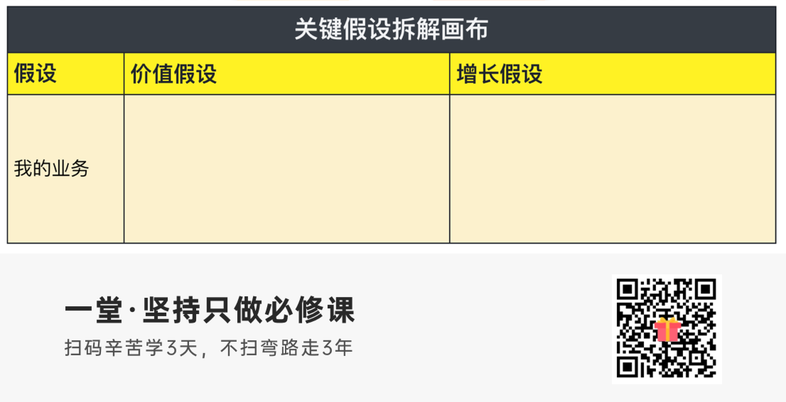

我们来带入“机器狗”项目的关键假设：

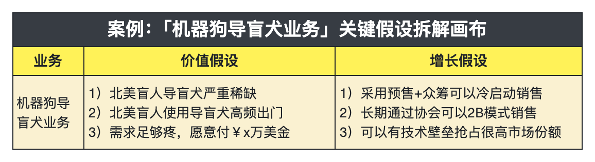

这是最简单，也是最糙的一种拆法。

## 第二种拆法：5部分

【🙋提问】 任何一个创业项目，从正式立项，到最终做到一定规模，甚至最终做大、上市，一共都需要走过哪些里程碑呢？

——————

是融资吗？还是团队规模？还是运营数据？都对，但是也都不对，这些都是表面现象和过程指标。

【重点💡】创业的核心里程碑，其实是“**最关键的假设**”得到验证。

市场上没有成熟的里程碑模型，2019年，我组建了国内第一个严肃教育的研究团队，搜集了大量的失败案例：

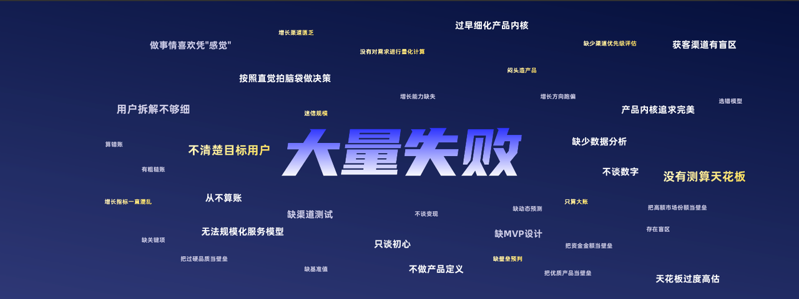

> <em>大量血泪教训，都赔过几十几百万：需求误判，产品力弱，商业亏损，过早扩张，过早细化等等....</em>

经过了一轮轮验证，测试迭代，最终不断合并同类项形成了一个模型：

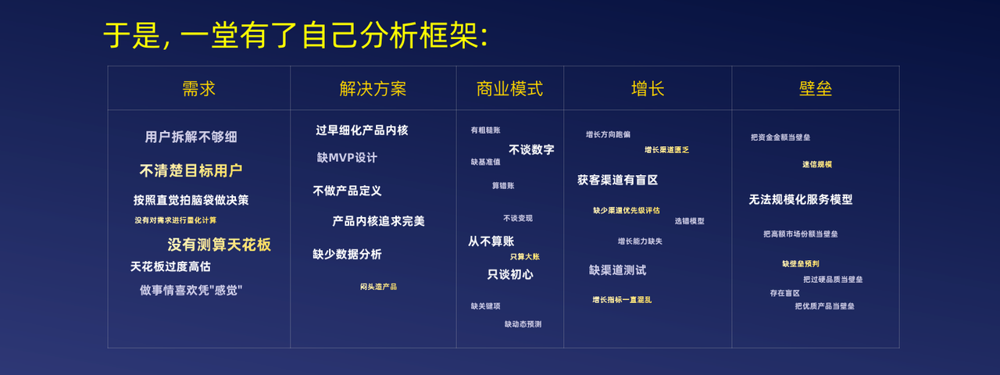

【核心🔨】我们一堂把创业总结为最重要的五个里程碑：**需求 - 解决方案 - 商业模式 - 增长 - 壁垒。**

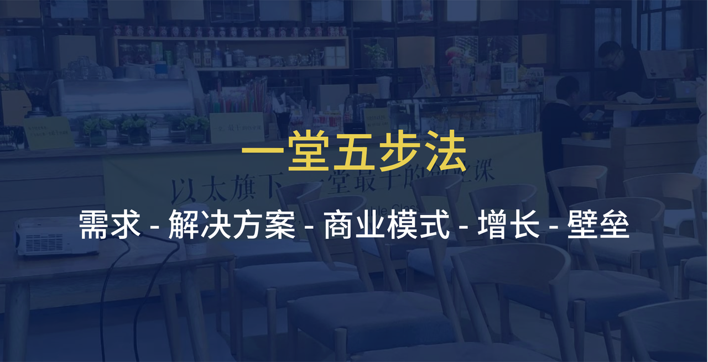

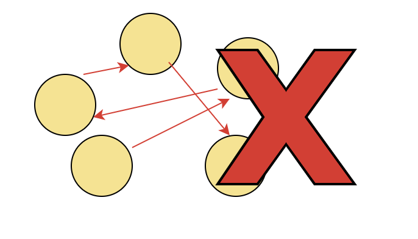

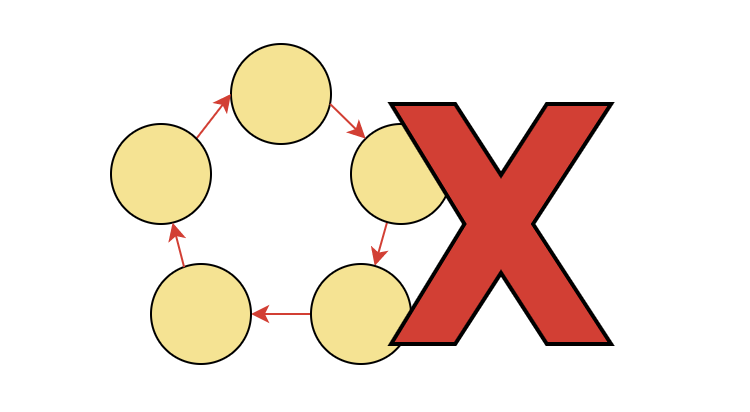

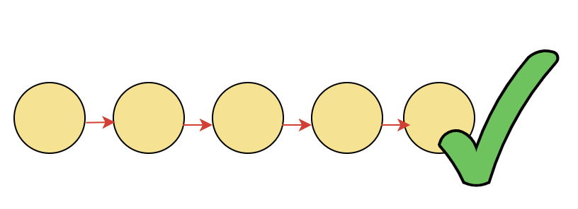

而且这些环节，环环相扣，是一个逐步推进，依次推导出来的过程。为了表达方便，在一堂的课里，我都把它称作『一堂五步法』吧。

**我们下一步，认真研究这个链条，做反思：**每一步都是后一步的前置条件，比如如果你的用户需求不存在，那么后面所有的解决方案、商业模式，增长策略，也就都不成立了。

同样，如果你的需求和模式没有验证，你的增长和扩张策略，也是不太重要的。

我又整理了一个画布，你可以尝试填一下：

【工具🔨】《关键假设拆解画布（5分法）》

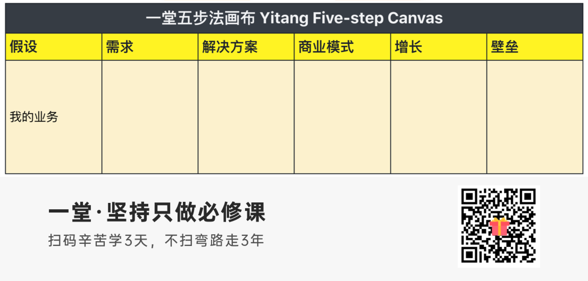

我们还是看一下机器狗项目：

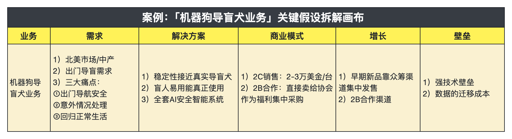

大家感受到了里程碑的感觉了么？从左往右，循序渐进推理，逐步细化和推理的过程。

## 第三种拆法：9部分

《商业模式新生代》这本书你读过么？整本书就是讲把一个商业模式，拆成了9个部分的画布，你把这个画布填完，基本商业模式也就梳理差不多了。

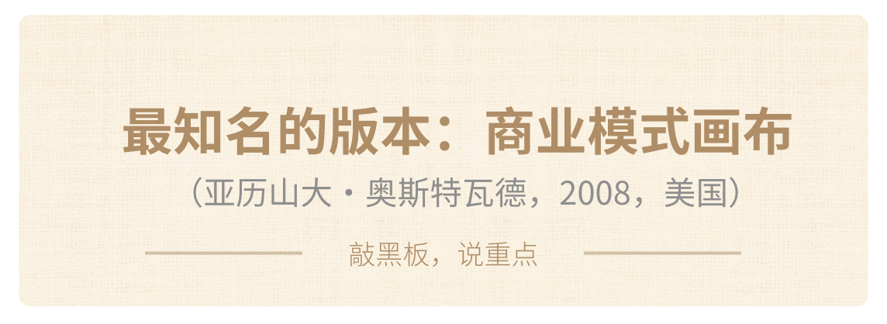

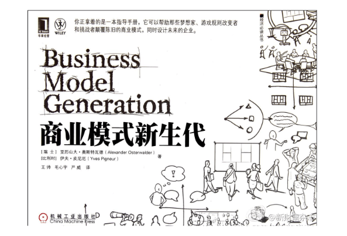

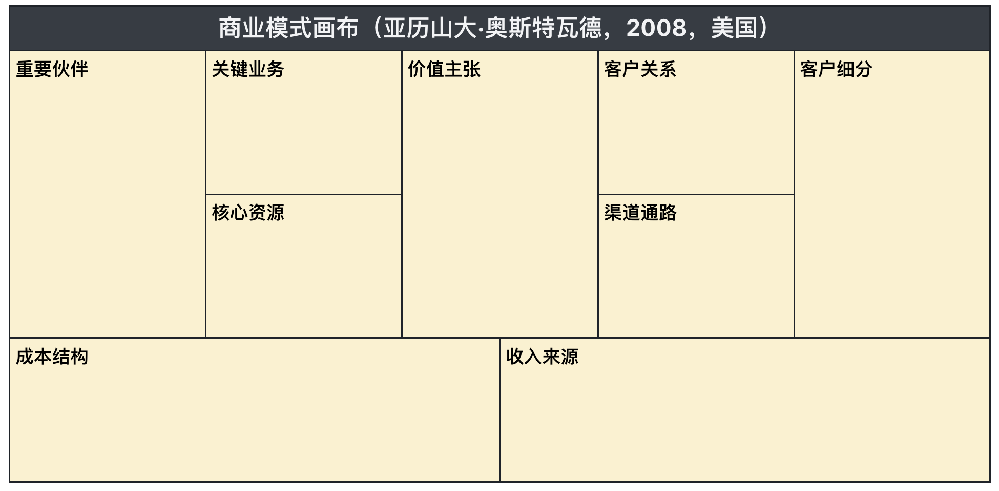

> 经典案例：3M、爱立信、凯捷咨询公司(Capgemini)、德勤、挪威电信（Telenor）

很多人在讨论业务的时候，都能用一页纸，把所有商业模式的要素全列出来，就是用的这个工具。我把这个画布的图放到了文稿里，大家如果不熟悉，可以看看这九个模块。

**【案例❤】两类典型的上门按摩项目（2016年；保健/休闲类）**

记得在2015年，O2O大火的时候，我们美团在考虑切不切入『上门按摩』这个市场。当初做调研的产品经理做过一次内部分享，比较了两个目前市场上主流产品的按摩O2O模式，一个是保健类的，一个是休闲类的，两个看似类似的服务，然而在产品核心价值、收入和成本结构上，有着巨大差异。

【提问🙋】大家想一想，如何在分享的时候，用1分钟，快速比较两个模式的相同点和差异点呢？

——————

答案是画两个画布，瞬间就清晰了。

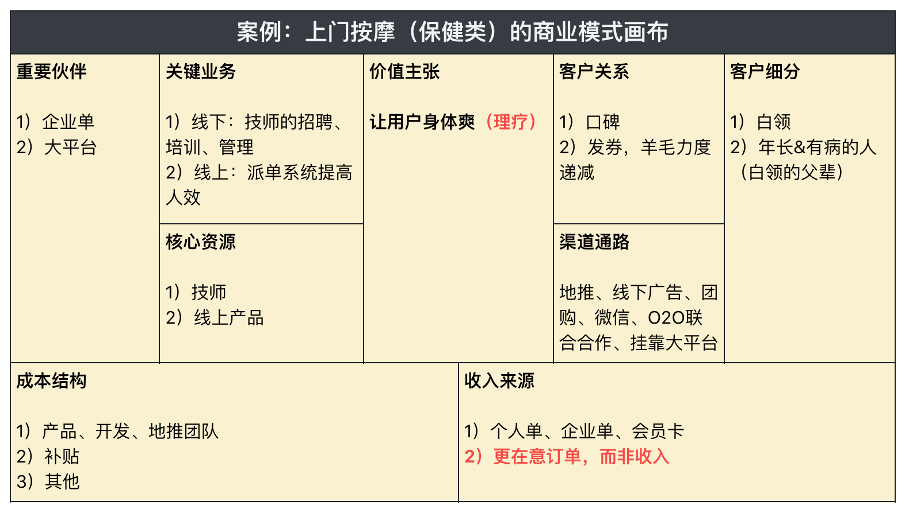

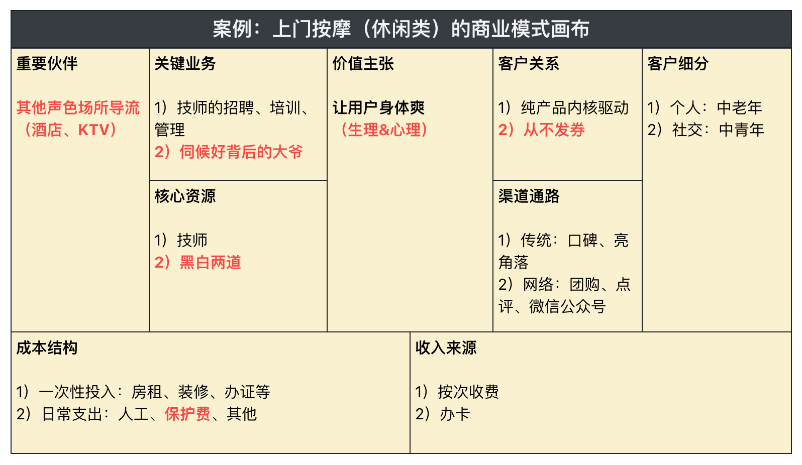

一场20分钟的分享，如果不用这个可视化工具的话，很难清晰表达完整。而用这个工具，可以快速找到模式各个环节的差异点。这个工具很经典，如果你不清楚的话，自己百度学习吧。

【思考💡】大家觉得这个画布好用吗？趁手么？

> 工具是用来用的，趁手很重要：方不方便记住，方不方便填写，方不方便阅读？

**【💡 升级】改良1：精益画布（适用于初创）**

《精益创业实战》这本书我在课上反复推荐过，在这本书里也推荐了一个工具：精益画布

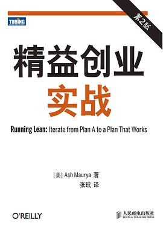

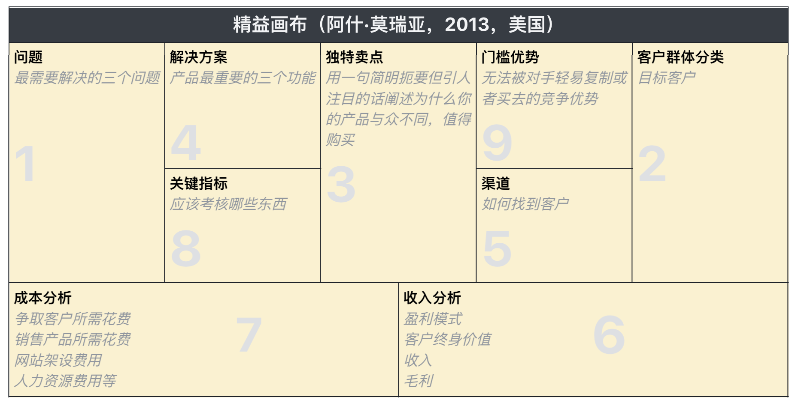

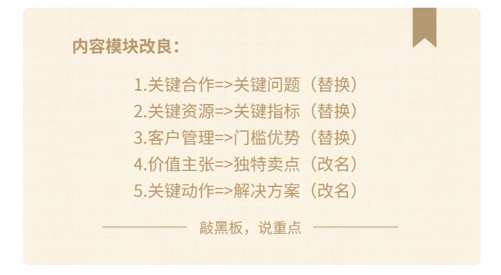

这个精益画布是商业模式画布的改良版，针对初创公司的高风险和高不确定性，对商业模式画布进行了一轮改版，他把一些关键要素做了替换和改名字，**更符合从0到1阶段业务的特性。**

**【💡 升级】改良2：一堂商业画布（暗含里程碑逻辑）**

在一堂教研的过程中，我和程浩（远望资本创始合伙人、迅雷创始人）讨论，觉得这个拆解方法，逻辑性还是不够好。于是决定在这个基础上， 再升级一版，做一个属于中国创业者的商业模式画布。

我把一堂商业画布这张图也附到了文稿里，你可以认真地看两遍，看看能不能看懂。

【工具🔨】《关键假设拆解画布（9分法）》

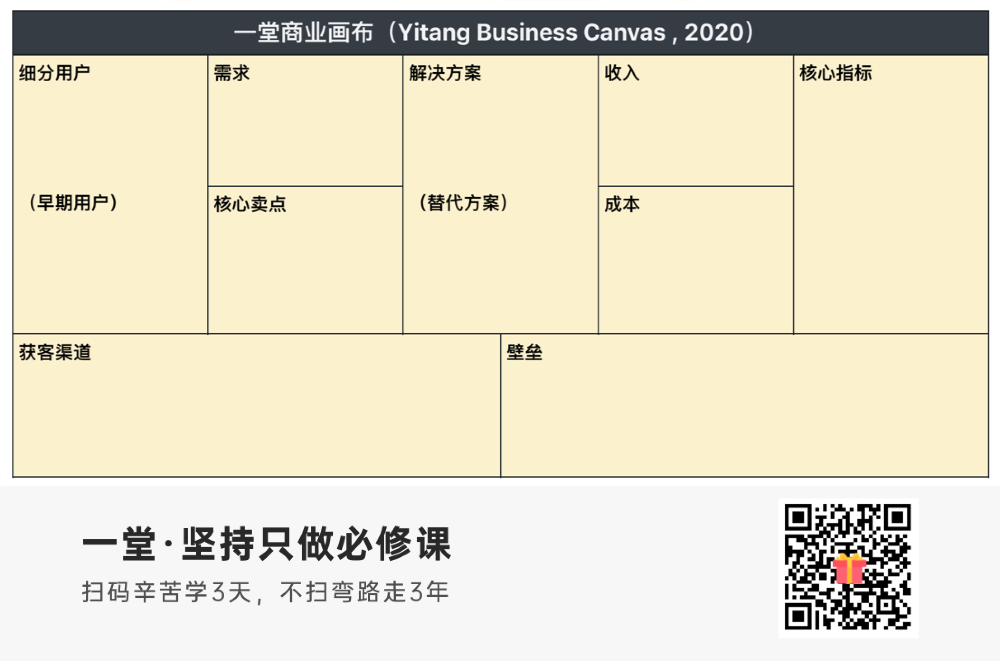

任何一个商业模式，都可以拆成9个关键部分，分别是：细分用户、需求、核心卖点、解决方案、收入、成本、核心指标、获客渠道以及壁垒。

回到预热思考题1，如果给你一张纸，让你把项目都整理清楚，那你可以尝试画一下一堂商业画布，然后认真填一遍，基本就会很清晰了。

我们还是用机器狗项目试着推演一下：

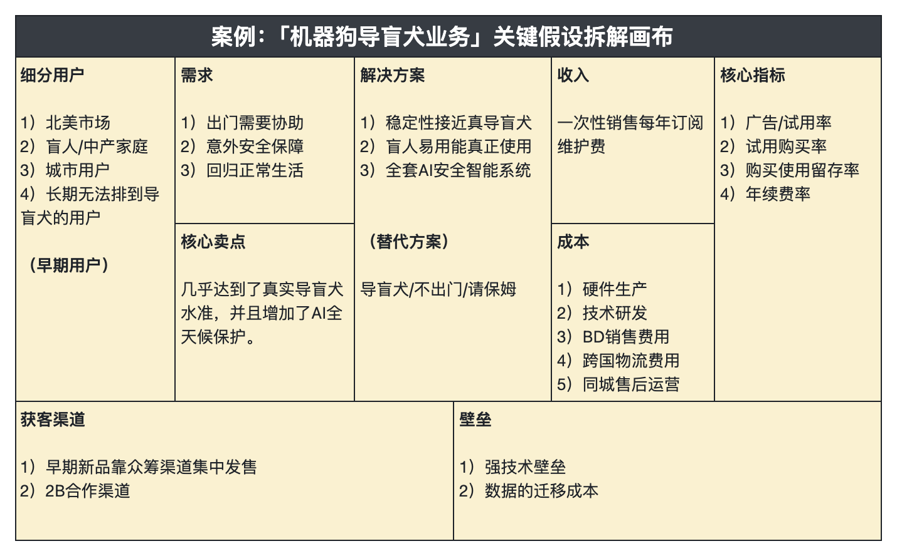

## 理解内在联系

【提问🙋】大家想一想，这三个方法259，有什么内在联系么？

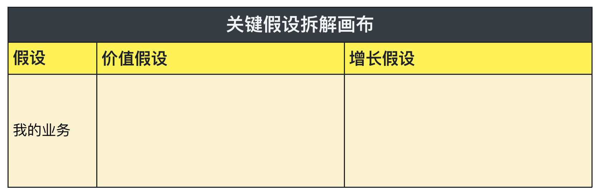

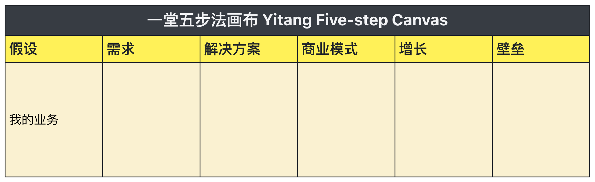

我们再进一步，来看一堂画布，和五步法又有什么联系呢？

> 1. 用户需求和卖点，其实就是五步法的第一步：需求。
> 2. 解决方案和替代方案，其实就是五步法的第二步：解决方案
> 3. 收入/成本和核心指标，其实就是第三步：商业模式
> 4. 底下的获客渠道和壁垒，对应的就是五步法的后两步：增长和壁垒。

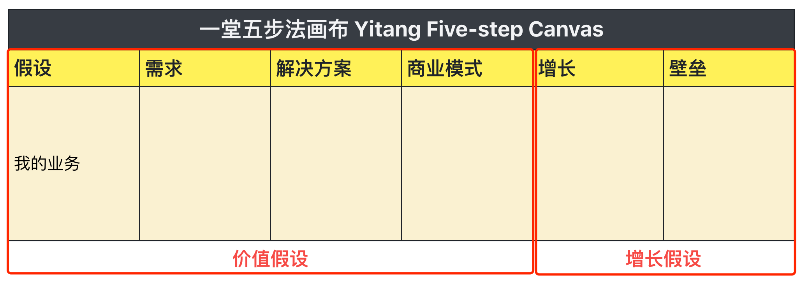

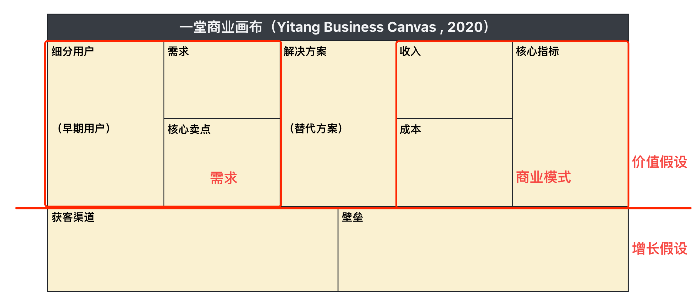

大家能不能从这个画布里看出来：**全局预判/重点执行，业务线路图，商业故事推理，独立自解释。**

而且如果你认真看这个画布，上面一排，都是价值假设；而下面一排，都是增长假设。

这样重新看一遍是不是容易理解多了？

**【互动🙋】来来，热个场，一起扣个关键词：拆好关键假设！！！！**

————

这节课，我建议你一定要意识到『**关键假设**』这个问题。不管你把它叫做『**创业风险**』，还是『**创业假设**』，还是别的什么名字，都不重要，重要的是希望你能深入思考业务背后成立的逻辑。

这是一个基本功，也是一个上帝视角的神器，站在项目『全局预判』的视角，看得越清楚，对项目理解越透彻，理解越透彻创业越不慌，决策越理性。

这也是"**一堂系同学**"以后拆解业务、复盘决策、公司参访、开私董会最大的基本共识。

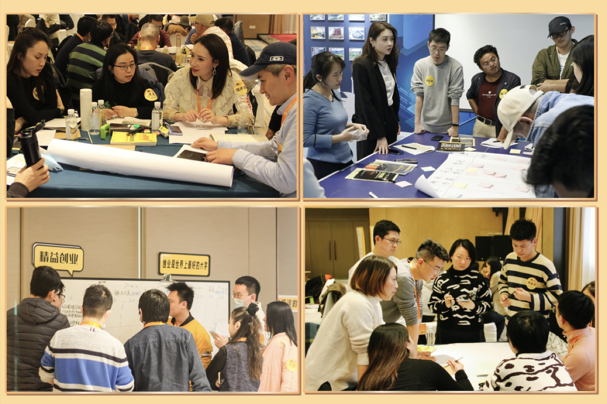

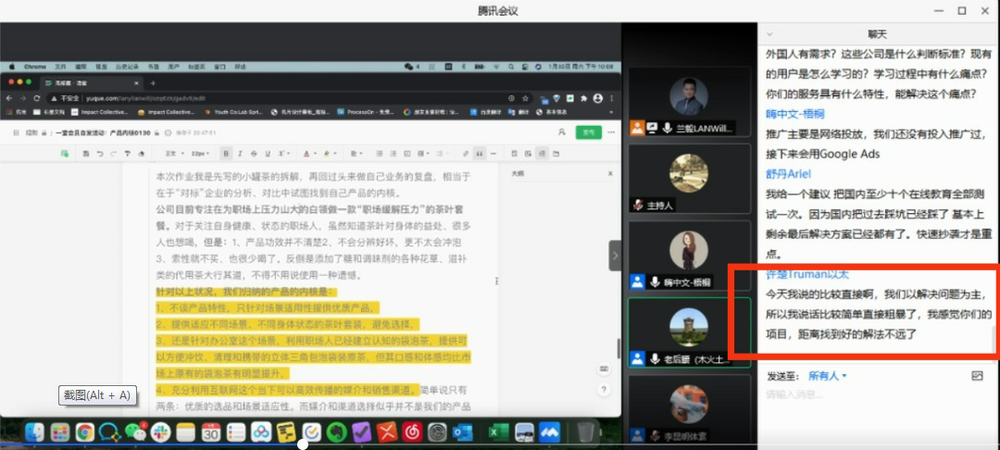

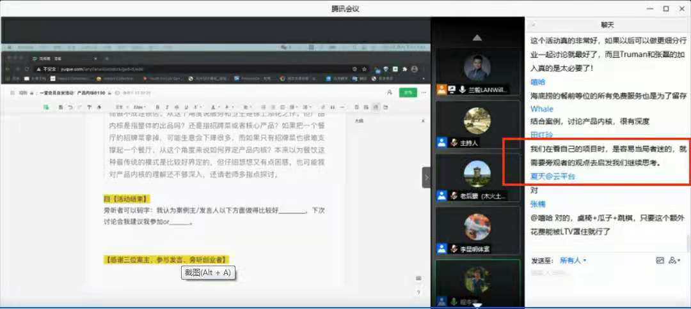
