# 🎁 中场划重点：作业任务和Candy

终于可以向大家正式介绍一堂的**<u>学习服务设计</u>**了。

大家如果想在一堂高水平学习，我得先纠正一个误解，我们远远不满足于~~个人网红IP、碎片的观点和谈资~~，我们的定位是做一家"**严肃教育**"公司：

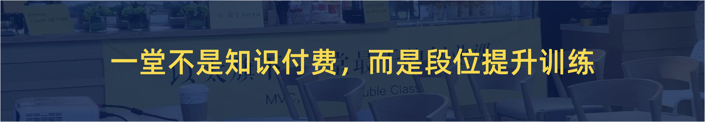

两者本质完全不同，前者很像是你高中在报刊亭买的一本杂志，一期新闻周刊，而后者是你的一个健身私教，一个985的1v1家教，前者本质是“**商品**”，后者本质是“**对人的积极改变**”。

希望大家积极躬身入局，进行一周核心能力段位的学习。

回顾一下刚才讲的进步方式：

其中最最核心的就是第二步：**深思考**。

你想要完成一份思考心得 or 复盘 or 推演作业，提交一份思考作业。

所以，在一堂，进行深度学习的第一个也是最重要的动作，就是完成一份**思考作业**。

下面是这节课的作业，你可以二选一完成。

**第一个作业，学习心得题。**

今天讲了双三角、关键假设、259、低成本创业/做业务，你有哪些新的收获和体会？可以讲讲你的想法和感受，或者对Truman想说的话，你可以自由讲讲你的感受和收获。

**第二个作业：课程巩固题。**

这节课我们讲了很多案例，AI教练，官网，偶像MV，机器狗等等，也分享了很多具体的公式和框架，你可以说说，这节课里面，哪个案例让你印象最深刻？或者哪个知识点最让你醍醐灌顶？最好可以展开讲讲让你印象深刻的原因。

这两个作业你可以挑一个来完成，当然如果全部完成，更容易拿到高分作业。

**【划重点1：作业奖励】**这是同学们特别喜欢的一个一堂特色，每一个按时交作业的同学，可以立刻领一份大礼包：最佳实践案例，落地案例集，工具箱，大咖直播，武器库电子版等等。

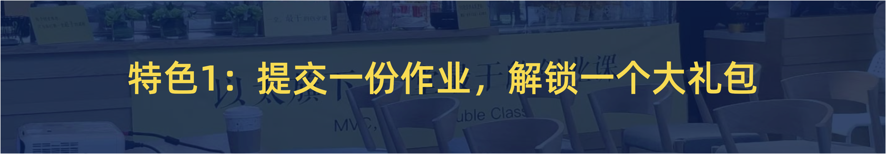

**第一个礼物：高质量商业模式画布**

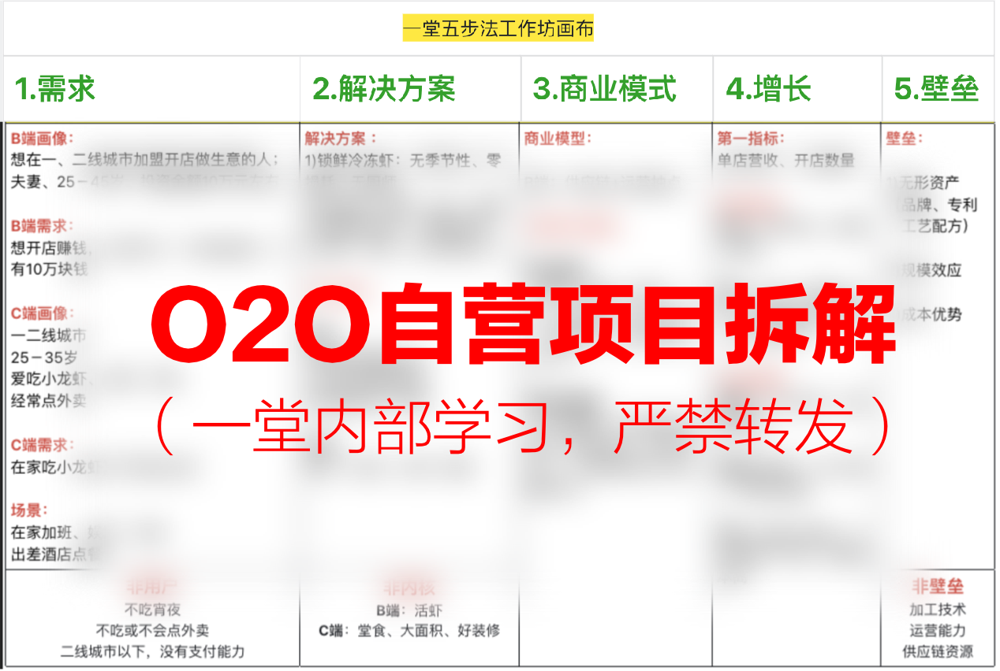

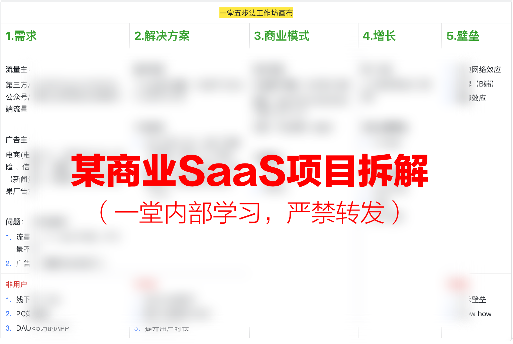

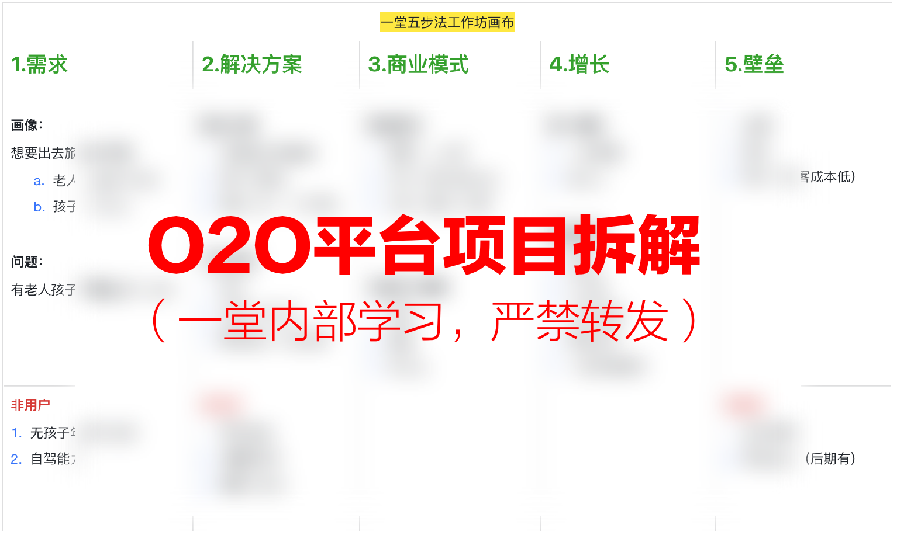

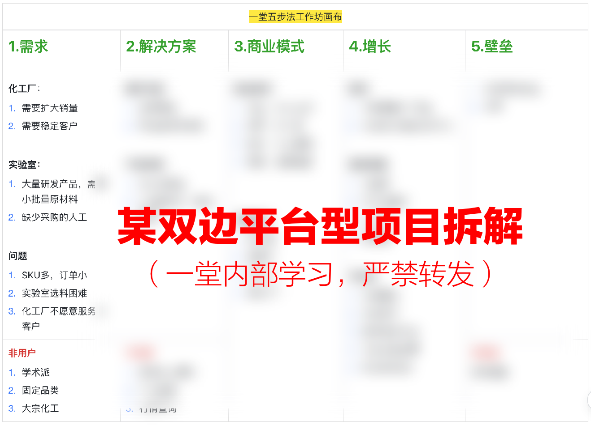

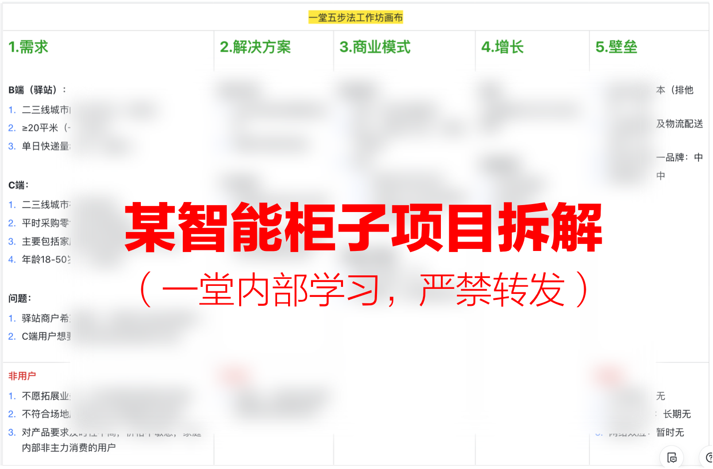

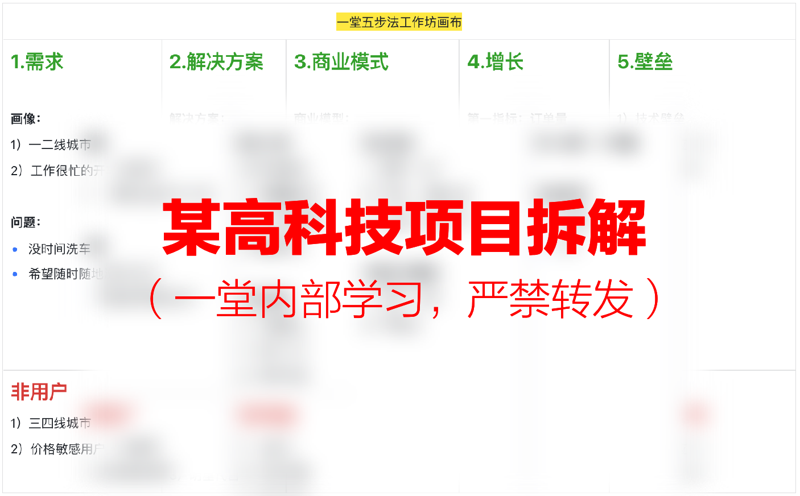

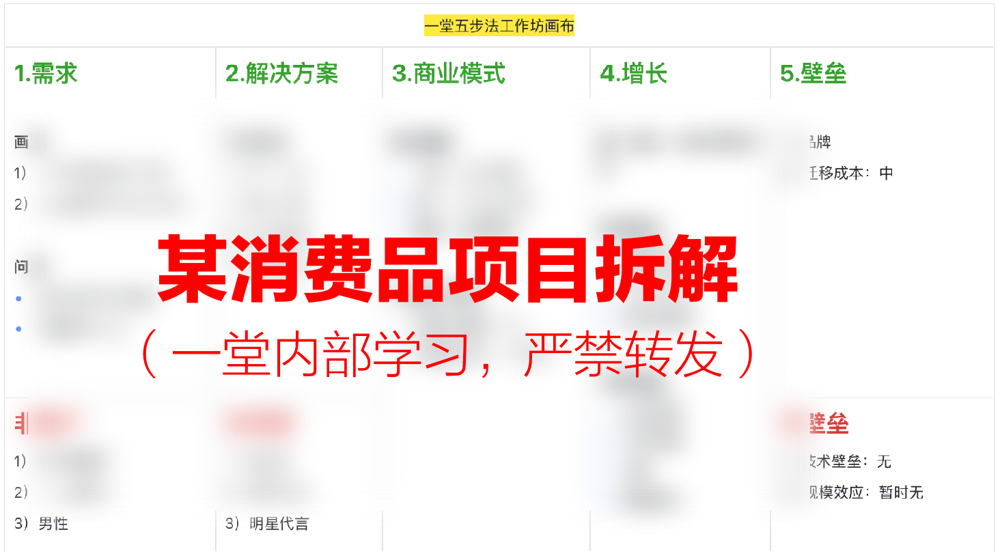

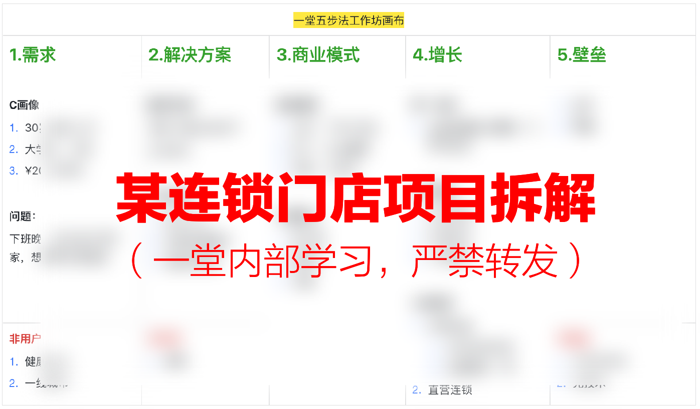

> 这个是十大典型商业模式高分作业。基本都是我们《关键假设实战工作坊》的第一名，超半数拿到过1000w+融资，其中还有非常知名的项目（脱敏），大家按时提交作业，可以看看，一个高水平的拆解是怎么完成的。

**第二个礼物：陈先敏的起盘案例（开店必看）**

陈先敏同学，是一堂非常优秀的Y型负责人的代表，完美执行了“**关键假设**”的思考逻辑。他自己起盘了一个中式汉堡品牌，现在已经有**50+家门店**。

他在一堂讲过一节案例课，分享了他的整个业务起盘过程，遇到的难题，以及背后的思考。同时，我在一堂的课程里面，也分享过他科学选品的过程，非常精彩。

如果你按时提交作业，就可以得到上面两个课程的回放，让你可以**近距离观察一个Y型负责人是如何操盘业务的**。

**第三个礼物：AI时代新创业预判。**

未来几年AI会在各个行业涌现大量的创业机会，但这是一个漫长的变革过程：太早成先驱，太晚成炮灰，如何分析AI的变化窗口和Timing，就变得非常关键。

当大家有了一堂五步法，我们就能和大量创业者、Top投资人平等对话了，这是我们内部的一个研究成果，如果你提交了作业，我们可以送你一份：

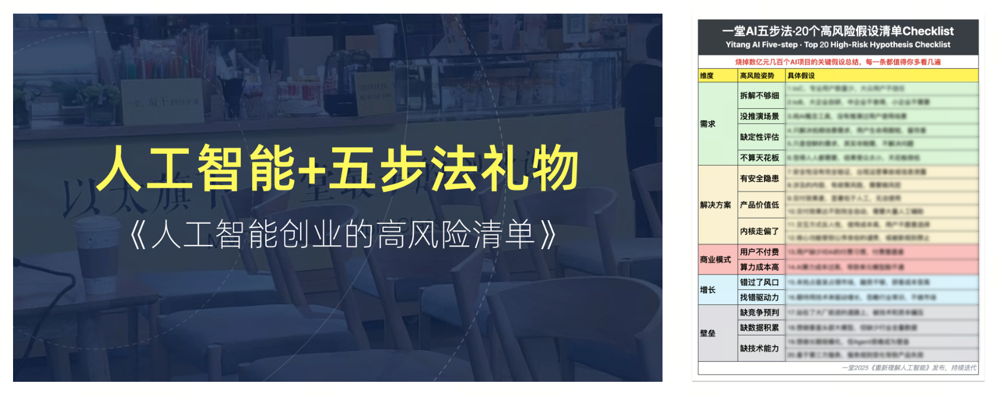

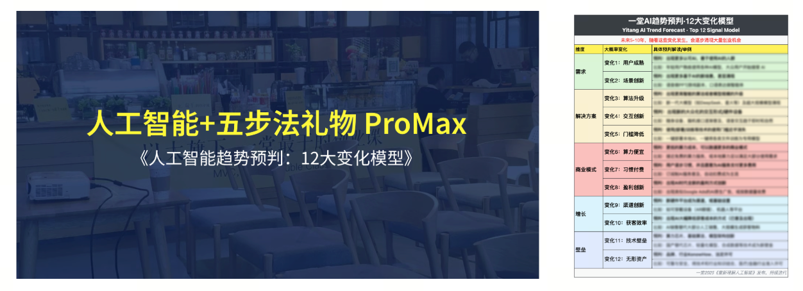

> <em>仅限内部使用，禁止外传；文档会不定期更新，以Candy最新版本为准。</em>

**【划重点2：作业学分】**<u>创业</u>是世界上最好的大学，在一堂修学分。每按时提交一份作业，可以拿到对应学分，这是成长的激励，也是一堂各种特权、福利发放的基础。

> <em>解读：创业的最大的误解。</em>

一堂学分评审规则：3分合格，5~6分优秀，6满分。

如何拿到高分作业：**作业完整度（字数）、作业深刻度（深度）、作业真诚度（认真）。**

【礼物🎁】未来随着大家不断写作业、修学分，我们给你们准备了大量的升级礼物（一堂周边）：

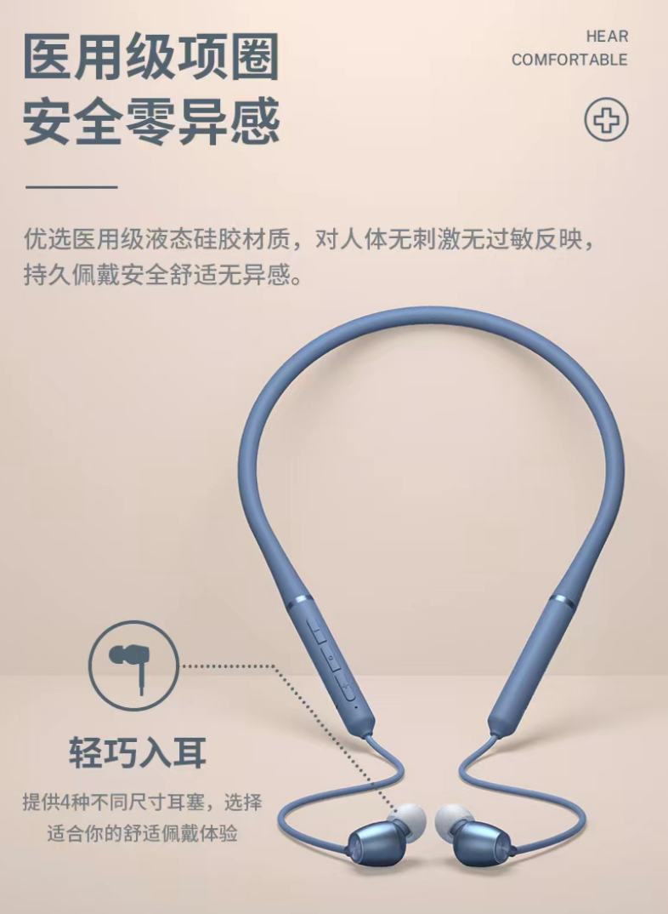

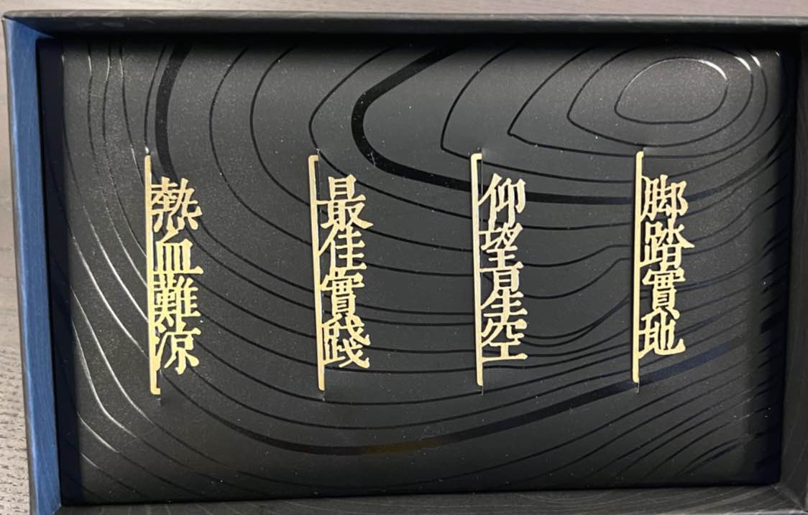

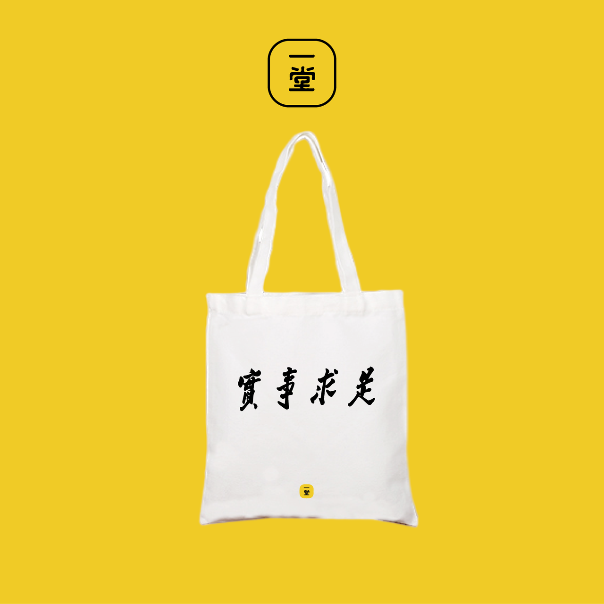

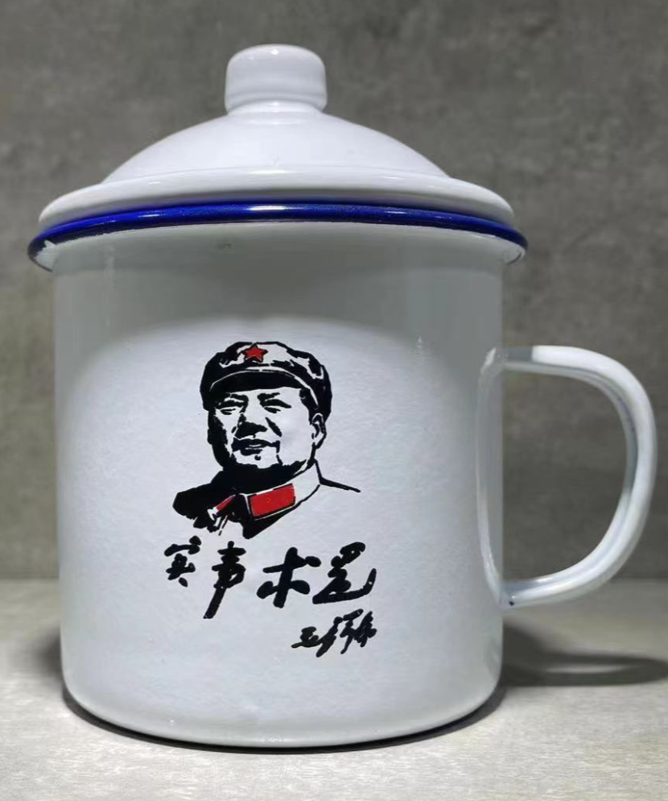

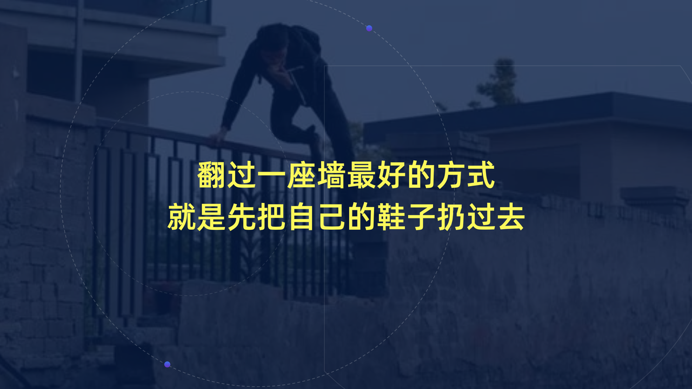

<em>翻过一个墙，最好的方式，就是先把自己的鞋子扔过去；</em>

<em>爬上一座高山，最好的方式，就是先在上面勇敢插一个旗子。</em>

**【互动🙋】来来来，立个Flag，一定要完成作业，评论区打一个口令：**

1. **一定全部作业！！**
2. **一定作业！**

我们有一套智能的分层运营系统，根据你们的自我追求（和勇气）分层运营：

> - <em>自学版：不扣口令，自己提醒和督促自己。</em>
> - <em>入门版：好看的班班额外一倍督促和陪伴，支持大家。</em>
> - <em>满血版：我的AI分身（语音）提醒，并带领班班，3倍强度提醒大家学习：）</em>

<em>口令的价值：①更高的成长速度  ②更多班班陪伴  ③学习全套一堂模型</em>

如果你想学习一堂的模式（每一期都不少友商==），或者你未来也有可能做教育、课程，或者你想知道国内规模化创新教育的天花板打磨成什么样了，请大家直接选满血版（六个字）。

**一次高质量的学习，抵得上10次，甚至100次的随便听听。**

大家总是很忙，很燥，很容易走神，但希望大家先给自己定个小目标：把这节课先认真听懂。

未来再做事、去求职、去解决商业问题，都会完全不一样了。

这节课有**210000多人**听过了，累计复盘作业也应该有差不**4500万**字了。很多人听了三遍才听懂，也很多同学听完大呼过瘾，还有同学评价说，我们终于抓到业务最核心的内核了。

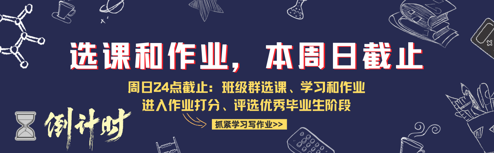

> 【嵌入第三方互动组件，见原文】

【**提醒**💡】想争取完成全部作业的同学，建议大家提前规划，合理安排时间，利用好周五周六的时间，不要全卡在周日，提前安排，轻松自由，而且更容易拿到优秀作业和毕业奖励。

> <em>除非有娶妻生子重大事情，建议大家把不重要的事情推一推，努力完成一次沉浸式的学习和深度复盘。</em>
> <em>在毕业课上，我听到过至少1000次类似的评价：</em><em><u>这一周，是我这几年进步最快的一周。</u></em>
> <em>我们准备了N多课题，帮大家把经验变成方法论，把碎片变成体系，把直觉变成科学。</em>
> <em>请大家尽量尽量尽量多安排时间。</em>

感谢大家对于这堂课的任务，提前预告一下一堂的推荐计划和福利：

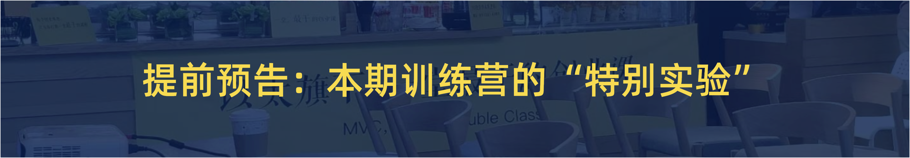

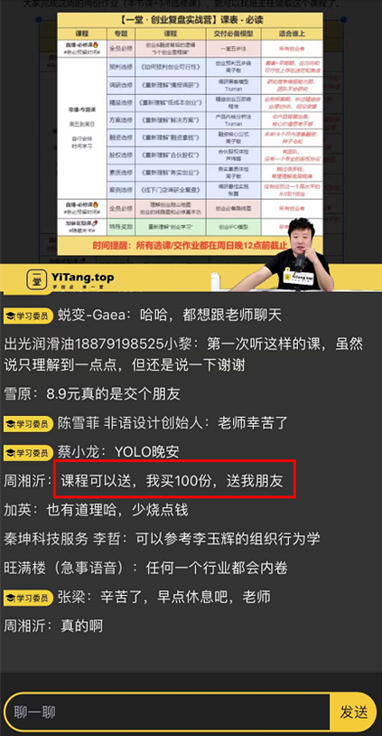

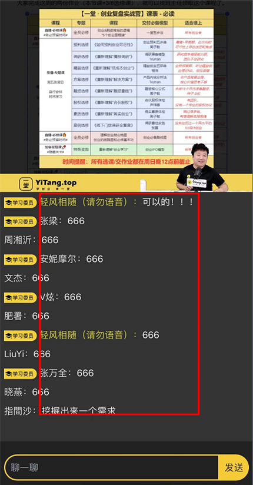

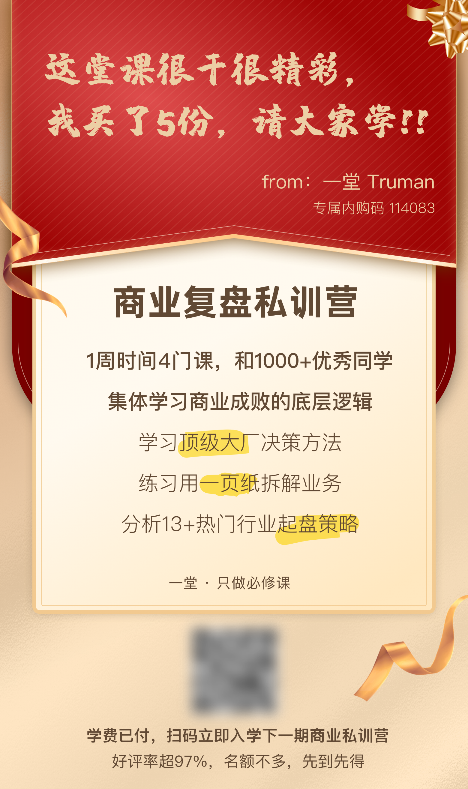

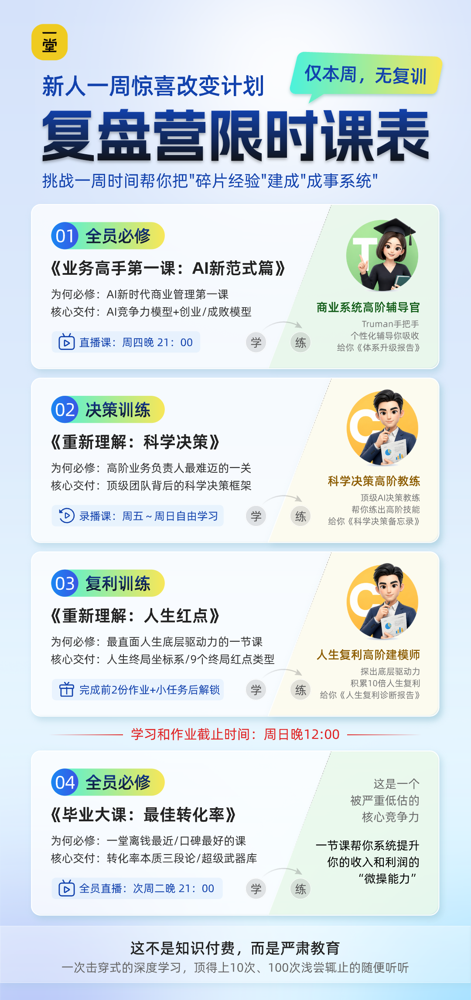

> <em>本期特权：200个名额，可以解锁"CEO同等内推"VIP绿色通道，免费免审，直接上下一期。</em>

【预报名🙋】

1. 扣一个口令：我请客，班主任明天会联系你们。
2. 在这周学习期间，你们可以享受请客特权，我来替你们朋友付钱，你们可以直接请大家来上课

这是一堂截至目前，评分最高的课程，于是一堂唯一一节跳出了商业和管理的《人生必修课》，97%都给了10分满分（NPS），很多人对这节课的评价是，**这门课，对我的人生，是个价值500万的课程。**

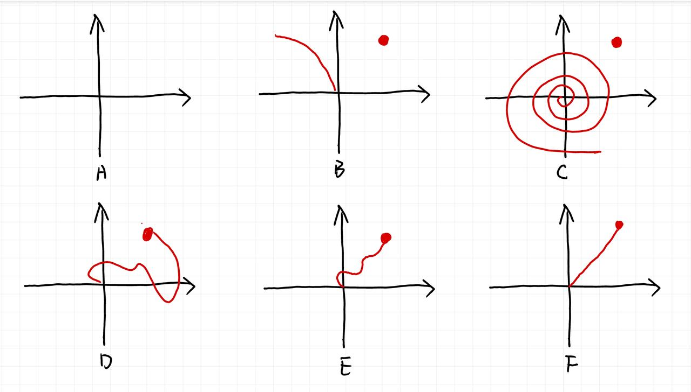

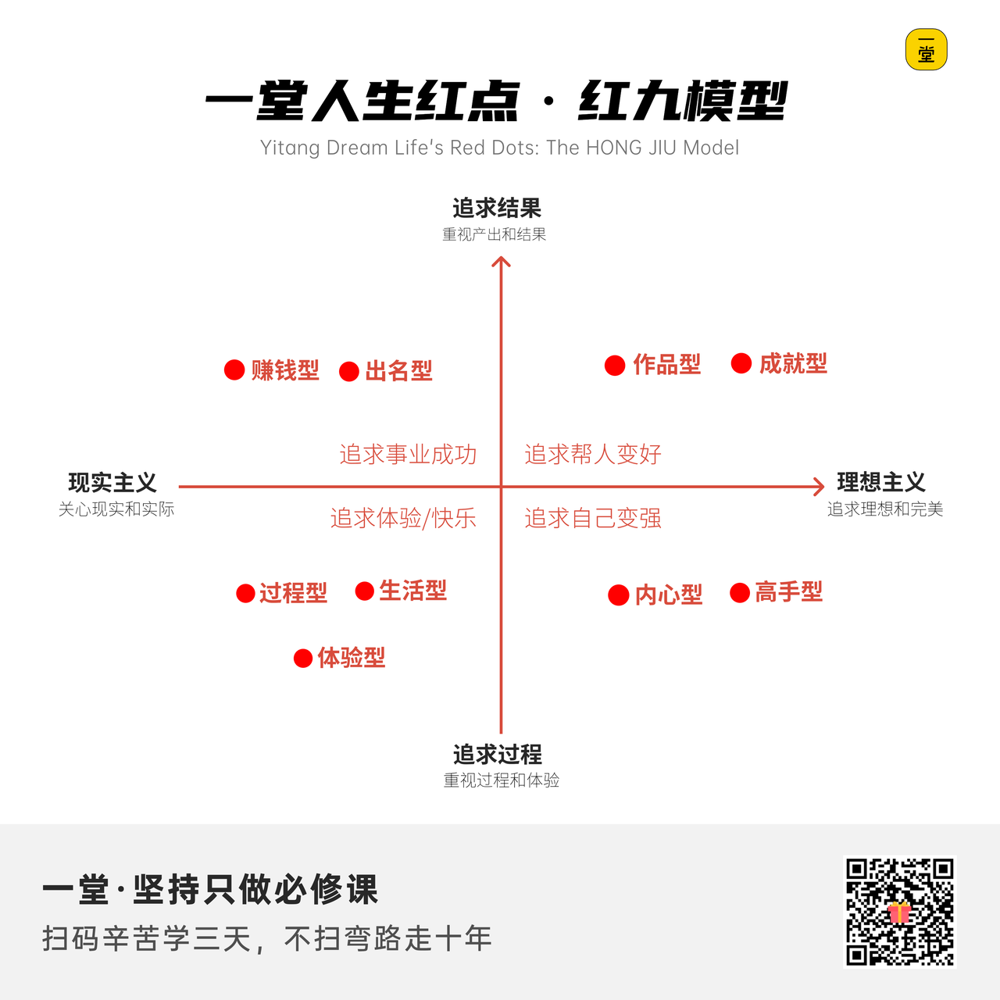

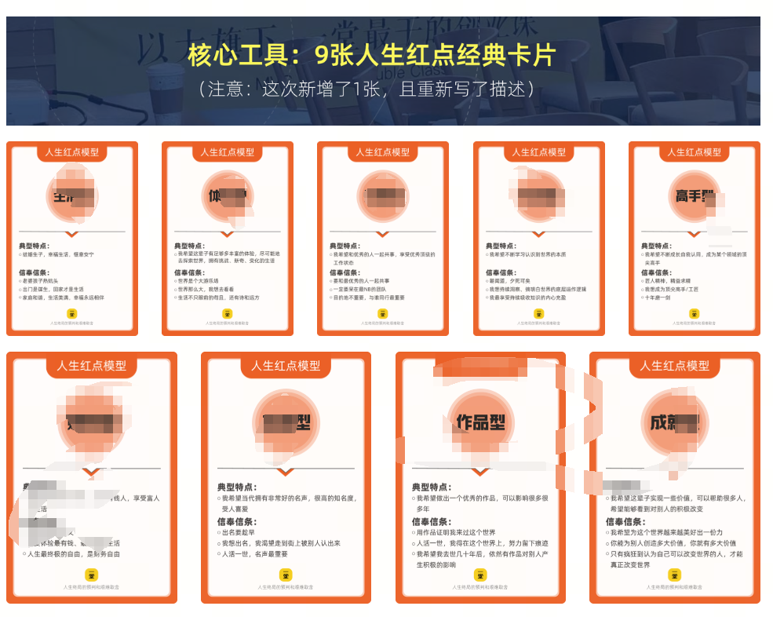

这节课，收到了数以千计的超级好评：

1. <em>我以为我的人生效率很高了，看到Truman的人生开源，我才发现</em>**<em><u>我还没入门</u></em>**<em>...</em>
2. <em>我的职业规划一直只有三五年，单这一节课，一下</em>**<em><u>把我的思维拉到了30-50年</u></em>**<em>。</em>
3. <em>这节课，我明天早晨就给我18岁的儿子听，这是他</em>**<em><u>最好的成年礼物</u></em>**<em>！！！</em>
4. <em>这是我在人生规划领域看到的，</em>**<em><u>最有"科学落地性"</u></em>**<em>的分析方法论。</em>
5. <em>听完课心有戚戚焉，原来我从来没给我的</em>**<em><u>人生建过模.</u></em>**<em>...</em>
6. <em>人生红点，弥补了我们在</em>**<em><u>义务教育阶段</u></em>**<em>，关于"人生追求"最缺失的一节课。</em>
7. <em>你可能不信，我曾一笔投资赚过200万，</em>**<em><u>竟然没有听这节课来的爽</u></em>**<em>...</em>
8. <em>........</em>

这节课是最不像一堂（人生课题）也最像一堂（体系建模）的一门课。

我曾写了八个字：**价值千金，分文不收。**

参加我请客计划，作为一堂的新朋友，我送你。

【限量🎁】报名尝鲜福利：**1）朋友免费免审入学   2）人生红点探索课   3）未来案例复盘会（可能）**

> <em>如果错过直播，找班主任扣口令：我请客</em>

我先初步预告到这里，具体的特权、等级奖励，课程最后我会花点时间给大家具体介绍。
