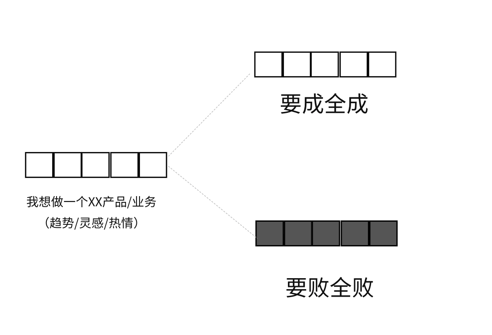
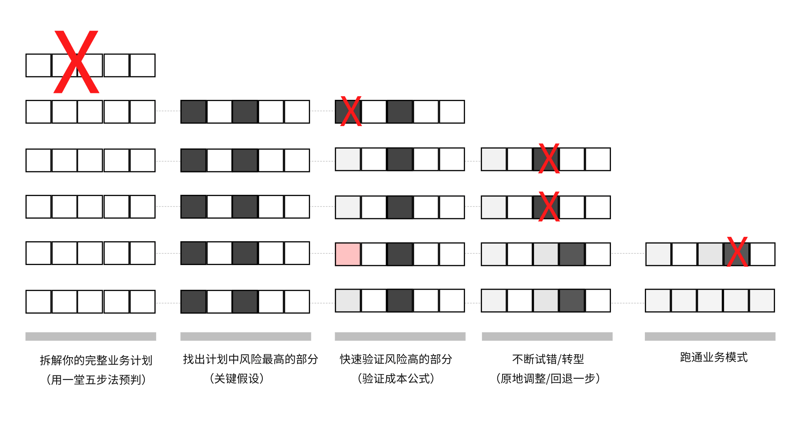
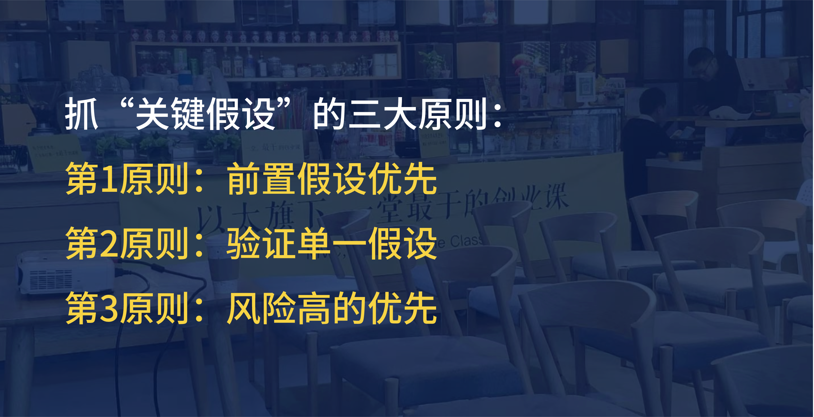
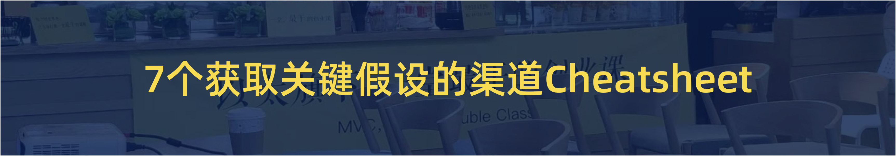
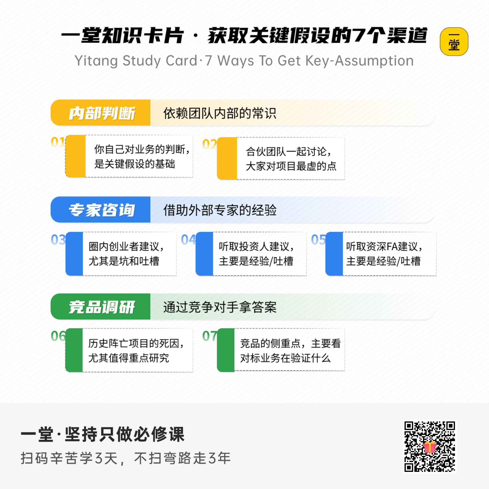
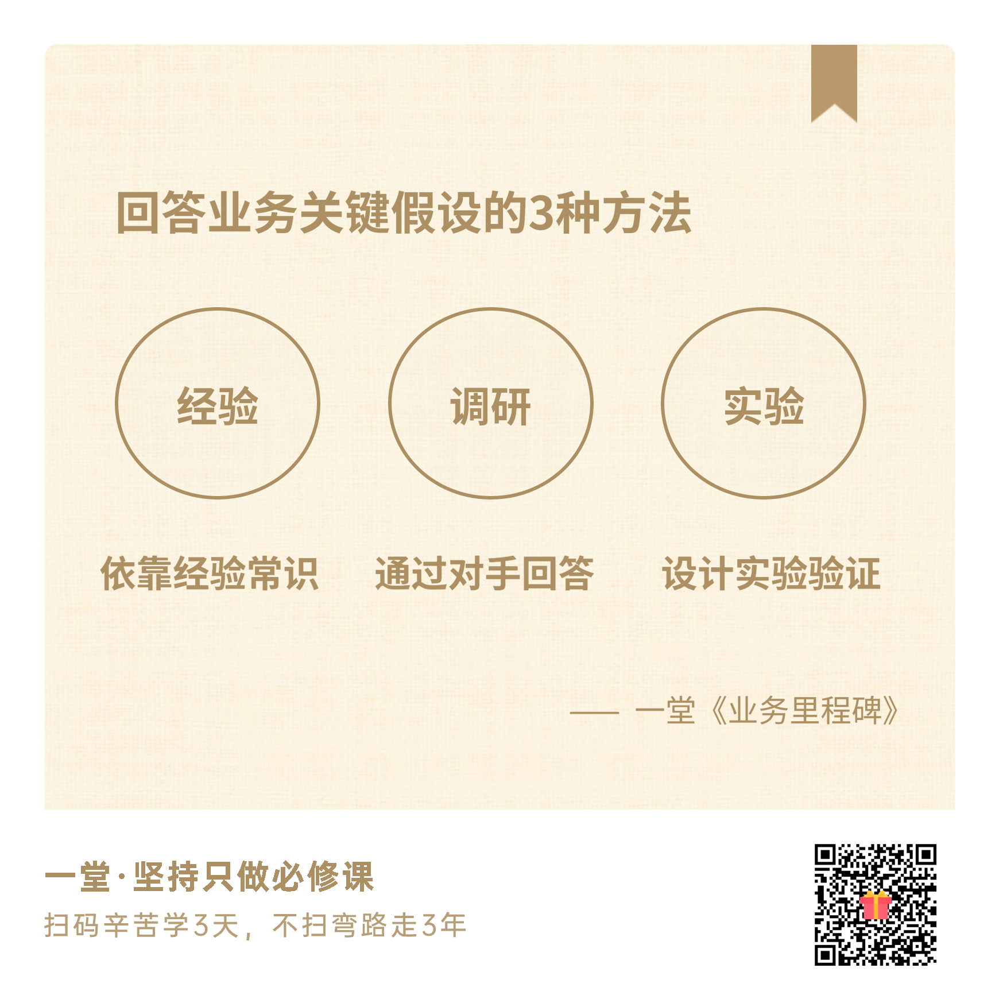
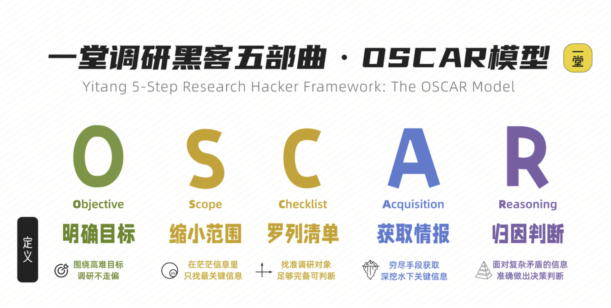
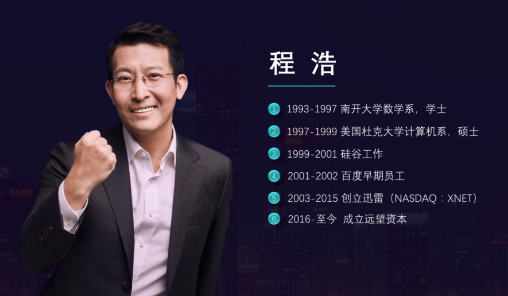
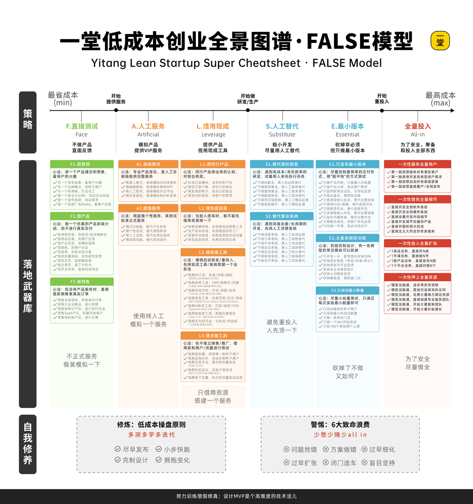
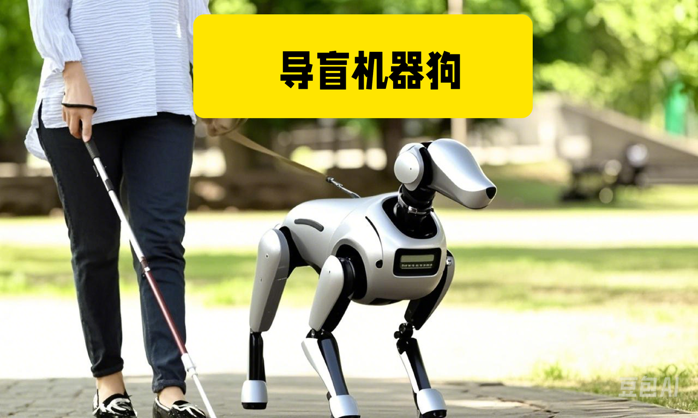

# 开始加速：当你学会了一堂五步法

## 第一次飞跃：进化出了逻辑链

【🙋‍♂️思考】提个问题，如果你想做一个未来规模化复制的业务，创业早期时候，假设你还在验证需求&解决方案阶段，需要尽早思考和判断后面的商业模式、增长和壁垒吗？要专注 还是要 提前？

————

【核心💡】所以，验证的一个重要原则是：

- 创业开始，在脑子里一定有全局思考，要对未来有所预判。#全局预判
- 打仗时候，把手里重点放在眼下真正重要的环节，专注执行。#重点执行

投资人问的壁垒问题，增长驱动力问题，天花板问题，都是在评估你的全局预判能力。

**英特尔前任董事长及CEO安迪格鲁夫："无法预测未来，不等于就此放弃计划"**

> **我们必须认清"无法预测未来"这个事实，但这并不等于"我们应该就此放弃计划"**。
> 首先，我们应该像消防队训练消防员一样地训练员工(因为消防员永远不知道下一场火灾发生在何时何地，所以他们时刻保持警惕，随时整装待发)

什么叫全局预判？

【核心💡】不能把创业搞成了开盲盒：**放弃旧地图，才能找到新大陆。**

我还见过不少团队，有些是5条一起验证，方案冗余不堪，还有一些是倒着验证，上来先直接验证增长和竞争问题，每次验证错误，都得推翻全部重来。

全局预判容易理解，如何重点执行呢？一个业务有几十个关键假设，哪些是关键假设呢？

## 第二次飞跃：善于抓主要矛盾

我们都说：**大胆假设、小心求证。**

但是商业太复杂了，一大堆的假设，哪些最值得优先求证呢？

【互动🙋🏻‍♀️】面对着我业务的一大堆假设，你觉得哪些可以算作是“关键假设”呢？

（也就是谁先谁后 => 先重点研究谁，暂时忽略谁）

如果我拆出来了10条假设，那怎么提炼其中最关键的呢？

1. **渠道可行：**靠2B渠道合作，可以通过协会等等方式完成规模化销售。
2. **供给不足：**北美市场有大量盲人需要导盲犬，但无法及时认领，供给严重不足；
3. **的确有效：**电子狗可以稳定使用，效率和体验接近真实导盲犬。
4. **体验良好：**整个全场景使用过程中，盲人体验自然舒适，没有显著硬伤和风险。
5. **付费可行：**一次性硬件销售+年费订阅制，普遍大家能接受。
6. **竞争优势：**靠技术+专利能形成竞争优势，未来成为头部品牌。
7. **销售策略**：采用“体验14天”的方式，可以非常有效的拉动销售。
8. **技术可行**：的确可以研发AI全天候陪伴，有效支撑盲人24h安全提升。
9. **集中城市**：需求主要集中在大城市中产人群，而非广袤的郊区和农村地区。
10. **续费率高**：因为数据和习惯的轻易成本，这个项目续费率很高。

如果你们选择Top3，第一阶段最最关键的假设，你们会选哪三个呢？

【提问🙋】谁能说说为什么？背后决策的方法论是什么？

————

【划重点💡】拆解“关键假设”第一原则：**前置假设优先**

这个我上面提到过，假设是有前后依赖关系的，**259最大的价值（之一），就是给了大家推理的前后依赖关系。**

如果你没验证需求存在，就不要过早关心商业模式和增长问题，按照从需求到方案的顺序验证，这样比较稳妥。通常，如果你的模式创新性很强，最大的风险往往就是没有需求。<u>所以通常我们建议，业务从研究用户需求开始。</u>

**【案例 ❤】**比如在一堂的案例研究里，大量项目犯过这个错误：

1. <em>有同学在快手给下沉市场卖自然美化妆品，最后发现完全反了；</em>
2. <em>有一个游戏社区一直想融资，认真算了天花板，VC完全不看；</em>
3. <em>有同学做了个社区人流智能管理系统，最后发现根本就不疼；</em>
4. <em>为藏獒定制的高端宠物粮，最后发现用户需求完全判断错了。</em>
5. <em>.....</em>

【划重点💡】拆解“关键假设”第二原则：**验证单一假设**

如果你的开发周期很长，而且创始团队花几个月的时间都在等待开发测试、在不断添加功能和打磨细节，那我提醒你一定要把上面讲过的认真看几遍，反思一下，你的关键假设是不是可以尽早验证。

【划重点💡】拆解“关键假设”第三原则：**风险高的优先**

如果你的方案里，有某一两项风险特别高，那你应该先验证这一两项。很多创始人都喜欢挑简单的验证，因为简单没什么风险，甚至会刻意回避高风险的部分。

你要知道，所谓关键假设，就是必须要一组全部成立，你的模式才成立。风险越高代表失败率越高，所以你一定逃不掉的，所以希望你尽量早验证，因为拖得越晚，损失越大。

如果你对自己的拆解能力没信心，我给你一个小的清单吧，也算是一份**业务作弊小抄CheatSheet**，你的关键假设，可以从这7个渠道快速提炼出来。

下面我快速读一遍这份**Cheatsheet，一共有7 个获取关键假设的渠道**

如果刚进入一个赛道，经验不多，可以用这7个策略，来找出你模式风险高的关键假设。

## 第三次飞跃：十倍速验证效率

希望你听课到这里，能深刻理解，做业务≠做一个产品出来，而把它理解成=验证关键假设，那么你已经具备把业务成本大幅降低的思考基础了。

下面，我们就来看看如何回答这些关键假设。

【🙋 提问】用哪些方法，可以回答我的关键假设呢？

————

如果你认真观察一下Y型负责人回答关键假设的过程，你会发现，他用可能不到1/5的时间，不到1/10的成本，就能完成一个更高质量的业务验证，背后其实用了3个方法。

第一个是常识，什么是常识呢？我举一些例子吧。

> 1. <em>做线下零售：毛利低于40%，根本建不起来分销渠道啊。#来自某知名操盘手失败后复盘</em>
> 2. <em>做养老院：重度依赖“关系”的业务，用关系来拿到便宜的租金。#来自某节调研案例课</em>
> 3. <em>做线下门店：是很辛苦的业务，毛利就那么多，需要精细化运营和管理 #来自很多互联网操盘手</em>

大家想过么？做业务最悲惨的结果是什么？

创了半天业，最后发现书里都有。（=一堂的课）

在竞争情报环节，很多业务负责人常常有三大误区：**以为原创，盲目自信，闭门造车**。

没有调查，就没有发言权。

没有调研，就没有决策权。

尤其是如果已经有很多很多同类项目死过一波了，你花时间去研究竞争对手死亡原因，比你辛苦开发一个APP再去重复验证，效率明显高太多了。

而这些年，我和身边的业务负责人，越是经验多、越是老道，越是习惯用调研的方式解决问题。

中心思想就是这句话：

上面这些，都是我们业务负责人的真实案例，他们曾经靠着数一数，跑一跑，蹲一蹲，或者是伪装一个身份去拜访，就学会了别人可能几万、几十万才能拿到认知。

**【必修课程🔓】**关于调研，目前市场上没有好的课程，我们一堂研发了应该是目前市场上唯一一套竞争调研的专题课。

我们把市场上顶级的调研专家，比如创业老兵、VC、咨询公司、研究机构等等，把大家的调研方法，提炼成了一个叫做“调研黑客”的方法论体系。

❤提醒：最近有一套情报调研必修课，我们搓了一组商业调查AI教练，如果感兴趣，后面有机会我们发给大家解锁和发放。

最后，还有一些假设风险很大，通过常识和竞争对手无法回答，这就需要你自己安排实验了，通过设计各种实验验证你的模式。

【🙋 提问】调研一下，大家读过《精益创业》吗？

我想请你思考一个问题：

> 两个操盘手，面对同一个要验证的业务题目，可能验证效率完全不同。
> 同样是开一家店，同样是一个企业服务陪跑产品，同样是一个账号定位；
> 为什么有人花了300万，半年的时间，而有些人只需要30万，甚至3万就能搞定？背后方法论的区别是什么？

这里我只想强调一点，好的验证，都是<u>小步快跑，低成本试错</u>，尽量避免在一开始，就做一个大而全的产品，打算一次性就把所有资源都赌上，把所有验证工作一次性都做了。

精益思维的本质，就是：**用少量的时间和试错成本，大幅降低系统性风险。**

在一堂的【验证模块】，我们邀请了程浩老师来共建讲这个话题，他应该是国内讲这个话题最知名最接地气的老师了，基于他的方法论，我们又补充了一系列的案例集和训练任务。

送给大家一张超级小抄吧，带着机器狗项目可以试一下：

