# 🎁中场划重点：这周学习的特别奖励

【重点💡】这是一次难得的跟数百上千操盘手，一起同班训练的机会。我们常常说“同侪(chai)效应”，身边优秀的同学，就是对自己最好的激励。

本期训练营，顺利毕业的同学，可以获得的特别奖励：

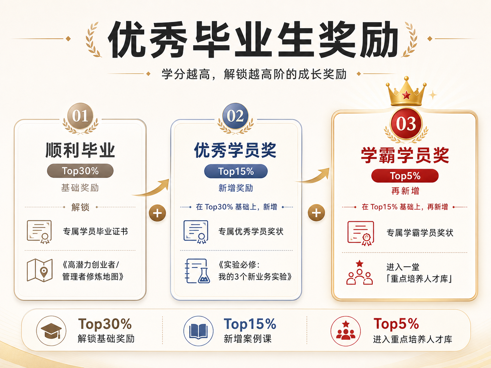

本期奖品清单：

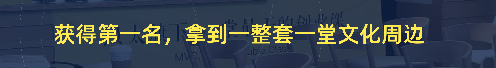

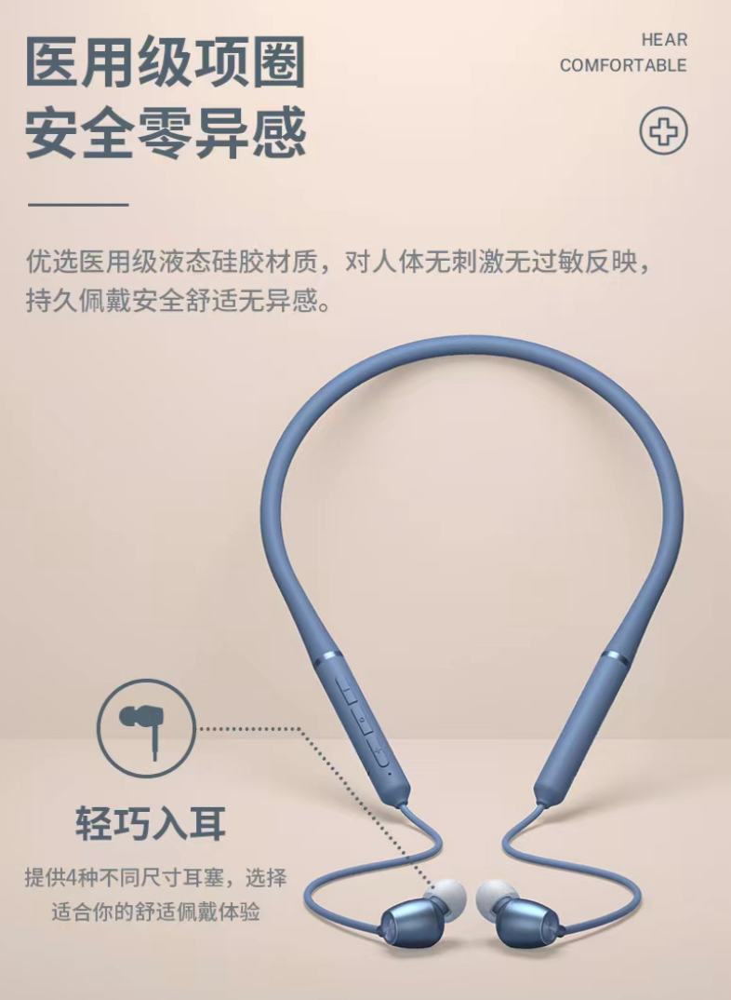

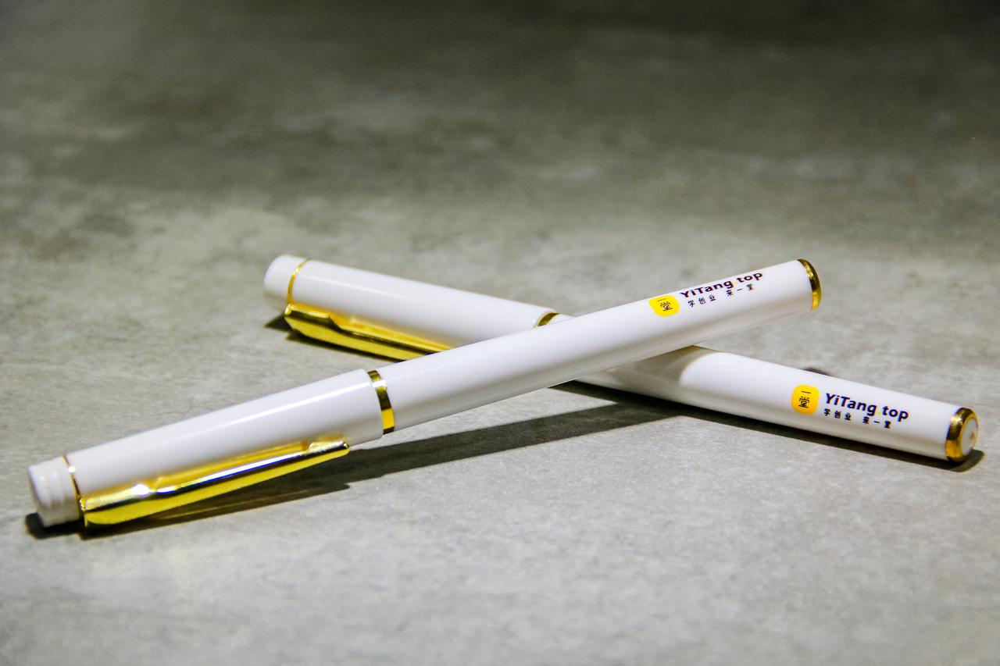

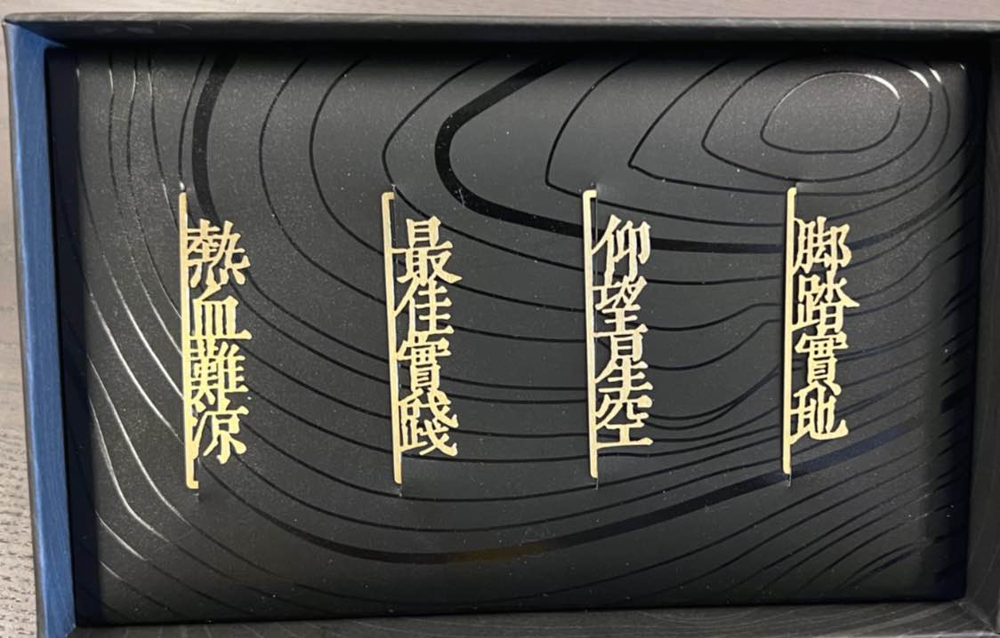

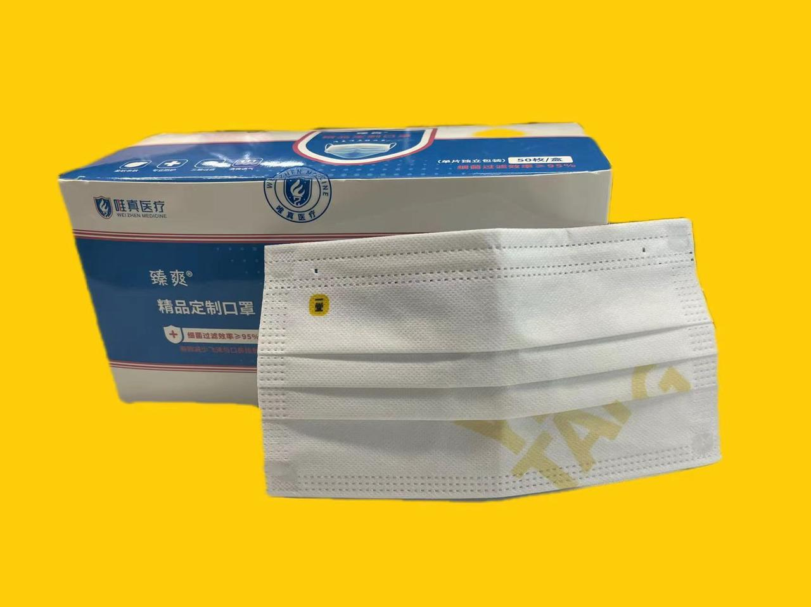

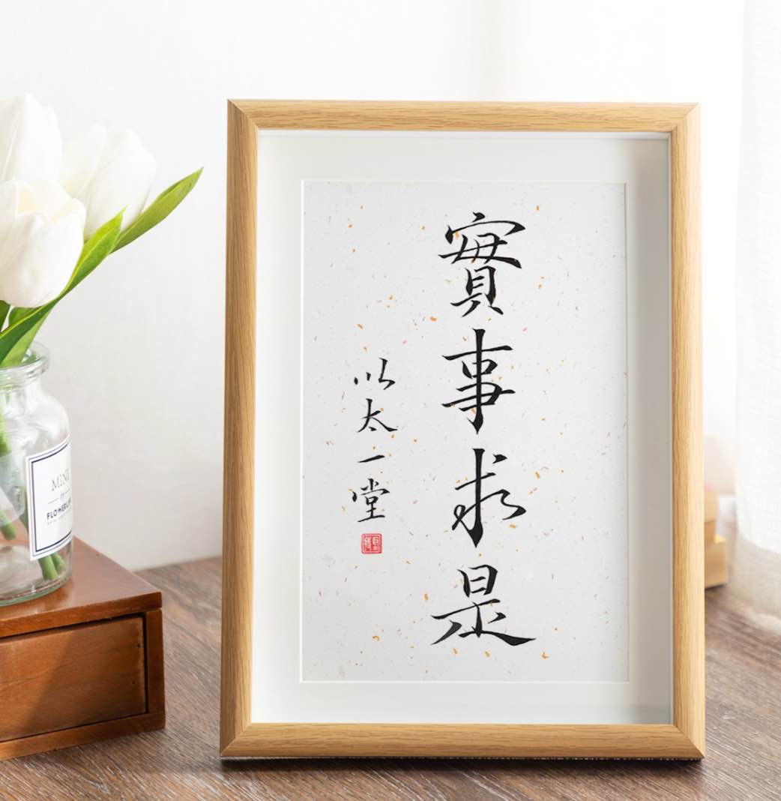

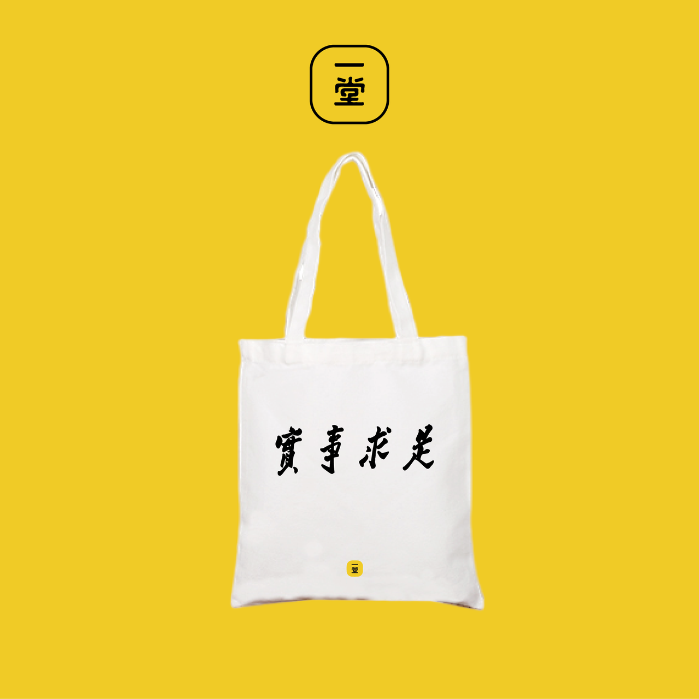

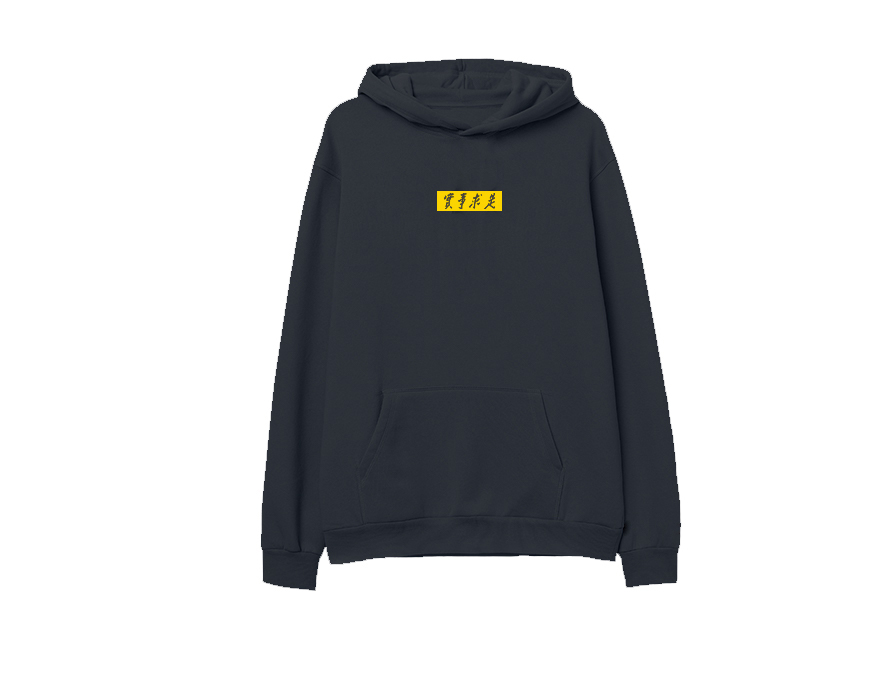

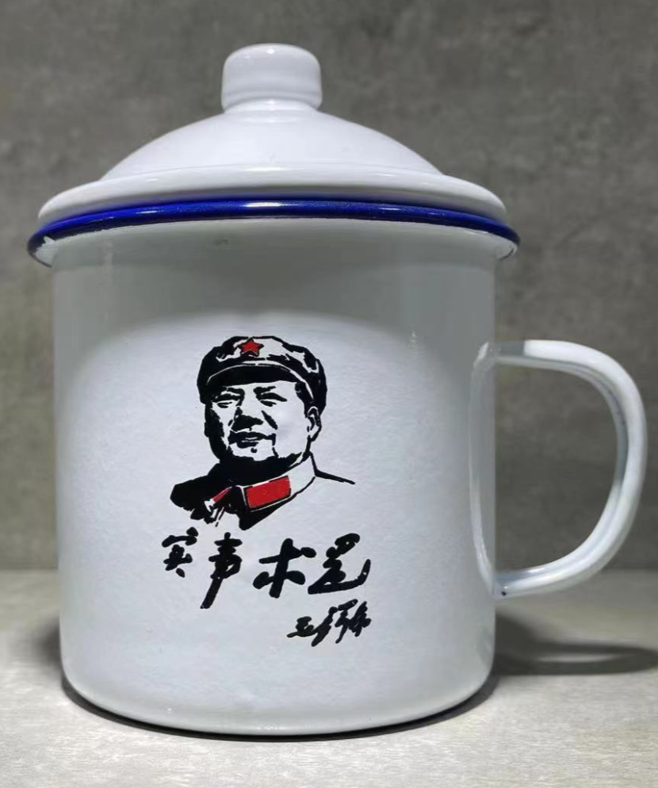

【🎁 奖励】Top15%多奖励一节课，5%进入重点人才库，第一名送我1小时1v1咨询。

【互动🙋】来来来，有没有勇气，大家一起来立一个本周学习Flag，你觉得你能拿到哪些奖励？

1. 争取**顺利毕业**：可以扣一个30
2. 争取**优秀学员奖**：可以扣一个15
3. 争取**学霸学员奖**：可以扣一个5

【**提醒**💡】想争取学霸学员的同学，建议大家提前规划，合理安排时间，利用好周五周六的时间，不要全卡在周日，提前安排，轻松自由，而且更容易拿到优秀作业和毕业奖励。

> 一定要扣：一定全部作业，一定作业，系统会智能识别，会努力推动你完成任务。

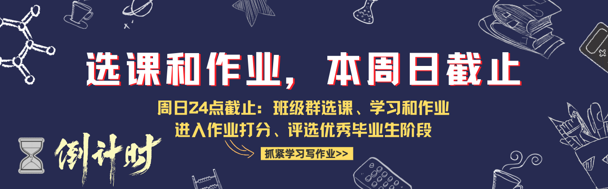

> 【嵌入第三方互动组件，见原文】

【划重点💡】如何争取业务训练名次：**多写作业、多完成训练、多提升复盘字数、多提升作业深度，多分享笔记，多在群里带动氛围。**

——————

诶，最近两年市场氛围太差了，今天扣了“我愿意”的同学，希望帮个忙：

明天拉群，讲讲今天的收获，分享笔记or给点背书，至少说一下我们不是骗子==。

哈哈哈，好，下面我们一起来上课。
