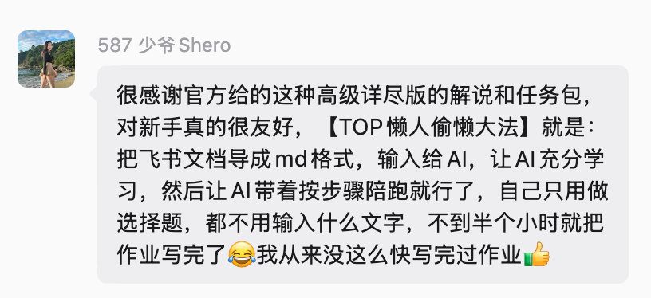

> 出自《一堂AI 任务书03：封装Skill技能》（[飞书原文](https://yitanger.feishu.cn/wiki/IZkcwFXtjixxiuk0wBQcimz6nGe)）

# 🟡 任务加油包


你可以直接挑战任务，但如果你刚刚入门，为了降低难度，我官方准备了5套“任务加油包”（点标题可直达👇）：

| **加油包**    | **定位**       | **什么时候使用**                     | **直达入口**                                                                                               |
| ---------- | ------------ | ------------------------------ | ------------------------------------------------------------------------------------------------------ |
| **加油包01**  | **🔴 纯新上手包** | **如果你完全没有经验，2分钟帮你消除行动恐惧和焦虑。**  | [纯新上手↗](https://yitanger.feishu.cn/wiki/IZkcwFXtjixxiuk0wBQcimz6nGe#share-TF9qdod2JoEIsVxkTq2cfP6Hnid) |
| **加油包02**  | **🟢 任务解读包** | **如果你想全面了解任务的价值和实现的最终收益。**     | [任务解读↗](https://yitanger.feishu.cn/wiki/IZkcwFXtjixxiuk0wBQcimz6nGe#share-QKhAdJNKHocXAoxnJ9wcYp3cneh) |
| **加油包03**  | **🟠 领先案例包** | **如果你想参考优秀同学案例，可学习，可临摹，可抄作业。** | [领先案例↗](https://yitanger.feishu.cn/wiki/IZkcwFXtjixxiuk0wBQcimz6nGe#share-FFMSdD6XVoAHX4xnpbrcgEBcnJg) |
| **加油包04**  | **🔵 专业方法包** | **如果你想系统掌握和训练，变成长期的核心能力。**     | [专业方法↗](https://yitanger.feishu.cn/wiki/IZkcwFXtjixxiuk0wBQcimz6nGe#share-FVAVdjIpboagq8x8ZZIcYyWinMf) |
| **加油包 05** | **🟣 卡点答疑包** | **一些常见的同学卡点、困扰和FAQ的答疑。**       | [卡点答疑↗](https://yitanger.feishu.cn/wiki/IZkcwFXtjixxiuk0wBQcimz6nGe#share-Kq7odUi47ogHyvxiIU6cCoPknuc) |

## 🔴 加油包1：纯新上手包


如果你完全没有基础，并且不知道如何下手，可以用下面最简单的方法先初步上手和完成新人从0到1的冷启动。

和你的Agent（workbuddy，codex）直接说：

```

查找xxx资料，帮我把这一类xxxx的工作封装成一个独立的技能。

```

> 鼠标滑动到代码块，右上角可点一键【复制】👆

封装完，尝试安排类似的任务，看AI是否自动调用和工作质量是否明显提升。

完成之后，恭喜你就解锁了封装Skill的从零到一。

## 🟢 加油包2：任务解读包


> 🟢 **一堂直播间版：**
> 
> - **回放：**
>   **https://air.yitang.top/live/YMzzk4BCnh**
> - **文稿：**
>   [揭秘直播：Truman的十大AI任务](https://yitanger.feishu.cn/wiki/Qqwjw4EPpi6IC6kQo8FcZLuZnzf)
> 
> **飞书妙记版：**[**任务 3 完整讲解**](https://yitanger.feishu.cn/minutes/obcnzzcpwmzf35jln738t649)

## 🟠 加油包3： 领先案例包


> ### 🟠 **《一堂同学领先案例/教程》**
> 🟠 在 AI场景梳理这个 方向，我们收到了**500+**相关的案例和教程，下面这**17份**作业是其中的佼佼者。欢迎大家可以参考这些优秀的一页纸。
> 
> **一页纸有三个价值：**
> 
> - **价值 1：**
>   帮大家去发现，帮大家去激发灵感，发现新的场景。
> - **价值 2：**
>   学习专业的工作过程，可以直接借鉴抄作业。
> - **价值 3：**
>   学习一页纸的写法，未来有机会挑战入围。
> 
> **🧾 李囧囧 ｜ 把JD变成生产可用的简历筛选Skill**　[**查看案例 ↗**](https://yitanger.feishu.cn/docx/FlS8dhWLfoGPvsxcYoScp0xDnsh)
> 
> 从JD提炼筛选规则，用真实简历校准，再串联邮箱、初筛、复核报告和平台标记，封装成Skill。
> 
> *一句话亮点：从 JD 提炼规则、用真实简历校准，再把邮箱到复核报告串成一条可生产使用的筛选链路。*
> 
> **🔬 Vikki ｜ 用控制变量法迭代 Skill**　[**查看案例 ↗**](https://yitanger.feishu.cn/docx/NpIsdSbzNoOEEHxZb6ici6hinMe)
> 
> 以口播改稿Skill为例，逐一更换模型、平台和Skill，并用盲测排查输出质量问题。
> 
> *一句话亮点：一次只改一个变量，配合盲测排查模型、平台和 Skill 差异，适合系统定位输出质量问题。*
> 
> **🧩 张伟强 ｜ 把专家脑子里的判断，做成一个 Skill**　[**查看案例 ↗**](https://yitanger.feishu.cn/wiki/DNzRwyvX8iwXgDkqQzccy043n9b)
> 
> 把招商研判经验拆成审慎表达、材料缺口、承诺核验、风险留痕；附v0.1提示词和评分标准。
> 
> *一句话亮点：把招商研判拆成表达、缺口、核验和留痕四类规则，并附提示词与评分标准，可直接复刻。*
> 
> **🎤 半肥猫 ｜ 我如何把一堂课变成一个AI工具**　[**查看案例 ↗**](https://yitanger.feishu.cn/wiki/R9NywV2i9izjuqkPd63cWuafn4g)
> 
> 从真实业务调研到PRD，并展示课程资料→诊断协议→Skill工程→反例测试→安装迭代的SOP。
> 
> *一句话亮点：从业务调研一路走到 PRD、Skill 工程和反例测试，给出把课程转成 AI 工具的完整 SOP。*
> 
> **📘 陈伟峰 ｜ Claude Skills 完全指南**　[**查看案例 ↗**](https://yitanger.feishu.cn/wiki/Ydrdwj4K7imJ3Nk9TsRcwc1Un4b)
> 
> 介绍Skill目录、SKILL.md触发说明、附属资料及渐进式读取。
> 
> *一句话亮点：把 Skill 目录、触发说明、附属资料和渐进式读取讲清楚，适合第一次系统理解 Skill 机制。*
> 
> **🧹 陈伟峰 ｜ 把臃肿 CLAUDE.md 拆成精简 Skills**　[**查看案例 ↗**](https://yitanger.feishu.cn/wiki/GTuVwNSfniPhQhkQ1lWc2QJWnzd)
> 
> 将臃肿CLAUDE.md中的独立流程拆为Skills，主配置保留索引。
> 
> *一句话亮点：把臃肿配置按独立流程拆成多个 Skill，主文件只留索引，解决上下文过重和职责混杂。*
> 
> **🧹 陈军峰 ｜ Vibe Coding Skills 机制（CodeBuddy版）**　[**查看案例 ↗**](https://yitanger.feishu.cn/wiki/SquuwOQFaiVcuOkgz7rcmSQSnBc)
> 
> CodeBuddy的Skills机制、目录组件，以及代码审查技能输出标准。
> 
> *一句话亮点：用 CodeBuddy 讲清 Skills 目录、组件和代码审查输出标准，适合工程团队照着落地。*
> 
> **🧭 陈伟峰 ｜ Skills 的21个应用方向**　[**查看案例 ↗**](https://yitanger.feishu.cn/wiki/VhdbweO0YiO0DVkTvkBcO9efnYb)
> 
> 列出品牌规范、文档模板、代码检查、数据分析等21类技能方向。
> 
> *一句话亮点：一次列出 21 类可封装技能方向，适合用清单快速发现团队里值得沉淀的高频动作。*
> 
> **📐 许晋诚 ｜ 如何创建一个好用的skill**　[**查看案例 ↗**](https://yitanger.feishu.cn/docx/PS6FdCvOloxivhxUakScqrXRnth)
> 
> 讨论上下文、知识库与Skill的关系，梳理个人技能创建和使用的实践。
> 
> *一句话亮点：把上下文、知识库和 Skill 的关系讲透，帮助从“会写提示词”走到“会设计技能”。*
> 
> **🧾 严振营 ｜ 「讲香skill」实践**　[**查看案例 ↗**](https://yitanger.feishu.cn/docx/IPomdx5zooE8H6x10PQcutOcnnb)
> 
> 用讲香课程资料生成Skill，逐轮检验理解、补最佳实践、场景诊断和反例，再修改SKILL.md。
> 
> *一句话亮点：用课程资料生成 Skill，再通过理解检验、最佳实践、场景诊断和反例逐轮修正 SKILL.md。*
> 
> **🧾 钟甜月 ｜ 用codex skill解决搜索爆款的问题**　[**查看案例 ↗**](https://yitanger.feishu.cn/wiki/JsYQwMO4jiN1cVkQ9vpcE7h6ndB)
> 
> 搜索多平台公开内容，采集可见数据、去重排序、拆解选题钩子并写入飞书表格。
> 
> *一句话亮点：把多平台搜索、去重排序和选题钩子拆解串成一条可执行链路，最后直接写入飞书表格。*
> 
> **🧾 许晋诚 ｜ 首批 AI Skill 开发指南：从需求到交付的五步实操手册**　[**查看案例 ↗**](https://yitanger.feishu.cn/wiki/CxI9wj1xBi1AlbkchqlcMl8bnff)
> 
> 需求分析、输入输出契约、技能设计、资源拆分、本地测试、发布交付的五阶段手册。
> 
> *一句话亮点：从需求到交付分为五阶段，明确输入输出契约、资源拆分和本地测试，适合当 Skill 开发 checklist。*
> 
> **📄 曾科燕 ｜ 用skill提升学习笔记记录慢的问题（持续迭代中）**　[**查看案例 ↗**](https://yitanger.feishu.cn/wiki/OYDSwcamIid06vkZNKScG4FwnyE)
> 
> 用Codex整理学习资料为清单体笔记，回写飞书，沉淀成场景适配和落盘规则。
> 
> *一句话亮点：用 Codex 把学习资料整理成清单体并回写飞书，重点沉淀场景适配和落盘规则，方便持续迭代。*
> 
> **📄 贾老师 ｜ Skill 架构师：让 AI 技能从"能用"变成"无法做错"**　[**查看案例 ↗**](https://yitanger.feishu.cn/wiki/SOd0wuNg8iPb5Vk8qKScgu9jn0d)
> 
> Skill架构师的触发、角色、原则、流程、资源五层模型，以及审查和创建模式。
> 
> *一句话亮点：用触发、角色、原则、流程、资源五层模型设计 Skill，再配审查模式，让技能从能用到不易做错。*
> 
> **📄 木东 ｜ 实践 Claude Code 一月，我终于复刻出了 Truman 的 Skill 生成器**　[**查看案例 ↗**](https://yitanger.feishu.cn/wiki/EfvtwTyKQiNwqekyp3BcLkWbnbb)
> 
> 从写书业务出发调研Skill最佳实践，交叉分析并迭代自己的Skill生成器。
> 
> *一句话亮点：从写书业务出发调研最佳实践，交叉分析后迭代出自己的 Skill 生成器，展示复刻方法而非只抄结果。*
> 
> **🧾 陈斌 ｜ 批量抖音数据采集 SKILL 制作过程**　[**查看案例 ↗**](https://yitanger.feishu.cn/wiki/BoZMw5hW5ifZsOkQkSScxrJqnWb)
> 
> 搭建抖音采集服务，并把数据采集动作封装为可通过一句指令调用的Skill。
> 
> *一句话亮点：把抖音采集服务封装成一句指令可调用的 Skill，覆盖搭建、采集和调用，适合做数据类技能参考。*
> 
> **🧾 胡喆骞 ｜ 如何把一次实战经验做成可复用的Skill**　[**查看案例 ↗**](https://yitanger.feishu.cn/wiki/KuHQwpYnmiNo1lkaTFpcVTPonBf)
> 
> 以IP商业模式调研为例：先做对一次，再抽象技能，独立审查，按问题升级。
> 
> *一句话亮点：以 IP 商业模式调研为例，先做对一次，再抽象成技能并独立审查，示范了从经验到资产的路径。*

## 🔵 加油包4：专业方法包


Skill和苦练基本功的逻辑特别特别像：


## 🟣 加油包 5：**卡点答疑包**


**❓实在想不出来，有哪些可以封装Skill的场景怎么办？**

> 😆 **实在想不出来可以封装Skill的场景怎么办？别担心！同学来支招儿：**
> 
> 感觉这个作业让我对自己有了新的认知😂 我直接把文档投给Workbuddy，发现他确实能查出来我想不到的、我经常调用的重复性工作😂 我一开始以为是【公众号写作】，但是workbuddy 调用出来说是【企业/个人背调】
> 
> 甚至包括我应该封装哪些不同的skill都给我整理出来了（详见以下截图）                    From 587少爷Shero❤️




> 👍 接楼上同学，也可以安装lark-cli，直接发飞书链接给Agent，就可以不用导出md文档
> 
> 附上介绍和安装指南：[飞书 CLI 能力介绍与最佳实践](https://yitanger.feishu.cn/wiki/ILuTww7Xcimb6GkhH0mcK2f4nS7)                                From 佳楠

还有另外一个支招儿同学（Sc）：


**❓这个任务太难了，不知道从何下手怎么办？**

> 😔 **提问：呜呜呜官方任务，太难了怎么办？**
> 
> 我提供一个思路给大家，虽然我还没开始动手，大家先想场景：
> 
> 我哪些是边界清楚，复用场景高的偏 sop 性质的工作，值得做成 skill，
> 
> 这篇文章喂给 ai，可以让 ai 带着自己一步一步的做
> 
> 回答From 长夜酱 同学❤️
> 
> （+1 确实是个很好的学习方式！AI 能给你及时反馈～）
> 
> 来自Shero同学的实践反馈：
> 
> 长夜酱同学真的教了我一个懒人偷懒大法啊笑死
> 
> 感谢长夜酱同学的启发哈哈哈哈

**❓没有参加过去年2025 AI大航海，没有AI 基础，怎么办？**

> 😶‍🌫️ **没有参加过去年2025 AI大航海，没有AI 基础，怎么办？**
> 
> 别担心！这份一页纸文档，有快速补课建议和资源合集：[AI 新人看这里｜2026 AI大航海快速补课清单](https://yitanger.feishu.cn/docx/EtAidxyOFoR11zxKAtTcc7Drnzb)

**❓怎么判断我的内容、实践的过程有没有缺漏、对不对？**

> 😆 **怎么判断自己填写的内容、实践的过程有没有缺漏、对不对，哪里可以迭代更好呢？**
> 
> **怎么拿到更多详细的反馈，一步一步检查修缮呢？**
> 
> 可以尝试把这个提示词发给其他AI，比如DeepSeek Harness，或者新建一个AI 对话窗口：
> 
> 学习一下这个内容：https://yitanger.feishu.cn/wiki/EHKcwpcOJiAHASkct3ZcwLs5nzh?from=from_copylink 帮我看看这个链接里我的内容：xxxxxxxxx（这里补链接：你和AI的对话封装skill过程，或者是你完成的任务包链接）
> 
> 这个是我的思考执行过程，帮我看看有没有缺漏、对不对，哪里还可以迭代？一步一步帮我检查一下，并给出具体的修缮建议，最好是我可以直接发给AI帮我直接修改的提示词，给我一些详细的反馈，尽量协助我把这个任务完成得更好。

**❓Skill太长读不出来，怎么办？**

> 🤔 **Skill太长读不出来，怎么办？**
> 
> 内容太长，点击查看👉👉 [🤔疑问解答：Skill太长读不出来，怎么办？](https://yitanger.feishu.cn/wiki/URLSwMS1ri0SlZkFwV1cIhFQnFg)
