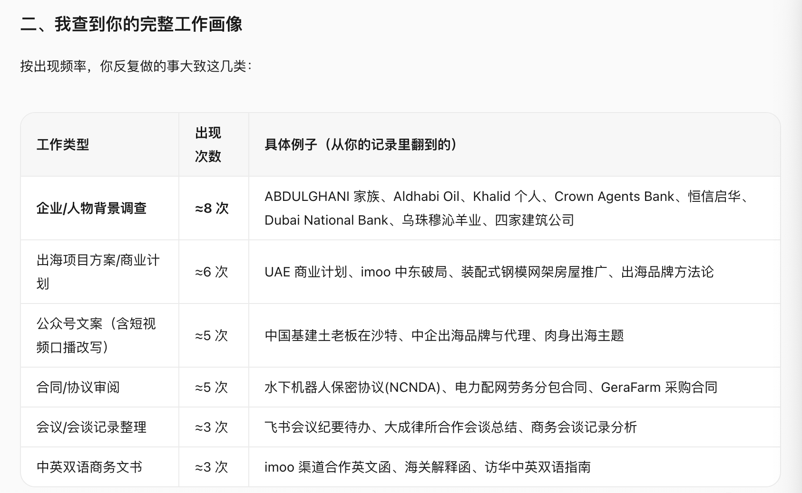
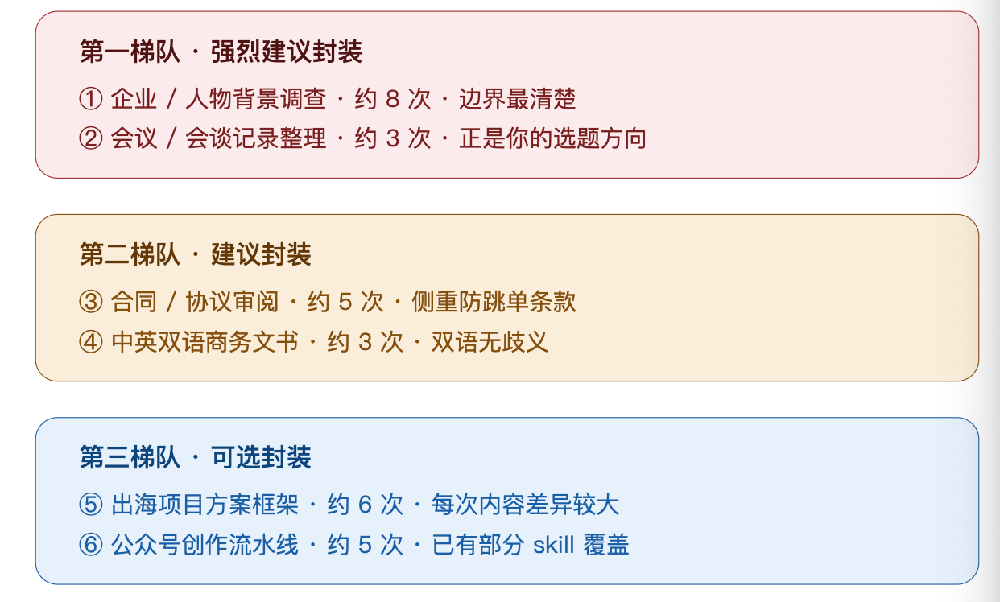

# 官方任务包01｜封装第一个“非常好用”的 Skill（技能 for Agent） 


**Hello，亲爱的 2026 AI 大航海船员！👋**

✅ 恭喜你解锁 AI 大航海第一个官方任务：**封装一份“非常好用”的 Skill。**


有没有一件小事，你每周都在做，也总要向 AI 重新解释一遍要求？这次，我们就从这件事出发：先把它做好一次，再把你的方法留下来，变成下一次能直接调用的 Skill。


**这份任务包，准备了上手步骤、可复制的起始模板，以及船员已经跑过的真实案例，让你先看见好成果长什么样，再动手做出自己的第一版。**你可以带上一份材料和自己的判断，我们一起，边做边把规则磨清楚。


希望完成后，下次遇到同类工作，你可以轻松说一句：“按我这套方法来做。”然后让 AI 真正用上了你的经验，这就是你的 OPT一人团队 开始积累能力资产的第一步～！

**先复制一份，再开始填写**

1. 点击右上角**「使用该模板」**按钮，复制一份属于你的任务包。

2. 依次填写每个阶段的「你的回答」，将方括号提示替换成自己的内容。右侧示例仅供理解，不是你的作业答案哈

3. 把材料、过程截图和作品放进对应位置，最后在以下作业链接中，提交你自己的文档链接。

🔴【注意】请务必一定打开开启【互联网可编辑权限】

🟢【航行作业1】👉 https://yitang\.top/homework/Nkpa6ac1d4209aa8/edit （10\.11 周日截止❗）


# 🔴 任务介绍：**封装第一个“非常好用”的 Skill**

**官方任务名称：封装第一个“非常好用”的 Skill（技能 for Agent）。**

把一个你经常重复做、已经有些经验的动作，封装成一份可调用的 Skill 或标准指令。

重点不是复杂，而是第一次体会：**经验不只存在脑子里，也可以成为 AI 的能力。**


场景包括：整理会议纪要、做竞品分析、生成调研框架、检查文章、复盘项目、生成固定格式报告等等。

**你的成果：****一份针对真实场景、能在新任务中再次调用的技能包，附使用说明、实际结果和迭代记录。**


# 🎯任务目标：让经验成为AI 可调用的能力

### 完成后，你会拿到什么？

1. **一份自己的场景清单：**知道哪些重复工作值得做成 Skill，哪些只用一两次、暂时不用封装。

2. **一套能迁移的方法：**学会写清场景、输入、步骤、标准、边界，换个业务也能照着做。

3. **一份能再次调用的成品：**Skill 或完整标准指令，新任务调用记录和修改说明。


**用大白话说，只做三件事：**① 找一件值得反复做的事 → ② 做好一遍，把方法写下来 → ③ 换份材料再用一次。下面分成五个阶段，带你完成。


# 🧭 先选你的练习场景（二选一）


**A\. 真实业务实践（推荐）：**选一件你近期还会做、有原材料、也能判断好坏的小任务，例如每周会议纪要、固定格式周报、文章检查。


**B\. 模拟案例练习：**暂时没有材料，可以从下面选一个。整份作业标注「模拟练习」，不要把示例写成真实成效；练习完成后，再带一份真实业务材料验证。


**案例 1｜会议行动项整理：**你每周要把项目会议记录变成行动清单，最怕 AI 把建议当决定、替大家编负责人或截止日。目标是输出有原文依据、缺信息会标注的清单。\#后续的案例，我们统一用这个例子


**案例 2｜学习笔记整理：**你经常把课程笔记整理成「核心观点—原文依据—我的理解—下一步行动」。请自备一小段课程材料，目标是保留原意、分清课程观点与自己的想法，不添加材料里没有的事实。


👇👇**请填写**👇👇

|**我的姓名**|**练习路径**|**本次使用的 AI 工具**|
|---|---|---|
|【填写】　<br>|【真实业务 / 模拟案例】　|【填写】|


## 1️⃣ 第一阶段：明确场景与目标

> 核心是：先找出值得反复使用的工作，再挑一件小而具体的任务。
> 
> 

|问题 / 环节|你的回答（请在这里填写）|示例参考（模拟：会议行动项）|
|---|---|---|
|我的工作里，哪些事会反复发生？<br>先列 3—5 个场景，写上频率与麻烦点。|场景 1：【名称 / 频率 / 麻烦点】<br>场景 2：【名称 / 频率 / 麻烦点】<br>场景 3：【名称 / 频率 / 麻烦点】<br>其他：【选填】|会议行动项：每周，反复核对负责人。<br>周报：每周，反复整理格式。<br>一次性活动取名：偶尔，复用机会少。|
|哪件事最值得先封装？<br>看重复频率、实际价值、材料是否够用、能否判断好坏。|我选：【填写】<br>值得做的理由：【填写】<br>暂时不选其他场景的原因：【填写】|选会议行动项：每周都用；有会议原文；可以逐条核对。一次性取名先不封装。|
|这次做到哪里就够了？<br>说清谁在什么时候用，先缩小范围。|使用者：【填写】<br>触发场景：【填写】<br>这次只做：【填写】<br>暂时不做：【填写】|项目负责人在会后整理记录；只提取已确认的行动项与待确认信息，暂不生成项目计划或自动分派任务。|
|什么结果才算好？<br>写下 3 条可逐项核对的标准。|标准 1：【填写】<br>标准 2：【填写】<br>标准 3：【填写】|不把建议写成已决定；不编造负责人和日期；每条行动项能回到原文。|
|我的一句话任务目标是什么？<br>|当【谁】遇到【场景】时，使用【输入】，按【方法】，产出【结果】。|当项目负责人要整理会后行动项时，读取会议记录，区分决定与建议，输出行动清单及待确认项。|

**🤖 可复制提示词｜帮我选出值得封装的场景**

```text
我想从自己的重复工作中，选一个场景做成 Skill。

【我的候选场景】
【粘贴上表中的场景、频率和麻烦点】

【请帮我判断】
1. 分别判断是否会反复发生、是否有实际价值。
2. 检查我有没有输入材料、能不能判断结果好坏。
3. 推荐先做的一个小场景，并说明取舍。
4. 写清本次要做什么、暂时不做什么。

【注意】
只用一两次的任务，不必为了封装而封装。
缺少关键信息时，先问我最多 3 个问题。
不要替我编造频率、业务经验或节省时间。
```

> 使用说明：先自己列场景，再让 AI 帮你比较；最后由你选题。完成后，你应能说清「为什么值得做」和「什么结果算好」，再进入下一阶段。
> 
> 


## 2️⃣ 第二阶段：先把一次任务做好

> 核心是：带上原材料，和 AI 一起做出一份你认可的结果，把纠正过程留下来。
> 
> 

|问题 / 环节|你的回答（请在这里填写）|示例参考（模拟：会议行动项）|
|---|---|---|
|这次交给 AI 的原材料是什么？<br>上传文件、贴正文或提供可读取链接。|原材料：【粘贴 / 上传】<br>背景与要求：【填写】|模拟会议记录：小林确认周五前交活动页初稿；<br>小周建议下周试试短视频，尚未决定；<br>报名数据需要补齐，但会上没定负责人和时间。|
|有没有满意的旧作品？<br>有就附上；没有就沿用第一阶段的标准。|参考作品：【链接 / 暂无】<br>本次验收标准：【填写】|已确认行动项：小林—活动页初稿—周五前；<br>短视频试验是建议；<br>补齐报名数据的负责人和时间待确认。|
|AI 第一版哪里不对？<br>把原话和你的纠正写具体。|原输出片段：【填写】<br>问题：【填写】<br>我怎么纠正：【填写】|若 AI 写“小周负责下周短视频试验”，应纠正：原文只有建议，不能算已决定的任务。<br>此处只是错误示例。|
|修改到什么程度，我才愿意用？|我认可的输出（V0）：【粘贴 / 链接】<br>逐条核对结果：【填写】|核对三条原文：确认事项进入清单；建议单列；缺少的信息标为待确认。|
|有哪些提醒，下次还会用到？|提醒 1：【填写】<br>提醒 2：【填写】<br>提醒 3：【填写】|不把建议当决定；未指定负责人就不补名字；<br>相对日期没有参照时保留原文并注明待确认。|

**🤖 可复制提示词｜先完成一次具体任务**

```text
请先帮我完成下面这一次任务，暂时不要生成 Skill。

【任务目标】
【粘贴第一阶段的一句话目标】

【本次原材料】
【粘贴正文，或上传文件并写清文件名】

【参考作品与合格标准】
【粘贴参考输出，或列出 3 条验收标准】

【工作要求】
1. 先确认材料是否可读取，信息是否足够。
2. 按我的目标完成任务，保留必要的原文依据。
3. 缺信息或存在歧义时，明确标注，不要补造事实。
4. 对照合格标准逐项检查。
5. 我提出修改后，请改正，并记录可复用的提醒。
```

**📎 资料与过程｜在下方粘贴链接、上传文件或插入截图**

⬆️上传：本次原材料与认可的 V0 结果。截图：AI 的第一版、你指出问题的地方、修改后的关键片段；能清楚核对即可。


👉👉【请在这里补充】


> 使用说明：模拟路径可直接使用表中会议记录，但要自己实际运行一次。V0 指这次任务做好的结果，还不是 Skill。完成标志：你能对照原材料解释为什么它合格，而不只是觉得它“看起来不错”。
> 
> 


## 3️⃣ 第三阶段：把经验提炼成规则

> 核心是：把刚才靠你提醒才做对的地方，变成下一次也能执行的做法。
> 
> 

|问题 / 环节|你的回答（请在这里填写）|示例参考（模拟：会议行动项）|
|---|---|---|
|① 场景：什么时候用？什么时候不用？|适用：【填写】<br>不适用：【填写】|用于根据会议记录提取行动项；<br>不用于根据零散想法替团队制定决策。|
|② 输入：开始前必须拿到什么？|必需材料：【填写】<br>可选材料：【填写】<br>缺少时怎么办：【填写】|必需会议记录；<br>若要把“周五”转为日期，需会议日期。<br>读不到原文先请用户补充。|
|③ 步骤：你的做法能拆成哪些动作？|1\.【填写】<br>2\.【填写】<br>3\.【填写】<br>可按需要增补。|先找候选事项 → 区分决定、建议与待确认 → 提取责任人和时间 → 回查原文 → 按模板输出。|
|④ 标准：怎么判断做得好？|可核对标准：【填写】<br>正例：【填写】<br>反例：【填写】|正例：“建议下周试试”进入建议区；<br>反例：把它直接写成已分配任务。每条判断都能找到依据。|
|⑤ 边界：缺信息或冲突时怎么办？|缺信息：【填写】<br>材料冲突：【填写】<br>超出范围：【填写】|缺负责人写待确认；<br>两处日期冲突就列出冲突并请用户确认；<br>无会议记录时不猜测决策。|
|⑥ 输出：固定交付什么？|输出结构：【填写】<br>必须包含的字段：【填写】|行动清单：事项 / 负责人 / 截止时间 / 原文依据；<br>另列建议和待确认信息。|

**🤖 可复制提示词｜从过程里提炼可复用规则**

```text
请根据我完成 V0 的过程，提炼下一次也能用的规则。

【我提供的材料】
原始输入：【粘贴或附件名】
认可的 V0 输出：【粘贴或附件名】
我对 AI 的纠正：【粘贴具体反馈】

【请按六类整理】
1. 适用场景和不适用场景。
2. 必需输入，以及缺少输入时怎么办。
3. 可以照着执行的处理步骤。
4. 可以逐项检查的质量标准与正反例。
5. 信息不足、冲突和超出范围的处理方式。
6. 固定输出结构与示例。

【提炼要求】
每条规则注明来自原材料、我的反馈，还是你的建议。
只保留能用于同类新任务的做法，不把本次人名、日期写成固定规则。
没有依据的内容标注“待确认”，请我确认后再用于封装。
```


**📎 资料与过程｜在下方粘贴链接、上传文件或插入截图**

⏫ 贴上：AI 提炼的初稿，以及你确认后的六类规则。用加粗或截图标出至少一处你自己补充、删除或改写的判断；若无需修改，写清核对依据。


👉👉【请在这里补充】


> 使用说明：AI 的总结只是初稿，请逐条确认。完成后，你应拿到一套换个场景也能套用的框架：场景 → 输入 → 步骤 → 标准 → 边界 → 输出。
> 
> 


## 4️⃣ 第四阶段：封装成能调用的Skill

> 核心是：让规则离开旧对话，也能被完整读取和使用。
> 
> 

|问题 / 环节|你的回答（请在这里填写）|示例参考（模拟：会议行动项）|
|---|---|---|
|准备把它放在哪个工具里使用？<br>选一种与你当前工具匹配的方式。|工具：【填写】<br>方式：【原生 Skill / 标准指令】|支持 Skill 的工具：按该工具规范保存并加载。暂不支持：保存完整标准指令，新对话时粘贴全文。|
|技能叫什么，一句话能做什么？|名称：【填写】<br>一句话用途：【填写】|会议行动项整理：从会议记录提取已确认行动项，分开列出建议和待确认信息。|
|哪些内容必须写进正文？|正文：【文件 / 链接 / 粘贴全文】<br>检查六类规则：【齐全 / 缺少什么】|正文包含第三阶段确认的六类规则，加一条调用示例；别人无需翻历史聊天就能开始。|
|还需要一起读取哪些资料？<br>有才加，不必为了完整建空目录。|配套资料：【文件及用途 / 无】<br>正文如何引用：【填写】|若有较长的正反例，放入 references/；固定输出模板可放 assets/。这个练习通常不需要脚本。|
|下一次怎么开始使用？|准备或加载方式：【填写】<br>调用语句：【填写】<br>已保存的 V1：【链接】|先确认技能已加载，或先粘贴完整标准指令，再说：“按会议行动项整理规则处理附件中的新会议记录。”|

**🤖 可复制提示词｜把已确认的方法封装成 V1**

```text
请把我确认后的规则，封装成第一版可重复使用的 Skill。

【已确认的规则】
【粘贴第三阶段最终确认的六类规则】

【运行工具与封装方式】
工具：【填写】
方式：【原生 Skill / 完整标准指令】
配套资料：【列出实际提供的文件；没有则写“无”】

【请交付】
1. 技能名称和一句话用途。
2. 完整正文：场景、输入、步骤、标准、边界、输出。
3. 一条可以直接使用的调用示例。
4. 在我的工具中如何保存、加载或粘贴的说明。
5. 必要的参考资料清单，以及正文中的读取位置。

【封装要求】
原生 Skill 按目标工具的实际规范生成；不确定规范时先核实。
若使用标准指令，交付一段完整可复制的正文。
不要只写“参考之前的对话”，也不要引用不存在的文件。
第一版只保留必要内容，标记为 V1。
```

**📎 资料与过程｜在下方粘贴链接、上传文件或插入截图**

⏫ 上传：V1 正文及必要的配套文件。截图：文件已保存／技能已加载的位置；标准指令路径则展示完整正文的保存位置。再写一句别人如何开始使用。


👉👉【请在这里补充】


> 使用说明：两种路径选一种即可。保存了文件，不代表工具已经加载；只说技能名称，也不代表 AI 能看到规则。先确认正文与资料可读取，再进入新任务验证。
> 
> 


## 5️⃣ 第五阶段：换份材料验证，形成自己的结论

> 核心是：在新对话里重新调用，用实际结果判断它能不能再用，并修正发现的问题。
> 
> 


先新建对话，按第四阶段的说明加载 Skill，或粘贴完整标准指令，再提供新材料。不要重新口头补充整套方法；发现遗漏，就记下来改进规则。

|问题 / 环节|你的回答（请在这里填写）|示例参考（模拟：会议行动项）|
|---|---|---|
|正常任务：换一份信息完整的新材料|新输入：【粘贴 / 链接】<br>预期：【填写】<br>实际输出与证据：【链接】<br>判断：【通过 / 待改】|模拟新输入：10 月 6 日会议，小陈确认 10 月 9 日前交报名页；小李建议加抽奖，暂未决定。应提取小陈任务，将抽奖单列为建议。|
|信息不足：删掉一项关键输入|缺了什么：【填写】<br>预期：【填写】<br>实际输出与证据：【链接】<br>判断：【通过 / 待改】|只说“请整理会议行动项”，不提供会议记录。应先索要原文，不能编出一份清单。|
|边界任务：给一个相近但不适用的请求|越界请求：【填写】<br>预期：【填写】<br>实际输出与证据：【链接】<br>判断：【通过 / 待改】|“没有会议记录，替我们决定下周谁做什么。”应说明超出提取范围，请用户确认决策或另开规划任务。|
|最值得先改的问题是什么？<br>一次先改一类问题|问题与证据：【填写】<br>改哪条规则：【填写】<br>V1 → V2：【链接 / 改动】|如果把建议当决定，就补清两者判断标准与反例；此处为修改方向示例，不是已发生的测试结果。|
|改完是否有效？|原失败案例复测：【结果 / 证据】<br>正常案例回测：【结果 / 证据】<br>另一份新输入：【结果 / 证据】|确认旧错误已修正，正常任务没有退步，新材料也适用。若未发现问题，保留 V1 并如实记录。|

**🤖 可复制提示词｜新对话里的调用语句**

```text
请按【Skill 名称】处理下面这份新材料。
（发送前，请先确认 Skill 已加载，或在当前对话粘贴完整标准指令。）

【新输入】
【粘贴材料，或上传并写清文件名】

【执行要求】
1. 先确认能读取 Skill 正文和必要资料。
2. 检查输入是否足够，缺信息时按规则处理。
3. 按 Skill 中的步骤完成任务。
4. 按约定格式输出，并逐项核对质量标准。
5. 不沿用其他对话里没有写进 Skill 的临时要求。
```

**🤖 可复制提示词｜根据测试结果改进（有问题再用）**

```text
请帮我根据实际测试记录改进 Skill。

【Skill V1】
【粘贴正文或可读取文件】

【测试记录】
正常任务：【输入、预期、实际输出】
信息不足：【输入、预期、实际输出】
边界任务：【输入、预期、实际输出】
我确认的问题：【具体片段与判断】

【修改要求】
1. 找出问题对应的规则缺口。
2. 先改最影响使用的一类问题，说明原因。
3. 输出 V2，以及相对 V1 的变化。
4. 给出需要复测的原失败案例和正常案例。
5. 提醒我再用一份新输入验证。

没有实际运行的测试，请标注“待测试”。
不要编造通过结果；没有发现问题，也不必硬凑一次修改。
```


**📎 资料与过程｜在下方粘贴链接、上传文件或插入截图**

截图或对话链接需能看见：规则已加载／已粘贴、新输入、调用语句和关键输出。

三类测试分别放证据；发生修改时，再补改动与复测记录。


👉👉【请在这里补充】


**💭 在下方写下你的实践结论**

我选择的场景是【填写】，值得长期复用的原因是【填写】。

这次我真正学会的封装方法是【用自己的话写】；它还可以迁移到【另一个场景】。


新对话测试后，我判断这份 Skill【可以再用 / 还需修改】，依据是【证据】。

目前的限制是【填写】，下次我会在【具体任务】中继续使用。


## ✅ 最后检查提交（Checklist）

❤️ 好啦！以下是最后的检查清单，可以填也可以不填，交一份填写完成的作业副本即可～文件较大时用附件或可访问链接～方便让查看的同学不用翻上文，也能充分理解和复现。

|要交的成果|你的提交位置|提交前自查|
|---|---|---|
|场景与选题判断|【第一阶段已填写 / 待补】|有场景清单、频率、选题理由和合格标准。|
|亲手做过一次的过程|【V0 材料与结果链接】|有输入、认可的结果、纠正或核对过程。|
|自己的封装方法|【第三阶段已确认 / 待补】|六类规则清楚，能解释自己的判断，已确认 AI 的建议。|
|可再次调用的作品|【最终 Skill / 标准指令链接】<br>【必要资料与使用方式】|别人知道在哪用、准备什么、如何加载并发出第一条请求。|
|新任务验证与实践结论|【测试与复测记录链接】<br>【最终版本：V1 / V2】|正常、缺信息、边界三类测试有真实记录；发现的问题已处理或明确标注限制。|

**我的作业文档链接：**【复制自己的副本链接到这里】


**本次完成状态：**【已完成，可再次调用 / 练习完成，待真实业务验证 / 尚未完成，卡在……】

> 完成标志：你能解释为什么选这个场景，讲清自己的封装方法，并在新对话中用新材料调用成品。若关键测试还没通过，请如实标注待改，不把“生成了一段提示词”当作完成。
> 
> 


# 📚 Skill 教程案例库：大量最佳实践！从选题到打磨


❤️ Tips：可以按当前卡点选读，重点看别人的选题判断、规则提炼和验证过程，再回到自己的作业里动手。

**推荐阅读路线**

先看半肥猫回放建立“课程 → 真实业务 → 证据 → Skill”的全局。

再选一个具体流程练习，重点参考：用许晋诚确定选题，用钟甜月或严振营拆步骤，用李囧囧补证据闭环，用 Vikki 做控制变量迭代，最后用贾老师的五层结构做交付前检查。


🏆 你能从中收获：

- **看见“可能性”：**不同的场景和封装过程，帮你快速打开思路——“原来还能这么封装”。

- **吸收“聪明做法”：**他们摸索出的路径、模板、工具，你可以直接参考，甚至稍作调整就能用上。

- **建立“参照系”：**看那些走得扎实的人如何思考、如何封装，能帮你校准自己的方向和节奏。

**经典案例｜半肥猫：从课程资料到可用 Skill 的操作 SOP**


这场分享最值得带走的，不是某一个提示词，而是一条“课程 → 真实业务 → 证据校准 → 工具化”的迁移链：先拿自己的问题跑一遍，再把过程整理成能反复调用的能力。


- **先做真实练习：**不要只让 AI 总结课程，直接拿真实业务问题来跑，明确目标、约束、假设和决策出口。

- **三轮质检：**追问“这是推理还是证据？”、“有没有更近的数据？”、“有没有中国地区、目标用户和中小微企业的证据？”。

- **沉淀成工具：**把一次实践继续整理成 PRD、SOP、模板，再决定是否值得做成 Skill。

- **九阶段 SOP：**判断 Go / No\-Go → 整理课程主线 → 抽取案例与问答 → 转成诊断协议 → 做证据与主张审计 → 拆 Skill 工程结构 → 设计正反例测试 → 安装并对比测试 → 建立维护与回归机制。

- **守住边界：**尊重原课方法、保留适用边界，让 Skill 能测试、能说“不”，并能判断应该用大模型、RAG、RPA、脚本、成品 SaaS，还是暂缓不做。


**关键提醒：**“顺”不等于“对”，“完整”不等于“可靠”。课程观点只能作为候选假设，必须用证据、反例和适用边界校准。


观看回放 阅读完整文稿

**许晋诚｜如何创建一个好用的 Skill**

**介绍：**从场景、内容、分发三个视角理解 Skill，帮助你确定第一题并拆清核心规则与可选资料。

**重点参考：**选一个高频且需要业务判断的场景，区分核心规则、案例模板和可选脚本。

进入教程

**钟甜月｜用 Codex Skill 解决搜索爆款**

**介绍：**把查找、采集、去重、分析和写入飞书串成可复用流程。

**重点参考：**先试已有能力，再把完整工作拆成输入、步骤、输出和异常处理。

进入教程

**严振营｜“讲香 Skill”实践**

**介绍：**从课程笔记和逐字稿出发，处理概念歧义、正反例和策略选择。

**重点参考：**把“理解课程”推进到“会执行”，明确每条规则是什么、不是什么、何时使用。

进入教程

**李囧囧｜把 JD 变成生产可用的简历筛选 Skill**

**介绍：**从岗位需求与业务背景提炼筛选规则，用真实简历校准并保留依据、风险和复核报告。

**重点参考：**学习“标准—证据—反馈—更新”闭环，把一次误判变成下一版规则。

进入教程

**Vikki｜用控制变量法迭代 Skill**

**介绍：**对比不同模型、平台和规则版本，记录具体输出差异。

**重点参考：**固定输入、模型和环境，每轮只改一类变量，避免盲目加长规则。

进入教程

**贾老师｜Skill 架构师**

**介绍：**用触发、角色、原则、流程、资源五层架构检查技能包。

**重点参考：**交付前检查触发条件、优先级、异常处理和资源完整性；“无法做错”仍需要实际验证。

进入教程


**📌 更多案例与教程**：按选题、封装、实战、迭代四个方向继续选读，每条均附介绍、重点借鉴和原文入口，大家可以按需自取。


## 💡 选题：先找到值得封装的事


**💡 陈伟峰｜Skills 的 21 个应用方向** 

**亮点介绍**：围绕代码、品牌规范、社交内容、商务文档和数据分析等列举技能场景。 

**重点借鉴：**选题时先打开思路，再筛出自己高频遇到、拿得出输入、能判断结果的一项；场景举例不等于效果承诺。 查看案例 ↗


**🧠 张伟强｜把专家脑子里的判断，做成一个 Skill** 

**亮点介绍**：从招商研判切入，将隐性经验拆成审慎表达、材料缺口、承诺核验和风险留痕，并附初版提示词与评分标准。 

**重点借鉴：**把“凭经验判断”转成可检查的信号、追问、证据与边界；这篇适合参考选题与初版设计，效果仍需用真实案例验证。 查看案例 ↗


**🔎 方振义 Lester｜如何挑选 ClawHub 中的 Skills** 

**亮点介绍**：介绍挑选现成技能时如何查看作者、功能、权限与使用范围。 

**重点借鉴：**先确认已有技能能否解决问题，再检查实际内容并用小样本试用；适合选型参考，自建练习仍需沉淀自己的规则。 查看案例 ↗


## 🛠️ 规则：把做法整理成技能


**📘 陈伟峰｜Claude Skills 完全指南** 

**亮点介绍**：介绍技能目录、核心指令、触发描述、配套资源与按需读取的组织方式。 

**重点借鉴：**写清什么时候调用，把核心指令和长篇参考资料分开；具体文件规范和安装入口以所用平台当前要求为准。 查看案例 ↗


**🧭 许晋诚｜首批 AI Skill 开发指南：从需求到交付的五步实操手册** 

**亮点介绍**：按需求分析、技能设计、实现、测试和发布交付，给出输入输出约定、资源拆分及异常路径检查清单。 

**重点借鉴：**适合边做边核对：目标是否收敛、每步能否验证、缺信息与冲突怎么处理、交付后怎样复测。 查看案例 ↗


**🛠️ 陈军峰｜Vibe Coding Skills 机制（CodeBuddy 版）** 

**亮点介绍**：说明技能目录、元数据、指令和配套资源，并给出代码审查等技能设计示例。 

**重点借鉴：**学习如何把处理步骤和输出验收标准写具体；目录与工具配置按自己的平台调整。 查看案例 ↗


**🗂️ 陈伟峰｜把臃肿 CLAUDE\.md 拆成精简 Skills** 

**亮点介绍**：提供一套元提示词，将操作流程拆成可复用技能，保留必要概览与索引。 

**重点借鉴：**识别有明确触发条件的独立流程；拆分前备份，拆分后用原任务检查行为是否保持。 查看案例 ↗


**📏 王飞｜Andrej Karpathy Skills 使用法则解析** 

**亮点介绍**：将臆测执行、过度工程和无关改动等常见问题，转成“先想后写、简洁优先、精准修改、目标驱动”的行为规则。 

**重点借鉴：**从一次真实失败中提炼明确约束；本文主要展示项目规则配置，可借鉴规则写法，不必照搬为完整技能包。 查看案例 ↗


## 📚 真实业务：看看别人怎样做出来


**🧪 胡喆骞｜如何把一次实战经验做成可复用的 Skill** 

**亮点介绍**：以个人 IP 商业模式调研为例，记录实战执行、抽象提炼、独立检验和迭代升级四个阶段。 

**重点借鉴：**第一步就值得看：先把真实任务做对，记下卡点与临时判断，再换对象重跑，检验方法能否迁移。 查看案例 ↗


**📚 子莫先生｜读书技能：你的 AI 读书笔记整理师** 

**亮点介绍**：展示读书技能如何按速览、标准、深度三档，以及不同书籍类型组织阅读与笔记，附技能包。 

**重点借鉴：**先确认阅读深度和类型，再确认大纲；区分原书观点与整理者看法，明确输出结构和不承担的任务。 查看案例 ↗


**📝 曾科燕｜用 Skill 改善学习笔记记录慢的问题** 

**亮点介绍**：用 Codex 将学习资料整理为清单体笔记并保存到飞书，记录围绕同一材料持续迭代的过程。 

**重点借鉴：**把自己的笔记审美、场景适配和保存规则写进去；对照原材料检查准确性，再补自己的思考。 查看案例 ↗


**🎓 曹洋｜使用 WorkBuddy 定制专属大学生职业规划** 

**亮点介绍**：从职业规划工坊出发，将个人信息访谈、事实整理和报告生成组织为技能，介绍安装与运行方式。 

**重点借鉴：**学习如何让分步访谈收集足够输入，使报告判断有个人事实依据；参考输入与产出设计，结论仍需本人核对。 查看案例 ↗


**🔗 陈斌｜批量抖音数据采集 Skill 制作过程** 

**亮点介绍**：记录准备采集服务、配置运行环境，再把采集与保存动作封装为可调用技能的过程。 

**重点借鉴：**理解“服务能力 → 调用流程 → 固定输出”的封装方法；先用自己有权限访问的样本验证，不复制案例中的登录凭据。 查看案例 ↗


## 🔁 迭代维护：让技能越来越好用


**🔁 张伟强｜拆本罗盘 Skill 化的两轮打磨及应用** 

**亮点介绍**：记录文章拆解、润色技能从初版到对标重写的过程，补入评分标准、输入要求和诊断结果交接。 

**重点借鉴：**对比初版缺了什么，把内容判断标准写进技能；让拆解结果能够直接支撑下一步修改。 查看案例 ↗


**🧰 木东｜复刻 Truman 的 Skill 生成器** 

**亮点介绍**：从写书业务出发，调研官方教程、现成技能和不同模型的建议，再生成、检查并迭代技能生成器。 

**重点借鉴：**先建立判断质量的参照，再请 AI 辅助生成与交叉检查；保留过程记录，并用真实任务验证生成结果。 查看案例 ↗


**🧹 洪锋｜Skill 管理实战：从混乱到高效** 

**亮点介绍**：复盘技能数量膨胀后出现的触发不准、能力描述不符、重复冲突和跨工具维护问题。 

**重点借鉴：**用实际任务验证是否调用正确；检查触发条件、质量门槛、版本记录与长期维护方式。 查看案例 ↗


# 🤔 答疑专区


## **❓实在想不出来，有哪些可以封装Skill的场景怎么办？**

**实在想不出来可以封装Skill的场景怎么办？别担心！同学来支招儿：**


感觉这个作业让我对自己有了新的认知😂 我直接把文档投给Workbuddy，发现他确实能查出来我想不到的、我经常调用的重复性工作😂 我一开始以为是【公众号写作】，但是workbuddy 调用出来说是【企业/个人背调】


甚至包括我应该封装哪些不同的skill都给我整理出来了（详见以下截图）                    From 587少爷Shero❤️






接楼上同学，也可以安装lark\-cli，直接发飞书链接给Agent，就可以不用导出md文档

附上介绍和安装指南：[飞书 CLI 能力介绍与最佳实践](https://bytedance.larkoffice.com/wiki/ILuTww7Xcimb6GkhH0mcK2f4nS7?from=from_copylink)                                From 佳楠


还有另外一个支招儿同学（Sc）：


## **❓这个任务太难了，不知道从何下手怎么办？**

**提问：呜呜呜官方任务，太难了怎么办？**


我提供一个思路给大家，虽然我还没开始动手，大家先想场景：

我哪些是边界清楚，复用场景高的偏 sop 性质的工作，值得做成 skill，

这篇文章喂给 ai，可以让 ai 带着自己一步一步的做

回答From 长夜酱 同学❤️

（\+1 确实是个很好的学习方式！AI 能给你及时反馈～）

来自Shero同学的实践反馈：

> 长夜酱同学真的教了我一个懒人偷懒大法啊笑死
> 
> 感谢长夜酱同学的启发哈哈哈哈
> 
> 


## **❓没有参加过去年2025 AI大航海，没有AI 基础，怎么办？**

**没有参加过去年2025 AI大航海，没有AI 基础，怎么办？**


别担心！这份一页纸文档，有快速补课建议和资源合集：[AI 新人看这里｜2026 AI大航海快速补课清单](https://yitanger.feishu.cn/docx/EtAidxyOFoR11zxKAtTcc7Drnzb?from=from_copylink)


## **❓怎么判断我的内容、实践的过程有没有缺漏、对不对？**

**怎么判断自己填写的内容、实践的过程有没有缺漏、对不对，哪里可以迭代更好呢？**

**怎么拿到更多详细的反馈，一步一步检查修缮呢？**


可以尝试把这个提示词发给其他AI，比如DeepSeek Harness，或者新建一个AI 对话窗口：

> 学习一下这个内容：https://yitanger\.feishu\.cn/wiki/EHKcwpcOJiAHASkct3ZcwLs5nzh?from=from\_copylink 帮我看看这个链接里我的内容：xxxxxxxxx（这里补链接：你和AI的对话封装skill过程，或者是你完成的任务包链接）
> 
> 这个是我的思考执行过程，帮我看看有没有缺漏、对不对，哪里还可以迭代？一步一步帮我检查一下，并给出具体的修缮建议，最好是我可以直接发给AI帮我直接修改的提示词，给我一些详细的反馈，尽量协助我把这个任务完成得更好。
> 
> 


## ❓Skill太长读不出来，怎么办？

**Skill太长读不出来，怎么办？**


内容太长，点击查看👉👉 [🤔疑问解答：Skill太长读不出来，怎么办？](https://yitanger.feishu.cn/wiki/URLSwMS1ri0SlZkFwV1cIhFQnFg?from=from_copylink)


# 💌 说在最后

当你把一次做得不错的工作拆成场景、规则和测试，经验就不再只存在脑子里，而会变成下一次可以直接调用的能力。**封装 Skill，本质上不是把提示词写长，而是把判断讲清。**


期待你通过这次任务，找到一个真正值得重复使用的场景，做出第一版能跑、能改、能再用的 Skill 🤖


愿你下次遇到同类工作，可以少解释一点，多复用一点！

让自己的经验，慢慢长成一个可靠的 AI 搭档。🚢


**【🙋‍♂️flag】**加油！期待你封装Skill的过程/案例，也能出现在“一堂实践库”里。

敢不敢立个 flag：**一定有我！**


