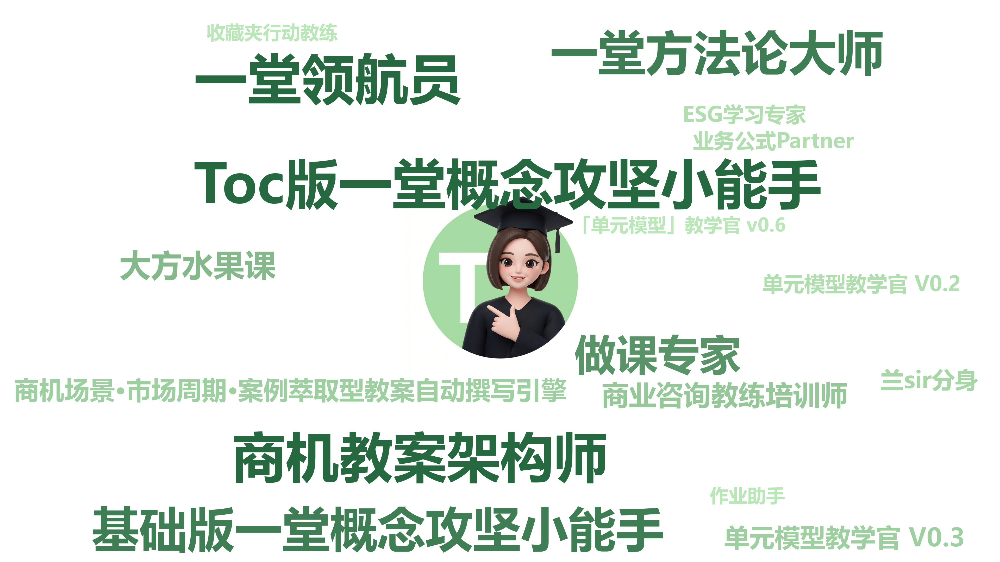
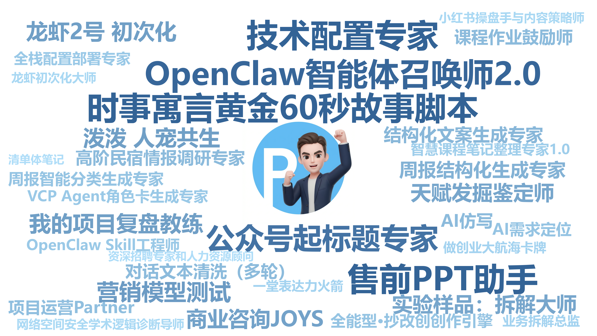
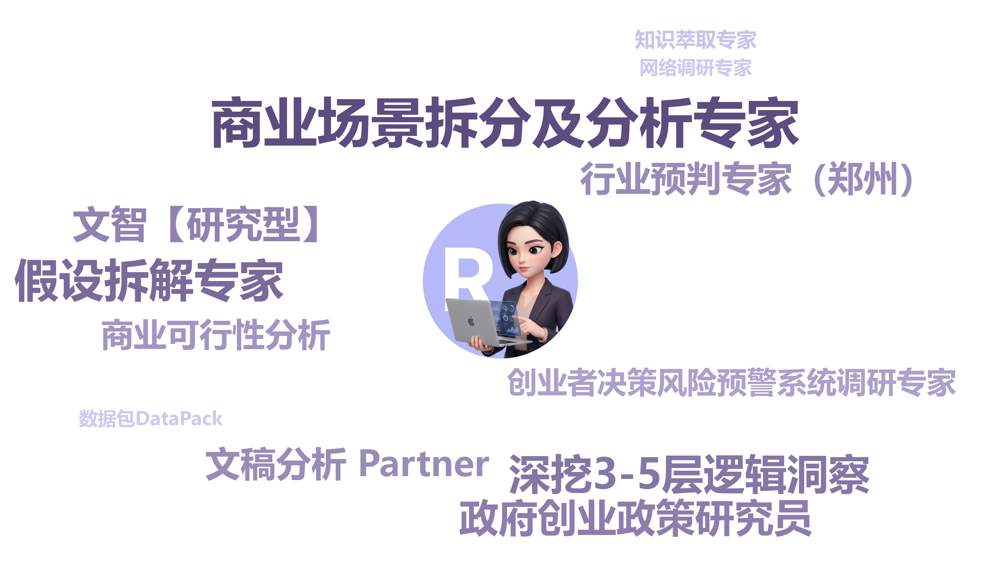
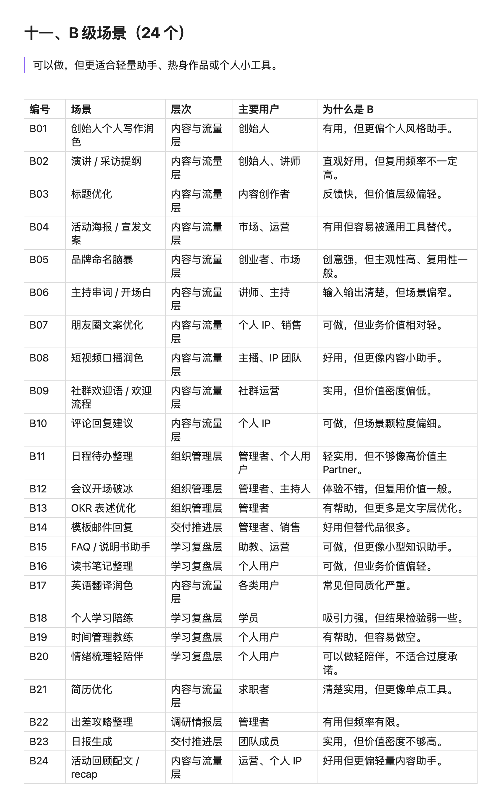

# 官方任务包02｜封装一个 Partner（系统提示词） 

**🎉 你好呀，2026 AI 大航海船员！**

✅ 欢迎你解锁第二个官方任务：**封装一个真正好用的 Partner。**


这份任务包会陪你挑一个真实的小场景，把角色、方法、资料和判断标准封装进一个可以反复召唤的 AI Partner。下次遇到同类问题，它能主动引导你，把任务一步一步做好。


你可以把它想成自己的工作伙伴：知道服务谁、怎么与你配合、按什么标准做事，也有一个下次找得到的入口。先选一件小事，边做边打磨，让它真的能帮上忙。我们一起通过这个任务包，让你的 OPT 一人团队，多一位懂业务、懂方法、找得到、用得上的伙伴。🚢


**使用方式：先复制，再填写**

- 点击右上角**「使用该模板」**，保留一份自己的作业。

- 按六个阶段填写「你的回答」替换方括号内容；右栏的模拟示例只帮助理解。提示词可直接复制，记得先补齐自己的材料。

- 将过程、对话截图/内容放进对应位置，最后在以下作业链接中，提交你自己的文档链接。

🔴【注意】请务必一定打开开启【互联网可编辑权限】

🟢【航行作业1】👉 https://yitang\.top/homework/Nkpa6ac1d4209aa8/edit （10\.11 周日截止❗）

**我的任务进度**

* [ ] 选定一个细分场景

* [ ] 准备好方法、数据包和质量标准

* [ ] 完成一次真实任务并提炼流程

* [ ] 配置并重新召唤自己的 Partner

* [ ] 完成测试、迭代和提交


# 🔴 任务介绍：封装一个 Partner

**官方任务名称：封装第一个好用的 Partner（系统提示词）。**

它可以是决策助理、写作助理、学习教练，也可以是情绪和职业支持者。关键是有明确角色，能匹配一个具体工作的协作需求。


**你的成果：**一份能在新对话中再次使用的 Partner 配置，包含系统提示词、必要资料、使用说明，以及真实运行和改进记录。


**封装，就是把过去的经验抽离出来，变成未来可复用的能力。**

先把一次对话做成有效解法，再把有效解法固化。它可以很轻，几句话、一个数据包或一小段流程，只要确实有用，就值得保存。

|三个要素|要回答的问题|这次留下什么|
|---|---|---|
|🎯 场景|谁在什么节点，会反复遇到什么问题？|一个细分场景和清晰边界|
|🧠 解法|凭什么把它做好？需要什么方法、数据和标准？|系统提示词＋必要数据包＋处理流程|
|📍 触点|下次从哪里找到、如何直接调用？|YAI 自建 Partner，或所用工具的固定系统指令入口|

系统提示词可以固定角色、任务、流程和输出格式；Partner 还可能结合模型、知识库、参数、数据包和产品入口。按场景需要选择这些能力，不必第一版就把所有功能装满。


# 🎯 任务目标：让好方法变成长期伙伴

### **完成后，你会拿到什么？**

1. **一个值得封装的场景：**场景清单（真实/重复/高价值）和身份卡，写清角色、内核、边界和交付标准。

2. **一套能迁移的封装方法：**用双三角准备要素，跑通解法，把有效规则和关键确认节点写进系统提示词。

3. **一位能再次调用的 Partner：**完整配置、必要数据包、固定入口，以及新任务测试和迭代记录。


**用大白话说，只做三件事：**① 找到值得请Partner帮忙的一件事 → ② 一起做好一次，把有效做法留下来 → ③ 装进固定入口，换份材料再试，确保后续可复用。


# **🧭 先选你的练习场景（二选一）**


**A\. 真实业务实践（推荐）：**选一个近期还会发生、拿得出材料、能判断结果好坏的小场景，例如课程方法应用、文章修改、学习训练或方案推演。


**B\. 模拟案例练习：**暂时没有业务材料，可以选下面一个，在下方的练习路径选择「模拟案例」。


**案例 1｜课程应用教练（示例）：**你学过一门课，却不知道怎么用在工作中。带上一段课程材料和一个真实小问题，让 Partner 先了解情境，再引导你尝试、反馈纠偏，最后形成一个可执行动作。


**案例 2｜文章修改助理：**你经常要写活动介绍或产品说明，初稿却容易重点不清、读者看不懂。请准备一份初稿、目标读者和一份满意的参考文章，让 Partner 先与你确认文章要解决什么问题，再定位关键问题、讨论修改方向，最后给出修改稿与理由。


👇👇**请填写**👇👇

|**我的姓名**|**练习路径**|**本次使用的 AI 工具**|
|---|---|---|
|【填写】　<br>|【真实业务 / 模拟案例】　|【填写】|


## 1️⃣ 第一阶段：明确场景，设定角色和边界

> 核心是：先确定这个Partner帮谁解决什么问题，再把第一版的范围缩小。
> 
> 


先发散 3—10 个想法，再结合频率、价值和自己能否判断质量做减法。

**关键是找到一个真实的、想优化的、价值比较大的细分 Partner 场景**，建议优先把完整工作流中最有价值的一小段做好，例如先做“PPT 内核打磨助手”，专门打磨课纲或汇报大纲。

|TCPR 角色|它怎样与你协作|可考虑的细分场景|
|---|---|---|
|T｜教学型|教会你、训练你、提升能力|概念讲解、入职训练、学习教练|
|C｜咨询型|与你讨论、判断、推演方案|ROI 决策、职业探索、方案诊断|
|P｜实践型|接收材料，直接产出结果|周报整理、文案清洗、大纲生成|
|R｜研究型|调研、建模、研究规律、结构化知识|竞品定位、行业研究、资料结构化|

**TCPR 是为了帮助你判断“这个问题该找谁”。**

一个 Partner 可以有组合能力，但先写清主要角色：它到底是在教你、陪你判断、帮你干活，还是帮你研究？


**🔎 选题灵感图｜先看看大家探索的场景，再回到自己的工作中挑一个：**










**这是AI灵感闪现的清单，供参考和启发你梳理自己的场景：**





|问题 / 环节|你的回答（请在这里填写）|示例参考（模拟：课程应用教练）|
|---|---|---|
|我有哪些反复遇到的问题？<br>> 列出3\-10个想法，并注明主要角色和价值<br>> <br>> |想法 1：【场景 / 频率 / TCPR / 高中低价值】<br>想法 2：【填写】<br>想法 3：【填写】<br>其他：【按需增加】|课程方法应用：每周学习后，T 为主，价值高。<br>文章修改：经常，C / P 为主。<br>一次性祝福语：偶尔，P 为主。|
|最值得先做哪一个？<br>> 先选 TOP1\-3，再决定本次只做哪一个<br>> <br>> 最终选择的细分 Partner 场景是什么<br>> <br>> 为什么这个场景真实、有价值、值得优化<br>> <br>> |我的候选 Top 1—3：【填写】<br>最终选择：【填写】<br>选择理由：【填写】<br>|选课程方法应用：学过的方法常停在笔记里；<br>有课程材料，也有当前要解决的小问题；<br>能对照原文检查是否用对，并实际做一次。|
|Partner 身份卡是什么？<br>> 给这个 Partner 起一个正式名字，然后设定它在 TCPR 中更像什么角色<br>> <br>> |Partner 正式名称：【填写】<br>TCPR 角色定位（T/C/P/R）：【填写】<br>目标用户 / 使用对象：【填写】<br>细分场景：【填写】|名称：课程应用教练。<br>T 教学型为主、C 咨询型为辅；<br>面向学完课程、希望把某个方法用到实际工作的同学。|
|内核和边界是什么？<br>> 内核：它主要解决的问题<br>> <br>> 边界：主动砍掉一些功能要素/场景，保持聚焦，主动不做什么？砍掉哪些非场景？<br>> <br>> |内核：主要解决【填写】<br>边界：暂不处理【填写】|内核：帮助学员理解一个课程方法，在具体场景中亲手尝试，依据材料反馈纠偏，形成行动。<br>边界：本次只练用户访谈提问；不代写整份业务方案，不把补充建议冒充课程结论。|
|什么结果算合格？<br>|交付物：【填写】<br>标准 1：【填写】<br>标准 2：【填写】<br>标准 3：【填写】|交付“方法与出处—我的应用练习—反馈与改稿—下一步行动”。<br>学员能用自己的话解释方法；练习符合课程规则；行动明确做什么、何时做、留下什么证据。|
|用一句话定义这个Partner|当【谁】遇到【具体问题】时，Partner 作为【角色】，使用【输入与方法】，帮助得到【可验收结果】。|当学员学完用户访谈方法、准备和用户交流时，课程应用教练结合课程片段与业务问题，引导学员写提问、检查并改进，形成可以实际使用的访谈提纲。|

**🤖 可复制提示词｜一起挑选题目**

```text
请帮我选一个值得封装的 Partner 场景。

【我的工作与候选想法】
【粘贴候选场景、频率与当前卡点】

【请依次协助】
1. 按 TCPR、频率、价值、材料是否可得、质量能否判断进行比较。
2. 找出过大或过泛的想法，建议如何缩成一个小场景。
3. 推荐 Top 1—3，说明取舍，等我选定一个。
4. 整理身份卡：名称、角色、用户、触发场景、内核、边界、交付标准。

【注意】
不要替我编造业务事实或使用频率。
只问影响当前选题判断的关键问题。
```


**📎 把资料与过程放在这里**

⬆️ 填写上表即留下场景清单和身份卡，补一段你从“大问题”缩小到“具体场景”的讨论文字或截图。


👉👉【请在这里补充，可以粘贴链接、上传文件或插入截图】


> 使用说明：先发散，再取舍；不要直接让 AI 替你定一个万能角色。
> 
> 完成后，你能明确说出“做什么、为什么值得做、暂时不做什么”。
> 
> 


* [ ] 我选定了一个细分场景，并写清角色、内核、边界和合格标准。


## 2️⃣ 第二阶段：完成“草稿版双三角”（5mins 预判思路）

> 核心是：先用双三角六个点整理初步思路。按照直觉和过去经验，把短平快、能想象到、符合经验和直觉的内容先写下来；先不追求完美，先写 3\-10 个关键词和关键要素。
> 
> 


**🔺 一堂双三角参考图｜边看图，边把六个角换成自己的业务内容：**


**5\-10mins 快速填写区：**

- 审美：

- 体系：

- 创造力：

- 场景：

- 数据：

- 基本功：

- 草稿版关键词（3\-10个）：


## 3️⃣ 第三阶段：充分准备和打磨（提假设/拉单子）

> **Tips：**这一阶段的目标是停下来，认真思考还有哪些提升双三角的机会。
> 
> 采用“充分做加法专业做减法”思路：先把能想到的都写下来，再排序，最后选择每个模块优先级最高的要素。
> 
> 可以围绕6个问题思考：审美、体系、创造力、基本功、数据、场景。
> 
> 上一轮初稿是 3\-10 个要素，这一轮争取写出 10\-30 个关键词和关键要素。
> 
> 


### 打磨角度1：提升审美

> 审美：哪些方法和维度可以帮我建立更高水平交付的审美？
> 
> 体系：从全局到局部，有哪些确定性的流程、模型和框架？
> 
> 创造力：我如何用创新性思维、假设思维和底层本质提出新想法？
> 
> 

**填写区：**

- 更高水平交付的审美标准：

- 可参考的高手案例 / 标杆案例：

- 可复用的流程、模型、框架：

- 新假设 / 新想法 / 新切入点：

- 最值得保留的 3\-5 个要素：


### 打磨角度2：找数据包

> 数据：哪些重要的数据源、数据包，可以有效提升最终交付质量？
> 
> 基本功：我需要用到哪些 AI 能力、工具和技术特性？
> 
> 

**填写区：**

- 必备数据源：

- 可选数据包：

- 需要补充的案例、样本、素材：

- 需要调用的 AI 能力 / 工具 / 技术特性：

- 数据如何提升交付质量：


### 打磨角度3：梳理里程碑

> 重点把场景推进成可执行里程碑：先做什么，后做什么，在哪些节点验证质量和可行性。
> 
> 

**填写区：**

- 里程碑 1：

- 里程碑 2：

- 里程碑 3：

- 关键验证点：

- 最大风险与应对：

- 这一阶段新增关键词（10\-30个）：


## 4️⃣ 第四阶段：整理“充分版双三角”（充分加法，理性排序）

> **Tips：**全面整理和排序，评估双三角信心的增加以及可行性。如果要素比较多，就按有效性高低排好优先级，这是后面执行的前提。把最重要的审美、最重要的数据、最重要的基本功等重点画出来。
> 
> 


**填写区：**

- 审美 Top 3：

- 体系 Top 3：

- 创造力 Top 3：

- 场景 Top 3：

- 数据 Top 3：

- 基本功 Top 3：

- 最值得优先执行的 5 件事：

- 现在对这个 Partner 的信心提升在哪里：

- 可行性判断：

* [ ] 我知道它需要什么资料、按什么标准做事，也明确了最先验证的关键假设。


恭喜你！！前四阶段已经完成场景选择、双三角准备和优先级排序。

最后两个部分：**第五阶段跑通并封装，第六阶段再次调用和复盘。**

这两个阶段分别回答：这套准备能不能做出结果？保存以后，换个任务还能不能用？

> **Tips：**进入第五阶段前，从第四阶段选出首轮真正要用的要素。资料要能读取，里程碑要有产物，审美要变成可检查的标准；没有证据的内容仍标为待验证。
> 
> 

**填写区：**

- 首轮聚焦的细分场景（沿用第一阶段）：【填写】

- 首轮保留的 3—5 个关键要素及作用：【填写】

- 已备齐的资料入口与仍缺的资料：【填写】

- 本次里程碑及每一步的阶段产物：【填写】

- 2—3 条可检查的验收标准：【填写】

- 最先验证的一个关键假设：【填写】


## 5️⃣ 第五阶段：跑通一次，把有效解法封装成V1

> **Tips：**带着第四阶段筛选出的要素完成一次具体任务，边做边对照里程碑和验收标准，记录哪些准备真正起作用；任务结束后，只把已经验证有效的规则整理进第一版 Partner。
> 
> 


**示例｜课程应用教练：**用一段课程材料和一个工作问题，验证它能否依据材料引导学员尝试、反馈和改进；

先验证“方法能不能被真正用起来”，暂不扩成完整学习规划。

|问题 / 环节|你的回答（请填写）|示例参考（课程应用教练）|
|---|---|---|
|这次要完成什么？<br>输入、目标和交付是什么？|任务：【填写】<br>输入材料：【链接 / 上传】<br>合格标准：【填写】|任务：把“先说结论，再说理由”用到一条工作消息。<br>材料：课程笔记＋原始消息。<br>标准：能解释方法，改出可直接发送的消息。|
|按哪些里程碑推进？<br>每一步留下什么？|里程碑 1：【输入 → 动作 → 产物】<br>里程碑 2：【输入 → 动作 → 产物】<br>里程碑 3：【输入 → 动作 → 产物】|先确认要解决的问题 → 讲清课程方法 → 让我先尝试 → 依据材料反馈 → 形成修改稿与下一步行动。<br>|
|过程中哪里需要我确认或纠偏？|关键节点：【填写】<br>我的反馈：【填写】<br>调整后的结果：【链接 / 粘贴】|学员先写一句后再反馈；<br>如果 AI 直接代写，就提醒它先让学员尝试。|
|哪些做法已经值得留下？|有效规则：【填写】<br>仍待验证：【填写】<br>本次结果：【链接】|先读材料，再问情境；一次推进一个问题；<br>课程观点、业务事实和额外建议分开。|

**🤖 可复制提示词｜按准备好的方法跑通一次**

```text
请按下面的 Partner 准备，和我一起完成一次实际任务。

【身份与边界】
【粘贴第一阶段的身份卡、内核和边界】

【本次任务与材料】
【填写任务，粘贴或上传资料】

【本次采用的准备】
【粘贴第四阶段保留的要素、里程碑和验收标准】

先检查材料是否齐全，再按里程碑推进。
在关键节点给出阶段产物，请我确认后继续。
我会补充信息和纠偏，请记录真正改善结果的做法。
没有材料支持的判断标为待确认，不要编造。
```

**🤖 可复制提示词｜趁热整理成 V1 系统提示词**

```text
请根据刚才完成的任务和我的反馈，整理一份可复用的 Partner 系统提示词 V1。

请写清：
1. 角色、服务场景、内核边界和交付结果。
2. 必需资料、每次使用时要补充的输入。
3. 已验证有效的步骤、阶段产物、确认节点和质量标准。
4. 缺信息、事实冲突和越界请求的处理方式。
5. 固定输出格式与一条调用示例。

只固化我确认有效的做法；待验证想法单独列出。
不要把本次任务的人名、数字和临时要求写成通用规则。
输出可直接粘贴的纯正文，并列出需要随 Partner 保存的资料。
```


**📎 把资料与过程放在这里：本次输入、结果、关键纠偏、V1 系统提示词。**


👉👉【请在这里补充，可以粘贴链接、上传文件或插入截图】


* [ ] 我完成了一次真实或明确标注为模拟的任务，并整理出审核后的 V1。


## 6️⃣ 第六阶段：固定入口，换任务再调用并复盘

> **Tips：**把 V1 保存到固定入口，再开一个新对话，换一份同类材料调用。
> 
> 重点看它是否能离开原对话独立工作；发现问题就改一处、再试一次，最后说明哪些双三角要素真正有效。
> 
> 

|问题 / 环节|你的回答（请填写）|示例参考（课程应用教练）|
|---|---|---|
|Partner 怎么保存？<br>下次从哪里找到？|平台 / 模型：【填写】<br>入口：【填写】<br>资料挂载方式：【填写】|YAI：召唤 Partner → 创建自有 Partner → 填名称和简介 → 粘贴系统提示词 → 配置必要资料 → 保存。|
|换一个什么任务来复用？<br>与第一次有什么不同？|新任务：【填写】<br>新材料：【链接 / 上传】<br>预期结果：【填写】|保留同一门课程方法，换一个工作问题；<br>检查 Partner 是否仍会先理解情境、再引导尝试。|
|实际结果怎样？<br>哪里需要改？|实际输出：【链接】<br>稳定执行的规则：【填写】<br>问题：【填写】<br>V1 → V2：【填写 / 无需修改】|如果一上来就给答案，补清“先让用户尝试，再反馈”的规则；修改后重跑新任务。|
|复盘：哪些准备真正有用？|保留的 3 个要素：【填写】<br>删掉 / 调整的内容：【填写】<br>下一步：【填写】|课程材料、确认节点和反馈标准最有用；<br>语气个性化暂不优先。|

**📍 ****YAI Partner****配置****指南****：**[🧭 创建 YAI Partner 指南](https://yitanger.feishu.cn/wiki/V0LHwZ1dzi9WhukJ6yYcWxMdnsL?from=from_copylink)**（同样你也可以用其他工具配置～）**


**📎 把资料与过程放在这里：**Partner 配置截图、V1 正文、新对话调用记录、修改前后和复用结果。

👉👉【请在这里补充，可以粘贴链接、上传文件或插入截图】


* [ ] 我在新对话中换了材料调用 Partner，能根据证据说明它的价值、限制和下一步。


**两阶段完成后的最终判断**

我从【场景】出发，准备了【关键资料与方法】，跑通了【一次任务】，并把有效解法保存成【Partner 入口】。换任务调用后，我判断它【可以继续使用 / 还需修改】，依据是【证据】。

如果只完成了 V1、还没有新任务调用，请标注“待复用验证”；不要把生成提示词当作闭环完成哦。


## 📦 成果提交：让别人也能看懂、用上、复现

|提交物|你要放什么|文件或截图要求|
|---|---|---|
|最终Partner |名称、简介、TCPR、版本、入口和系统提示词全文|他人能看懂如何调用|
|场景和方法|身份卡、内核边界、双三角及关键流程|能解释为什么这样设计|
|配套资料|必要数据包、来源说明、示例输入与输出|链接可访问，内容可分享|
|运行证据|原任务、新材料调用、正常 / 缺信息 / 边界测试|保留输入、实际输出、判断依据|
|迭代与复盘|V1 → V2 改动、复测结果、待改进点|结论和证据对应|

|## **我的作业提交卡**||
|---|---|
|姓名||
|Partner 名称 / TCPR / 版本||
|一句话介绍解决的问题||
|Partner 使用入口 / 配置截图||
|系统提示词全文或文件||
|数据包与输入输出材料||
|新对话与三类测试记录||
|V1 → V2 最重要的改动||
|节省了什么重复工作（有记录再写数字）||
|当前局限与下一步||

**交付前，自己勾一遍**

* [ ] 我选定了一个真实、重复、有价值的小场景

* [ ] 角色、内核、边界和交付标准清楚

* [ ] 数据包可读取，事实、经验与假设有区分

* [ ] 系统提示词和流程已经保存到固定入口

* [ ] 我在新对话里用新材料调用过

* [ ] 正常、缺信息、边界三类测试都有实际记录

* [ ] 修改和复测有证据，遗留问题没有隐藏

* [ ] 伙伴拿到作业后，知道如何复现；分享资料已脱敏

**邀请一位大航海同学，做一次测试/接力试用**

把身份卡、入口、必要资料和示范问题交给对方，请 TA 独立跑一遍。

TA 最顺的一步：〔填写〕
TA 卡住的一步：〔填写〕
TA 建议补上的一个规则或资料：〔填写〕


|## **对比复盘：Before → After**||
|---|---|
|Before：最初的草稿版双三角||
|After：充分版和当前的升级||
|最大变化 1 / 2 / 3||
|这些差异是如何形成的 / 我如何找到它们||
|工作能力上的升级||
|思考方式上的升级||
|心态上的变化||
|最后一句话：我最想分享的收获||
|对我下一次 AI 实践的启发||


# 📚 Partner教程案例库：大量最佳实践！


❤️Tips：以下案例，帮助你先打开思路，再从真实、高频、能稳定判断结果的场景中做选择。


🏆 你能从中收获：

- **看见“可能性”：**不同的场景和封装过程，帮你快速打开思路——“原来还能这么封装”。

- **吸收“聪明做法”：**他们摸索出的路径、模板、工具，你可以直接参考，甚至稍作调整就能用上。

- **建立“参照系”：**看那些走得扎实的人如何思考、如何封装，能帮你校准自己的方向和节奏。


**🎯 Noah（OPT版）：来个灵感闪现助手智能体吧精选一页纸｜初版配置案例**

**亮点介绍：**灵感闪现助手的身份、SOUL模型、用户认知、协作协议与边界，开源初版。

**重点借鉴：**为创意Partner定义适用场景、目标和交互方式，试用后反馈迭代。 （来源：2026 商业突破大航海｜第2周精选） 查看案例 ↗


**💡 胡喆骞：把 Fable 的系统提示词迁移到 DeepSeek：一份可复制的实操教程精选一页纸｜实操教程**

**亮点介绍：**系统提示词迁移：模块迁移矩阵、无工具初版、真实调用测试、失败补丁、独立验证及停止条件。

**重点借鉴：**拆分角色和行为要求，设计反例测试；用输出验证Partner是否符合预期。 （来源：2026 商业突破大航海｜第8周精选） 查看案例 ↗


**🧠 徐大勇： AI 助手“技术方案架构师”提示词打磨精选一页纸｜提示词案例**

**亮点介绍：**技术方案架构师v4\.0：需求确认、技术选型、模块与接口、测试、部署、执行清单及输出自检。

**重点借鉴：**照着角色、处理流程、输出格式和增量修改协议，打磨自己的系统提示词。 （来源：2026 商业突破大航海｜第4周精选） 查看案例 ↗


**🔎 沈思雨：通用型AI经营诊断助手搭建精选一页纸｜场景方法教程**

**亮点介绍：**经营诊断三步法：设计诊断方案、看板形式和生成逻辑，附提问式与直给式提示词和纠错方法。

**重点借鉴：**为经营诊断Partner定义分析标准与追问方式；此篇侧重看板，不是通用Partner部署教程。 （来源：2026 商业突破大航海｜第2周精选） 查看案例 ↗


**🔎 谭再超：还在为写营销方案纠结？今天开源一个营销策略agent精选一页纸｜角色设计＋配置**

**亮点介绍：**营销策略Agent的身份、方法论、用户画像、沟通风格和职责档案。

**重点借鉴：**把专业方法论转为Partner的角色、提问逻辑和工作规则。 （来源：2026 商业突破大航海｜第8周精选） 查看案例 ↗


**🧭 人工智能入门：提示词必修课正式课程**

**亮点介绍：**讲解提示词调优中的角色、上下文、任务拆分和迭代。

**重点借鉴：**补充Partner提示词的角色与表达方法；系统提示词封装操作看同学教程。 （来源：一堂正式课程） 查看案例 ↗


**🛠️ 李鑫与郭帅：提示词框架和多维表格实战实操分享**

**亮点介绍：**李鑫的提示词框架研究与实践

**重点借鉴：**定义角色、职责和输出规则；用对话反馈修订系统提示词。 （来源：2025 AI大航海｜高手分享） 查看案例 ↗ / 查看案例 ↗


**📚 灵鸢：持续互动的行业专家和工作助手一页纸案例**

**亮点介绍：**角色、行业资料和细化职责的组合

**重点借鉴：**可迁移到 Partner 和员工职责设计 （来源：2025 AI大航海｜第5周） 查看案例 ↗


**🔁 Hans：Coze＋飞书科学提问助手 V2\.0一页纸案例**

**亮点介绍：**STAR/SMART/MECE 提问规则、Top3问题与多轮追问

**重点借鉴：**定义角色、职责和输出规则；用对话反馈修订系统提示词。 （来源：2025 AI大航海｜第5周） 查看案例 ↗


**🎯 Yanjun：多维表格AI上下文工具与提示词库一页纸案例**

**亮点介绍：**输入、评分、改进建议如何沉淀成可持续迭代的资料库

**重点借鉴：**定义角色、职责和输出规则；用对话反馈修订系统提示词。 （来源：2025 AI大航海｜第5周） 查看案例 ↗


**🧪 Emil：5B专业咨询助理路演案例**

**亮点介绍：**成熟模型、测评、访谈和课程逐字稿怎样转为专业助理

**重点借鉴：**按真实工作流程试—卡—调 （来源：2026 商业突破大航海｜收官路演） 查看案例 ↗ / 查看案例 ↗


**🧩 白栋：让AI帮你写Agent提示词一页纸案例**

**亮点介绍：**先拓展方法和示例，再总结为简明提示词，用写歌名、写歌词场景演示迭代

**重点借鉴：**定义角色、职责和输出规则；用对话反馈修订系统提示词。 （来源：2025 AI大航海｜第13周） 查看案例 ↗


**💡 段小鹏：酒业营销专家智能体试错复盘**

**亮点介绍：**理论与行业结合后，输出混入提示词

**重点借鉴：**通过删减冲突指令改善结果；适合学习如何调试，原文说明仍与预期有差距 （来源：2025 AI大航海｜第14周） 查看案例 ↗


**🧠 陈雄：Coze循环功能迭代提示词一页纸案例**

**亮点介绍：**生成→评估→修改，明确循环输入、循环体与退出条件

**重点借鉴：**可迁移到Partner或员工训练的反馈机制 （来源：2025 AI大航海｜第5周） 查看案例 ↗


**🧭 徐大勇：汇报讲解分享大师精选一页纸｜实操案例 / 教程**

**亮点介绍：**汇报讲解助手的完整提示词：场景识别、目标校准、结构、逐字稿、预演和自检。

**重点借鉴：**照着输入澄清、处理流程和输出标准，做一个单场景Partner。 （来源：2026 商业突破大航海｜第8周精选） 查看案例 ↗


**🛠️ 胡司令：基于一堂知识底座设计“北美烤肉 · AI店长智能体”精选一页纸｜设计与初版配置**

**亮点介绍：**北美烤肉AI店长的职责、知识图谱、方法论调用场景和质量判断标准。

**重点借鉴：**围绕真实业务圈定知识和职责，先验证一个经营问题。 （来源：2026 商业突破大航海｜第5周精选） 查看案例 ↗


**📚 陈星： 爆款内容拆解提示词精选一页纸｜实操案例 / 教程**

**亮点介绍：**爆款内容拆解专家提示词，定义输入作品、分析任务和固定输出结构。

**重点借鉴：**从一个作品开始测试Partner能否稳定拆解，再调整分析维度。 （来源：2026 商业突破大航海｜第5周精选） 查看案例 ↗


**🔁 徐大勇：跨角色业务方案深度提问专家团精选一页纸｜实操案例 / 教程**

**亮点介绍：**跨角色专家团v5\.0提示词，自动识别方案阶段、关键假设并递进提问。

**重点借鉴：**给Partner设计反驳和追问机制，减少只肯定方案的问题。 （来源：2026 商业突破大航海｜第3周精选） 查看案例 ↗


**🧪 Val：提示词从0\-1实操指南精选一页纸｜新手实操教程**

**亮点介绍：**以Kimi为例，从明确目的、让AI写提示词，到测试、调优和继续追问。

**重点借鉴：**先做一个简单提示词，再用输出反馈逐轮修改。 （来源：2025 AI大航海｜第3周精选） 查看案例 ↗


**🧩 玲玲子：Kimi提示词助手使用指南精选一页纸｜入门使用指南**

**亮点介绍：**Kimi提示词助手把口语需求转为清晰指令，给出报告等使用示例。

**重点借鉴：**把模糊需求改成可执行提示词，检查生成指令是否符合自己的目标。 （来源：2025 AI大航海｜精选库（原索引未标周次）） 查看案例 ↗


**💡 冉鹏：记忆胶囊第一次使用心得：在GPTs指令中创建“JSON行为宪章 \+ 动态JSON步骤 \+ 结构化报告”精选一页纸｜实操案例 / 教程**

**亮点介绍：**GPTs中组合JSON行为宪章、动态步骤记录与结构化报告的使用复盘。

**重点借鉴：**将固定行为规则与会话状态分开，避免Partner长聊后忘记流程。 （来源：2025 AI大航海｜第6周精选） 查看案例 ↗


**🧠 李守彬：用Coze搭建一个灵感闪现助手Agent精选一页纸｜实操案例 / 教程**

**亮点介绍：**灵感闪现助手从简单Prompt版到Coze工作流版的创建、调试和发布。

**重点借鉴：**先做纯提示词Partner，再按实际卡点增加流程。 （来源：2025 AI大航海｜第6周精选） 查看案例 ↗


**🔎 张征：用Agent搭建自己的招投标商务助理伙伴精选一页纸｜实操案例 / 教程**

**亮点介绍：**在智谱清言建立招投标商务助理，收集网站信息、清洗、存储并邮件分发。

**重点借鉴：**围绕固定业务信息需求定义助理角色和交付物，跑最小信息闭环。 （来源：2025 AI大航海｜第6周精选） 查看案例 ↗


**🧭 LEONA：错题专项训练Agent精选一页纸｜需求与阶段性实践**

**亮点介绍：**错题收集、按科目建库、识别知识点与同类训练的需求和开发步骤。

**重点借鉴：**参考学习助手的输入、知识范围和训练输出设计；此篇是初步实践。 （来源：2025 AI大航海｜第6周精选） 查看案例 ↗


**🛠️ 莉：新闻稿件品控Agent 迭代精选一页纸｜持续调试案例**

**亮点介绍：**新闻稿品控Agent的知识库、评分和优化提示词两轮修改，并记录尚存问题。

**重点借鉴：**把稿件质量标准写清楚，用评分和修改建议检验Partner。 （来源：2025 AI大航海｜第6周精选） 查看案例 ↗


# 💌 说在最后

当你把一次好对话，沉淀成一个清晰场景、一套有效解法和一个随时找得到的入口，AI 就开始真正用上你的经验。


希望完成这次任务后，你下次遇到同类工作，可以少解释一点，多复用一点；把精力留给新的判断，让自己的AI Partner 一点点长成可靠的工作搭子。🤖


**【🙋‍♂️flag】**加油！期待你封装Partner的过程/案例，也能出现在“一堂实践库”里。

敢不敢立个 flag：**一定有我！我愿意把这次封装过程整理成一个可分享的实践案例～**


