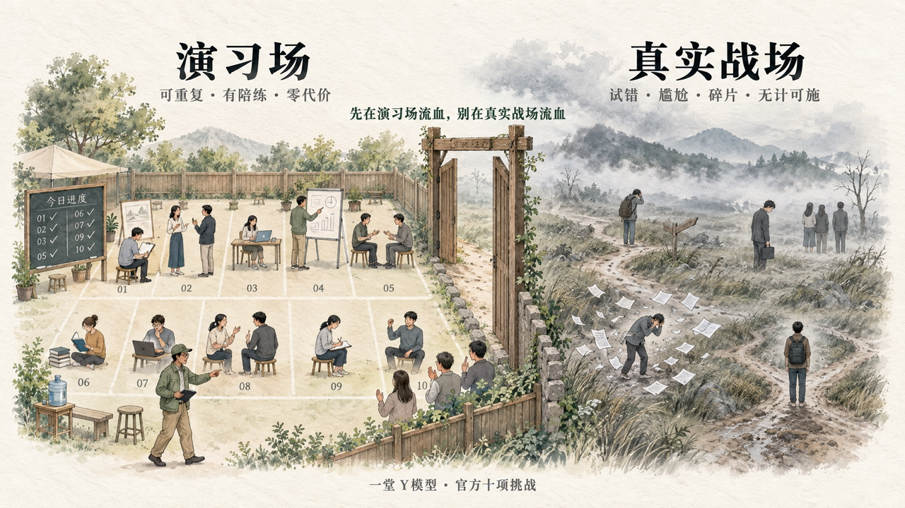
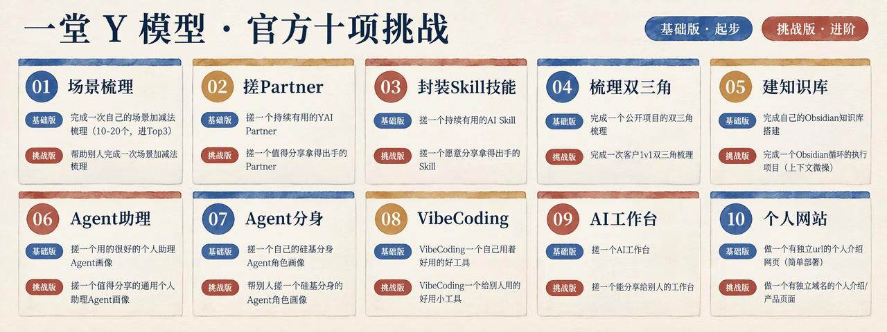
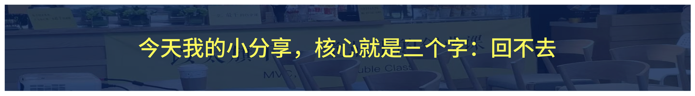

# 揭秘直播：Truman的十大AI任务

> 来源：https://yitanger.feishu.cn/wiki/Qqwjw4EPpi6IC6kQo8FcZLuZnzf

📺 **直播回放：[https://air.yitang.top/live/YMzzk4BCnh](https://air.yitang.top/live/YMzzk4BCnh)**
哈哈哈哈，各位同学大家好，
今天这个分享呢，我不是老师，我也不是什么一堂CEO，我的身份是和大家一样，作为一堂“AI实践者”，给大家做一个阶段性分享。
雪儿跟我讲，很多同学在拿到官方任务以后，很想做但又觉得无从下手，不理解价值，没见过最佳实践，所以今天我来给大家做一个加餐分享，讲讲我这一年的案例，以及试着抛砖引玉。

### 说下初衷：为什么做任务书

先简单解释下我们为什么做这个“官方挑战”。
为什么要做这个呢？因为很多同学使用AI，迟迟没有做Partner，做Skill，没有VibeCoding一直没有“**感受过第一次的爽**”，而且大家的基本功差距越来越大，且缺少一个共识框架。
于是我提出了一个大胆设想：**能不能官方做一组任务，给大家做一个演习场，给大家一组“基本功练习”，大家可以在一个模拟环境里去学习和补基本功，大家还可以相互切磋、正向建立能力，不用去真实的战场里去试错、去流血、去焦虑尴尬。**

先看下结果，我们给大家准备了十大任务：

如果你想成为一个“AI基本功没有短板”的人，这10个题目基本上都是必经之路。
**我们还特别给大家准备了两个层级：**

- **基础版：**提供给全体会员训练，用来“进入状态”；
- **挑战版：**更难一些，“高手营”同学可以来挑战。

好啦，今天这个分享，我给大家讲讲相对简单的1-5个任务，我带大家做做解读，以及我自己是怎么实操的。
♥️ 注意：今天不是一个正课啊，大家降低预期，就是一个“案例开放麦”，我会更加自由、松弛地讲一讲我的实践案例。
今天不是课，但是还有点忍不住教大家点什么，我送给大家今天我分享最重要的三个字吧：

什么是你每个任务入门的标志呢？就是这三个字：**回不去。**
我一旦习惯了拆场景，封Partner、Obsidian知识库，封Skill、封双三角、配置角色、VibeCoding，就回去了。
回去了就感觉工作效率大大下滑，大概率就是这个任务把你击穿了。
