## 任务4：梳理双三角

### 理解：双三角做什么的？

这个价值无需多说了吧？
快速复习一下：

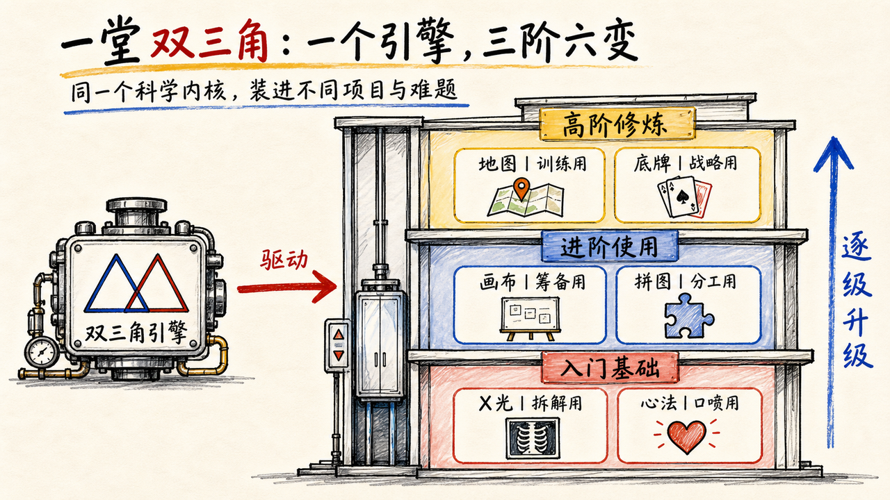

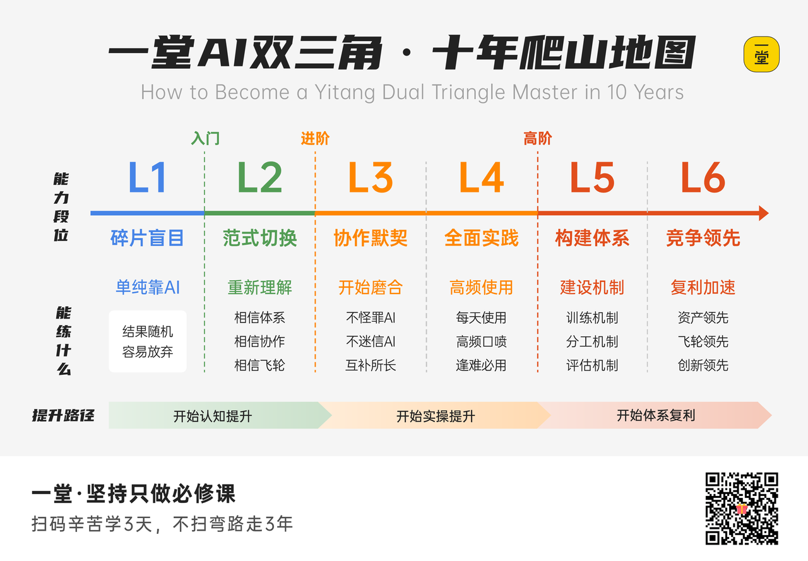

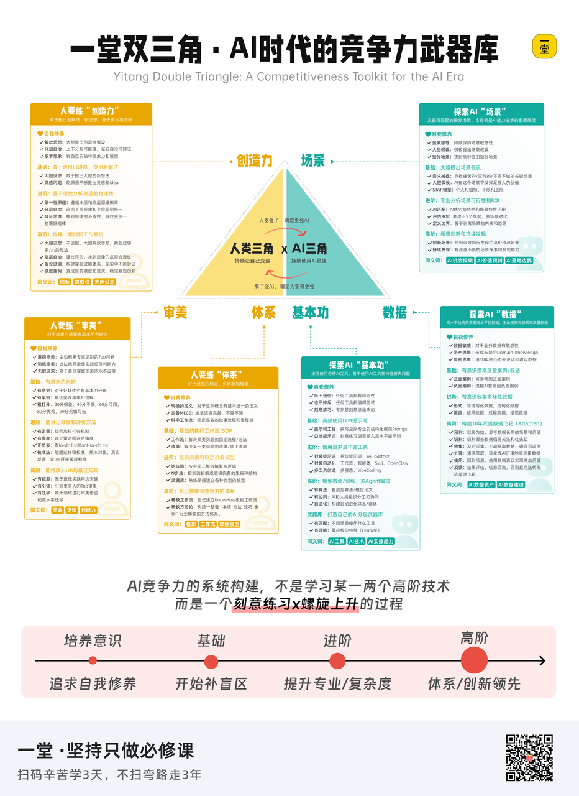

调研一下：

1. 还不认识
2. 认识学习了，但没完整梳理过
3. 梳理过，但没感觉到价值
4. 充分理解了价值，有显著质变提升
5. 无法离开，双三角是我的肌肉记忆

大家什么阶段？
双三角是我们搓Partner的基本框架：

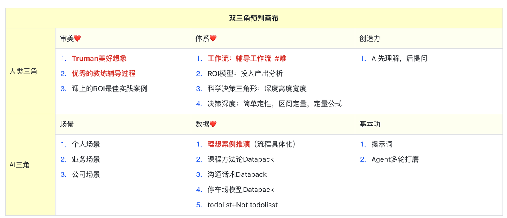

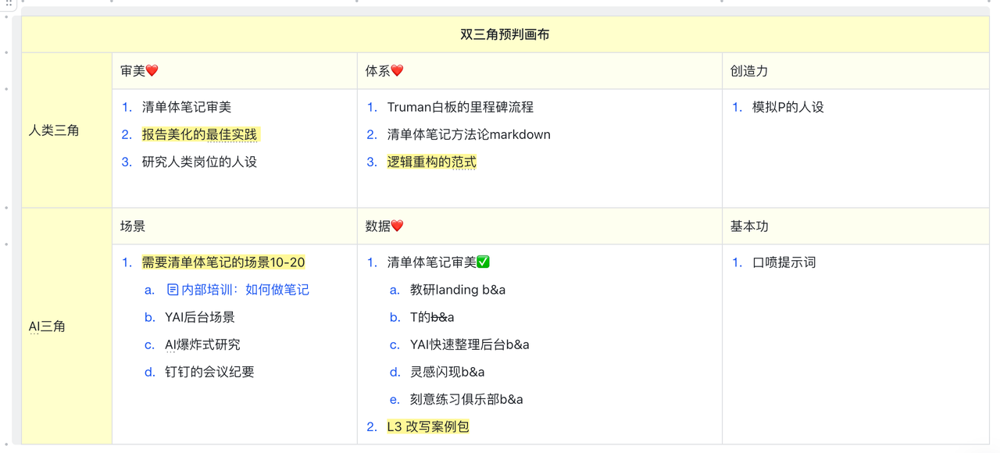

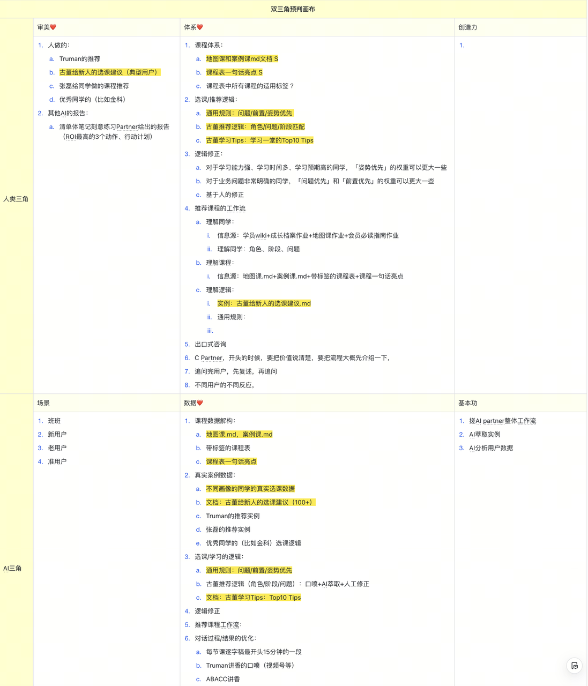

是我做短平快AI MVP项目的基本前提（复盘营Partner）：

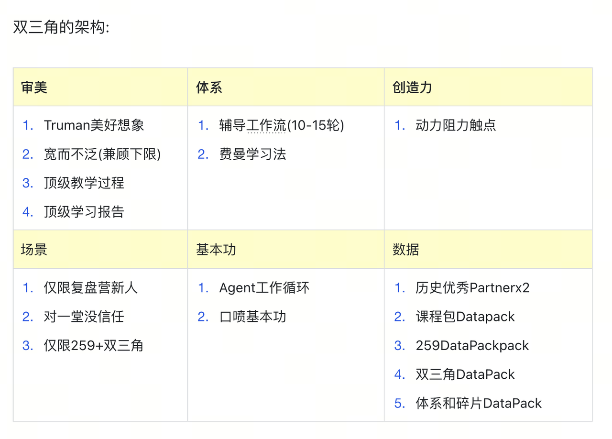

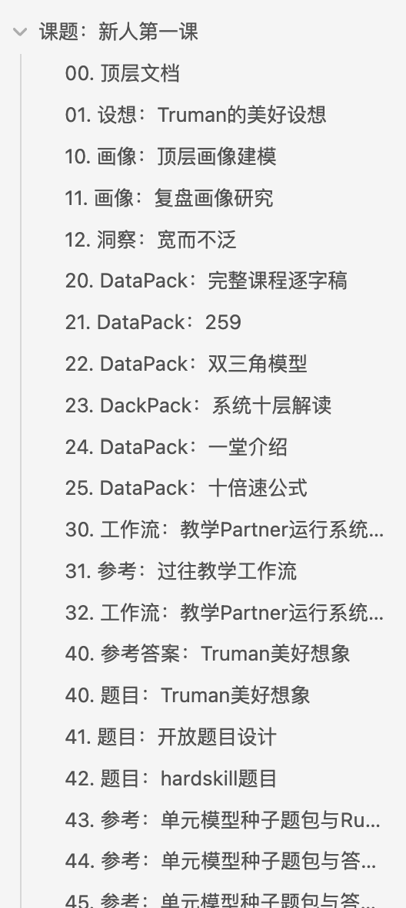

给360中高层内训，中间我升级了一版本AI训练计划，很重要的准备工作就是梳理双三角：

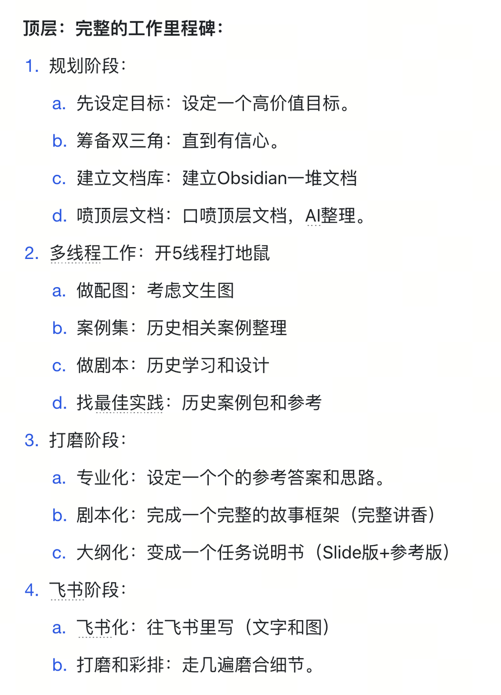

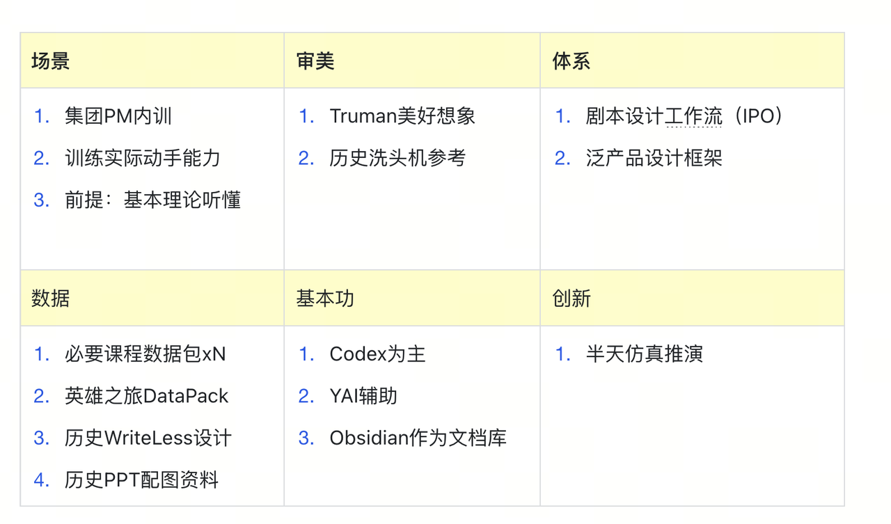

### 双三角的三个阶段

**第一个阶段：很有道理**
第一个阶段，就是你学了模型，觉得好有道理啊。

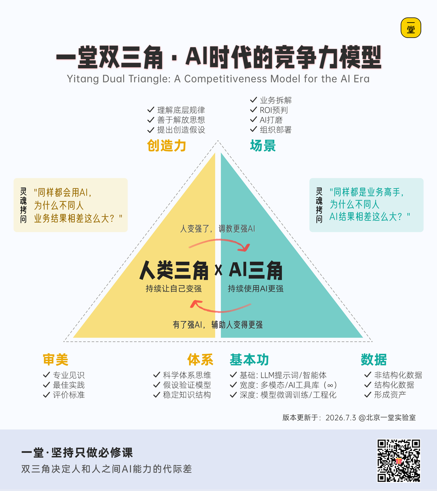

**第二个阶段：动手实操**
当你遇到一个具体的AI问题，开始拉满填双三角的时候，你会感觉你的工作体系、信心会有一个巨大的提升。

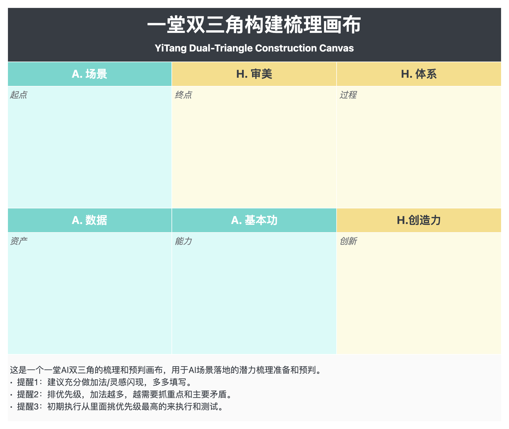

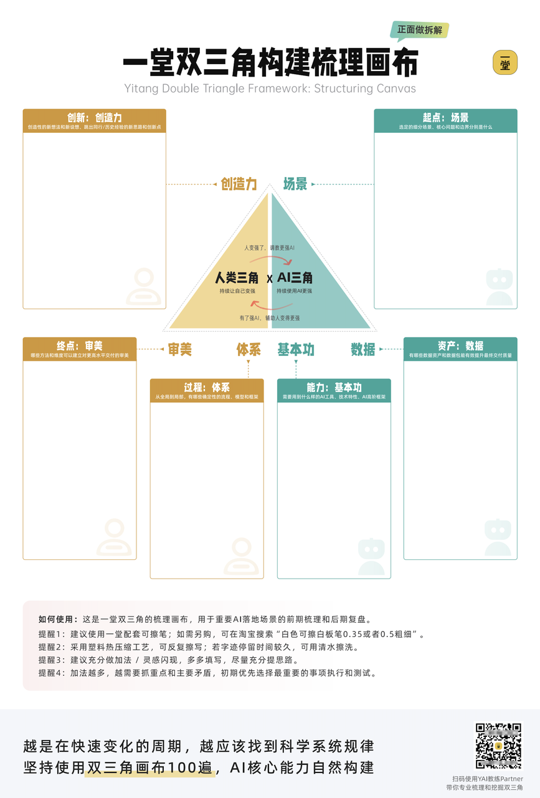

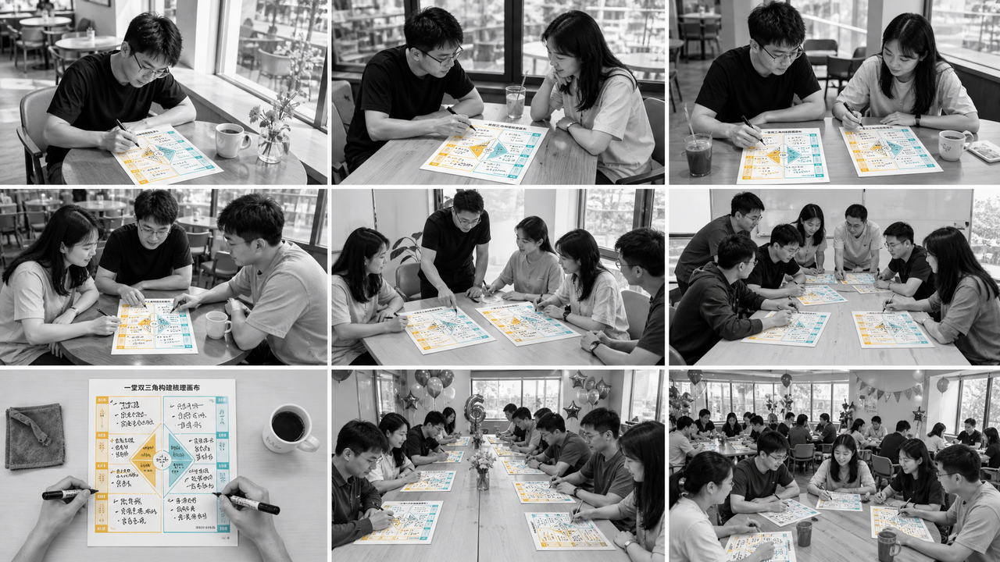

我前两天睡不着，做了一个**《3小时挑战手搓百万短视频访谈操盘手》**的视频，其中最最重要的一步，就是填写一遍双三角画布，这是当时的快闪视频：

📹 视频附件

*哈哈哈，为了方便自由填写和讨论我们采用了A3，除了有点点大不便携，没有任何缺点hhh；*
*哈哈哈，为了方便自由填写和讨论我们采用了A3，除了有点点大不便携，没有任何缺点hhh；*
实话实说，大家填过几次？（自己和带别人）
**第三个阶段：形成肌肉记忆。**
我模模糊糊感觉，如果你**认真填过10-20个这个数量**，后面反而“不必一定填”，因为这个方法论融入了你的决策习惯，甚至变成肌肉记忆：**这缺审美，这缺数据，条件反式地看出问题。**
所有报名高手营的同学，你们要努力找各种机会，练习拆解双三角。
比如：

1. *公司某一个具体细分场景AI落地。*
2. *搓一个AI分身、助理。*
3. *做一个好看的很难做的海报/PPT*
4. *做一个大概率会失败的AI交付。*

这个任务大家试着努力拉满完成1-3次，基本上就完全回不去了。
