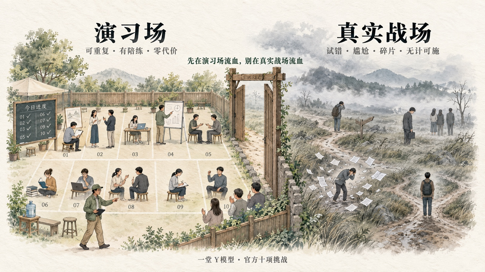
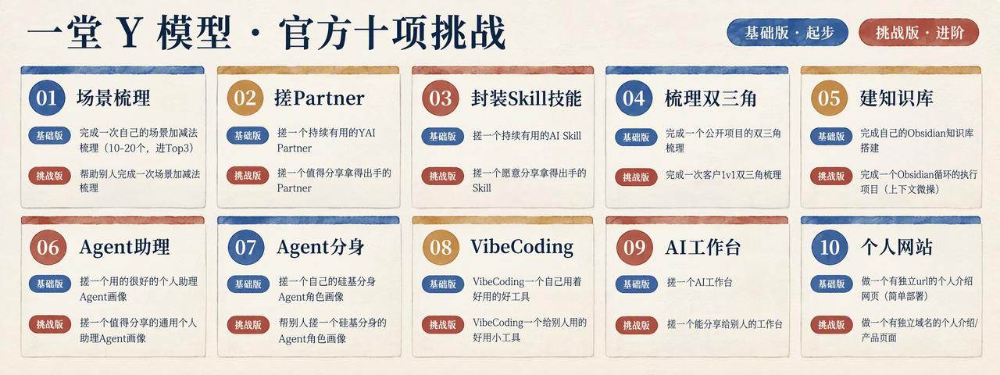

## 回到开始：上半场示范结束

好啦，收个尾吧：
开篇我给了大家一张图：

先看下结果，我们给大家准备了十大任务：

如果你想成为一个“AI基本功没有短板”的人，这10个题目基本上都是必经之路。
**我们还特别给大家准备了两个层级：**

- **基础版：**提供给全体会员训练，用来“进入状态”；
- **挑战版：**更难一些，“高手营”同学可以来挑战。

什么是你每个任务入门的标志呢？就是这三个字：**回不去。**

### One More Thing：我的Trumind送大家一个礼物

🎵 回不去·原版·体育场摇滚

🍞 [Intro]
（打字声 · 半声念白）
Prompt，Agent，Skill，Token
每个字我都认识
连起来 一句都不懂

[Verse 1]
我会运营
一场会 我不用稿
我会销售
他说再考虑 我知道他在想什么
我扛过一家公司
我扛过一个团队
有一阵子
我真觉得 自己无所不能

[Verse 2]
然后 所有人都在学 AI
我坐下来
手心 出汗
十个题目 摊在桌上
拆场景
填双三角
居然还有 VibeCoding
我这辈子 都没想过
这事 跟我有关

[Chorus 1]
回不去 回不去
我想回到我熟悉的地方
回不去 回不去
那里 没有这些名词
所有人都在往前
我站在门口
回不去 回不去
我 回 不 去

[Verse 3]
一堂说
这些 是必经之路
我说 好吧
那我不怂了
我去接了杯凉水
洗了把脸
这一次
我往里冲

[Verse 4]
第一题
真的难
我咬着牙
一毫米 一毫米往前挪
它答错
我改
它又答错
我再改

[Chorus 2]
做完我才发现
没那么难
AI 能做到这个程度
我真没想到
把这道题做完
我竟不再似从前

[Verse 5]
第一关 拆场景
我先有场景 再谈工具
我把十年的活
拆成 五十条
第二关 搓 Partner
我给它起了名字
一喊 它就来
第三关 封 Skill
我一个词
它就能开工

[Verse 6]
第四关 双三角
我画满那张纸
才知道自己 缺什么
第五关 建库
我把自己的话
一句一句 喂给它
第六关 助理
它替我跑腿
我睡我的觉

[Verse 7]
第七关 分身
它一开口
同事认不出
第八关 VibeCoding
那件我以为
一辈子跟我无关的事
我做了
第九关 工作台
我给自己 装了个台面
第十关 网站
我有了 自己的地址

[Bridge]
一关 一关
我往上走
回头一看
AI 也不过如此
每一步 我都回不到过去
这个世界
原来 这么好看

[Chorus 3]
把这道题做完
我竟不再似从前
把这道题做完
我竟不再 是 从 前

[Verse 8]
有天同事说
你现在是 AI 高手了
我笑笑 没敢接话
三周以前
我还手心出汗

[Bridge 2]
AI
我以为 是一堵墙
原来 是一座天梯
爬上去了
就再也 回不去

[Chorus 4]
回不去 回不去
我不愿意回到没有 AI 的日子
回不去 回不去
所有事都自己扛
所有事都自己做
那个日子
真的 回不去

[Outro]
（打字声 · 一声"输入完成"）
回不去（回不去）
回不去（回不去）
把这道题做完
我竟不再似从前
