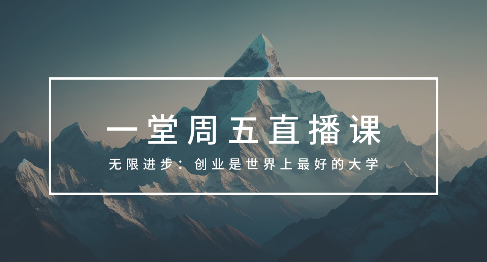
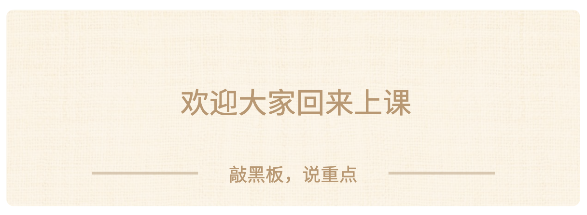
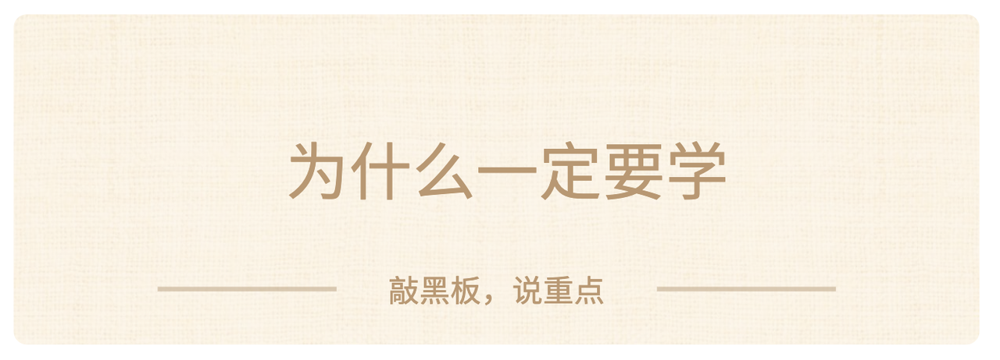
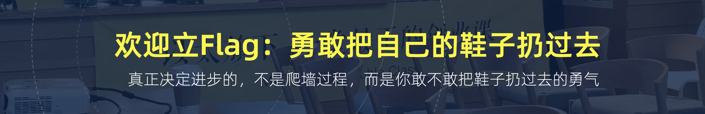

## 开始上课

Hello，大家好啊，

我是Truman，许久未见~~

欢迎大家回来继续（来到）上课，进入**本周末的成长加速时间**。

这是我的介绍，如果直播间有新人的话，自己读一下吧：
> 1. **以太一堂CEO：**2016年加入以太创服，现为合伙人，兼一堂CEO。
> 2. **前美团产品专家：**擅长从0到1业务探索、产品快速起盘、商业分析。
> 3. **一堂课程总设计师：**研发100节创业实操课，收到50万份创业训练作业。
> 4. **曾创办“易项直通车”**：资本对接平台，帮助100+项目融资成功。

**【热场🙋‍♂️】**来来来，我们热个身吧，这是一个有趣的问题，如果穿越回10年前，你挑选一堂课，送给十年前的自己，并且附上一句话，来获得你这10年成长和成事的最大化，你会挑选哪节课呢？

————

我猜很多人会回答：一堂五步法，刻意练习，知识管理，实事求是。

大家猜到我的答案是什么了么？

哈哈哈，如果给我一张1min穿越门票，回到2016年我刚从大厂出来，刚加入以太，我如果穿越回去，我会带上一堂的**《Y模型》**，我会非常严肃地带上一句话：

> 这门课我猜你会听不懂，甚至会不以为意，但请一定至少听10遍，把它背下来，争取拉满了理解和实践；

> 我是未来的你，相信我——

> 关于未来，你所有困扰痛苦、解题机会和成事大牌，都藏在这个模型里。

如果这句话带到了，我猜过去10年，我应该能至少少走一半弯路吧。

ok，这就是今天我们的主题**《Y模型：实操篇》。**

有些同学喜欢《案例课》，但更多同学喜欢《理论课》，这节课是一堂所有一堂理论课的底层“元理论课”，一通百通但特别难，大家做好准备了么？

### 为什么要学

大家预习过了吧？先做一个调研吧：

**【调研🙋‍♂️】**对于一堂的Y模型，大家的学习基础如何？
1. 还没听说过，第一次听说
2. 早有耳闻，没听过课
3. 听过课，但理解很浅
4. 基本理解和认同，但没实践过
5. 有意识在持续实践
6. 大量实践，是自己成事最大的底牌

————

在两年以前，我们正式发布了**《科学理念：Y模型认知篇》**，系统解读和介绍了Y模型；

在一年以前，我在MBA的小场子（NPC、高阶营、探索营）试着讲过Y模型的实操落地。

这个话题实在太难了，我们内部又积累实践、酝酿了一年多，尤其是经历了最近AI一波变革洗礼，终于形成了理论自信，今天《实操篇》开始给大家交付了。

Y模型，如果你只是把它当做一个“**解释模型**”，用来回顾、复盘、拆解和解读案例，固然可以，但你大大低估了它存在的价值。

从这节课开始，我带着大家把它变成一个“**解题模型**”：当我们遇到一个难题（困难or持续），你想科学做短视频，科学搭建AI工作流，科学降低血糖，科学投放，科学销售，科学做OPC探索......Y模型如何成为你的解题核心驱动力。

### 预热思考题

来来，照例，给大家两个预热思考题吧：

**第一个题目：回顾过去习惯。**

和很多高段位的人聊过后，我发现大家有一个基本的共识：不要把工作能力的积累构建在一些表层的流程上（流程/SOP），要努力构建在稳定的底层底座上，这样我们的能力才能够持续积累、不断跨领域迁移。

我甚至写过一个金句：那些能把你从旧时代带到新时代的能力，才是你的“**核心能力**”。

> 最近聊过很多的一个词：底层的“元能力”，能在底层长出各种能力的能力。

那么，一个扎心的问题来了：过去10年，我们做过各种项目、参与过各种产品设计和团队管理，做过成百上千的海量决策，这些决策的成败得失，最终积累到**哪些底层的能力上**了呢？

你做过一百个大大小小的项目，当你做第101个全新的项目（新创业/AI新挑战）时，你如何调动前100个项目的经验，在短时间内成为一个自信的熟手，甚至专家呢？

**第二个题目：场景推演题目。**

当你想学习如何解决一个难题的时候，需要不断积累“核心认知”：同样大家都在学习短视频、学习投放、学习定价、学习AI FDE落地和学习AI本地部署，但是不同人的学习速率相差几倍甚至几十倍。

有些人总是能在短时间内入门，每周迭代，快速进步，持续突破；

而有些人一直在尝试着学习、尝试着与AI讨论，尝试着做事，却很难形成积累。

请拉满思考：如果要用Y模型把你认知积累的速度提升3倍、10倍、甚至100倍，你具体会怎么做呢？

这两个题目都有些难，希望你做一个头脑实验，拉满了想一想，这节课结束以后，你能有一个完全不同的、笃定的答案和操作系统。

### 提前划重点

提前划一下重点，大家不要迷路，今天我会讲3个话题：

**第一部分：快速复习理解。**为了避免断片，我会先带大家快速回顾下Y模型的基本理解，框架和推导过程。

**第二部分：落地执行框架。**我会给大家一个Y模型的落地执行步骤，这是一个全新的工作框架，如何把一个模型变成一个解决问题的工作流。

**第三部分：每部分的解读。**每一个部分有哪些难题，必知必会和策略，以及如何用Y模型去解决一个系统的问题，我会给大家一些实操建议。

提醒：这个课题太大了，这节课估计只能讲50%，看看大家学习兴趣和长期追求，我们在考虑未来给大家一些更进一步的实操展开课。

> 比如武器库篇，组合篇，动态迭代篇，画布篇等等。

**预告♥️：**Y模型太重要又太难了，这周随课我们会发布两个AI Partner，T Partner负责辅导你理解吸收，C Partner负责带你一步步推理Y模型方案。

> 别担心：YAI已经启动商业化，没订阅没关系，在籍大会员，本周网页端使用对应的Partner限免。

这周大家多留一些时间用来吸收和练习。

### 本期磨课组成员名单

**角色**

课题组成员

**工作**

**主理人**

** 楚门Truman**

把控选题、课程方法论架构和教学设计。

**小组成员**

**产品经理：希瑞、砻沣、路禹、盈盈**

- 课程支持：李頔**、**Sherry**、**古董

完成整个课题的拆解和落地：

- 案例调研，专家访谈、案例拆解。
- 参与方法论萃取、课后数据分析和迭代。

**【毛遂自荐🙋】欢迎大家主动报名“学习委员”，谁愿意？**在评论区扣一个：**我愿意**

> 请大家积极报名学习委员，提升上课质量、班级群氛围、督促选课和互帮互助。

**"翻过一个墙，最好的方式，就是先把自己的鞋子，勇敢扔过去"**

来来来，希望大家一起立一个Flag（承诺），认真听课吸收，最后完成这次训练作业。

扣四个字吧：**一定作业**

> 我们正在持续升级作业陪伴&督促服务，口令代表有更高配的周末学习服务：）

**【划重点💡】**欢迎大家勇敢一点承诺，这四个字代表：
1. **给自己的一个预期：**把这个收录进你的10年进步练习清单。
2. **倒逼自己一定进步**：提高优先级，帮你排除杂念进行学习。
3. **享受更高配的服务：**更完备、更好的班班周末督促服务：）

哈哈哈，欢迎大家**一定作业**，未来在这个课题上，持续享受持续进步的滋养和复利。

OK，进入第一个话题。