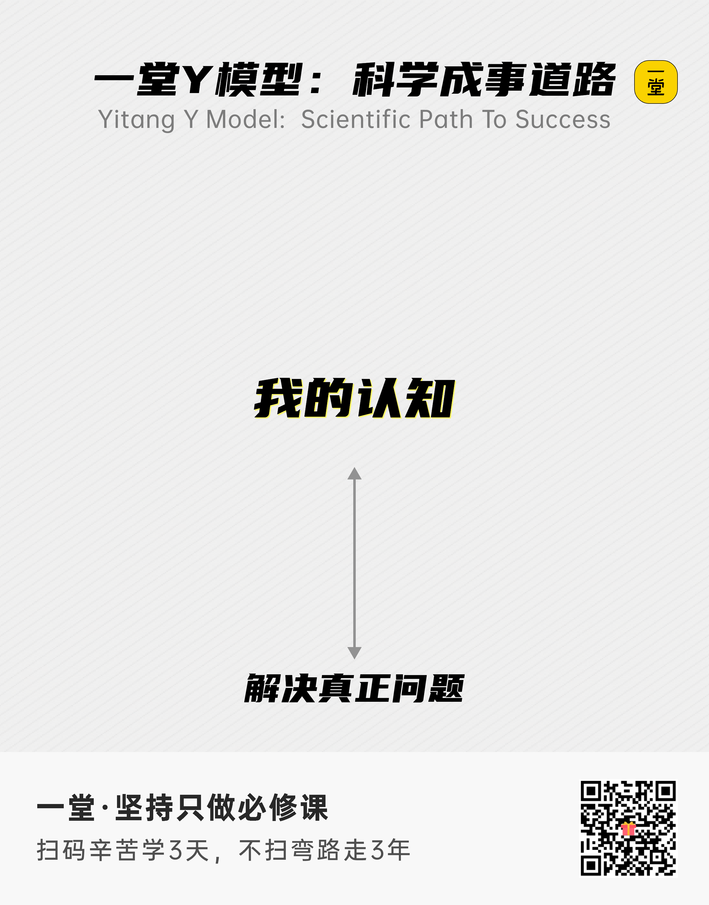
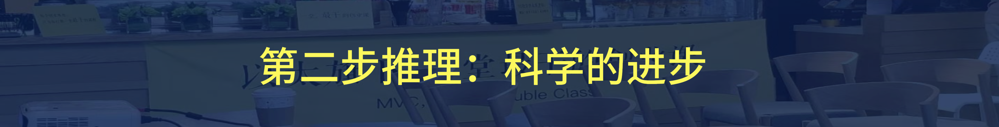
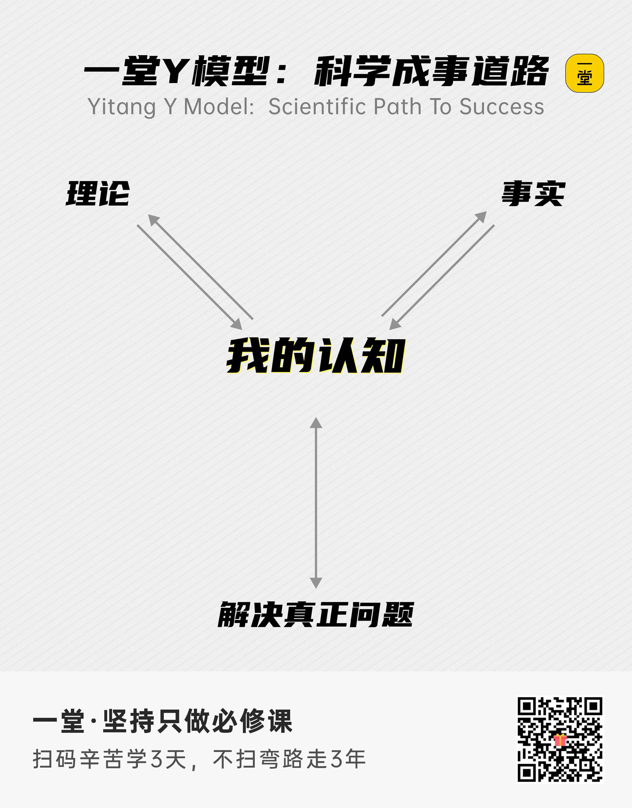
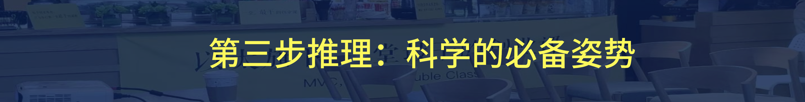
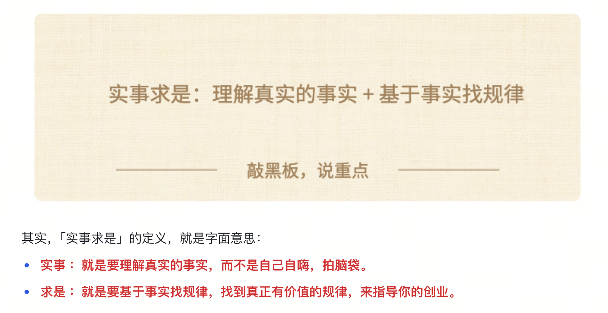
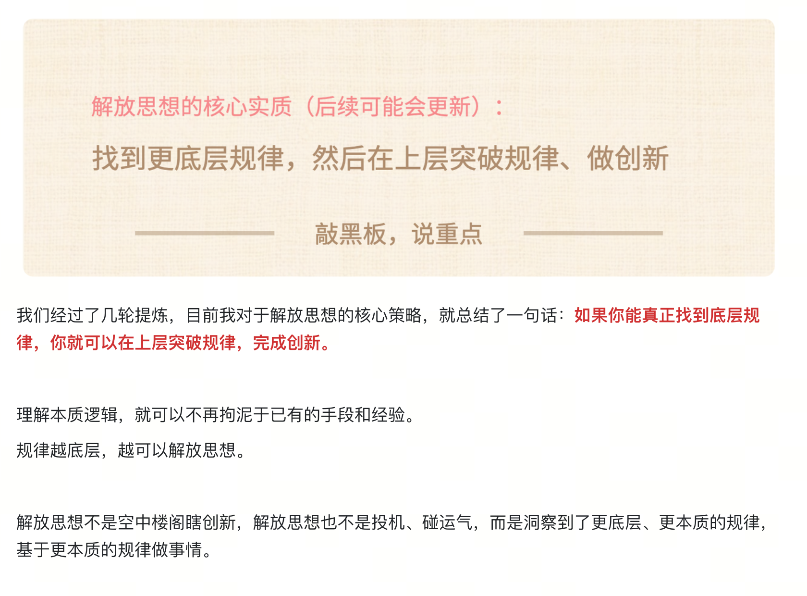
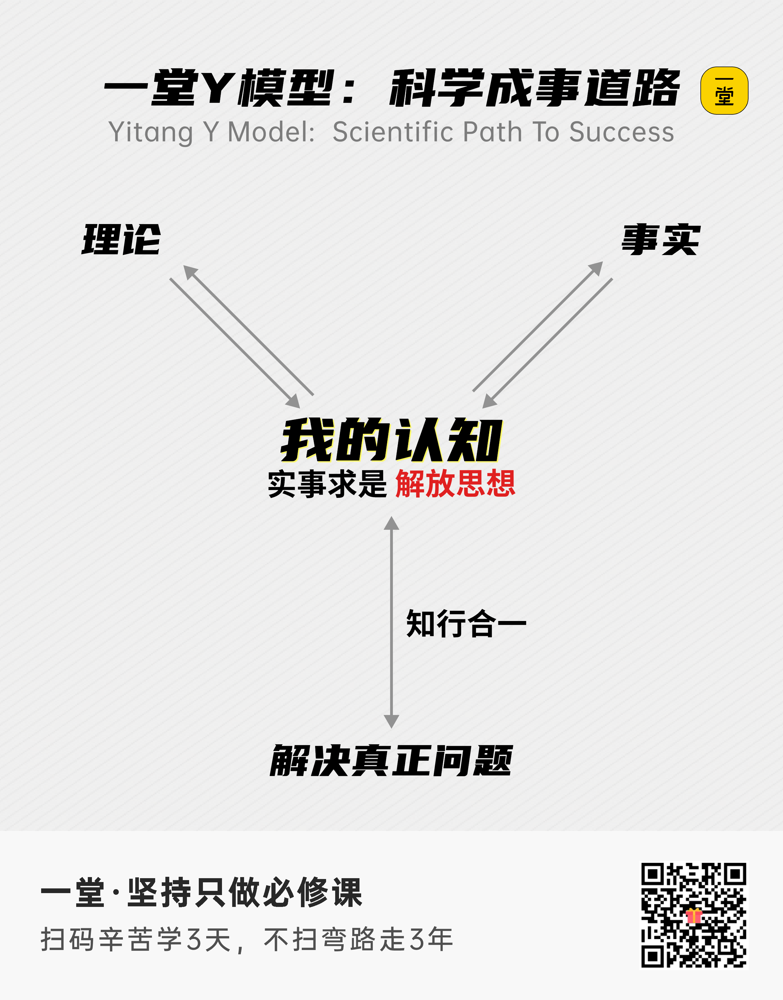
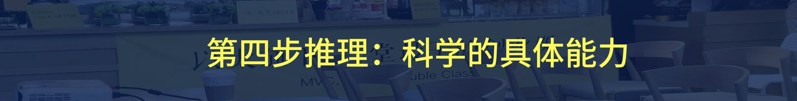
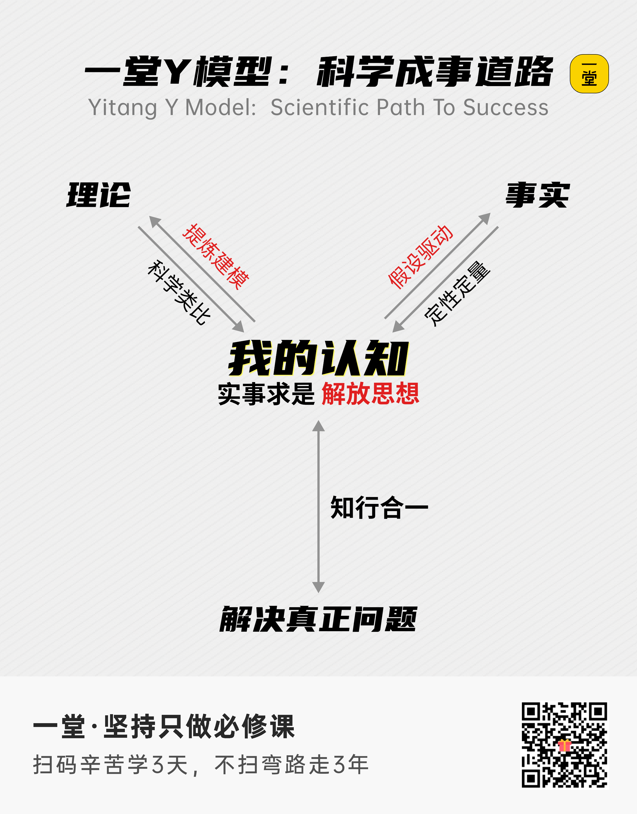

## 60分：理解Y模型（回顾）

我一直有一个明确判断：**对于一个核心的实操框架，比如一堂五步法、ROI、转化率框架、Y模型、刻意练习，一定要想办法理解记下来，只有清晰的记在脑子里，才有机会去实操、调用和解决问题。**

如果每次都靠“现查笔记”，几乎是不可能持续使用的，更别说刻意练习，变成肌肉记忆了。

那问题来了，来来来，考试时间到：

**【考试🙋‍♂️】**如果闭卷给你一张纸，让你把Y模型完整的框架默写下来，并且把各个关键策略和名词准确标记在上面，你能默写个百分之多少呢？

- A：一张白纸，最多写个“Y”
- B：能写3叉的定义
- C：能写完整的四个策略
- D：能写完整，并且做5-10层解读

————

你大概是什么基础呢？hhhh

为了避免老同学断片，新同学完全跟不上，我们还是带着大家快速回顾下“必备认知”吧。

注意：请大家努力跟上理解，我们的T Partner其中一个工作就是帮大家找到盲区、理解吸收。

哈哈，我给你讲，越是底层的可靠的模型，往往模型越是简单和优雅的，格式本身就是非常简洁美的，为了方便大家理解，我总结了一个口诀：**1234。**

> 预告：这只是一部分，第二部分我会给你1234完整版本。

### 第一步推理：1个核心

**第一步：科学理念的核心是什么？**

**【抢答🙋🏻‍♀️】**如果忘掉工具、原则和手段，科学只保留一个最核心的内核，你们认为是什么？

————

是相信**规律**，相信**客观**规律，相信客观**因果**规律，**相信并追求客观的因果规律。**

> 有了这个基础，才有了科学经常讲的：可证伪性，确定性，可复现性。

我画了一个示意图：

我们有了一个明确的目标（“果”）以后，要相信，

- 当我只有模糊的认知，我就有随机的结果；
- 当我形成入门的认知，我就有入门的结果；
- 当我形成优秀的认知，我就有优秀的结果；
- 当我形成顶级的认知，我就有顶级的结果。

商业极其复杂，充满了运气和随机，但是我们要持续追求确定性的因果规律，可能极端情况下80%都是运气，但是人和人真正的差距，就在于拥有那20分的确定性。

圣人畏因，凡人畏果，我们不要总盯着结果，把你的注意力，放在核心的认知和规律上，去追求更好的、对于客观规律的理解和掌握。

### 第二步推理：2个进步

这一步跟上了哈，下一步，继续推理：

我们经常讲，科学讲究没有绝对真理，永远在不断迭代、证实证伪、自我批判、建模更新中进化，而且永远没有尽头，没有人可以掌握100%的绝对真理。

**【抢答🙋🏻‍♀️】**你掌握的科学规律（“因”），是靠什么一步步升级和进化，来驱动你拿到更好结果的呢？

————

核心两个来源：
1. **理论**：一些抽象过的规律和模型（学习别人的 or 自己提炼的）
2. **事实**：一些具体业务现场的现实（调研别人的 or 自己测试的）

> 提醒：我曾经在MBA《战略笃定》探索营里拆过《毛选》，其中最重要的篇章之一《实践论》其实讲的就是这个部分，和这个模型很一致，我们提炼模型的时候也重点参考了教员的分析。

不断学习理论、理解事实，然后一步步进化，你就能持续进步，对科学规律逐渐形成很高的水准：

上半部分，帮助我们更好**认识**世界；

下半部分，帮助我们更好**改变**世界。

### 第三步推理：3大姿势

跟上了哈? 我们继续推理：

如果我们想升级，我们该修炼什么？什么是科学精神的必备姿势和核心心法呢？尤其是对于我们做商业、做管理和真正创业的人来说，哪些是长期高水平精进的必经之路呢？

**【抢答🙋🏻‍♀️】**哪些核心精神和姿势，是科学成事的必经之路呢？

————

我们一路调研，做加法、减法，最后发现有三个东西是最小集，不能再化简了：
1. **知行合一**：认知和实践必须统一，知行要合一，要同步升级。
2. **实事求是**：对于客观事实和规律，要有敬畏心，相信自己是普通人。
3. **解放思想**：善于使用新工具，解决新问题，不拘泥于固有经验和路径。

大家上过子敬的《实事求是》和我的《解放思想》么? 

大家记得长期修炼的一句话心法是什么？

————

简单关联一下：

————

大家跟上了么？然后我们把它们也加到图里：

这一层就开始比较具体了，可以用来变成自己的日常做事准则，变成团队文化，变成团队灵魂。

### 第四步推理：4项能力

哈哈，大家感觉怎么样？最后我们更近一步：具体我该修炼什么能力、基本功呢？来真正把科学理念落地，不断修炼科学成事儿的能力呢？

**【抢答🙋🏻‍♀️】**如果我想具体训练科学实操能力，我该长期修炼什么呢？

————

一堂讲了很多核心工具和策略：假设，MVP实验，调研，建模，类比，复盘 等等。

我们按照偏理论和偏事实分类，再尝试合并一下同类项，同时关联其他部分，严谨化一些，于是**我们就有了四大科学迭代工具：**
1. **定性定量：**调研和实验分析，全面准确地理解客观事实。
2. **科学类比：**用辩证的、交叉类比的方法使用规律，理解内核边界。
3. **假设驱动：**勇敢提出一些前置假设，用假设驱动推进工作。
4. **提炼建模：**不要怂，练习自己建模、抽象一些客观的规律。

于是，我们尝试把这四条也添加到图里，一堂整个Y模型就全部形成了：

> 1. 注意箭头顺序：向内向外，向内是已经发生的事实和理论；向外是主动提出新的假设/模型；
> 2. 业务的构建是从下往上构建的：
> 1. 下半部分：客观规律（快速入门）
> 2. 上半部分：进化方式（无限进步）

哈哈哈，怎么样？如果大家想特别开(shu)心(fu)地和我们的Y模型教学官一起学习，请大家务必提前温习下上面这一段，不然会有点尴尬hhh。