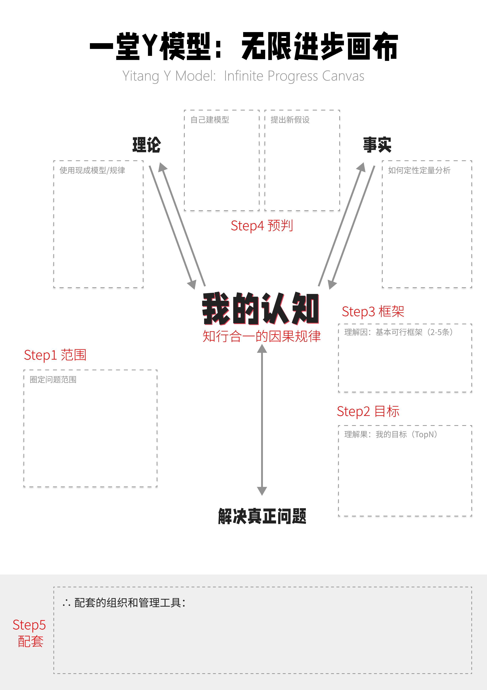
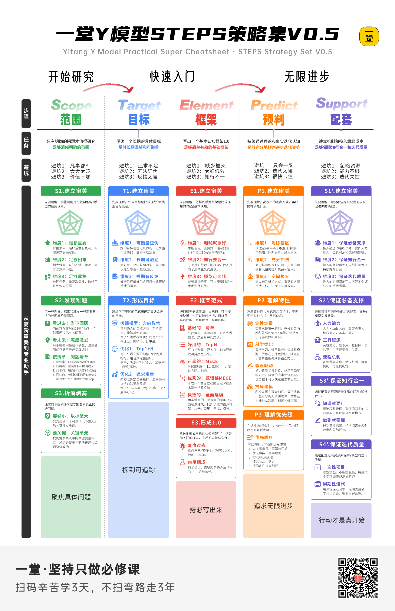
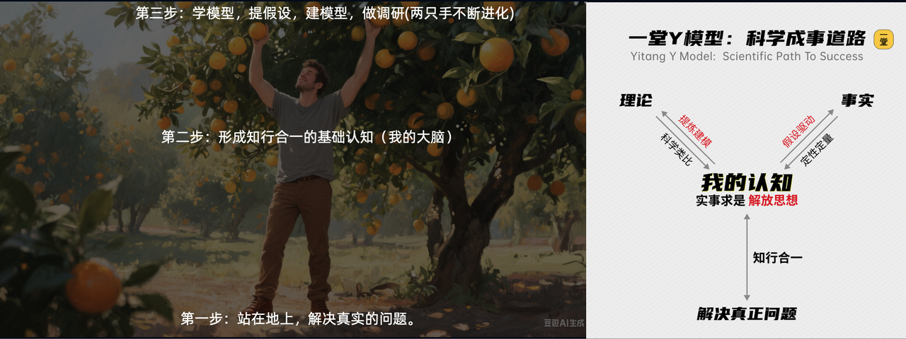
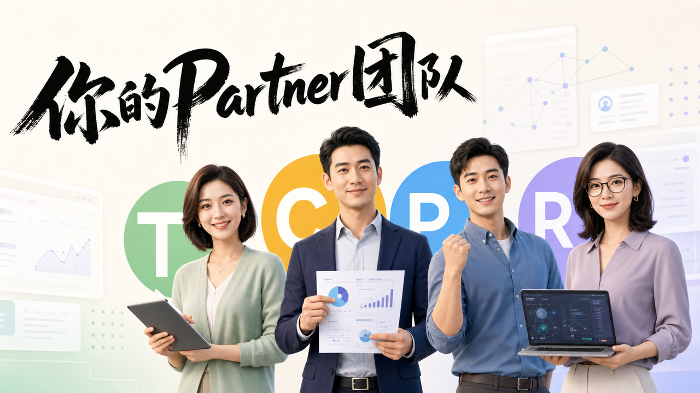
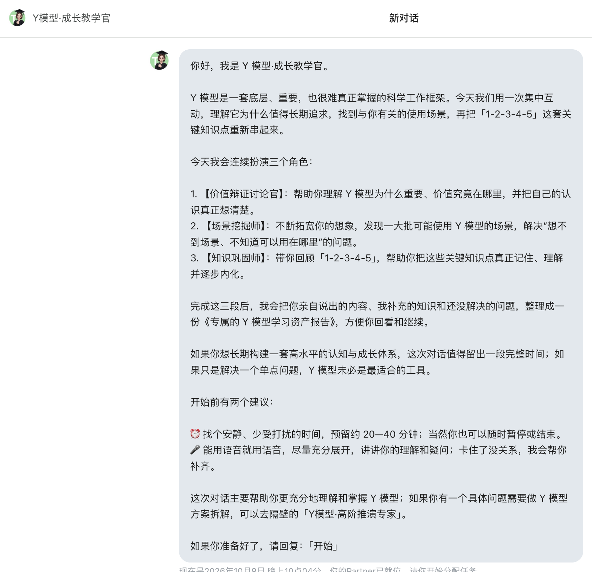
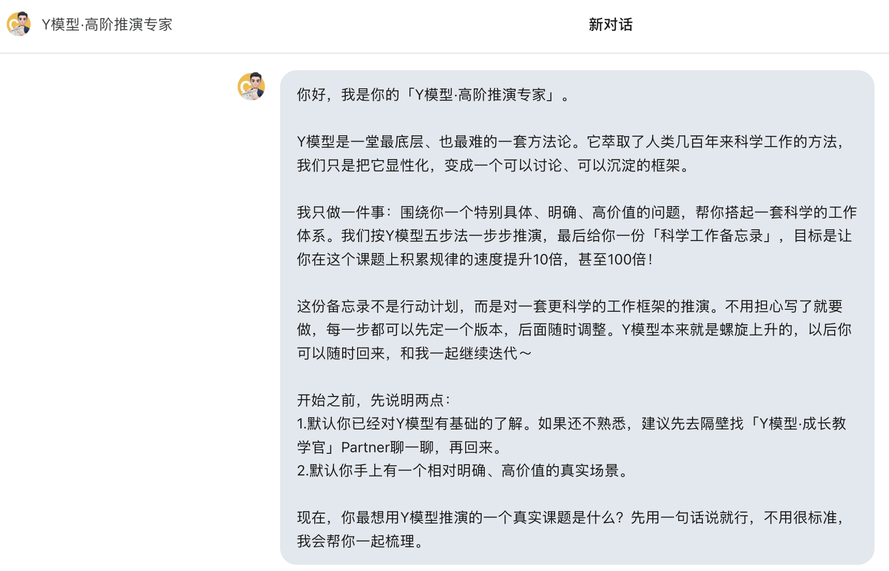
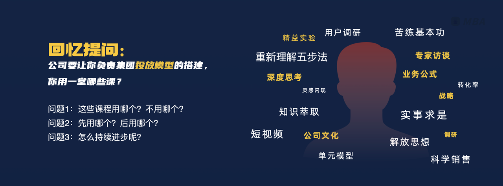
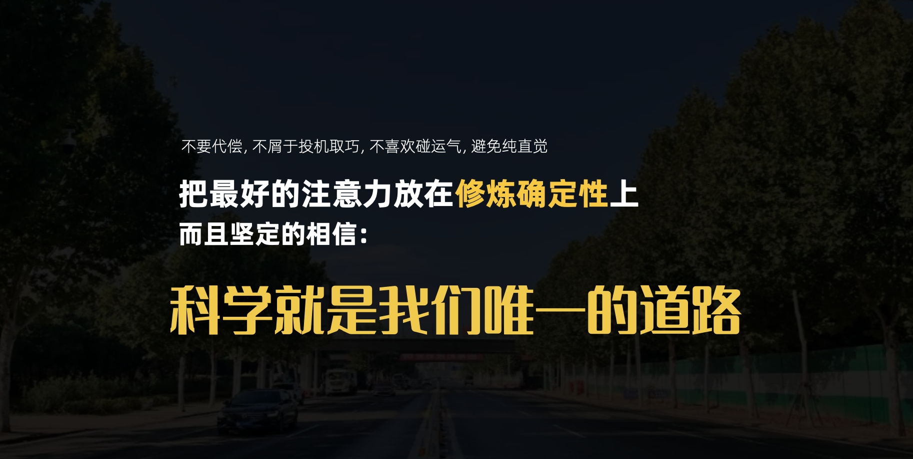

## 重新理解“科学理念”

### 快速复习

开篇给大家了Y模型适用的基本框架：

- **1：一个核心：因果规律**
- **2：两个基本点：理论，事实**
- **3：三大必备原则：知行合一，实事求是，解放思想**
- **4：四种迭代方式：科学类比，定性定量，假设驱动，提炼建模**
- **5：五步推理里程碑：范围，目标，框架，预判，配套**

好啦，终于可以给大家一整套完整的策略集了：

我们再回看一下这个摘果子的逻辑，是不是清晰很多：

- 地上篮子，清楚解决真实的问题，明确具体（①范围和②目标）
- 我的大脑，有一套认识框架，要知行合一（③框架）
- 看见果子，预判有大量高质量的果子可以摘（④预判）
- 不断摘果，不断伸手用这四叉去摘、吃、吸收进化（⑤配套）

### 去实践，去和Partner拉满工作

这次我们给大家准备了两个Partner：

- T教学：Y模型 · 成长教学官   #对人责任
- C顾问：Y模型 · 高阶推演官  #对方案负责

前者负责你你的成长，带你理清价值、挖掘场景和带你把模型长在你的身上。

会给你一个《专属的Y模型学习资产报告》。

后者负责带你一步步解题，你拿出一个真实场景难题，他带你一步步推演、画画布。

给你一套《Y模型高水平工作备忘录》

最后我想回扣一下最开始的题目：**Y模型为什么如此重要？如果穿越回去，为什么我会坚定带这个模型过去？**

因为我们学的所有其他课，都是一个“**工具范式**”，都是套用逻辑。

学了就去用，别人用得好就去学，知名方法就得研究。

而只有Y模型给了大家一个“**解题范式**”：忘掉工具，盯着你手里的问题和规律，需要什么就去扥。

这才是真正的：**用完就忘掉，无招胜有招。**

有了Y模型，它是催化剂，是工作流，是更底层的范式，**Y模型x任何科学方法论**，才是真正的大杀器。

- 方法论：提供了一个可靠的静态因果结构。
- Y模型：提供了动态的、螺旋上升的科学工作流。

在作业里面，我们看到了一段评论：

> Y模型最令我印象深刻的是其动态成长性：前期用简单框架快速落地，后期通过"因果嵌套"不断深化。这种既保持框架稳定又允许无限细化的设计，完美平衡了实用性与扩展性，尤其"努力预判"的思维让模型始终留有进化空间。真正实现了"快速上手"与"无限进步"。

回到本质，我们是只花时间在变化的机会上，还是不断去积累一些业务的因果规律和确定性？这个才是Y模型最底层的理念：**我们用坚定的唯物辩证的思维，去构建一个快速迭代业务学习的组织。**

最后送给大家一句话吧：

