## **💡一堂活动信息**

### 城市活动招生

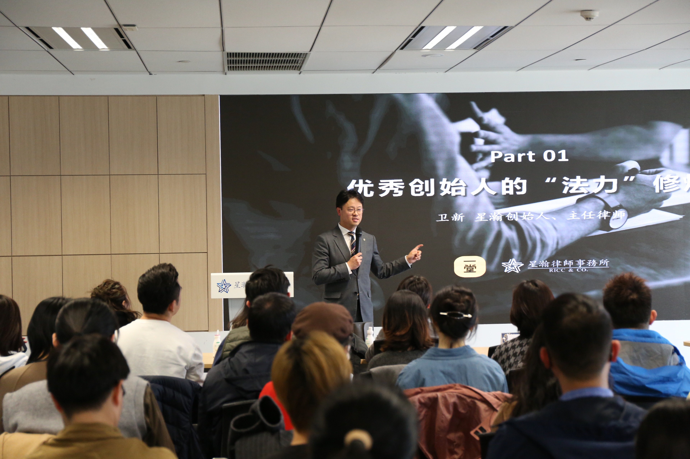

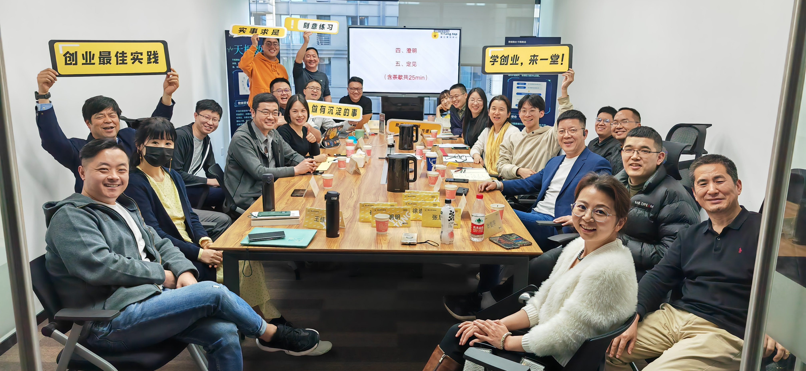

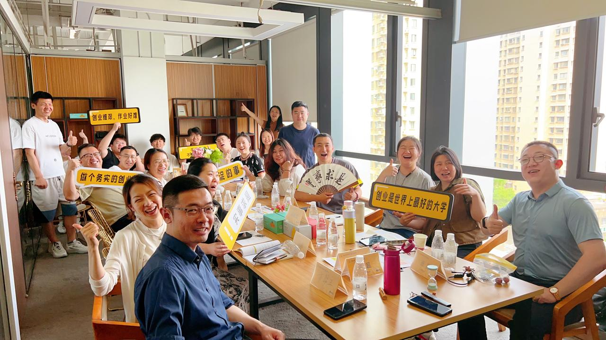

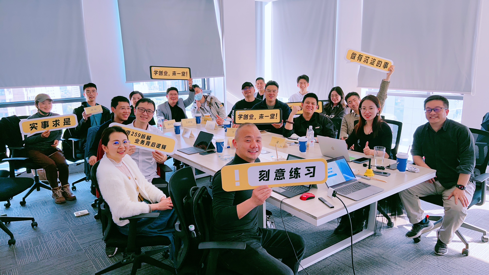

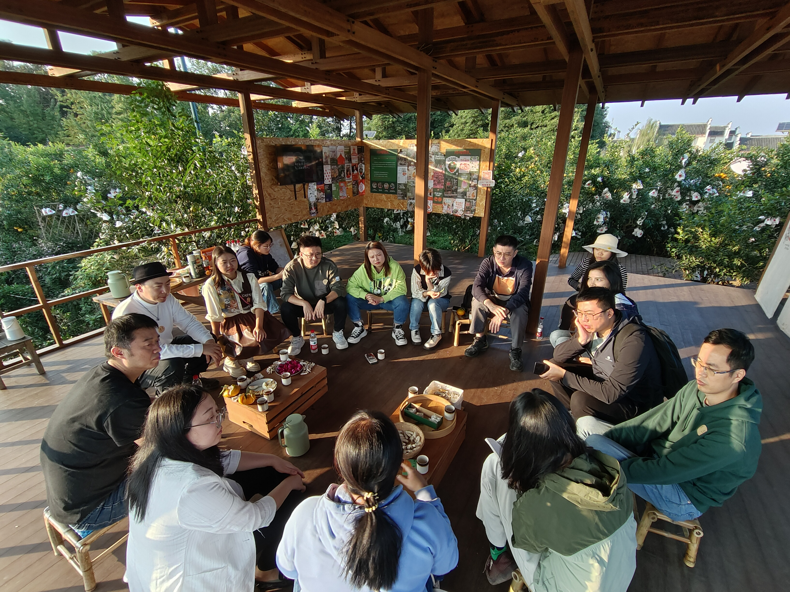

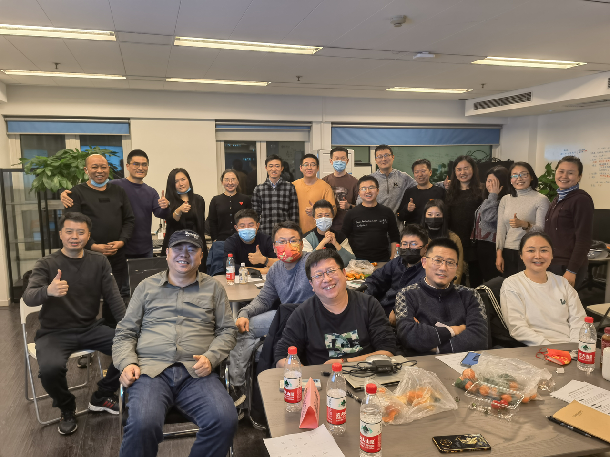

**【🙋🏻‍♀️互动】**已经来到直播间的同学，扣一下你所在的城市吧~

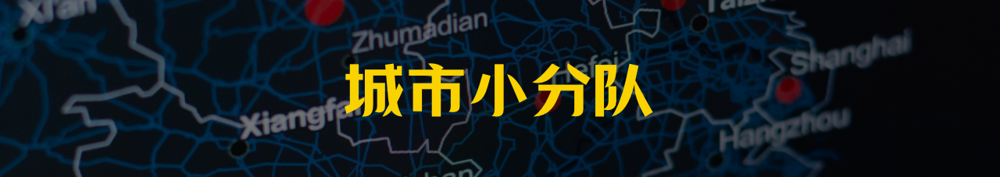

**【🙋🏻‍♀️提问】**还有同学还没进城市群吗？

来来来，新同学别迷路，先自己找一下组织。以后所有的城市活动都会在城市群内和大家同步。

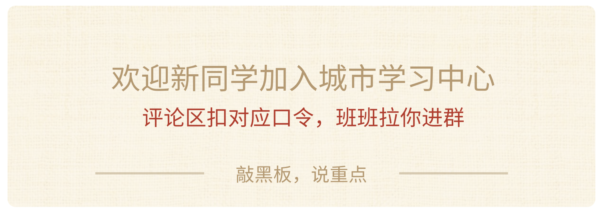

**【🙋🏻‍♀️互动】**还有没进城市群的同学，**评论区扣口令，班班下周拉你进群。**

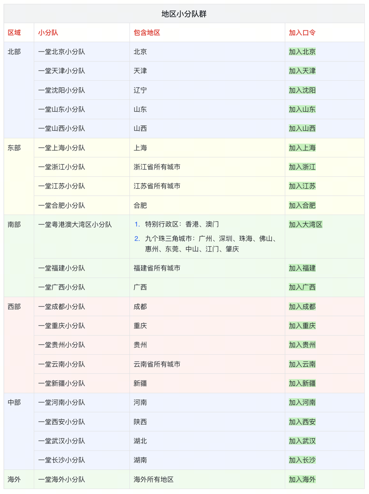

大家扣口令，陆续班班会拉大家进群。

📊 嵌入电子表格（原文为在线表格，内容无法转录）

### 💃🏻城市活动

📹 8_1681191996.mp4

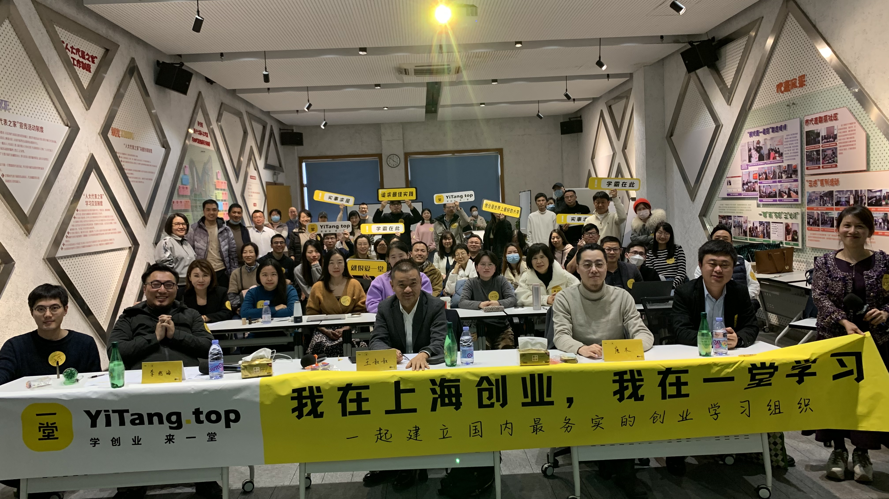

### 读书俱乐部

2021年8月，我们发起了一堂首个兴趣俱乐部「读书俱乐部」，聚焦商业类书籍的专业深度拆解，**致力于将读书融入创业。** 目前群内聚集了一批喜欢读书、坚持输出、爱交流的书友们，除了日常好书/读书笔记分享之外，**每周二晚8-10点，**会定期举办拆书会。

主理人是一堂品牌顾问、一堂优秀学员水水，她来牵头带大家每周拆解一本商业相关的好书。

截至目前，读书俱乐部已经解读了**222本商业/创业相关书籍**（有文稿/无回放），会员同学可以免费学！

AI用了很多，却没有带来真正的变化，问题可能不在工具，而在于AI始终只是辅助，真正执行和承担结果的还是人。

这期拆书，古董老师拆解了《智能：AI时代的商业、组织与战略的本质》（下），带我们理解AI真正变强的条件，并拆解如何选择一个能让AI从执行任务、获得反馈到持续改进的完整场景。

如果你正在推动企业使用AI，或者想判断自己的AI应用到底是在提效，还是在形成长期能力，这期回放可以帮你找到一套更清晰的判断标准！

**回放&文稿&作业入口，**都在「读书俱乐部」群公告里啦！

**【🙋🏻报名】**还没进「读书俱乐部」的同学，可以直接私聊玖月班班口令：**加入读书俱乐部**

AI 俱乐部

**2023年4月的会员日，我们发起了一次招募，应对ChatGPT带来的冲击。**

> **原定招募目标**：**俱乐部成员x1000、观察员x100、研究员x10。**

> **最后实际报名：**

> 1500+个**俱乐部成员**，大家进来学习、吸收信息、听分享。

> 500+个『**观察员**』，持续学习、持续思考，通过定期作业的形式，每个月提交自己的新认知、新观察、新案例发现。

> 100+个『**研究员**』，大量阅读和吸收信息，定期整理、归纳、汇总，变成工具集和武器库，甚至我带着大家尝试萃取了一些模型和方法论，指导我们的AI预判工作。

**我们筛选出了很多背景非常不错的同学加入研究员行列。**

> 乔同学，清华大学工学学士(自动控制)、清华大学理学博士(生物信息学)，在算法研究等多学科都有产研经验

> 韩同学，华为云数据中心解决方案架构师，有自己的团队，已经落地实际应用

> 王同学，在纽约高盛做投行，专注前沿领域初创公司融资，研究量子计算、自动驾驶等领域

> 林同学，国家级机构元宇宙顾问团队，有自己的研究落地

> 徐同学，中科院工科博士，在持续研究AI领域，近期关注AIGC和ChatGPT

> David，美国加州大学统计硕士，研究NLP，machinelearning，AI相关

> 周同学，美国统计博士，在美国工作曾参与推荐系统AI研究

> ……

到现在已经有**5000+**的同学加入，共同探索人工智能的实践落地。

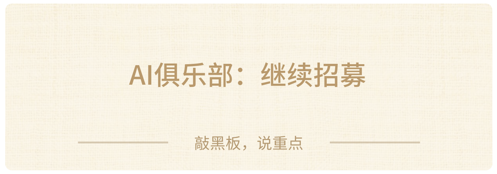

**【报名🙋‍】**欢迎大家正式报名，直播间评论区扣口令：**加入AI俱乐部**

> 明后天陆续拉群；错过可以在会员群or私发玖月班班口令加入；

为了和大家一起加速学习和使用AI，我们决定**把一堂使用AI的真实场景，给大家分享出来**。给大家看看我们是怎么用的，给一个参考借鉴的例子，所以就有了**一堂AI落地Live。**有几个特点：

- **真实性**：颗粒度有大有小，但都是真实场景，真实落地；
- **易用性**：从入门、到进阶和高阶，都尽量体现，覆盖各个层面的同学；
- **开放性**：你有什么想学的能力，抛出来，我们一起学；我们讲的不好的，你来纠正。

两年时间分享了49次，**每周三晚进行**，俱乐部的同学一定要关注群消息。

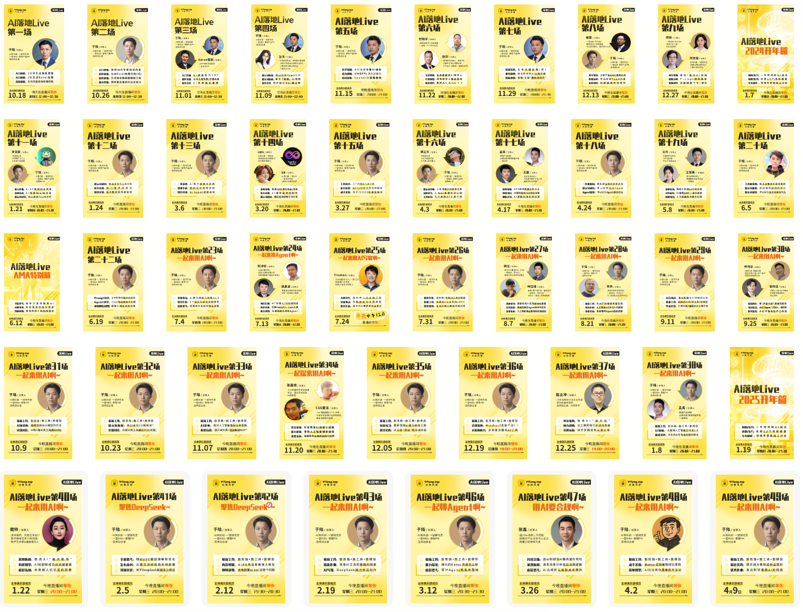

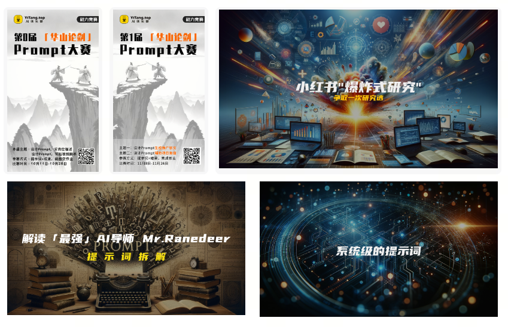

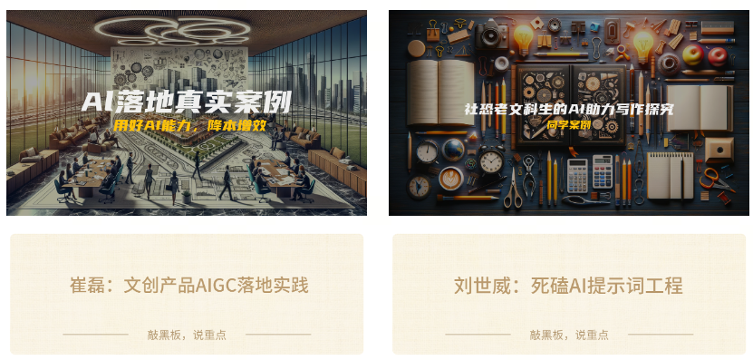

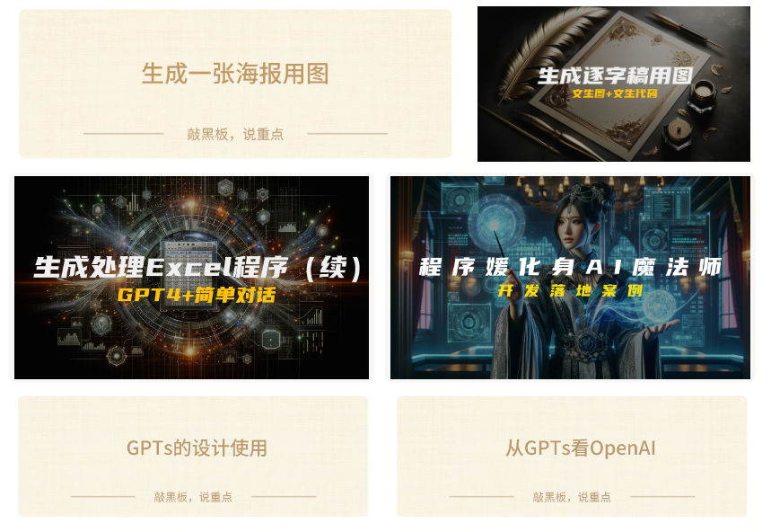

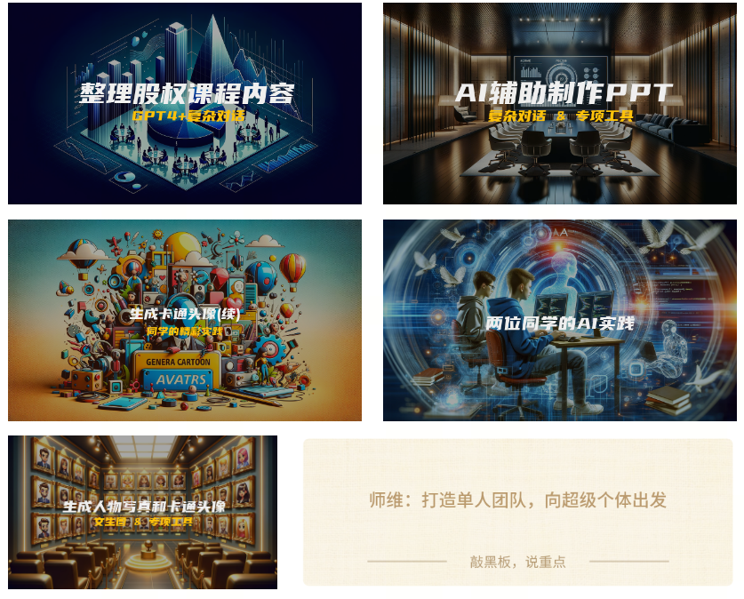

整个分享受到同学们很多的正反馈，确实给了大家一些落地AI的思路。

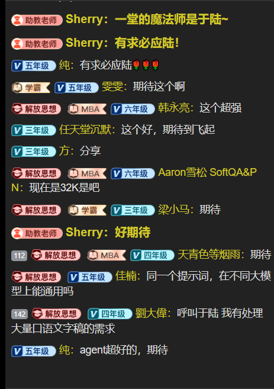

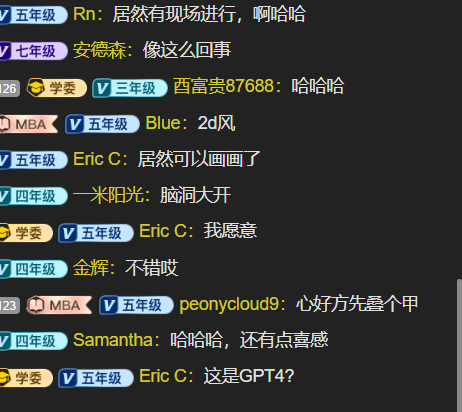

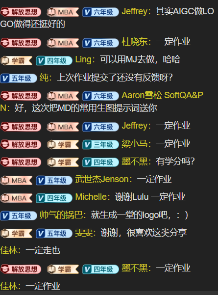

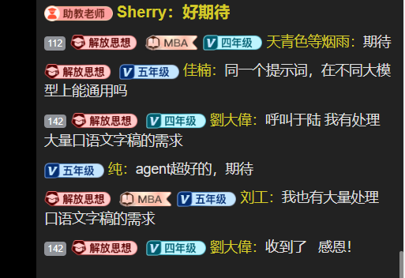

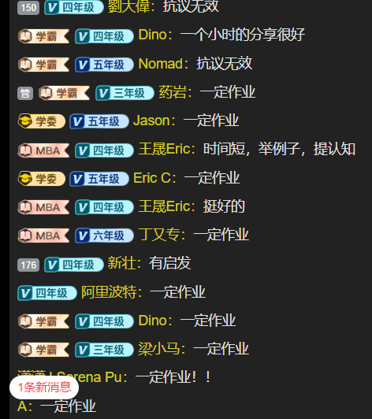

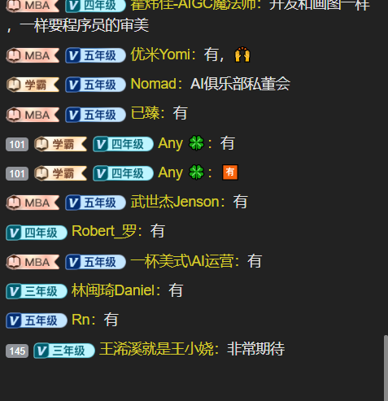

每周三晚上8点，AI落地Live分享，大家可以关注一下。

再重复一下，还没加入AI俱乐部的同学。

**【报名🙋‍】**欢迎大家正式报名，直播间评论区扣口令：**加入AI俱乐部**

### **Yitang活动小助手上线**

这是一项重要的服务升级，关乎到每一个一堂会员的体验升级。

我先说一下背景啊 ，很多同学来了一堂之后给了我们一个很有意思的的评价：「一入一堂深似海」。

你会发现在一堂，每一周都有大量的会员活动：四大俱乐部、城市活动、训练营、大航海····

我们的初衷是希望大家能在一堂有更多成长的机会，但是随着活动增多，我们发现大家陆陆续续遇到了一些困扰：

- **消息淹没：**活动通知被聊天记录淹没，转眼就错过报名
- **活动密集：**每周 4 大俱乐部、线上训练营、训战营活动扎堆，「选哪个」「会不会撞时间」纠结到放弃
- **收集困难：**在大量的活动群里收到听课、回放、作业、报名提醒···信息收集非常不容易

大家的难处，其实班班们都看在眼里，也急在心里。

所以，这一次，玖月班班们主动发起了这个升级体验的假设：给每一个会员同学配上一个你的专属——**Yitang活动小助手。**

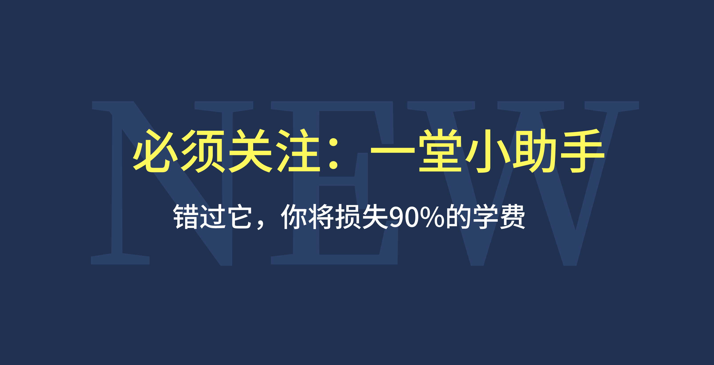

介绍一下小助手的作用，这是一个专门给大家**汇总活动类消息**，**个性化推送**的新账号，它有 3 个价值：

- **精准不打扰：你可以按兴趣订阅活动，我们只推 “你想看” 的活动**，想看的活动准时提醒，无关的消息一概没有～
- **省心不费脑：**每周自动汇总「线上活动精华」，「同城线下活动」，3秒掌握重点，省出80%筛选时间！  
- ** 抢先有特权：** 你感兴趣的新活动上线…第一时间通知你，让你抢先报名！  

简单来说，**Yitang活动小助手**就是给你们配了一个活动管家，一个助理，一个秘书。

大家注意啊，原来的玖月班班依旧会继续服务大家，不过以后2 个账号会有职责上的不同。

### 🟢 AI大航海第一周航行作业公布！！

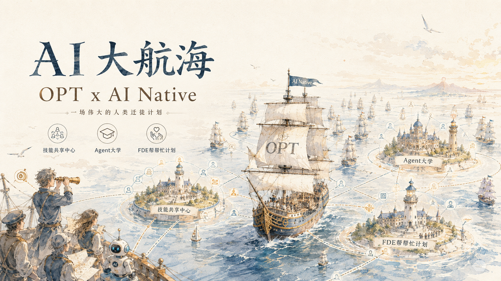

🔥 热身结束！从本周起，正式任务来了！接下来，我们进入高密度训练、高强度实践的航行阶段！

🎯这周的任务是：选择一件真实、重复且价值的工作，把你的经验封装成一个可复用的 Skill 或 Partner。

🧰 **官方任务包01｜封装第一个“非常好用”的 Skill：**

> 可复用的流程、规范和工具使用说明

**🧰 官方任务包02｜封装一个 Partner（系统提示词）**

> 一个配置好的 AI 专家角色/工作伙伴

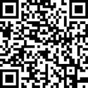

**🟢【航行作业1】10.11周日截止❗ **

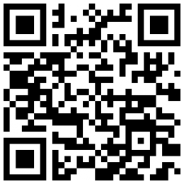

**📒【航海手册】所有你关心的事儿都在这里，务必收藏！**

**🏃AI 新人看这里｜2026 AI大航海快速补课清单**

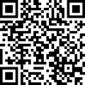

**🙋如果你有任何关于大航海的信息，随时联系雪儿！**

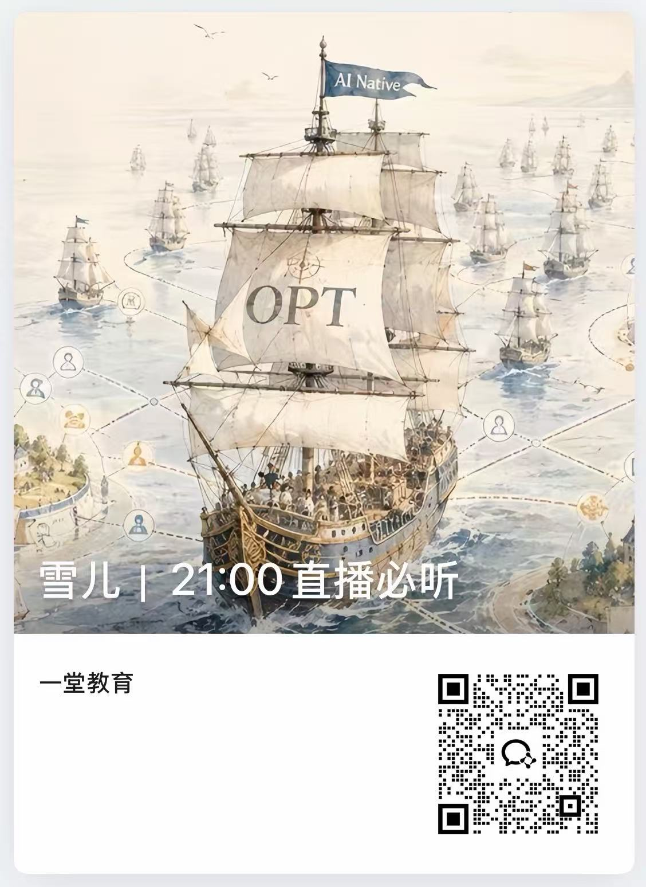

### 今晚课程预告

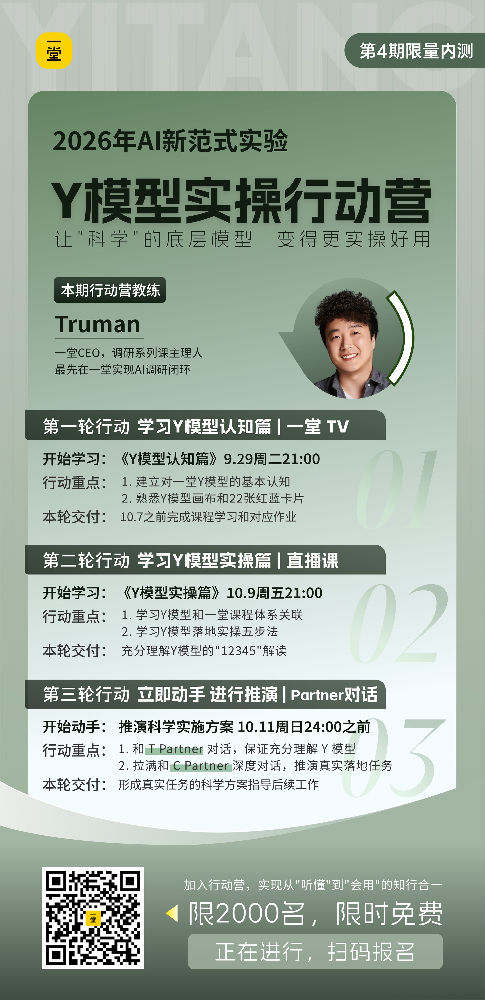

📌新学期第一课，我们这次挑战一堂过去最底层也最高价值的模型：Y模型。

✨真正理解Y 模型之后，能极大改善各类工作，涵盖范围极广：科学选题、科学定价、科学创业、科学设计AI系统等等。

🧐但很多同学一直困惑：不清楚这个模型如何落地到具体业务场景。

今晚九点直播，重磅开启实操课，真正把这套底层抽象模型，变成人人能用的落地好用模型！

🤔 如果你也遇见过：

❓过去做过 100 个项目，遇到第 101 个新项目时，能不能快速调动过去的经验？

❓明明学过很多方法论，为什么一到真实问题，还是只能凭感觉做？

❓面对 AI 新挑战，如何快速入门，并持续迭代？

今晚，Truman 将带大家继续学习《Y模型实操篇》：

✅ 从解释模型走向解题模型

✅ 学会把 Y 模型变成解决问题的工作流

✅ 理解 Y 模型如何应用到短视频、AI 工作流、销售、投放、创业等真实场景

✅ 结合 T Partner 和 C Partner，进一步理解并推演真实问题

🚀 这不是一次单纯的知识学习，而是把一个底层模型真正用起来！

直播间的同学们，大家抓紧做个听课准备：

- 用手机的同学，快去打开你的**电脑**，画质更清晰，评论区互动更欢乐~
- 把你的椅子、靠垫、水杯等准备好，营造一个舒适的**学习环境**~
- 准备好沉浸式学习，和直播间几千人一起，开启今晚的**高效成长**之旅~

好，那接下来，把时间交给Truman。

让我们一起：欢迎Truman~~